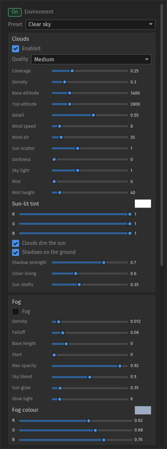
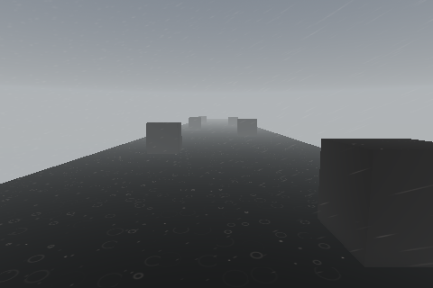
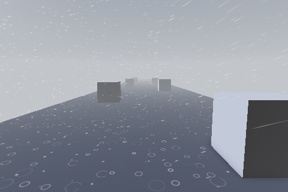
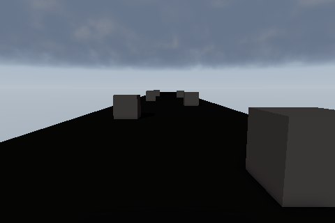
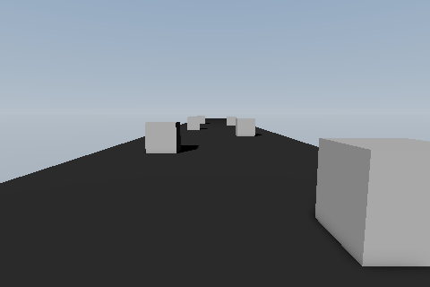
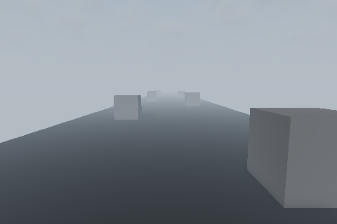

# Environment: clouds, fog, rain and lightning in Doppio

<div class="doc-meta">
  <span class="doc-badge doc-badge--stable">Stable</span>
  <span class="doc-badge">Doppio</span>
  <span>Last updated: <time datetime="2026-11-21">2026-11-21</time></span>
</div>

<p class="doc-lede">Clouds that shade the ground, height fog, rain with depth, wind and lightning with thunder as one system that agrees with the sun and with Photon's GI, and the Environment tab that manages it.</p>

The scene's weather lives in two reflected components on one entity: `Volumetric Clouds` (the sky) and `Weather` (fog, rain, wind, lightning
and the coupling between everything). Doppio edits them from the **Environment** tab (View menu, next to Photon) and from the
Inspector: both write the same fields, so they never disagree, and scripts and agents use the same fields too.

<figure class="doc-figure">
  
  <figcaption>The Environment tab: presets, clouds, fog, rain and the link between them</figcaption>
</figure>

## 1. What was already there

The environment work reused what the engine had instead of building a second copy:

| Part | Before | Now |
|---|---|---|
| Clouds | `VolumetricCloudsComponent` drawn by `sky.frag` (ray-marched, procedural, with wind and mist), serialised but not reflected and with no UI | Reflected, editable in the tab; new fields `Tint`, `Darkness` and `Sky Light` appended |
| Fog | A linear post-process fog (`deferredFog`) and the forward pass's volumetric light | Both stay as they are; a new **exponential height fog** in the composite pass, with the sky fading into it |
| Wetness | `modWetness` per mesh renderer | A scene-wide wetness added on top of it |
| Rain | Nothing | Layered screen-space streaks and wet surfaces |
| Photon sky | A fixed sky colour times `Sky intensity` | The same colour times a weather factor (section 6) |

## 2. The Environment tab

The tab edits the first entity that carries the weather components. **Add environment** creates one on a new entity (clouds on,
from the *Clear sky* preset) when the scene has none. Every edit goes through the engine's component API and records one undo
step (a slider is one step per field, not per value); a preset is one step.

The hierarchy's **+** palette (World) also has an **Environment** entry: it creates the environment entity once and, when the
scene already has one, selects it and opens this tab, so there is never a second one.

| Control | Field | What it does |
|---|---|---|
| **Preset** | | Off, Clear sky, Cloudy, Fog, Light rain or Storm: sets clouds, fog and rain together |
| **Clouds** | `Volumetric Clouds` | Section 3 |
| **Fog** | `Weather` | Section 4 |
| **Rain** | `Weather` | Section 5 |
| **Sky, sun and light** | `Weather` | `Enabled` (master switch) and `Link Sky` (section 6) |

## 3. Clouds

Procedural volumetric clouds between two altitudes, ray-marched in the sky pass, so they cost nothing when the sky is hidden.

| Control | Field | What it does |
|---|---|---|
| **Enabled**, **Quality** | `Enabled`, `Quality` | Off, Low (8 steps), Medium (16) or High (24) |
| **Coverage** | `Coverage` | 0 is a clear sky, 1 a full one |
| **Density** | `Density` | Extinction: thin and wispy to thick |
| **Base altitude**, **Top altitude** | `Base Altitude`, `Top Altitude` | The layer's bounds, in metres |
| **Detail** | `Detail` | Weight of the high-frequency octaves |
| **Wind speed**, **Wind dir** | `Wind Speed`, `Wind Direction` | Drift, in metres per second and degrees around +Y |
| **Sun scatter** | `Sun Scatter` | How strongly the sun lights them |
| **Darkness** | `Darkness` | 0 to 1: darker, heavier clouds for a storm |
| **Sky light** | `Sky Light` | The light that fills the shadowed side |
| **Mist**, **Mist height** | `Mist Density`, `Mist Height` | Ground mist at the horizon (above 0 it also switches on the forward pass's volumetric fog, a few milliseconds at 720p: the presets leave it at 0) |
| **Sun-lit tint** | `Tint` | Colour multiplied into the sun-lit side: orange at dusk, grey in a storm |
| **Clouds dim the sun** | `Cast Shadows` | The cloud cover lowers the direct light (section 8) |
| **Shadows on the ground**, **Shadow strength** | `Ground Shadows`, `Shadow Strength` | Moving cloud shadows on everything the sun lights, and in Photon's bounce (section 8) |
| **Silver lining** | `Silver Lining` | A bright rim on thin cloud edges in front of the sun |
| **Sun shafts** | `Sun Shafts` | Rays through the gaps of the clouds while the sun is in view |

The clouds animate with the wind whenever the sky is drawn.

## 4. Fog

Exponential height fog, integrated along each view ray in the composite pass: `density * exp(-falloff * (y - baseHeight))` per metre.
Because it uses the depth buffer it covers every object, terrain and water alike, and the sky fades into it near the horizon.

| Control | Field | What it does |
|---|---|---|
| **Fog** | `Fog Enabled` | The switch |
| **Density** | `Fog Density` | Per metre at the base height |
| **Falloff** | `Fog Height Falloff` | How fast it thins with height; 0 is uniform |
| **Base height** | `Fog Base Height` | World height where the density applies |
| **Start** | `Fog Start` | Metres before the fog begins |
| **Max opacity** | `Fog Max Opacity` | The most it can hide |
| **Sky blend** | `Fog Sky Blend` | 0 uses the fog colour, 1 uses the sky's own colour at the horizon in the direction looked at |
| **Sun glow**, **Glow tight** | `Fog Sun Scatter`, `Fog Sun Exponent` | The glow of the fog towards the sun |
| **Fog colour** | `Fog Color` | sRGB |

With a sky blend above 0 the fog samples the same sky texture the sky pass draws, so a ground haze matches the horizon behind it.

## 5. Rain

Rain is still one screen-space shader, with no particles and no models, but it is computed in the world: six shells of falling
streaks from 2.5 m to about 60 m in front of the camera, each a lattice of cells in world space. A streak is a slanted capsule
with a bright head, it is hidden wherever geometry is nearer than its shell, and a drop near the camera is long and sharp while
a far one is short and soft. Because the shells live in the world, moving the camera gives **parallax**: the near drops sweep past
and the far ones hang, which is what gives the rain its depth.

<figure class="doc-figure">
  
  <figcaption>Rain with depth: streaks at several distances, rings and sparks where it meets the road</figcaption>
</figure>

| Control | Field | What it does |
|---|---|---|
| **Rain** | `Rain Enabled` | The switch |
| **Intensity** | `Rain Intensity` | 0 to 1: how many streaks, and how much the scene loses contrast |
| **Wind speed**, **Wind dir** | `Rain Wind Speed`, `Rain Wind Direction` | The wind's velocity: the whole lattice leans along it against a fall speed of about 9 m/s |
| **Drop length** | `Rain Drop Length` | 0 to 1 |
| **Fall speed** | `Rain Speed` | Animation speed |
| **Brightness** | `Rain Brightness` | How bright a streak is; the colour follows the sky and the light level |
| **Wetness** | `Rain Wetness` | How wet surfaces get at full intensity |
| **Splashes** | `Rain Splashes` | 0 to 1: rings and sparks where the rain meets an upward-facing surface within about 35 m (the normal is rebuilt from the depth buffer, so it also works on the terrain) |

Wet surfaces: the scene-wide wetness is `intensity * wetness` and is added to each mesh renderer's own `Wetness`. The lit shader
darkens the albedo and makes the surface glossy, as it already did for `modWetness`.

## 6. Wind

One wind drives the whole scene. Its mean is `Rain Wind Speed` and `Rain Wind Direction` (the clouds keep their own drift), and
it surges: a sum of slow sines, never negative and never repeating within minutes, scaled by **Gusts** (`Wind Gust`, 0 to 1).
The same gust factor leans the rain, shakes the foliage and is reported by the engine, so everything moves together.

| Control | Field | What it does |
|---|---|---|
| **Gusts** | `Wind Gust` | 0 is a steady wind, 1 surges between calm and about twice the mean |
| **Foliage sway** | `Wind Foliage` | Multiplies the sway of foliage materials by `1 + value * speed / 8 * gust`; 0 leaves foliage alone |
| **Weather sound**, **Volume** | `Audio Enabled`, `Audio Volume` | Plays the rain, the wind and the thunder (section 7); a preset leaves them as you set them |

## 7. Lightning and thunder

Switch **Lightning** on and the sky strikes on its own. Strikes are deterministic: each minute is cut into slots and every slot
holds one strike whose moment, bearing, distance and strength are hashed from the seed, so the same seed gives the same storm and a
test can predict it. With the link on, lightning needs an overcast sky (cloud cover or rain of at least 0.4), as there is no
lightning in a clear sky.

What a strike does, all within a second:

* **The flash.** Up to three return strokes flicker, over an afterglow of the cloud. The flash lights the scene as a cold
  directional light from where the bolt struck (no shadow of its own), so it also **reaches Photon**: the bounce flashes with it.
  It raises the sky light and Photon's sky, flares the rain and lights the fog and the clouds from inside.
* **The bolt.** A forked line from the cloud base to the horizon, in the sky pass, at the strike's bearing.
* **The thunder.** Each strike raises one event that arrives after the sound's travel time (distance / 343 m/s). Doppio logs it in
  the Console (*Thunder, 1.2 km away*); the engine makes no sound itself, see the limits.

<figure class="doc-figure">
  
  <figcaption>A strike at its peak: the cold flash lights the road, the fog and the rain</figcaption>
</figure>

| Control | Field | What it does |
|---|---|---|
| **Lightning** | `Lightning Enabled` | The switch |
| **Thunder events** | `Thunder` | Whether strikes raise thunder events |
| **Strikes / min** | `Lightning Rate` | One strike per slot of `60 / rate` seconds |
| **Flash** | `Lightning Intensity` | 0 to 2: the brightness of the flash |
| **Nearest**, **Farthest** | `Lightning Distance Min`, `Lightning Distance Max` | Where strikes land, in metres; a close strike is brighter and louder |

Thunder is also **heard**: with `Audio Enabled` on (the *Sound* card), the session plays each clap from noise, panned to the strike's
bearing and quieter with the distance, along with a rain bed and a wind bed that follow the weather (see the
[audio system](../audio/audio-system.md)). Off by default, so a scene stays silent until it asks. A game or a script that wants its own sound
can still poll `caffeine_session_poll_thunder` (section 12).

## 8. How they agree: sun, sky and Photon

With **Link sky, sun and fog** on (the default) the sections act on each other, and on the light:

| When | Then |
|---|---|
| It rains and clouds are on | Coverage rises to at least `0.55 + 0.40 * intensity`, the density grows by up to 80% and the clouds darken |
| It rains and fog is on | The fog density grows by `1 + intensity` |
| The sky is overcast (cloud cover, or rain) | The sun's intensity drops by up to 80% for every stage that uses it: the forward shader, the cloud lighting, the fog glow and Photon's injection |
| The sky is overcast | The sky light Photon falls back to, and the forward ambient, grow by up to 25% and tend to a neutral grey of the same brightness |
| Thick fog | The sky light takes the fog's hue, keeping its brightness |

Photon needs nothing new for these: the sun reaches it through the same light list, and its sky radiance is the fixed sky colour times
`Sky intensity`, now also times the weather's scale and tint (`kPhotonSkyRadiance`). These factors depend only on the
settings, never on time or on the frame, so they add no noise: Photon's temporal average and its per-probe sampling offsets
keep working as before, and the fog is applied after Photon's resolve, so it also softens what is left of the noise in the distance.

With the link off every section acts alone, and the clouds keep exactly the values in the component.

### Clouds that move the light

Three effects tie the clouds to the lighting without baking anything (switch them on in **Clouds**; the presets do):

* **Shadows on the ground** (`Ground Shadows`, `Shadow Strength`). The forward shaders trace the sun's ray to the cloud layer and
  read the same noise as the sky at two heights of it, so a cloud's shadow crosses the ground, the terrain and every object the
  sun lights, moves with the wind and agrees with what the sky shows. Photon's injection reads the same function for every voxel,
  so the **bounce follows the shadow** (the near field already did: it reads the forward pass's direct light). No texture is
  added: the forward pass is at the 16-sampler limit.
<figure class="doc-figure">
  
  <figcaption><em>Cloudy</em> with the ground shadows on: the sun is shaded by the layer above (compare with the same sky without them)</figcaption>
</figure>

* **Silver lining** (`Silver Lining`). The thin edges of the clouds in front of the sun glow, by forward scattering.
* **Sun shafts** (`Sun Shafts`). A screen-space radial gather towards the sun: rays through the gaps of the clouds, in 14
  steps, and only while the sun is in front of the camera (looking away costs nothing).

## 9. Presets

| Preset | Clouds | Fog | Rain |
|---|---|---|---|
| **Off** | off | off | off |
| **Clear sky** | coverage 0.25 | off | off |
| **Cloudy** | coverage 0.75, a little dark | off | off |
| **Fog** | coverage 0.55 | density 0.03, falloff 0.035, sky blend 0.7 | off |
| **Light rain** | coverage 0.8 | thin | intensity 0.35 |
| **Storm** | coverage 0.95, dark, fast wind, gusts 0.7, lightning 9 a minute | thin, grey | intensity 0.95, strong wind |

Every preset with clouds also switches on ground shadows, a silver lining, a little sun shaft strength and foliage sway.

<figure class="doc-figure">
  
  <figcaption>The regression road, <em>Clear sky</em>: the blocks keep their contrast all the way down the road</figcaption>
</figure>

<figure class="doc-figure">
  
  <figcaption><em>Fog</em>: the far blocks fade into the fog and the sky fades into it at the horizon</figcaption>
</figure>

<figure class="doc-figure">
  
  <figcaption><em>Storm</em>: dark clouds, an overcast sun, thin fog, wet road and rain leaning with the wind</figcaption>
</figure>

## 10. Components, scripts and agents

The two components are reflected, so `add_component` and `set_component_field` by name reach every field (the Inspector shows
them too). The `Weather` struct is serialised as a raw prefix and a scene without it renders exactly as before; the new
cloud fields are appended, so an older scene keeps their defaults (no tint, no darkness).

Agents (`ICED_MCP=1`, feature `agent`) read the `environment` query and use `show_environment`, `environment_add`,
`environment_set` and `environment_preset`:

```json
{ "action": "environment_preset", "args": { "name": "Storm" } }
{ "action": "environment_set", "args": { "field": "fog_density", "value": 0.02 } }
{ "action": "environment_set", "args": { "field": "fog_color", "value": [0.5, 0.55, 0.6] } }
```

## 11. Limits

* Rain is a screen-space effect with world-space depth: no particles and no collision, and it does not know about roofs (a streak is
  hidden by geometry in front of it, but rain falls on the camera inside a building too). Splashes reach about 35 m and only on
  surfaces the depth buffer shows.
* The wetness is not smoothed in time, and it does not reach terrain, which has its own shader.
* Fog and rain are drawn in the final pass, so they are not in the images reflection probes and planar reflections show.
* Cloud shadows are traced at two heights of the layer with a soft three-octave noise: they are soft shadows, not sharp edges, and they do
  not shade the sky light. Photon's voxels read the same function, so the bounce is as soft.
* The weather's sound plays in the editor session (and wherever a session is hosted), not in `caffeine-runtime`, which does not use
  this renderer. It is mono and made from noise: it does not follow rooms or roofs (the rain is as loud indoors), and the thunder is
  panned but has no Doppler or echo.
* The bolt is a sky effect: it has no geometry, casts no shadow and strikes nothing.
* Rain with the link on thickens existing clouds; with no clouds component the sky stays as it is.

## 12. Where it lives and how it is tested

| Part | Where |
|---|---|
| Components | `src/caffeine/ecs/WeatherComponents.hpp` (`Weather`, serialised as scene type 60), `include/caffeine/environment/VolumetricClouds.hpp`; both reflected through `scripts/gen-component-reflection.py` (ids 128 and 129) |
| The coupling | `src/caffeine/scene/WeatherSystem.hpp`: `resolveWeather()` is pure, so every rule in section 8 is a unit test; the wind gust and the lightning (`windGustFactor`, `lightningStrike`, `lightningAt`, `thunderBetween`) are pure functions too |
| Renderer | `GpuSceneRenderer` (resolves the weather once per frame, scales the lights, the ambient and Photon's sky), `sky.frag` (clouds, bolt, silver lining), `scene_lit.frag` and `terrain_lit.frag` (cloud shadows), `photon_inject.comp` (the same shadow for the bounce), `post_composite.frag` (fog, rain, sun shafts) |
| Panel | `uikit/panels/environment.rs` (one table of switches, numbers and colours drives the panel, the presets and the agent), `windows/main/environment.rs` |

The weather itself goes through the reflected components. C ABI v19 adds two read-only calls for what moves on its own:
`caffeine_session_weather_state` (the flash, the bolt, the wind's gust, the clock of the strikes) and `caffeine_session_poll_thunder`
(the claps that have arrived since the last call), plus `caffeine_session_audio_state` for the weather's sound (device, levels, claps).

Nothing of this moves while the editor is stopped. C ABI v21 adds `caffeine_session_set_simulating`: off, a rendered frame stands still
(clouds, rain, wind on foliage, lightning, water and the scene's sound do not advance and the sound device closes); on, each frame advances them.
A new session simulates, so the runtime and older callers are unchanged; Doppio turns it off at start and on only while **Play** is active, and
a stopped viewport draws a frame only when something changed (an edit, the camera, a setting), a few more while TAA and Photon settle, and none otherwise.

Tests:

* `tests/test_weather.cpp`: defaults, the coupling rules, scene round trip and old-prefix loading, reflection, the gust, the strikes (the same
  seed gives the same storm, the flash peaks and fades, thunder arrives at distance / 343 s) and the thunder synth.
* `tests/test_weather_gpu.cpp`: the real post stack on a known scene (needs a GPU, skipped without one): fog hides the far half and not
  the near half, the start distance and the maximum opacity, rain adds streaks on the sky and none behind near geometry, a flash lights the rain
  and the fog, wind bends the streaks, a floor gets splashes, and shafts stream from an HDR sun only while it is ahead.
* `windows/main/tests.rs`, module `environment_weather`: the panel's table, the presets through the engine, undo, and
  images of a road of blocks: everything off equals no weather, fog loses contrast with distance, rain adds streaks that fall,
  wet roads darken, clouds and their tint show in the sky, an overcast sky dims the sun only when linked, Photon's sky light greys
  without adding flicker, cloud shadows darken the lit ground only while on, wind changes the rain, and a storm flashes the scene and
  raises thunder once the sound has travelled (and nothing with the lightning off).
* UI flows `environment-panel.json` and `environment-scene.json`, and the capture flow `captures/flows/capture-environment-docs.json`
  (run it with `scripts/capture-environment-docs.sh`, which also writes the renders this page shows).

Things to know when you write a test like these:

* The renderer is not bit-exact between still frames (ambient occlusion and dithering): two frames of one scene differ by about
  0.03 levels on average and by up to about 10 at single pixels. "Nothing changes" is therefore measured against that noise, not with
  equality.
* A linked fog also hands its hue to the sky light, even when its maximum opacity is 0: switch the link off to compare a fog that hides
  nothing with no fog.
* `Mist Density` also drives the forward pass's volumetric fog, so set it to 0 when a test isolates the sun.
* Compare images with a difference helper, not with `assert_eq!` on the pixels: a failure prints every byte.
