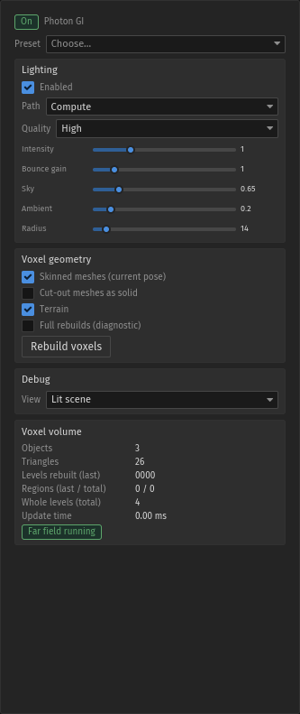

# Photon: global illumination in Doppio

<div class="doc-meta">
  <span class="doc-badge doc-badge--stable">Stable</span>
  <span class="doc-badge">Doppio</span>
  <span>Last updated: <time datetime="2026-11-21">2026-11-21</time></span>
</div>

<p class="doc-lede">Indirect light, colour bleeding and sky occlusion without ray-tracing hardware, and the Photon tab that manages it.</p>

Photon is the engine's global illumination (GI). Doppio edits it from the **Photon** tab (View menu, next to the
generators) and from the `Photon GI` component in the Inspector: both write the same fields, so they never disagree.

<figure class="doc-figure">
  
  <figcaption>The Photon tab: lighting, voxel geometry, debug view and the live voxel statistics</figcaption>
</figure>

## 1. How Photon works

| Part | What it does |
|---|---|
| Near field | Screen-anchored radiance cascades (K to 0) traced against the depth buffer, merged front to back and resolved to SH-L1 probes (`photon_cascade.comp`, `photon_c0.comp`) |
| Far field | Four clipmap levels of voxels (cells of 0.25, 0.5, 1 and 2 m, 64 cubed each) with a lattice of probes per level; rays that leave the screen query it |
| Material volume | The albedo and coverage of the scene's surfaces, written by the **triangle voxeliser** (`photon_voxelize_tri.comp`) and by the screened fill |
| Injection | The sun, point and spot lights, and the sky, are injected into the voxel faces with a shadow marched through the material volume (`photon_inject.comp`) |
| Feedback | The previous frame's irradiance is fed back with a cap and a reprojected history, which is the multi-bounce |
| Temporal average | Every probe offsets its traced directions by its own fixed amount, so the noise is not coherent; the resolve averages the reprojected irradiance of the previous frame into this one (weight 0.4 while the scene changes, 0.07 when still, quicker for large differences), and the far probes follow the same weight |

The screen cascades dominate what the camera sees. The far field is what lights a surface from things the camera does
not see: the wall behind it, the underside of a ceiling, the sun's bounce through a slit.

## 2. The Photon tab

The tab edits the first `Photon GI` component of the scene (the renderer reads the last enabled one, so keep one). **Add Photon GI**
creates it on a new entity (on, compute path, High quality) when the scene has none. Every edit goes through the engine's component API and records one undo step
(a slider is one step per field, not per value).

| Control | Field | What it does |
|---|---|---|
| **Enabled** | `Enabled` | Photon on or off |
| **Path** | `Path` | The screen fallback gather, or the compute cascades with the voxel far field |
| **Quality** | `Quality` | Off, Low, Balanced, High or Eco: probe spacing and cascade count |
| **Intensity** | `Intensity` | Multiplier of the indirect light, near field and far field alike |
| **Bounce gain** | `Bounce gain` | Scales the light the voxels hold (see section 4) |
| **Sky** | `Sky intensity` | The sky light a ray finds when it leaves the screen and the voxels |
| **Ambient** | `Ambient` | An extra ambient bounce added to the fallback |
| **Radius** | `Radius` | Reach of the screen cascades, in world units |
| **Skinned meshes** | `Voxel skinned meshes` | Skinned meshes in the volume, in their current pose |
| **Cut-out meshes as solid** | `Voxel cut-out meshes` | Foliage cards count as solid blocks (off by default) |
| **Terrain** | `Voxel terrain` | Terrain meshes in the volume |
| **Full rebuilds** | `Full rebuilds` | Diagnostic: rebuild every level on every change |
| **Rebuild voxels** | | Throw the volume away; the next frame voxelises the scene again |
| **View** | `Debug view` | Lit scene, GI only, or the sky fallback only |

## 3. What is in the voxel volume

The triangle voxeliser writes the scene's geometry into the volume, including what the camera never sees:

* **Opaque meshes** always, with the colour of their material times the mean colour of its picture (mid grey when the
  picture cannot be read), per material slot. Blended surfaces are not solid and stay out.
* **Terrain** from its mesh, with an earth colour taken from its tint (its splat layers are not one picture).
* **Skinned meshes** in the pose of the frame; they are revoxelised where they move.
* **Cut-out meshes** only when the switch is on: foliage cards then shade like solid blocks.
* Water and volumetric lights never.

### Dirty regions

Each object has a hash of its mesh, transform, pose and colour. A frame where nothing changed costs one hash per object.
When an object moves, the voxeliser clears and revoxelises only the boxes where it was and where it is, in all four levels
(each box padded by one cell of the level); at most eight boxes, beyond that the levels rebuild whole. A level also rebuilds
whole when its clipmap origin moves. The panel shows both counts.

### The 1 million triangle cap

Above 1 million triangles the voxeliser does not run and only the screened fill remains (it covers what the camera sees).
The panel shows **Over 1M triangles: screen fill only** and the engine reports `over_budget`. Nothing is dropped silently.

### What it costs: probes outside the view and coarse levels

The far field traces 16,384 probes (4 levels of 16 cubed), about 100 rays each, so it was the biggest cost of Photon (25 ms at 720p on the benchmark
scene). A surface the camera sees reads the probes within about one spacing of it, so:

* A probe more than 1.8 spacings outside the camera's frustum is not traced: its tile is carried over from the previous frame and its SH is left as it was. A probe that was out of view for more
  than 120 frames starts from a fresh trace when it comes back.
* While the scene is calm (the temporal weight below 0.2) level 1 and level 2 are traced every second frame and level 3 every fourth, with the previous frame's weight raised to the period so they
  converge as fast per second. While anything changes every level follows every frame.

* The border texels of a probe's tile repeat the nearest of the 8 by 8 interior directions, so they copy what the interior traced instead of tracing 36 more rays.
* While the camera is still and the scene calm, the screen cascades 2 and up are also traced on alternate frames (they keep their atlas in between); a moving camera rebuilds them every frame.

The probe pass fell from 25 to about 7 ms, the near field from 12.7 to about 7 ms, and the regression scenes of section 8 still pass. The [Profiler](profiler-guide.md) lists each pass (`Photon::probes`, `Photon::inject`, one scope per
cascade); with GPU timing on they are real GPU times.

## 4. Bounce gain

`Bounce gain` multiplies the light injected into the voxels (the sun, the lights and the sky ambient), so the bounce between
surfaces grows without touching the direct light. It does not scale the screen cascades, which follow `Intensity`.
Measured on the far floor of a closed room with a slit in the ceiling, GI only, out of 255:

| Bounce gain | 0 | 1 | 4 |
|---|---|---|---|
| Far floor | 13 | 18 | 24 |

With gain 0 what remains is the screen cascades and the sky fallback; the gain moves the far field's share (the part above the gain-0 level).

### The weather and the bounce

The Environment tab's weather reaches Photon through the light it already reads, so nothing is baked:

* **Moving cloud shadows.** With the clouds' ground shadows on, the injection pass multiplies the sun by the cloud shadow at each voxel
  (the same function the forward shaders use), so the bounce off the ground follows the cloud's shadow as it drifts. The near field
  reads the forward pass's direct light and follows it already.
* **Lightning.** A flash adds a cold directional light for its length, which Photon injects like the sun, and multiplies its sky radiance
  (the sky flashes too), so the bounce flashes with the strike and falls back with it.
* **Overcast and fog** grey and tint Photon's sky light (see the [Environment guide](environment-guide.md)).

The drift of the cloud shadows is deliberately not part of the light hash (it would hold the temporal average in its fast mode all the
time): the resolve follows a large difference between history and present on its own, so a slow drift stays smooth, while a flash adds
a light, changes the hash and is followed at once.

## 5. Presets

Every preset switches Photon on, on the compute path.

| Preset | Quality | Radius | Sky | Ambient | Bounce gain | Notes |
|---|---|---|---|---|---|---|
| **Balanced** | Balanced | 14 | 0.65 | 0.2 | 1 | The default look |
| **Interior (strong bounce)** | High | 10 | 0.35 | 0.1 | 2 | Rooms lit through openings |
| **Outdoor** | High | 40 | 0.8 | 0.25 | 1 | Long reach, strong sky |
| **Fast (Eco)** | Eco | 14 | 0.65 | 0.2 | 1 | Skinned meshes and terrain left out of the volume |
| **Diagnostic (GI only)** | High | 14 | 0.65 | 0.2 | 1 | GI only view and full rebuilds |

## 6. Voxel statistics

The **Voxel volume** card reads the engine's counters every frame (no GPU read-back):

| Line | Meaning |
|---|---|
| Objects, Triangles | What the volume was built from (triangles are 0 while over budget) |
| Levels rebuilt (last) | One bit per level rebuilt whole in the latest update |
| Regions (last / total) | Boxes revoxelised in the latest update, and since the session began |
| Whole levels (total) | Level rebuilds since the session began |
| Update time | CPU time to encode the latest update |
| Far field running | The far field ran in the latest frame |

What it costs, and what it does not: each view that uses Photon (the editor Viewport, the Gameplay tab, the Camera tab) has its **own** instance, because the
targets are sized to the view and the far field is centred on its camera; one shared instance made two views of different sizes or places rebuild each
other's targets and voxels every frame. In a still scene with a still camera the far field is left as it is once it has converged (48 frames, with a real
trace every 240), and while the camera only turns, in a calm scene, it is traced every other frame. The engine counts both (`far_skipped`, `far_half_rate`,
`target_rebuilds` in the C ABI's Photon stats). On a sun, a camera and a cube at 1158 x 536 the editor frame went from 14.4 ms to 4.1 ms still and to 10.0 ms
turning, and three views from 43.5 ms to 9.2 ms still; `cargo test -p doppio-ui --lib -- --ignored --nocapture frame_budget::` prints these with the engine's profiler.

## 7. For agents and tests

The same commands are agent actions (`--features agent`), each returning a `Message`:

| Action or query | Args |
|---|---|
| `show_photon`, `photon_add`, `photon_rebuild` | none |
| `photon_set` | `{ "field": "Bounce gain", "value": 2.5 }` (a bool, a number, or an option name or index) |
| `photon_preset` | `{ "name": "Interior (strong bounce)" }` |
| query `photon` | The settings and statistics, or `{ "present": false }` |

The headless flows are `doppio/tests/ui-flows/photon-panel.json` and `photon-scene.json`; the images of this page come
from `caffeine-website/captures/flows/capture-photon-docs.json` (`./scripts/capture-photon-docs.sh`).

### C ABI v17

```c
CaffeineResult caffeine_session_photon_stats(const CaffeineSession*, CaffeinePhotonStats* out);
CaffeineResult caffeine_session_photon_rebuild(CaffeineSession*);
```

`CaffeinePhotonStats` holds `objects`, `triangles`, `over_budget`, `far_enabled`, `full_rebuilds`, `region_rebuilds`,
`last_level_mask`, `last_regions` and `last_update_ms`. Rust reads it as `Engine::photon_stats()`.

## 8. Tests and limits

* GPU tests (`tests/test_photon_voxelizer.cpp`): voxels of a triangle, a wall behind the camera, clipmap moves, the sun's
  injection, probes in front of a red wall, a closed room, the mean colour of a picture, a **moving object revoxelising
  only its box** (identical, voxel for voxel, to a rebuild from scratch) and the **cap**.
* Regression scenes (`photon_gi` in `windows/main/tests.rs`): colour bleed, an off-screen sunlit wall, a sealed room, a
  thin wall, the debug views and the bounce gain; and `photon_panel`: add, edit, undo, rebuild and a moving object.
* Limits: no motion vectors yet (the history reprojects with the previous matrix), the terrain has one colour, a cut-out
  mesh is a solid block, and a change (a light that moved) takes about twenty frames to settle in, because the resolve averages frames.

See also the [graphics roadmap](graphics-roadmap.md) and the [editor page for Photon](../editor/photon.md).
