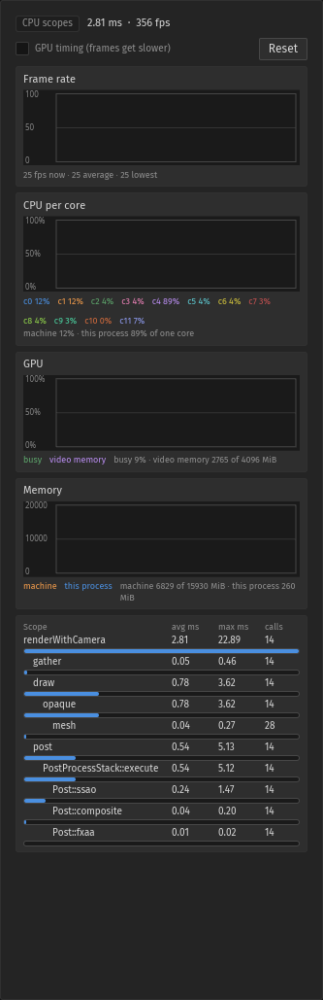

# Profiler: where a frame's time goes

<div class="doc-meta">
  <span class="doc-badge doc-badge--stable">Stable</span>
  <span class="doc-badge">Doppio</span>
  <span>Last updated: <time datetime="2026-11-21">2026-11-21</time></span>
</div>

<p class="doc-lede">A tree of timed scopes for the renderer, with real GPU time per pass when you ask for it, in the Profiler tab, through the C ABI and for agents.</p>

Slow frames were being guessed at. The profiler gives the numbers: every stage of the renderer is a scope, and the Profiler tab (View menu) shows them as a tree with the average, the worst case and how many times each ran.

<figure class="doc-figure">
  
  <figcaption>The Profiler tab: the frame time, the two controls and the scope tree with a bar per scope</figcaption>
</figure>

## 1. What it times

The engine has one process-wide tree of scopes (`Debug::Profiler`). The renderer opens a scope for each stage: gathering the scene,
the shadows, the opaque and translucent passes, reflections, Photon's passes one by one, and the post-processing stack.

| Mode | What a scope's time is |
|---|---|
| **CPU scopes** (default) | The time the CPU spent recording that stage. The GPU runs behind it, so this is not the GPU's cost |
| **GPU timing** | The time the stage really takes: the GPU passes wait for the GPU at their edges, so the scope covers recording plus execution |

SDL3 GPU has no portable timestamp queries, so GPU timing works by submitting what has been recorded and waiting for it at the start and
the end of each GPU scope (`CF_GPU_SCOPE`). That serialises the CPU and the GPU: **frames get slower while it is on**. It is a measuring
mode, off by default. A scope inside a render pass (the per-mesh and terrain scopes) cannot wait, so it always shows CPU time.

## 2. The Profiler tab

The tab has four charts over the last minute (four samples a second), then the scope tree.

| Chart | What it draws |
|---|---|
| **Frame rate** | The viewport's frames per second; the caption gives the latest, the average and the lowest |
| **CPU per core** | The busy share of every logical core, one colour per core (the legend under the chart repeats the colours with each core's latest value), then the whole machine and this process (in percent of one core) |
| **GPU** | The GPU's busy share and the video memory in use as a share of its size (NVML on NVIDIA, the `gpu_busy_percent` counter on AMD); empty where the platform cannot say |
| **Memory** | Memory in use on the machine and by this process, in MiB, up to the machine's size |

The CPU, GPU and memory numbers come from `caffeine_system_metrics` (C ABI v19). They are read from `/proc`, NVML and sysfs on Linux, from the processor performance counters, `GlobalMemoryStatusEx` and `nvml.dll` on Windows, and from the Mach host counters on macOS (no GPU figures there). The Windows and macOS readings were written without those machines to run on: only the shared computation of the percentages is tested there.
Where a platform cannot say, the chart says under it what is missing.

| Control | What it does |
|---|---|
| **GPU timing** | Switches the mode above on or off |
| **Reset** | Forgets every sample (scopes and charts) |
| Frame line | The average of the renderer's top scope and the frame rate it implies |
| Table | One row per scope, indented by depth, in the order they first ran: the average and the worst milliseconds of its latest 120 calls (about two seconds of a 60 fps scope), the call count, and a bar against the frame time |

The charts sample on the viewport's frames, and the tab reads the scopes at the same pace while it is showing.

## 3. Reading a profile

The benchmark scene (`assets/benchmarks/dense_outdoor.caf`, 287 entities, 1.1M triangles) at 1280 x 720, before and after the first round of
findings:

| | Before | After |
|---|---|---|
| Frame, wall clock | 22.7 ms (44 fps) | 10.7 ms (93 fps) |
| Gathering the scene (CPU) | 1.7 ms | 0.3 ms |
| Opaque pass | 13.5 ms | 2.3 ms |
| Shadows | 2.8 ms | 3.3 ms |
| Post-processing | 1.3 ms | 1.3 ms |

What the profile showed, and what was done:

* **Terrain draws cost 0.7 ms of CPU each.** Every draw asked the texture cache for its pictures, and every ask resolved the path and read
  the file's timestamp: a handful of file-system calls per draw per frame, and the same again for a picture that does not exist. The cache
  now answers from memory, looks at the disk again only every half second (a rewritten file still shows up), and remembers pictures that
  are missing. The opaque pass fell from 13.5 to 2.3 ms.
* **Photon's far-field probes cost 25 ms.** Every frame, 16,384 probes traced about 100 rays each. Probes more than 1.8 spacings outside the camera's frustum have no
  reader on screen, so they are not traced (their tiles are carried over); the coarse levels, which change slowly, are traced every second or fourth frame while the scene is
  calm. The probe pass fell to 9 ms and every Photon regression scene still passes. See the [Photon guide](photon-guide.md).
* **Clouds cost about 5 ms** with the sky in view. The sun march now reads the cheap shape of the cloud (4 octaves of noise instead of 7) in 3 steps, which cut it to about 2.7 ms.
* **Materials had the same problem.** The scene gatherer asked the material cache for every draw's material, every frame, and each ask canonicalised the path and read the file's timestamp. With 600
  bushes the gather took 1.3 ms and 150 bushes took 2.9 ms; it is now answered from memory with the same half-second recheck.
* **The sun's shadow cascades drew every caster.** A caster wholly outside a cascade's sides is now skipped (it was clipped anyway, so no pixel changes). With 600 swaying bushes on the benchmark scene the shadows
  went from 10.8 to 6.6 ms, and the frame from 19.6 to 16.6 ms. The render stats report `shadow_draws` and `shadow_draws_culled`.
* **The probe tile's border no longer traces rays.** Each probe keeps a 10 by 10 tile (8 by 8 directions and a one-texel border that repeats the nearest direction); the border used to be 36 more rays per probe, a third of the
  pass, and now copies what the interior just computed. With the coarse cascades from 2 up traced on alternate frames, Photon at High went from 34 to 23 ms and the regression scenes still pass.
* **Photon's two coarsest cascades** are traced on alternate frames while the camera is still and the scene calm (they keep their atlas in between): the near field went from 12.7 to 9.7 ms (cascades 2 and up since the border change).
* **Creating many entities of one kind was cubic.** Choosing the name of the n-th "Sphere" asked the engine for every entity once per suffix: 150 spheres took 14 s. It is one pass now (600 take 3 s).
* **A cloud mist above 0 switches on the forward pass's volumetric fog** (an extra 4 ms at 720p), so the Environment presets leave the mist at 0; the height fog covers the haze.

## 4. Adding scopes, the C ABI and agents

```cpp
void Renderer::drawThing(RHI::CommandBuffer* cmd) {
    CF_GPU_SCOPE(cmd, "Thing::draw");      // GPU pass: real time with GPU timing on, CPU time otherwise
    // ...
    CF_PROFILE_SCOPE("Thing::prepare");    // CPU work: always CPU time
}
```

Place a `CF_GPU_SCOPE` outside render and compute passes: it flushes the command buffer at its edges.

C ABI v18 and v19: `caffeine_system_metrics` (v19), `caffeine_profiler_report` (scopes depth first), `caffeine_profiler_reset`, `caffeine_profiler_set_gpu_timing` and
`caffeine_profiler_gpu_timing`. The Rust engine crate wraps them as `Engine::profiler_scopes`, `profiler_reset`, `set_profiler_gpu_timing`
and `profiler_gpu_timing`.

Agents (`ICED_MCP=1`, feature `agent`) read the `profiler` query, and use `show_profiler`, `profiler_gpu_timing` and `profiler_reset`:

```json
{ "action": "profiler_gpu_timing", "args": { "enabled": true } }
{ "action": "profiler_reset", "args": {} }
```

## 5. Measuring from the tests

The measurements above come from ignored tests that print the tree: run them on the machine you care about.

```bash
cd doppio
cargo test -p doppio-ui --lib zz_profile_dense_outdoor -- --ignored --nocapture
PERF_ALL=1 cargo test -p doppio-ui --lib zz_profile_features -- --ignored --nocapture
```

`zz_profile_features` prints the wall time and the top scopes of the benchmark scene with the baseline, clouds, fog, the storm and Photon
on, one after the other. Nothing there fails on speed: speed depends on the machine.

## 6. Limits and what is next

* GPU timing is per pass, not per draw: a scope that covers many draws cannot say which one is slow. Add a scope, or compare two runs.
* The CPU, GPU and memory charts of Windows and macOS are untested; GPU use needs NVML (NVIDIA) or an amdgpu sysfs counter (Linux), so AMD and Intel on Windows, and every Mac, show no GPU figures.
* The benchmark scene with 600 swaying bushes runs at about 60 fps at 720p; the shadows (6.6 ms) and the opaque pass (4.3 ms) are where it goes. A sea of 400 by 400 m costs about 4 ms (CPU side of the water
  simulation included). Photon at High is 23 ms on this machine (it was 34), of which the far-field probes (7 ms) and the near field (7 ms) are the biggest.
  The near field already traces one probe per 4 by 4 pixels at every quality tier (the tier does not change the spacing; `s0` does), so a half-resolution near field is a setting, not a free saving, and was not made automatic.
* The table follows the latest 120 calls of each scope, so it shows what the scene does now; `avg_ms` and `max_ms` in the C ABI still cover everything since the last reset.
