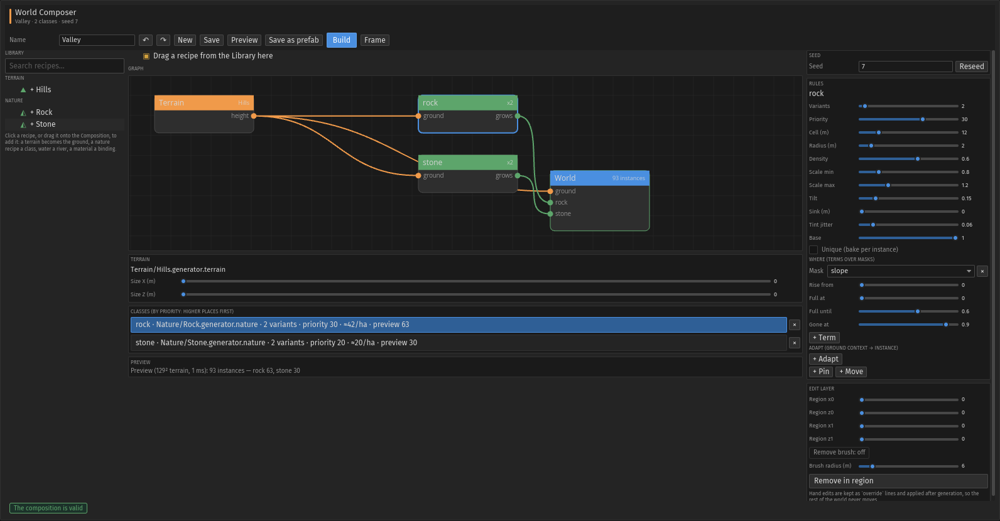
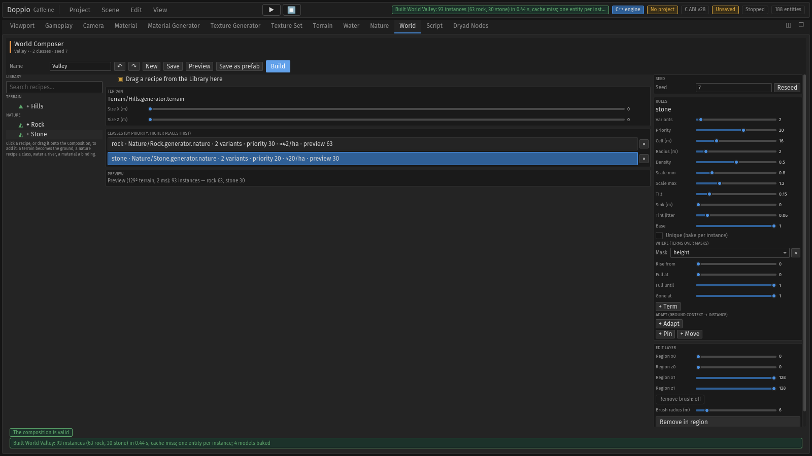

# World Composer: build a prefab world from generator recipes

<div class="doc-meta">
  <span class="doc-badge doc-badge--reference">Guide</span>
  <span class="doc-badge">Doppio</span>
  <span>Last updated: <time datetime="2026-11-26">2026-11-26</time></span>
  <span>Source: <a href="https://github.com/devscafecommunity/caffeine/blob/main/content/en/docs/doppio/world-composition.md"><code>world-composition.md</code></a></span>
</div>

<p class="doc-lede">One file that says <em>what the world is made of</em>: a terrain, the trees, rocks and grass
that grow on it, the rivers and lakes that cut through it, and the materials that dress it. You choose the
composition; the system builds the world, and every plant adapts to the place where it stands because its
randomness comes from a hash of its coordinates. It is a <strong>complement to the Terrain Generator</strong>,
not a replacement: the terrain stays a graph, the composition decides what lives on it.</p>

> **Status: built.** The core build (`src/caffeine/world`), the C ABI (v28), the `.cinst` bake and its draw path,
> the bake cache and the World tab in Doppio exist; section 8 lists what is done and the few things still open.
> It replaces the "target architecture" and "World tab" parts of
> [`photoreal-world-roadmap.md`](photoreal-world-roadmap.md), which stays as the validation of the idea and the
> engine and rendering phases.

## 1. The idea in one picture

```text
Valley.generator.world                         ← the composition (one file, you edit it)
  seed 1234, generator_version 2
  terrain   Terrain/Alpine.generator.terrain   ← height + masks (slope, wetness, flow, ...)
  water     Water/River.generator.water        ← follows the terrain's flow mask
            Water/Lake.generator.water         ← fills basins under a level
  classes   (what grows where, in priority order)
    boulder  Nature/MossRock.generator.nature   where slope > 0.3
    oak      Nature/OakTree.generator.nature    where gentle, dry, near water
    grass    Nature/LowerGrass.generator.nature where flat, not rock
  materials Materials/Moss.generator.material   ground layers, rock moss, ...
        │
        ▼  build (deterministic)
  placement per cell:  sub-seed = hash(world seed, class, cell x, cell z)
        │                → variant, yaw, scale, tint, lean — all from that one number
        ▼
  prefab world: terrain + water + instances, always identical for the same inputs
```

Three properties define it:

1. **Composition, not generation.** The user picks parts (`.generator.*` recipes) and rules; nothing is random
   unless a seed says so. Open the same file tomorrow, get the same world.
2. **Everything in one place.** Terrain, nature, water, materials and textures are listed in one file and one
   tab, instead of five tools that each place their own result.
3. **Adapts to position.** A tree is not a copy of a model dropped at (x, z). Its variant, size, lean and tint
   derive from the hash of its cell *and* from what the terrain is there (slope, height, wetness, distance to
   water). The same oak recipe looks different on a dry ridge and on a wet bank.

It is **not** an open-world streamer (that is the runtime path of the world roadmap). The composer builds a
bounded, authored world. It is designed so that the same build function can later run per chunk for streaming.

## 2. What already exists

Verified against the engine's `main` (C ABI version 27).

| Piece | Where | State |
|---|---|---|
| Recipe files, one per generator | `Oak.generator.nature`, `Lake.generator.water`, ... (`uikit/recipe.rs`, [`generator-recipes.md`](generator-recipes.md)) | done; `generator_version` in every one |
| Recipe resolver and variants | `uikit/recipe_ref.rs`: `nature_variants`, `bake_nature_variant(recipe, seed, quality, cache)` | done, cache keyed by graph + version + seed + quality |
| Integer hash | `core/Hash.hpp`: SplitMix64 `deriveSeed(parent, salt, x, z)`, `toUnit`; Rust twin in `recipe_ref.rs`; golden tests | done |
| Terrain masks | C ABI v15: `height`, `slope`, `curvature` (engine), `flow`, `wetness`, `wear`, `deposit` (graph) | done |
| Biome table | `terrain/TerrainBiome`: `base x` product of trapezoids over masks, plain text | done |
| Scatter core | `src/caffeine/scatter`: jittered grid, priority, exclusion radius, cell ownership, chunk-independent result | done |
| Scatter on a terrain | C ABI v16, `Scatter/default.scatter`, **Scene > Scatter on Terrain**, composite classes (`part mesh ...`) | done, one entity per instance |
| Nature output for scattering | vertex colour, flutter weight, material slots per submesh, per-instance tint and scale range | done |
| Rendering of many instances | Micromesh cluster LOD for opaque parts, wind, leaf translucency | partial (no impostors, no per-chunk buffers) |
| Water | surface and `water_height`, Gerstner waves on the GPU | done as a separate placement |
| Prefabs | `.prefab` entity tree that remembers its source recipe (`uikit/prefab_file.rs`) | done |

So the work is the **layer that connects them**, which the roadmap called "the world layer".

## 3. The composition file

`<Name>.generator.world`, a new recipe kind in the same family, so double-clicking it reopens the Composer.
caf-pack already skips it as an editor-only source: `Registry::isEditorOnly` matches every `.generator.` name.
The file is the usual recipe JSON header; like every generator, the composer owns the text form of its `graph`,
and that text shares the grammar of the `.scatter` plan and the biome table (one `key value` line per thing,
indented biome terms under a class). The core parses it in
[`WorldComposition.hpp`](https://github.com/devscafecommunity/caffeine/blob/main/src/caffeine/world/WorldComposition.hpp),
so it needs no JSON library.

```json
{
  "format": "caffeine-generator", "version": 1, "kind": "world",
  "name": "Valley", "product": "", "generator_version": 2,
  "graph": "seed 1234\nterrain Terrain/Alpine.generator.terrain size 1024 1024\n..."
}
```

The `graph` text, unescaped:

```text
seed 1234
water_distance 64
terrain Terrain/Alpine.generator.terrain size 1024 1024
water Water/River.generator.water follow flow min 0.8 carve 1.5
water Water/Lake.generator.water fill basins level 0.18
material terrain.layer0 Materials/Moss.generator.material
class boulder ref Nature/MossRock.generator.nature variants 6 priority 30 cell 16 radius 2.2 density 0.9 scale 0.7 1.6 tilt 0.8 sink 0.3
  slope 0.30 0.45 1.00 1.00
class oak ref Nature/OakTree.generator.nature variants 8 priority 20 cell 9 radius 3 density 0.8 scale 0.8 1.4 tilt 0.1 tint 0.1
  slope   0.00 0.00 0.15 0.35
  wetness 0.20 0.40 0.80 1.00
  adapt size wetness
  adapt lean slope 0.3
  adapt wetness water_distance
  adapt param.crown wetness
override remove oak 12 -4
override move oak 3 7 120.5 88.25
override pin boulder 5 5 2
```

Top-level lines: `seed`, `water_distance <metres>` (where the `water_distance` mask reaches 1; 64 by default),
`terrain <ref> [size <x> <z>]`, `water <ref> [follow <mask> min <value>] [carve <metres>] [fill basins level <value>]`,
`material <slot> <ref>`, `class` and `override`.

Class properties: `ref` (required), `variants`, `priority`, `cell`, `radius`, `density`, `scale <min> <max>`, `tilt`,
`sink`, `tint` (jitter), `base` (the rule's base density) and `unique on|off`. Indented lines are a biome term
`<mask> <rise0> <rise1> <fall1> <fall0>` or `adapt <target> <source> [amount]` (section 4.2). References cannot
contain spaces.

Rules for the file:

- **References are project paths to recipes**, never to baked OBJs; the Composer re-runs recipes, so editing an
  oak recipe changes every oak. A missing or wrong-kind reference is an error in the status bar and nothing is
  built (the same refusal the recipe slots already use).
- **`where` is the existing biome syntax** (trapezoids over masks), so the biome table, the `.scatter` plan and the
  composition share one grammar. A `.scatter` file becomes a *view* of the `classes` list, not a second format.
- **Everything has a version.** `generator_version` at the top; the build records the versions of every recipe it
  used, so an old world keeps its old behaviour until it is re-baked on purpose.
- **`overrides`** is the sparse edit layer (section 7), kept in the file so determinism survives hand edits.

## 4. Adapting to position

Two separate mechanisms; keep them apart because they cost differently.

### 4.1 Hash of the coordinates (cheap, exists)

For each class, placement runs on a global jittered grid. For a cell `(cx, cz)`:

```text
cell_seed = deriveSeed(world_seed, class_salt, cx, cz)        // integer, platform independent
variant   = floor(toUnit(deriveSeed(cell_seed, 1, 0, 0)) * N)
yaw       = toUnit(deriveSeed(cell_seed, 2, 0, 0)) * 360
scale     = lerp(min, max, toUnit(deriveSeed(cell_seed, 3, 0, 0)))
tint      = jitter(toUnit(deriveSeed(cell_seed, 4, 0, 0)))
```

The result depends only on seed, composition and terrain, never on load order or chunk size, so two halves of a
region add up to the whole (already tested in the scatter core). `class_salt` is derived from the class `id`, not
its position in the list, so reordering classes does not move every tree.

### 4.2 Ground context (new)

Hash alone gives variety, not adaptation. After the edit layer, the build samples the terrain at each instance's
final position and keeps a small **context** with it (`InstanceContext` in
[`WorldBuild.hpp`](https://github.com/devscafecommunity/caffeine/blob/main/src/caffeine/world/WorldBuild.hpp),
also in the C ABI instance):

| Context | From | Possible uses |
|---|---|---|
| `slope` | built-in mask | lean, root flare depth, sink |
| `height` | built-in mask | stunted trees near the summit, snow |
| `wetness` | stored mask (0 when the terrain has none) | larger, denser crown near water; moss tint |
| `water_distance` | water layer (section 5) | reeds only at the bank, willows near it |
| `neighbours` | the generated instances | crowding: other instances within three radii, over 6 |

`adapt <target> <source> [amount]` maps one source (any terrain mask, `water_distance` included, or `neighbours`),
`v` in 0..1, onto a target:

| Target | Effect | Default amount |
|---|---|---|
| `size` | `scale *= 1 + amount * (2v - 1)` | 0.25 |
| `lean` | tilt toward the normal `+= amount * v` | 0.5 |
| `tint` | `tint *= 1 - amount * v` | 0.2 |
| `wetness`, `snow` | the run-time modifier `= amount * v` (CAPI v10 modifiers) | 1 |
| `param.<name>` | an exposed parameter of the class's nature recipe `= amount * v`: changes the **bake** | 1 |

Neighbours are counted on the generated instances, *before* the edit layer, so moving or removing one instance never
changes another; the build reads a margin of three radii around the region, so regions still add up to the whole.
`param.<name>` (at most four per class) is v2: the context becomes an input of the Nature graph, so a tree is grown
for its place. The graph must expose that parameter (`expose` in the nature graph); the engine reports the values
per instance and the editor bakes the models.

### 4.3 Pool versus unique bake

A bake per tree would be exact and far too slow. The Composer therefore keeps a **variant pool** per class (N baked
variants, cached as today) and the hash picks one, then deforms and tints it. A class with `param.<name>` mappings
bakes one model per quantised value set and reuses it. A class may be marked `unique on` for hero objects (a few
trees near the player's start): it is baked per instance, seeded by the instance's seed. Default is the pool.

## 5. Build pipeline

One deterministic function, `World::build(request) -> WorldPart`
([`WorldBuild.hpp`](https://github.com/devscafecommunity/caffeine/blob/main/src/caffeine/world/WorldBuild.hpp)), in the
core so Doppio, the runtime and the headless driver run the same code. The C ABI wraps it without a session
(`caffeine_world_build`, v28):

```text
1. resolve     every ref -> recipe (kind and version checked); fail with a list, build nothing
2. terrain     the caller bakes the terrain recipe and passes height + masks (the graph lives in Doppio)
3. water       rivers follow a mask, carve the bed, lakes fill basins, then the water_distance mask
4. materials   checked and passed through as bindings
5. classes     the scatter core, every class at once: priority + exclusion radius decide conflicts,
                 the biome terms decide density, the class id's hash is its salt
6. overrides   the edit layer (remove, move, pin), then the ground context and the adapt mappings
7. output      instance lists per class (placement order) + carved terrain + water + material bindings
```

Notes:

- **Priority order is the rule that stops a tree growing through a rock**: rocks first, then trees, then bushes,
  then grass, each with its exclusion radius. Solved at placement, not at mesh time.
- **Water before scatter** so `water_distance` exists
  ([`WorldWater.hpp`](https://github.com/devscafecommunity/caffeine/blob/main/src/caffeine/world/WorldWater.hpp)).
  A river is every vertex where its `follow` mask is at least `min`; `carve <m>` lowers that bed on a copy of the
  heightfield before any class reads a mask, so the built-in `slope` and `curvature` see the new banks, and the
  surface stays at 70% of the depth. A lake is every vertex under both its spill height (a priority-flood from the
  border) and `level`. `water_distance` comes from an integer 3-4 chamfer transform, so every machine gets the same
  bytes. Water is computed over the whole terrain whatever the region, on the CPU: the documented limit is a bounded
  heightfield (129 to 513 vertices a side).
- **Region**: the function takes a rectangle, as `scatterTerrain` does, so streaming later is the same call per chunk.
- **Output is data, not entities.** Small builds (up to 3000 instances) spawn one entity per instance, as Scatter
  does. Large ones write an instance bake (`.cinst`) and a models file and draw them from one entity with the
  `World Instances` component; the per-entity path is the thing that makes thousands of instances slow to edit.

### Where the result goes

| Output | What it is | When |
|---|---|---|
| Live scene | holder `World <name>` at the terrain's corner: a `<name> terrain` child (the baked, carved terrain with its masks and `water_distance`), one `<name> lake N` water entity per lake, and one child per instance with its baked nature parts | editing, small worlds |
| `World/<name>.prefab` | the saved tree, remembers its `.generator.world` | place the same world in other scenes |
| `World/<name>.cinst` + `World/<name>.models` | the instance bake (classes, then instances in square chunks of 64 m, the cache key and the instance hash) and the models file; the holder gets the `World Instances` component | big worlds (over 3000 instances), runtime draw |
| `<assets>/.cache/world/` | the bake cache (`<key>.cinst`) and the baked nature models | every build |

All of them come from the same `WorldPart`; the recipe stays the source of truth. A rebuild replaces the previous
`World <name>` and keeps its position.

### Drawing a bake

The `World Instances` component (`Bake`, `Models`, `Draw distance`, `Cast shadows`;
[`WorldInstanceDraw.hpp`](https://github.com/devscafecommunity/caffeine/blob/main/src/caffeine/world/WorldInstanceDraw.hpp))
draws every instance of a bake from one entity. Its models file has one line per model part:

```text
# class variant mesh [slots a.mat;b.mat] [cutout on|off]
0 0 .cache/world/nature/oak_tree_3f2a9c0d11e84b27/oak_tree_trunk.obj
0 0 .cache/world/nature/oak_tree_3f2a9c0d11e84b27/oak_tree_leaves.obj cutout on
# a per-instance model (unique or parameter-driven class) wins over the variant line
1 cell 12 -4 .cache/world/nature/pine_9b07e15c4d2a6f80/pine_trunk.obj
```

The renderer loads the bake and the models file once per change, skips whole chunks outside the frustum or beyond
`Draw distance`, and turns each visible instance into ordinary mesh draws, which the existing instancing batches (the
tint is quantised to 1/32 so instances still share batches). Cut-out parts cast no shadow. Every baked part names
its material in `slots`: the same `.mat` assets the Nature Generator writes when it places the tree (bark, leaf cards,
rock surfaces, your own material), recorded beside the cached OBJs in `.materials`. Rivers and lakes are water
entities shaped by the engine's surface grid (`caffeine_world_water_surface` and
`caffeine_session_set_water_surface`); with a library without it a lake is a flat plane and a river is only carved.

## 6. The Composer tab

A **World** tab (View > World Composer, or double-click a `*.generator.world` in Assets) built from components only:

- **Library**: the project's `generator.*` recipes by kind (terrain, nature, water, material, texture). Drag one onto
  the Composition's drop row, or click it, to add it.
- **Composition**: a terrain row, water rows, material rows and the class rows (ref, variants, priority), and above
  them a **Graph** (`world.composition.graph`, a `node_canvas`): the same building blocks as nodes, each wired into a
  `World` output — Terrain feeds every Water and Class node (the ground they grow on or carve into), and Water,
  Material and Class nodes all feed `World`. It is a view over the composition, not an editing surface: clicking a
  class node selects it (the Rules panel below then shows its properties, same as clicking its row); dragging a node
  only rearranges the layout, which is session-only UI state, not part of the saved recipe. The graph's shape always
  matches what was added — there is no rewiring, so `Connect`/`Detach` on the canvas are no-ops.
- **Rules**: the selected class's properties, its `where` terms as sliders, its `adapt` mappings, `unique`, the seed
  with a *Reseed* button (a derived seed, undoable), and the edit layer: pin and move rows, a region rectangle with
  *Remove in region*, and a **remove brush**. With the brush on, a left drag in the Viewport removes the instances of
  the last build under the ring; the stroke is one undo step and writes `override remove` lines.
- **Preview**: a coarse build after each edit, debounced, on a worker thread (the terrain bake and the engine build,
  through a session-free `WorldBuilder`); the latest edit wins and every instance is counted.
- **Build**: the full build through the bake cache; one undo step; the status line reports instances per class, the
  time, whether the cache answered and how many models were baked. *Save as prefab* writes `World/<name>.prefab`;
  *Frame* points the Viewport camera at the last build.

<figure>
  
  <figcaption>The World tab with the <code>world</code> headless fixture: two rock recipes on a hills terrain.</figcaption>
</figure>

<figure>
  
  <figcaption>After <em>Build</em>: 93 instances (63 rock, 30 stone), a cache miss, one entity per instance.</figcaption>
</figure>

Project rules apply: every widget has a `UiId` and a `CATALOG` entry, composition edits use the tab's undo stack and a
build is one scene `App::commit`, and every command is a `Message` and an MCP action: `world_show`, `world_add`,
`world_add_class`, `world_set_class`, `world_set_rule`, `world_reseed`, `world_preview`, `world_build`,
`world_remove_in_region`, `world_brush`, `world_remove_in_circle`, `world_undo`, `world_save`, `world_save_prefab`,
`world_frame`, plus the read-only query `world`. The headless fixture `world_showcase` is a world that looks like one
(hills round a valley, a river, a lake, trees, rocks, shrubs and grass) for the documentation images. The headless flow `doppio/tests/ui-flows/world-composer.json` adds, drags and undoes
a class, reseeds, edits a rule, toggles the brush and builds; `doppio/crates/ui/src/windows/main/tests.rs` covers
large worlds, cache hits, carving and lakes, the brush and the prefab.

## 7. Edits, determinism and caching

- **Edit layer.** Sculpting, moving a tree and deleting a rock are stored as sparse `overrides` keyed by
  `(class, cell)`: `remove`, `move to`, `pin variant`. They apply *after* generation, so the generated world never
  stops being reproducible. Moving a tree does not change any other tree.
- **Cache key.** The seed, `generator_version`, the composition text, the content hash and version of every recipe
  used, the baked terrain (heights and stored masks), the region and the instance budget. `cacheKeyOf(request)`
  computes it without building. `WorldCache` keeps bakes on disk as `<key>.cinst`
  ([`WorldInstanceFile.hpp`](https://github.com/devscafecommunity/caffeine/blob/main/src/caffeine/world/WorldInstanceFile.hpp);
  `caffeine_world_build_cached` in the C ABI). Changing one recipe, or sculpting the terrain, invalidates only what
  depends on it.
- **No floating point in placement decisions.** Accept/reject and cell order use integers; pin noise and `libm` calls
  that decide *where*, as the roadmap already requires.
- **Golden tests**: `tests/test_world.cpp` pins the instance hash of a small composition and the class salts (whose
  Rust twin is `recipe_ref::content_hash`), checks that the build on 1 and 7 threads is identical, that halves add up
  to the whole (water and crowding included) and that a `.cinst` is byte-for-byte the same for the same build.

## 8. Gaps, in build order

Each step is useful alone and testable headless. `[x]` means already true on the engine's `main`.

### C0 — Foundations

- [x] Recipes with `generator_version`; resolver and cached variants.
- [x] Integer hash, same numbers in C++ and Rust.
- [x] Masks, biome table, scatter core, Scatter on Terrain action.
- [x] caf-pack skips `*.generator.world` (`Registry::isEditorOnly` matches any `.generator.` name).
- [x] `generator.world` recipe kind in Doppio: `recipe::Kind::World`, asset kind, double-click opens the tab.

### C1 — Composition model and headless build (core, no UI)

- [x] `src/caffeine/world`: parse and validate the `graph` text (`WorldComposition`); `build(request)` using the
      existing scatter and biome code; output `WorldPart` (instances grouped per class, in placement order).
- [x] Class salt from the class `id` (`classSalt`, FNV-1a + SplitMix64, Rust twin `recipe_ref::content_hash`);
      ref resolution through a resolver callback with kind and version check; all-or-nothing error list.
- [x] Edit layer: `override remove|move|pin`, keyed by `(class, cell)`; `Scatter::Instance` carries its cell.
- [x] C ABI v28: `caffeine_world_build` and its getters, `caffeine_world_check`, POD, tests in C++ and Rust.
- [x] Tests (`tests/test_world.cpp`): halves add up to the whole; reordering or adding classes does not move
      the others; 7 threads equal 1; overrides; golden instance hash.

### C2 — Water as part of the composition

- [x] `water_distance` mask from water bodies; rivers follow a mask, lakes fill basins under a level.
- [x] Optional bed carving before the masks are read (documented limit: CPU, bounded heightfield).
- [x] Water refs checked and wired: lakes are placed as water entities with their recipe's look.
- [x] Rivers and lake shores drawn as shaped water surfaces (with the engine's water surface grid).

### C3 — Ground context and adaptation

- [x] Context sampling (slope, height, wetness, water distance, neighbours) per instance.
- [x] `adapt` mappings to instance scale, lean, tint and the run-time wetness and snow modifiers.
- [x] Exposed parameters on `generator.nature` (`expose`) and `adapt param.<name>`, so context drives the **bake**;
      pool (quantised value sets) versus `unique` (per instance).
- [ ] A Nature Generator control to expose a parameter (today the `expose` line is written in the graph text).

### C4 — Output and rendering

- [x] `.prefab` output that keeps the link to its `generator.world`.
- [x] `.cinst` instance bake and the `World Instances` draw path (chunk culling, existing instancing).
- [x] Persistent bake cache keyed as in section 7.
- [ ] Impostors, per-chunk GPU instance buffers and mesh LOD for instances (roadmap phase 4); picking instances; the
      runtime renderer, the CPU shadow map and the Photon bake do not draw `World Instances` yet.
- [x] Materials on the baked nature parts: entities get them like composite Scatter parts, models files as `slots`.

### C5 — Editor

- [x] World tab, library drag, rules editor, preview build, build action with undo.
- [x] `UiId`s, MCP actions, headless flow and fixture, captures through the headless driver
      (`scripts/capture-world-docs.sh`).
- [x] Painting of overrides: the remove brush in the Viewport and the region rectangle.
- [x] The preview runs on a worker thread through `WorldBuilder` (no instance cap; stale results are dropped).

### C6 — Documentation

- [x] Portuguese mirror (`content/pt/docs/doppio/world-composition.md`) and both audits.
- [x] The Nature, Terrain and Water guides link here.

## 9. Risks and open questions

| Risk or question | Plan |
|---|---|
| Per-entity instances do not scale | `.cinst` + `World Instances` (C4); entities only for small builds |
| Adapting the bake needs graph parameters Nature does not expose | `expose` in the nature graph and `adapt param.<name>` (C3) |
| Carving a river changes every mask | carve first, then read masks; cache key includes it |
| Reordering classes or editing one recipe reshuffles the world | salt from the class id; per-recipe hashes in the cache key |
| Floats decide placement across machines | integer decisions, golden tests |
| Is the unit "a world" or "a region"? | build takes a region, so both work; one terrain per composition until terrain tiling exists (generator output is 129/257/513) |
| `.scatter` versus `.generator.world` | `.scatter` stays readable and becomes a view of `classes`; no second format |

## 10. Related

- [`photoreal-world-roadmap.md`](photoreal-world-roadmap.md): the engine, rendering, streaming and quality phases this builds on.
- [`generator-recipes.md`](generator-recipes.md): recipe files, references, variants, the hash.
- [`terrain-generator-guide.md`](terrain-generator-guide.md): masks, biome table, scatter .
- [`nature-generator-guide.md`](nature-generator-guide.md), [`water-generator-guide.md`](water-generator-guide.md), [`material-pipeline.md`](material-pipeline.md).
