# Doppio UI reference

Generated by `cargo test -p doppio-ui capture_ui_gallery -- --ignored`. Descriptions live in `caffeine-website/captures/ui-captions.json`.

## `editor.menu.scene`

Scene menu: add, save and play.

## `editor.menu.edit`

Edit menu: undo, redo and delete.

## `editor.menu.view`

View menu: focus, camera reset and render.

## `editor.pane.hierarchy`

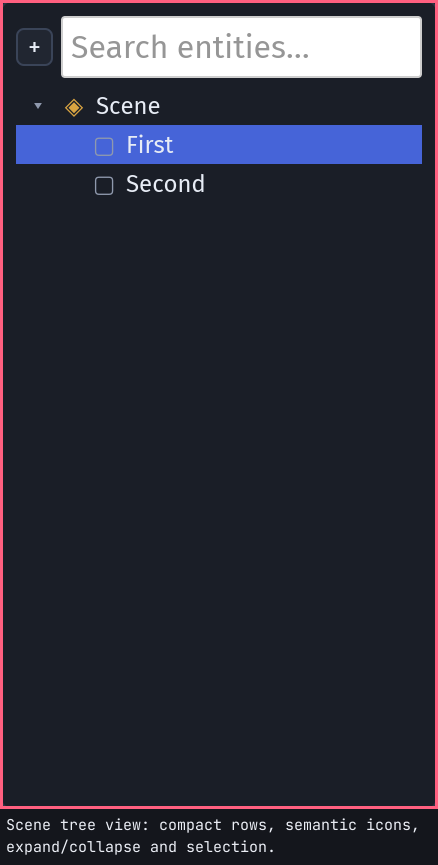

Scene tree view: compact rows, semantic icons, expand/collapse and selection.

## `viewport.canvas.gizmo`

Transform gizmo over the scene viewport (move, rotate or scale).

## `editor.pane.viewport`

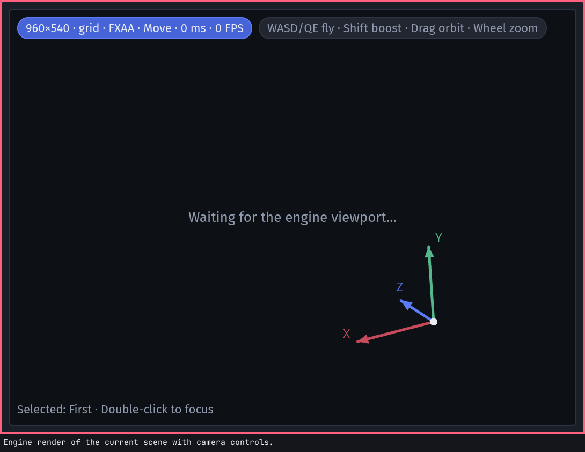

Engine render of the current scene with camera controls.

## `editor.pane.inspector`

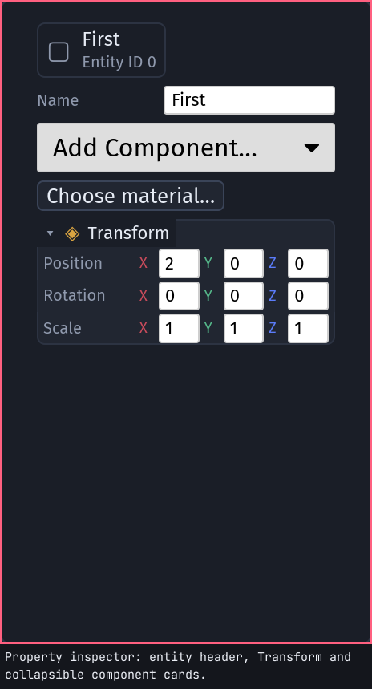

Property inspector: entity header, Transform and collapsible component cards.

## `inspector.material.picker`

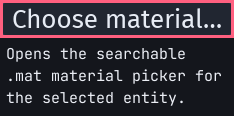

Opens the searchable .mat material picker for the selected entity.

## `hierarchy.toolbar.add`

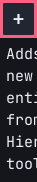

Adds a new entity from the Hierarchy toolbar.

## `hierarchy.tree.scene`

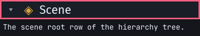

The scene root row of the hierarchy tree.

## `hierarchy.search`

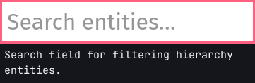

Search field for filtering hierarchy entities.

## `editor.pane.tab.hierarchy`

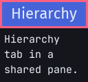

Hierarchy tab in a shared pane.

## `editor.pane.tab.assets`

Assets tab in a shared pane.

## `editor.pane.tab.viewport`

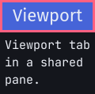

Viewport tab in a shared pane.

## `editor.pane.tab.inspector`

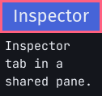

Inspector tab in a shared pane.

## `editor.pane.tab.console`

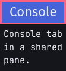

Console tab in a shared pane.

## `console.filter.error`

Show or hide error entries in the Console.

## `console.filter.log`

Show or hide general log entries in the Console.

## `console.filter.action`

Show or hide editor action entries in the Console.

## `console.filter.engine`

Show or hide engine entries in the Console.

## `console.filter.ui`

Show or hide UI entries in the Console.

## `editor.pane.console`

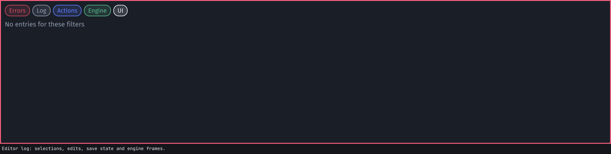

Editor log: selections, edits, save state and engine frames.

## `viewport.canvas.surface`

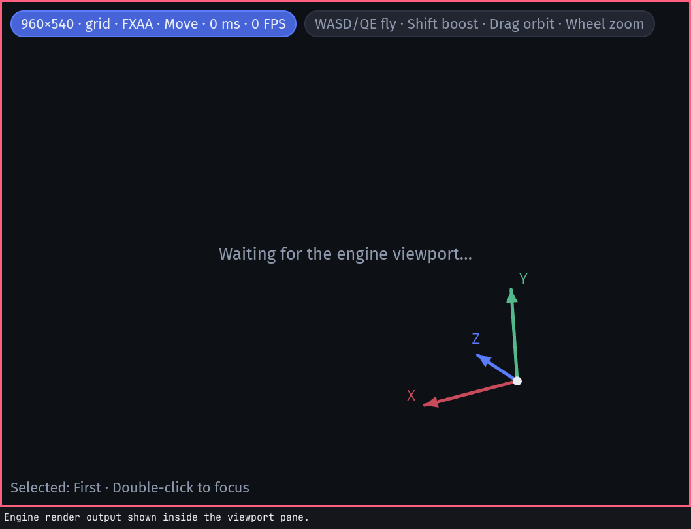

Engine render output shown inside the viewport pane.

## `inspector.entity.name`

Editable name of the selected entity; edits reach the engine.

## `inspector.add_component`

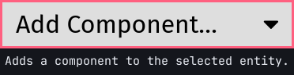

Adds a component to the selected entity.

## `hierarchy.list.entity_row.0`

A row in the hierarchy list; rows use the .N suffix.

## `hierarchy.list.entity_row.1`

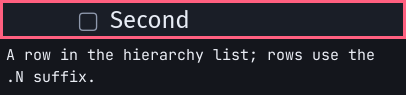

A row in the hierarchy list; rows use the .N suffix.

## `annotated.inspector`

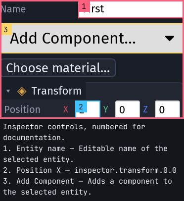

Inspector controls, numbered for documentation.

