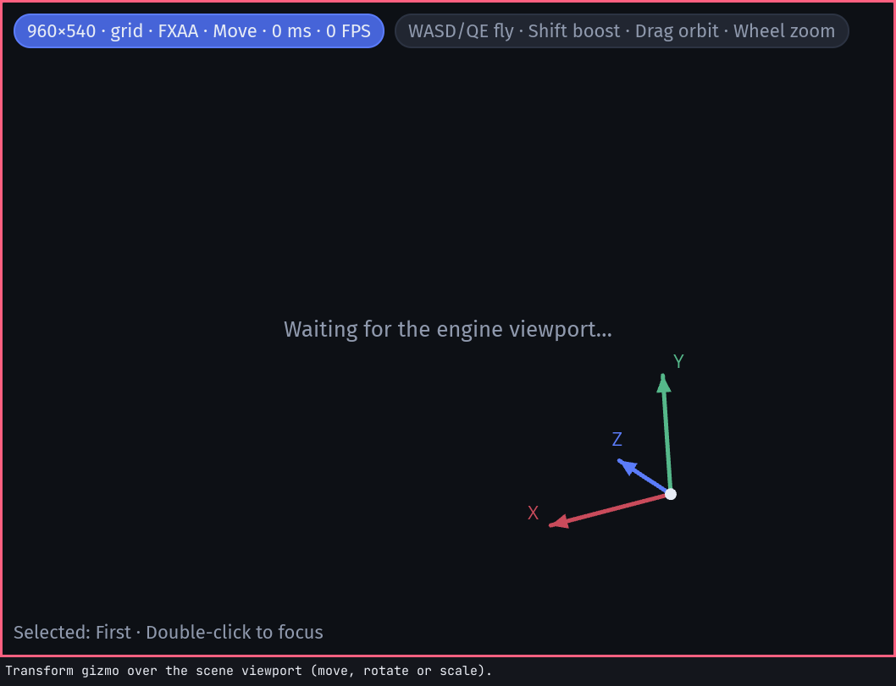
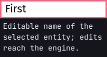
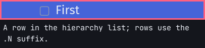

# Doppio UI reference

  Generated
  Doppio

Generated by `cargo test -p doppio-ui capture_ui_gallery -- --ignored`. Descriptions live in `captures/ui-captions.json`.

## `editor.pane.tab.texture_generator`

<figure class="doc-figure">
  
  <figcaption>Tab of the Texture Generator pane.</figcaption>
</figure>

## `editor.menu.project`

<figure class="doc-figure">
  
  <figcaption>Project menu: Project Manager and asset refresh.</figcaption>
</figure>

## `editor.menu.scene`

<figure class="doc-figure">
  
  <figcaption>Scene menu: add, save and play.</figcaption>
</figure>

## `editor.menu.edit`

<figure class="doc-figure">
  
  <figcaption>Edit menu: undo, redo and delete.</figcaption>
</figure>

## `editor.menu.view`

<figure class="doc-figure">
  
  <figcaption>View menu: focus, camera reset and render.</figcaption>
</figure>

## `editor.pane.hierarchy`

<figure class="doc-figure">
  
  <figcaption>Scene tree view: compact rows, semantic icons, expand/collapse and selection.</figcaption>
</figure>

## `editor.pane.assets`

<figure class="doc-figure">
  
  <figcaption>Project assets found under the loaded project's asset root.</figcaption>
</figure>

## `assets.toolbar.search`

<figure class="doc-figure">
  
  <figcaption>Filters the asset browser by file name or path.</figcaption>
</figure>

## `assets.toolbar.up`

<figure class="doc-figure">
  
  <figcaption>Moves to the parent folder in the asset browser.</figcaption>
</figure>

## `assets.toolbar.root`

<figure class="doc-figure">
  
  <figcaption>Returns the asset browser to the asset root.</figcaption>
</figure>

## `assets.toolbar.refresh`

<figure class="doc-figure">
  
  <figcaption>Rescans the project asset root.</figcaption>
</figure>

## `assets.toolbar.view_grid`

<figure class="doc-figure">
  
  <figcaption>Shows assets as thumbnail cards.</figcaption>
</figure>

## `assets.toolbar.view_list`

<figure class="doc-figure">
  
  <figcaption>Shows assets as compact rows.</figcaption>
</figure>

## `assets.tree.empty`

<figure class="doc-figure">
  
  <figcaption>Shown when a folder or search has no assets.</figcaption>
</figure>

## `assets.toolbar.new`

<figure class="doc-figure">
  
  <figcaption>Opens the asset wizard on the Create tab (folder, material, script…).</figcaption>
</figure>

## `assets.toolbar.import`

<figure class="doc-figure">
  
  <figcaption>Opens the asset wizard on the Import tab.</figcaption>
</figure>

## `assets.toolbar.tree_toggle`

<figure class="doc-figure">
  
  <figcaption>Shows or hides the folder tree beside the file view.</figcaption>
</figure>

## `assets.tree.folders`

<figure class="doc-figure">
  
  <figcaption>Folder tree of the project asset root.</figcaption>
</figure>

## `viewport.canvas.gizmo`

<figure class="doc-figure">
  
  <figcaption>Transform gizmo over the scene viewport (move, rotate or scale).</figcaption>
</figure>

## `editor.pane.viewport`

<figure class="doc-figure">
  
  <figcaption>Engine render of the current scene with camera controls.</figcaption>
</figure>

## `editor.pane.inspector`

<figure class="doc-figure">
  
  <figcaption>Property inspector: entity header, Transform and collapsible component cards.</figcaption>
</figure>

## `inspector.material.picker`

<figure class="doc-figure">
  
  <figcaption>Opens the searchable .mat material picker for the selected entity.</figcaption>
</figure>

## `inspector.behaviour.add`

<figure class="doc-figure">
  
  <figcaption>Adds a behaviour to the selected entity: a component, script, mesh or material.</figcaption>
</figure>

## `hierarchy.toolbar.add`

<figure class="doc-figure">
  
  <figcaption>Adds a new entity from the Hierarchy toolbar.</figcaption>
</figure>

## `hierarchy.tree.scene`

<figure class="doc-figure">
  
  <figcaption>The scene root row of the hierarchy tree.</figcaption>
</figure>

## `hierarchy.search`

<figure class="doc-figure">
  
  <figcaption>Search field for filtering hierarchy entities.</figcaption>
</figure>

## `editor.pane.tab.hierarchy`

<figure class="doc-figure">
  
  <figcaption>Hierarchy tab in a shared pane.</figcaption>
</figure>

## `editor.pane.tab.assets`

<figure class="doc-figure">
  
  <figcaption>Assets tab in a shared pane.</figcaption>
</figure>

## `editor.pane.tab.viewport`

<figure class="doc-figure">
  
  <figcaption>Viewport tab in a shared pane.</figcaption>
</figure>

## `editor.pane.tab.script`

<figure class="doc-figure">
  
  <figcaption>Script editor tab in a shared pane.</figcaption>
</figure>

## `editor.pane.tab.dryad_nodes`

<figure class="doc-figure">
  
  <figcaption>Dryad Nodes tab in a shared pane.</figcaption>
</figure>

## `editor.pane.tab.console`

<figure class="doc-figure">
  
  <figcaption>Console tab in a shared pane.</figcaption>
</figure>

## `viewport.canvas.surface`

<figure class="doc-figure">
  
  <figcaption>Engine render output shown inside the viewport pane.</figcaption>
</figure>

## `inspector.entity.name`

<figure class="doc-figure">
  
  <figcaption>Editable name of the selected entity; edits reach the engine.</figcaption>
</figure>

## `hierarchy.list.entity_row.0`

<figure class="doc-figure">
  
  <figcaption>A row in the hierarchy list; rows use the .N suffix.</figcaption>
</figure>

## `hierarchy.list.entity_row.1`

<figure class="doc-figure">
  
  <figcaption>A row in the hierarchy list; rows use the .N suffix.</figcaption>
</figure>

## `annotated.inspector`

<figure class="doc-figure">
  
  <figcaption>Inspector controls, numbered for documentation.</figcaption>
</figure>

