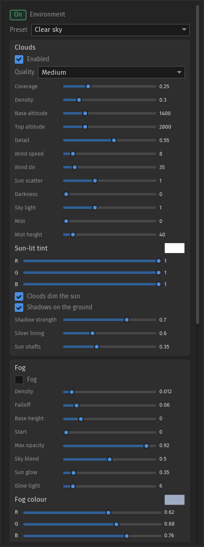
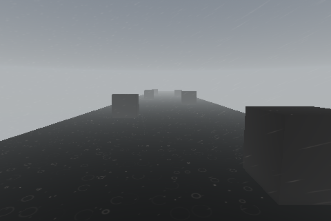
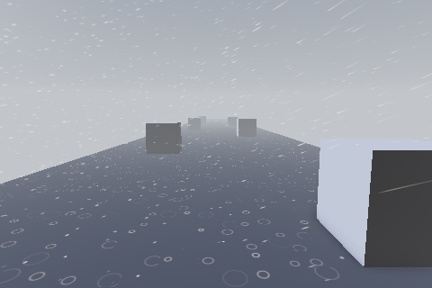
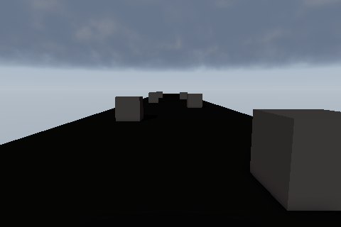
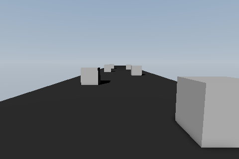
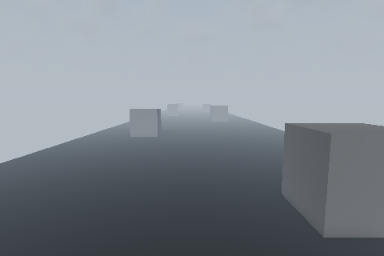

# Environment: nuvens, névoa, chuva e relâmpagos no Doppio

<div class="doc-meta">
  <span class="doc-badge doc-badge--stable">Estável</span>
  <span class="doc-badge">Doppio</span>
  <span>Última atualização: <time datetime="2026-11-21">2026-11-21</time></span>
</div>

<p class="doc-lede">Nuvens que sombreiam o chão, névoa de altura, chuva com profundidade, vento e relâmpagos com trovões como um só sistema que concorda com o sol e com o GI do Photon, e o separador Environment que o gere.</p>

O tempo da cena vive em dois componentes refletidos numa só entidade: `Volumetric Clouds` (o céu) e `Weather` (névoa, chuva
e a ligação entre tudo). O Doppio edita-os no separador **Environment** (menu View, ao lado do Photon) e no
Inspector: ambos escrevem os mesmos campos, por isso nunca discordam, e os scripts e os agentes usam os mesmos campos.

<figure class="doc-figure">
  
  <figcaption>O separador Environment: predefinições, nuvens, névoa, chuva e a ligação entre elas</figcaption>
</figure>

## 1. O que já existia

O trabalho de environment reutilizou o que o motor tinha em vez de construir uma segunda cópia:

| Parte | Antes | Agora |
|---|---|---|
| Nuvens | `VolumetricCloudsComponent` desenhado pelo `sky.frag` (ray-marching, procedural, com vento e neblina), serializado mas não refletido e sem UI | Refletido, editável no separador; campos novos `Tint`, `Darkness` e `Sky Light` acrescentados |
| Névoa | Uma névoa linear de pós-processamento (`deferredFog`) e a luz volumétrica do passo forward | Ambas ficam como estão; uma nova **névoa exponencial de altura** no passo de composição, com o céu a esbater-se nela |
| Humidade | `modWetness` por mesh renderer | Uma humidade da cena inteira somada a essa |
| Chuva | Nada | Riscos de ecrã em camadas e superfícies molhadas |
| Céu do Photon | Uma cor de céu fixa vezes `Sky intensity` | A mesma cor vezes um fator do tempo (secção 6) |

## 2. O separador Environment

O separador edita a primeira entidade que tem os componentes de tempo. **Add environment** cria uma numa nova entidade (nuvens ligadas,
a partir da predefinição *Clear sky*) quando a cena não tem nenhuma. Cada edição passa pela API de componentes do motor e grava um passo
de desfazer (um slider é um passo por campo, não por valor); uma predefinição é um passo.

A paleta **+** da hierarquia (World) também tem uma entrada **Environment**: cria a entidade de environment uma só vez e, quando a
cena já tem uma, seleciona-a e abre este separador, por isso nunca há uma segunda.

| Controlo | Campo | O que faz |
|---|---|---|
| **Preset** | | Off, Clear sky, Cloudy, Fog, Light rain ou Storm: define nuvens, névoa e chuva em conjunto |
| **Clouds** | `Volumetric Clouds` | Secção 3 |
| **Fog** | `Weather` | Secção 4 |
| **Rain** | `Weather` | Secção 5 |
| **Sky, sun and light** | `Weather` | `Enabled` (interruptor geral) e `Link Sky` (secção 6) |

## 3. Nuvens

Nuvens volumétricas procedurais entre duas altitudes, calculadas no passo do céu, por isso não custam nada quando o céu está escondido.

| Controlo | Campo | O que faz |
|---|---|---|
| **Enabled**, **Quality** | `Enabled`, `Quality` | Off, Low (8 passos), Medium (16) ou High (24) |
| **Coverage** | `Coverage` | 0 é um céu limpo, 1 um céu cheio |
| **Density** | `Density` | Extinção: finas e leves até espessas |
| **Base altitude**, **Top altitude** | `Base Altitude`, `Top Altitude` | Os limites da camada, em metros |
| **Detail** | `Detail` | Peso das oitavas de alta frequência |
| **Wind speed**, **Wind dir** | `Wind Speed`, `Wind Direction` | Deriva, em metros por segundo e graus em torno de +Y |
| **Sun scatter** | `Sun Scatter` | A força com que o sol as ilumina |
| **Darkness** | `Darkness` | 0 a 1: nuvens mais escuras e pesadas para uma tempestade |
| **Sky light** | `Sky Light` | A luz que enche o lado na sombra |
| **Mist**, **Mist height** | `Mist Density`, `Mist Height` | Neblina junto ao chão no horizonte (acima de 0 também liga a névoa volumétrica do passo forward, uns milissegundos a 720p: as predefinições deixam-na a 0) |
| **Sun-lit tint** | `Tint` | Cor multiplicada no lado iluminado pelo sol: laranja ao pôr do sol, cinzenta numa tempestade |
| **Clouds dim the sun** | `Cast Shadows` | A cobertura de nuvens baixa a luz direta (secção 8) |
| **Shadows on the ground**, **Shadow strength** | `Ground Shadows`, `Shadow Strength` | Sombras de nuvens em movimento em tudo o que o sol ilumina, e no bounce do Photon (secção 8) |
| **Silver lining** | `Silver Lining` | Um rebordo brilhante nas pontas finas das nuvens à frente do sol |
| **Sun shafts** | `Sun Shafts` | Raios através das aberturas das nuvens enquanto o sol está à vista |

As nuvens animam com o vento sempre que o céu é desenhado.

## 4. Névoa

Névoa exponencial de altura, integrada ao longo de cada raio de visão no passo de composição: `density * exp(-falloff * (y - baseHeight))` por metro.
Como usa o buffer de profundidade, cobre todos os objetos, terreno e água, e o céu esbate-se nela perto do horizonte.

| Controlo | Campo | O que faz |
|---|---|---|
| **Fog** | `Fog Enabled` | O interruptor |
| **Density** | `Fog Density` | Por metro à altura de base |
| **Falloff** | `Fog Height Falloff` | A rapidez com que rareia com a altura; 0 é uniforme |
| **Base height** | `Fog Base Height` | Altura do mundo onde a densidade se aplica |
| **Start** | `Fog Start` | Metros antes de a névoa começar |
| **Max opacity** | `Fog Max Opacity` | O máximo que pode esconder |
| **Sky blend** | `Fog Sky Blend` | 0 usa a cor da névoa, 1 usa a cor do próprio céu no horizonte na direção para onde se olha |
| **Sun glow**, **Glow tight** | `Fog Sun Scatter`, `Fog Sun Exponent` | O brilho da névoa na direção do sol |
| **Fog colour** | `Fog Color` | sRGB |

Com uma mistura de céu acima de 0 a névoa amostra a mesma textura de céu que o passo do céu desenha, por isso uma neblina no chão combina com o horizonte por trás dela.

## 5. Chuva

A chuva continua a ser um só shader de espaço de ecrã, sem partículas nem modelos, mas é calculada no mundo: seis cascas de riscos a cair
desde 2.5 m até cerca de 60 m à frente da câmara, cada uma uma grelha de células no espaço do mundo. Um risco é uma cápsula inclinada
com uma cabeça brilhante, fica escondido onde há geometria mais perto do que a sua casca, e uma gota junto à câmara é longa e nítida
enquanto uma distante é curta e suave. Como as cascas vivem no mundo, mover a câmara dá **paralaxe**: as gotas próximas passam
a varrer e as distantes ficam suspensas, o que dá profundidade à chuva.

<figure class="doc-figure">
  
  <figcaption>Chuva com profundidade: riscos a várias distâncias, anéis e faíscas onde encontra a estrada</figcaption>
</figure>

| Controlo | Campo | O que faz |
|---|---|---|
| **Rain** | `Rain Enabled` | O interruptor |
| **Intensity** | `Rain Intensity` | 0 a 1: quantos riscos, e quanto contraste a cena perde |
| **Wind speed**, **Wind dir** | `Rain Wind Speed`, `Rain Wind Direction` | A velocidade do vento: toda a grelha inclina-se por ele contra uma velocidade de queda de cerca de 9 m/s |
| **Drop length** | `Rain Drop Length` | 0 a 1 |
| **Fall speed** | `Rain Speed` | Velocidade da animação |
| **Brightness** | `Rain Brightness` | O brilho de um risco; a cor segue o céu e o nível de luz |
| **Wetness** | `Rain Wetness` | Quão molhadas ficam as superfícies com a intensidade máxima |
| **Splashes** | `Rain Splashes` | 0 a 1: anéis e faíscas onde a chuva encontra uma superfície virada para cima a menos de cerca de 35 m (a normal é reconstruída a partir do buffer de profundidade, por isso também funciona no terreno) |

Superfícies molhadas: a humidade da cena é `intensity * wetness` e soma-se ao `Wetness` próprio de cada mesh renderer. O shader iluminado
escurece o albedo e torna a superfície brilhante, como já fazia para `modWetness`.

## 6. Vento

Um só vento comanda a cena toda. A sua média é `Rain Wind Speed` e `Rain Wind Direction` (as nuvens mantêm a sua própria deriva), e
ele tem rajadas: uma soma de senos lentos, nunca negativa e sem repetir em minutos, escalada por **Gusts** (`Wind Gust`, 0 a 1).
O mesmo fator de rajada inclina a chuva, abana a folhagem e é comunicado pelo motor, por isso tudo se move em conjunto.

| Controlo | Campo | O que faz |
|---|---|---|
| **Gusts** | `Wind Gust` | 0 é um vento constante, 1 oscila entre a calma e cerca do dobro da média |
| **Foliage sway** | `Wind Foliage` | Multiplica o balanço dos materiais de folhagem por `1 + valor * velocidade / 8 * rajada`; 0 deixa a folhagem em paz |
| **Weather sound**, **Volume** | `Audio Enabled`, `Audio Volume` | Toca a chuva, o vento e o trovão (secção 7); uma predefinição deixa-os como os definiu |

## 7. Relâmpagos e trovões

Ligue **Lightning** e o céu fulmina sozinho. Os raios são deterministas: cada minuto é cortado em ranhuras e cada ranhura
tem um raio cujo momento, direção, distância e força saem de um hash da semente, por isso a mesma semente dá a mesma tempestade e um
teste consegue prevê-la. Com a ligação ligada, os relâmpagos precisam de um céu encoberto (cobertura de nuvens ou chuva de pelo menos 0.4), pois
não há relâmpagos num céu limpo.

O que faz um raio, tudo dentro de um segundo:

* **O clarão.** Até três descargas de retorno cintilam, sobre um brilho residual da nuvem. O clarão ilumina a cena como uma luz
  direcional fria vinda de onde o raio caiu (sem sombra própria), por isso também **chega ao Photon**: o bounce pisca com ele.
  Sobe a luz do céu e o céu do Photon, faz a chuva cintilar e ilumina a névoa e as nuvens por dentro.
* **O raio.** Uma linha bifurcada da base das nuvens até ao horizonte, no passo do céu, na direção do raio.
* **O trovão.** Cada raio levanta um evento que chega depois do tempo de viagem do som (distância / 343 m/s). O Doppio regista-o na
  Console (*Thunder, 1.2 km away*); o motor não faz som nenhum, ver os limites.

<figure class="doc-figure">
  
  <figcaption>Um raio no seu pico: o clarão frio ilumina a estrada, a névoa e a chuva</figcaption>
</figure>

| Controlo | Campo | O que faz |
|---|---|---|
| **Lightning** | `Lightning Enabled` | O interruptor |
| **Thunder events** | `Thunder` | Se os raios levantam eventos de trovão |
| **Strikes / min** | `Lightning Rate` | Um raio por ranhura de `60 / rate` segundos |
| **Flash** | `Lightning Intensity` | 0 a 2: o brilho do clarão |
| **Nearest**, **Farthest** | `Lightning Distance Min`, `Lightning Distance Max` | Onde os raios caem, em metros; um raio próximo é mais brilhante e mais alto |

O trovão também se **ouve**: com `Audio Enabled` ligado (o cartão *Sound*), a sessão toca cada estrondo a partir de ruído, panorâmico para a direção
do raio e mais baixo com a distância, juntamente com um leito de chuva e um de vento que seguem o tempo (veja o
[sistema de áudio](../audio/audio-system.md)). Desligado por omissão, por isso uma cena fica em silêncio até o pedir. Um jogo ou um script que queira o seu
próprio som pode continuar a consultar `caffeine_session_poll_thunder` (secção 12).

## 8. Como concordam: sol, céu e Photon

Com **Link sky, sun and fog** ligado (o predefinido) as secções atuam umas sobre as outras, e sobre a luz:

| Quando | Então |
|---|---|
| Chove e há nuvens | A cobertura sobe para pelo menos `0.55 + 0.40 * intensity`, a densidade cresce até 80% e as nuvens escurecem |
| Chove e há névoa | A densidade da névoa cresce `1 + intensity` vezes |
| O céu está encoberto (cobertura de nuvens, ou chuva) | A intensidade do sol desce até 80% para todas as etapas que a usam: o shader forward, a iluminação das nuvens, o brilho da névoa e a injeção do Photon |
| O céu está encoberto | A luz do céu a que o Photon recorre, e o ambiente do forward, crescem até 25% e tendem para um cinzento neutro do mesmo brilho |
| Névoa espessa | A luz do céu toma o tom da névoa, mantendo o brilho |

O Photon não precisa de nada de novo para isto: o sol chega-lhe pela mesma lista de luzes, e a sua radiância de céu é a cor de céu fixa vezes
`Sky intensity`, agora também vezes a escala e o tom do tempo (`kPhotonSkyRadiance`). Estes fatores dependem só das
definições, nunca do tempo nem do frame, por isso não acrescentam ruído: a média temporal do Photon e os desvios de amostragem por probe
continuam a funcionar como antes, e a névoa é aplicada depois do resolve do Photon, por isso também suaviza o que resta de ruído ao longe.

Com a ligação desligada cada secção atua sozinha, e as nuvens mantêm exatamente os valores do componente.

### Nuvens que movem a luz

Três efeitos ligam as nuvens à iluminação sem cozer nada (ligue-os em **Clouds**; as predefinições ligam-nos):

* **Sombras no chão** (`Ground Shadows`, `Shadow Strength`). Os shaders forward seguem o raio do sol até à camada de nuvens e
  leem o mesmo ruído do céu a duas alturas dela, por isso a sombra de uma nuvem atravessa o chão, o terreno e todos os objetos que o
  sol ilumina, move-se com o vento e concorda com o que o céu mostra. A injeção do Photon lê a mesma função para cada voxel,
  por isso o **bounce segue a sombra** (o campo próximo já seguia: lê a luz direta do passo forward). Não se acrescenta nenhuma textura:
  o passo forward está no limite de 16 samplers.
<figure class="doc-figure">
  
  <figcaption><em>Cloudy</em> com as sombras no chão ligadas: o sol é sombreado pela camada de cima (compare com o mesmo céu sem elas)</figcaption>
</figure>

* **Silver lining** (`Silver Lining`). As pontas finas das nuvens à frente do sol brilham, por dispersão para a frente.
* **Sun shafts** (`Sun Shafts`). Uma recolha radial em espaço de ecrã em direção ao sol: raios pelas aberturas das nuvens, em 14
  passos, e só enquanto o sol está à frente da câmara (olhar para o outro lado não custa nada).

## 9. Predefinições

| Predefinição | Nuvens | Névoa | Chuva |
|---|---|---|---|
| **Off** | desligadas | desligada | desligada |
| **Clear sky** | cobertura 0.25 | desligada | desligada |
| **Cloudy** | cobertura 0.75, um pouco escuras | desligada | desligada |
| **Fog** | cobertura 0.55 | densidade 0.03, falloff 0.035, mistura de céu 0.7 | desligada |
| **Light rain** | cobertura 0.8 | fina | intensidade 0.35 |
| **Storm** | cobertura 0.95, escuras, vento rápido, rajadas 0.7, relâmpagos 9 por minuto | fina, cinzenta | intensidade 0.95, vento forte |

Toda a predefinição com nuvens liga também as sombras no chão, um silver lining, um pouco de força de sun shafts e o balanço da folhagem.

<figure class="doc-figure">
  
  <figcaption>A estrada de regressão, <em>Clear sky</em>: os blocos mantêm o contraste ao longo de toda a estrada</figcaption>
</figure>

<figure class="doc-figure">
  
  <figcaption><em>Fog</em>: os blocos distantes esbatem-se na névoa e o céu esbate-se nela no horizonte</figcaption>
</figure>

<figure class="doc-figure">
  
  <figcaption><em>Storm</em>: nuvens escuras, um sol encoberto, névoa fina, estrada molhada e chuva inclinada pelo vento</figcaption>
</figure>

## 10. Componentes, scripts e agentes

Os dois componentes são refletidos, por isso `add_component` e `set_component_field` por nome chegam a todos os campos (o Inspector
mostra-os também). A struct `Weather` é serializada como um prefixo bruto e uma cena sem ela renderiza exatamente como antes; os novos
campos das nuvens são acrescentados, por isso uma cena mais antiga mantém os seus valores por omissão (sem tom, sem escuridão).

Os agentes (`ICED_MCP=1`, feature `agent`) leem a query `environment` e usam `show_environment`, `environment_add`,
`environment_set` e `environment_preset`:

```json
{ "action": "environment_preset", "args": { "name": "Storm" } }
{ "action": "environment_set", "args": { "field": "fog_density", "value": 0.02 } }
{ "action": "environment_set", "args": { "field": "fog_color", "value": [0.5, 0.55, 0.6] } }
```

## 11. Limites

* A chuva é um efeito de espaço de ecrã com profundidade no mundo: sem partículas nem colisão, e não conhece telhados (um risco é escondido
  pela geometria à sua frente, mas a chuva cai sobre a câmara dentro de um edifício também). Os salpicos chegam a cerca de 35 m e só em
  superfícies que o buffer de profundidade mostra.
* A humidade não é suavizada no tempo, e não chega ao terreno, que tem o seu próprio shader.
* A névoa e a chuva são desenhadas no passo final, por isso não estão nas imagens que as probes de reflexo e os reflexos planares mostram.
* As sombras das nuvens seguem-se a duas alturas da camada com um ruído suave de três oitavas: são sombras suaves, não arestas nítidas, e não
  sombreiam a luz do céu. Os voxels do Photon leem a mesma função, por isso o bounce é igualmente suave.
* O som do tempo toca na sessão do editor (e onde quer que uma sessão esteja alojada), não no `caffeine-runtime`, que não usa
  este renderer. É mono e feito de ruído: não segue salas nem telhados (a chuva é igualmente alta dentro de casa), e o trovão
  tem pan mas não tem Doppler nem eco.
* O raio é um efeito de céu: não tem geometria, não projeta sombra e não atinge nada.
* A chuva com a ligação ligada engrossa nuvens existentes; sem componente de nuvens o céu fica como está.

## 12. Onde vive e como é testado

| Parte | Onde |
|---|---|
| Componentes | `src/caffeine/ecs/WeatherComponents.hpp` (`Weather`, serializado como tipo de cena 60), `include/caffeine/environment/VolumetricClouds.hpp`; ambos refletidos através de `scripts/gen-component-reflection.py` (ids 128 e 129) |
| A ligação | `src/caffeine/scene/WeatherSystem.hpp`: `resolveWeather()` é pura, por isso cada regra da secção 8 é um teste unitário; a rajada de vento e os relâmpagos (`windGustFactor`, `lightningStrike`, `lightningAt`, `thunderBetween`) são também funções puras |
| Renderer | `GpuSceneRenderer` (resolve o tempo uma vez por frame, escala as luzes, o ambiente e o céu do Photon), `sky.frag` (nuvens, raio, silver lining), `scene_lit.frag` e `terrain_lit.frag` (sombras de nuvens), `photon_inject.comp` (a mesma sombra para o bounce), `post_composite.frag` (névoa, chuva, sun shafts) |
| Painel | `uikit/panels/environment.rs` (uma tabela de interruptores, números e cores comanda o painel, as predefinições e o agente), `windows/main/environment.rs` |

O próprio tempo passa pelos componentes refletidos. A C ABI v19 acrescenta duas chamadas só de leitura para o que se move sozinho:
`caffeine_session_weather_state` (o clarão, o raio, a rajada do vento, o relógio dos raios) e `caffeine_session_poll_thunder`
(os estrondos que chegaram desde a última chamada), mais `caffeine_session_audio_state` para o som do tempo (dispositivo, níveis, estrondos).

Nada disto se move enquanto o editor está parado. A C ABI v21 acrescenta `caffeine_session_set_simulating`: desligada, um frame desenhado fica parado
(nuvens, chuva, vento nas folhas, relâmpagos, água e o som da cena não avançam e o dispositivo de som fecha); ligada, cada frame avança-os.
Uma sessão nova simula, por isso o runtime e os chamadores antigos ficam como estavam; o Doppio desliga-a no arranque e só a liga enquanto o **Play** está ativo, e
um viewport parado só desenha um frame quando algo mudou (uma edição, a câmara, uma definição), mais alguns enquanto o TAA e o Photon assentam, e nenhum caso contrário.

Testes:

* `tests/test_weather.cpp`: valores por omissão, as regras da ligação, ida e volta da cena e carga de prefixos antigos, reflexão, a rajada, os raios (a mesma
  semente dá a mesma tempestade, o clarão atinge o pico e desvanece, o trovão chega a distância / 343 s) e o sintetizador de trovão.
* `tests/test_weather_gpu.cpp`: o post stack real numa cena conhecida (precisa de GPU, é saltado sem ela): a névoa esconde a metade
  distante e não a próxima, a distância de início e a opacidade máxima, a chuva acrescenta riscos no céu e nenhum atrás de geometria próxima, um clarão ilumina a chuva
  e a névoa, o vento dobra os riscos, um chão recebe salpicos, e raios saem de um sol HDR só enquanto está à frente.
* `windows/main/tests.rs`, módulo `environment_weather`: a tabela do painel, as predefinições pelo motor, o desfazer, e
  imagens de uma estrada de blocos: tudo desligado é igual a sem tempo, a névoa perde contraste com a distância, a chuva acrescenta riscos que caem,
  as estradas molhadas escurecem, as nuvens e o seu tom aparecem no céu, um céu encoberto baixa o sol só quando ligado, a luz do céu do Photon fica cinzenta
  sem acrescentar cintilação, as sombras das nuvens escurecem o chão iluminado só quando ligadas, o vento muda a chuva, e uma tempestade pisca a cena e
  levanta trovão depois de o som viajar (e nada com os relâmpagos desligados).
* Fluxos de UI `environment-panel.json` e `environment-scene.json`, e o fluxo de captura `captures/flows/capture-environment-docs.json`
  (corra-o com `scripts/capture-environment-docs.sh`, que também escreve as imagens que esta página mostra).

O que convém saber ao escrever um teste como estes:

* O renderer não é bit-exato entre frames parados (oclusão ambiente e dithering): dois frames da mesma cena diferem cerca de
  0.03 níveis em média e até cerca de 10 em pixéis isolados. "Nada muda" mede-se por isso contra esse ruído, não com
  igualdade.
* Uma névoa ligada também dá o seu tom à luz do céu, mesmo com opacidade máxima 0: desligue a ligação para comparar uma névoa que não esconde
  nada com nenhuma névoa.
* `Mist Density` também comanda a névoa volumétrica do passo forward, por isso ponha-o a 0 quando um teste isola o sol.
* Compare imagens com um auxiliar de diferença, não com `assert_eq!` nos pixéis: uma falha imprime todos os bytes.
