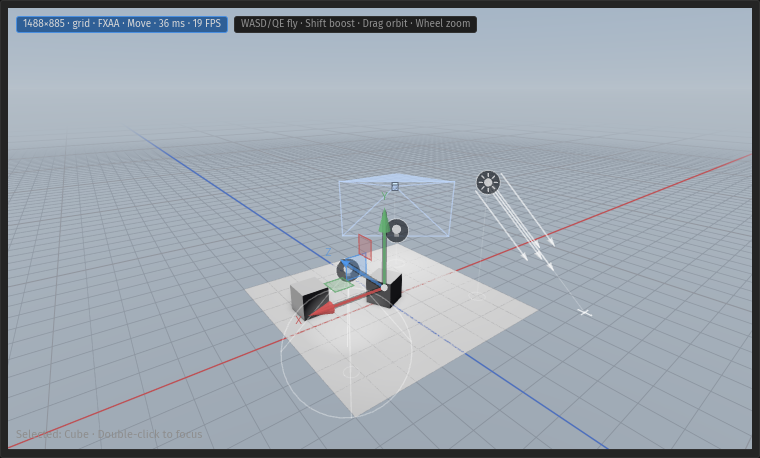
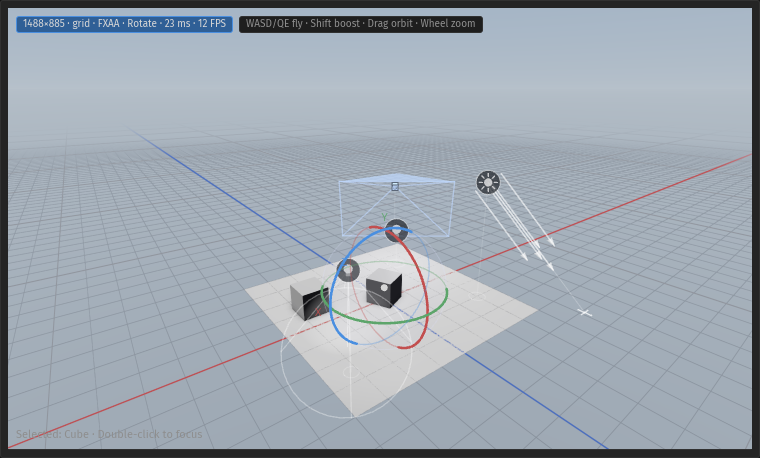
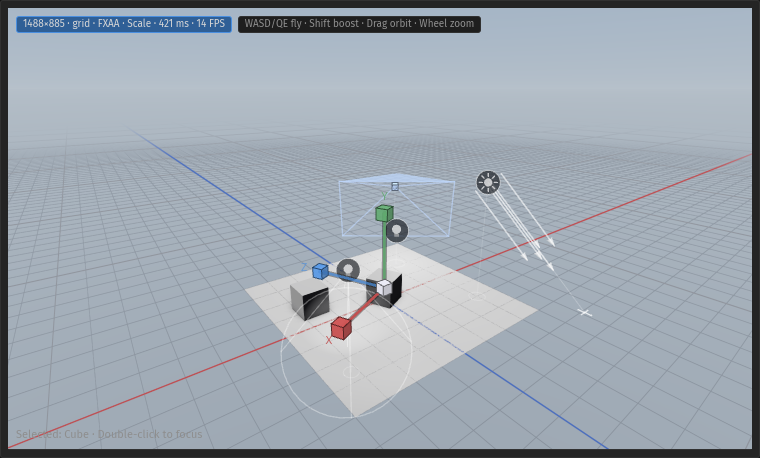
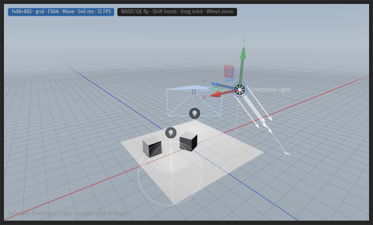
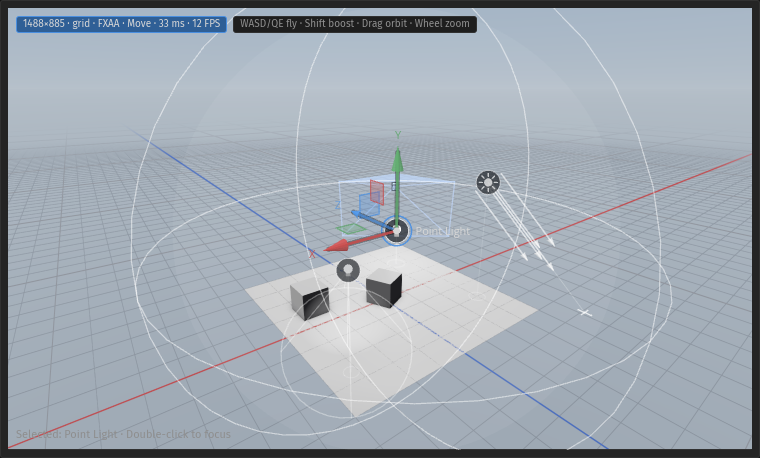
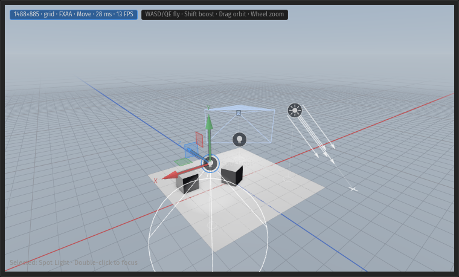
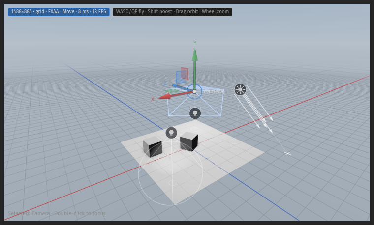
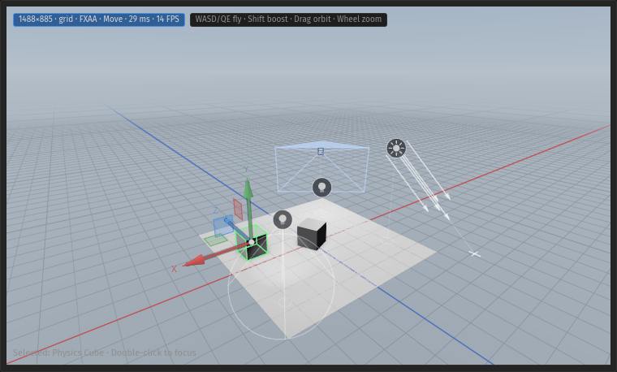

# Gizmos e marcadores de cena

<div class="doc-meta">
  <span class="doc-badge doc-badge--stable">Estável</span>
  <span class="doc-badge">Doppio</span>
  <span>Última atualização: <time datetime="2026-11-20">2026-11-20</time></span>
</div>

<p class="doc-lede">Handles de mover, rodar e escalar para a entidade selecionada, mais ícones e frusta para luzes, câmaras, colliders e empties.</p>

O viewport desenha duas sobreposições por cima do render do motor. Ambas são canvases 2D que reconstroem a
projeção da câmara orbital (`uikit/components/viewport_math.rs`), por isso não precisam de chamadas ao motor: trabalham
a partir de valores de transformação simples e de dados de componentes que o editor já lê.

| Overlay | Componente | Mostra |
|---|---|---|
| **Transform gizmo** | `components/gizmo.rs` | os handles Move, Rotate e Scale da entidade selecionada |
| **Scene markers** | `components/scene_markers.rs` | luzes, câmaras, colliders e empties, que não têm nenhuma malha para ver |

Os marcadores ficam **por baixo** do gizmo: um clique vai primeiro para um handle do gizmo, depois para o ícone de um marcador, e por fim
para a cena (órbita e picking de malhas).

<figure class="doc-figure">
  
  <figcaption>Gizmo de mover, marcadores de luz e um frustum de câmara</figcaption>
</figure>


## 1. Gizmo de transformação

Mude de ferramenta com `1` (Move), `2` (Rotate), `3` (Scale) enquanto o ponteiro está sobre o viewport, ou
a partir do menu View. `X` sobre o viewport (ou **View > Snapping**) liga o snapping: Move encaixa a 0.25 m, Rotate a
15 graus e Scale a 0.1, apenas no eixo ou plano que está a ser arrastado. O handle sob o cursor acende-se antes de o premir, e o que está a ser
arrastado fica amarelo. Cada arrasto é um passo de undo por handle.

### Move (`1`)

* **Setas de eixo** com cones 3D sombreados e depth cueing: um eixo que aponta para longe da câmara é
  mais ténue, de modo que as três setas se leem como três dimensões e não como uma cruz plana.
* **Handles de plano** (os pequenos quadrados entre duas setas): arraste dentro do plano XY, XZ ou YZ. O
  raio do clique é intersetado com o plano, por isso o objeto segue o cursor exatamente nesse plano.
* O movimento é em eixos do **mundo** e escreve a posição no mundo, por isso um filho de um pai movido
  continua a seguir o handle.

### Rotate (`2`)

<figure class="doc-figure">
  
  <figcaption>Gizmo de rodar</figcaption>
</figure>


* Três anéis numa esfera translúcida. A metade de cada anel que está **à frente** do objeto é
  brilhante e grossa, a metade de trás é ténue, o que torna óbvia a orientação de cada anel.
* Durante o arrasto, uma **cunha** mostra o ângulo percorrido e uma etiqueta por baixo da esfera mostra o delta e o
  ângulo resultante (`Y +37.5°  →  62.5°`).
* O objeto roda **no sentido em que o cursor vai**, de qualquer lado do anel: o sinal da rotação
  depende de o eixo apontar para si ou para longe de si (uma rotação positiva parece
  anti-horária quando o eixo aponta para o observador, e os ângulos de ecrã crescem no sentido horário). Antes era
  um sinal fixo, por isso o gizmo parecia invertido a partir de metade dos ângulos de visão.

<figure class="doc-figure">
  
  <figcaption>Gizmo de rodar na câmara</figcaption>
</figure>


### Scale (`3`)

<figure class="doc-figure">
  
  <figcaption>Gizmo de escalar</figcaption>
</figure>


* Os handles de eixo seguem os eixos **locais** do objeto, com pontas em cubo sombreado. Um objeto rodado
  escala portanto ao longo do que vê; antes, os handles estavam alinhados com o mundo enquanto a escala é
  local, por isso arrastar "X" numa malha rodada escalava um eixo diferente e invisível e parecia avariado.
* O **cubo central** escala os três eixos pelo mesmo fator (arraste para a direita ou para cima para crescer, para a esquerda ou
  para baixo para encolher). O fator é exponencial, por isso nunca inverte o sinal e nunca chega a zero.
* Os valores são limitados a `0.01 .. 1000`.

Para o lado da textura ao escalar (um quad com o dobro do tamanho já não estica o seu material), veja
[a secção de escala UV do guia de materiais](materials-guide.md#6-escalar-um-objeto-manter-a-densidade-da-textura).

### Edições

O gizmo nunca chama o motor: emite edições absolutas e a aplicação aplica-as.

| Edição | Aplicada como | Chave de histórico |
|---|---|---|
| `Move { axis, position }` | posição no mundo | `gizmo:move:<id>:<axis>` |
| `MovePlane { plane, position }` | posição no mundo | `gizmo:move:<id>:<plane>` |
| `Rotate { axis, rotation }` | graus de Euler | `gizmo:rotate:<id>:<axis>` |
| `Scale { axis, scale }` | escala local | `gizmo:scale:<id>:<axis>` |
| `ScaleUniform { scale }` | escala local | `gizmo:scale:<id>:uniform` |

Com o snapping ligado, `Edit::snapped(SnapSteps)` arredonda a edição antes de ser aplicada (só as coordenadas do próprio handle, nunca
zero negativo, a escala nunca abaixo de um passo), por isso as chaves de histórico e os passos de undo não mudam.

## 2. Marcadores de cena

Luzes, câmaras e colliders são invisíveis no render, por isso cada um recebe um marcador. Cada marcador tem uma
**haste ténue até ao chão** e um pequeno anel no chão, para que a sua altura seja legível, e um ícone em placa
em que pode **clicar para selecionar** a entidade (o raycast de malhas não os consegue acertar). Ao passar o rato mostra-se o nome.

| Entidade | Marcador |
|---|---|
| **Directional light** | um sol e um feixe de raios paralelos ao longo da direção real da luz, mais uma cruz onde o raio central encontra o chão. Um sol sem rotação usa a direção por omissão do motor (0.35, -0.82, 0.45), exatamente como o renderer. |
| **Point light** | uma lâmpada; quando selecionada, o raio como uma esfera em wireframe e uma concha suave |
| **Spot light** | uma lâmpada e o cone (ângulo e alcance); o alcance é limitado a 6 m nas luzes não selecionadas para que cones longos não inundem a vista |
| **Camera 3D** | um corpo de câmara com uma lente, o frustum (campo de visão, proporção, near e far) e o triângulo de "cima". O seu tamanho é **fixo no mundo** (2.6 m de profundidade): não cresce nem encolhe quando voa à sua volta, apenas as proporções acompanham a lente. |
| **Collider 3D** | (só quando selecionado) a caixa, esfera ou cápsula com o seu offset e a escala da entidade; os triggers são cor de laranja e etiquetados |
| **Empty entity** | um localizador de três eixos (X vermelho, Y verde, Z azul) |

<figure class="doc-figure">
  
  <figcaption>Luz direcional</figcaption>
</figure>


| Point light (selecionada) | Spot light (selecionada) |
|---|---|
|  |  |

| Câmara (selecionada) | Collider (selecionado) |
|---|---|
|  |  |

**Alternar:** View > Hide / Show Scene Markers (`editor.view.toggle_markers`). Os dados são mantidos, por isso
mostrá-los outra vez é instantâneo.

### Como são construídos

`scene_markers::collect` percorre as entidades uma vez e lê os seus componentes pelo nome
(`Directional Light`, `Spot Light`, `Point Light`, `Camera 3D`, `Collider 3D`, `Light` para a
cor). Corre após cada mensagem que possa alterar a cena (não em movimentos do ponteiro nem em ticks), e
demora cerca de 6 ms para as 287 entidades de `dense_outdoor.caf`. A orientação vem dos
ângulos de Euler locais da entidade, compostos `Rz * Ry * Rx` como no motor; uma luz direcional ou câmara sob um
pai rodado é por isso desenhada com a sua mira local.

## 3. Porque é que uma edição de escala ou rotação podia ser ignorada (corrigido)

Uma entidade pode ter o `Transform` legado **e** os componentes separados `Position 3D` / `Rotation 3D` /
`Scale 3D`; as cenas guardadas por editores mais antigos têm ambos (o cubo, o cilindro, a
esfera e a câmara do projeto Chair têm). O renderer e o sistema de hierarquia constroem a matriz do mundo a partir dos componentes
separados sempre que `Position 3D` existe, mas a C ABI escrevia a rotação e a escala só em
`Transform`, e lia-as primeiro de `Transform`. O Inspector e os gizmos mostravam por isso
o novo número (`Scale 47.159, 6.127, 9.381`) enquanto o objeto continuava a ser desenhado com o antigo `Scale 3D`
inalterado: escala e rotação "não faziam nada", enquanto a posição funcionava porque já era escrita em
ambos.

Agora (`EngineAPI.cpp`, `prefersSplitComponents`): as leituras devolvem os componentes que o renderer usa, e
as escritas chegam a **todos** os componentes presentes, acrescentando `Rotation 3D` / `Scale 3D` a uma entidade separada
que não os tenha. Coberto por `entities_with_both_transform_and_split_components_render_their_scale_and_rotation`
(desenha a entidade antes e depois) e por um teste da C ABI (`tests/test_capi.cpp`).

## 4. Para agentes e scripts

* Consulta `markers`: se estão visíveis e, por marcador, o id da entidade, o nome, o tipo e a posição
  no mundo.
* Ações `toggle_scene_markers`, `select_marker { id }` (o mesmo que clicar no ícone) e `toggle_gizmo_snap`; a
  consulta `gizmo` indica `snap`.
* As edições do gizmo são `Message`s normais, por isso um agente não pode fazer mais do que a UI.
* Driver headless: a fixture `scene3d` constrói uma pequena cena com motor (chão, cubos, sol, luz de ponto
  e de foco, câmara) e precisa de `libcaffeine-capi`; veja [headless-testing.md](headless-testing.md).

## 5. Limites

* As sobreposições usam um campo de visão de 60° e a câmara orbital, como o viewport; uma câmara do modo de jogo
  não é desenhada através delas.
* Move é apenas em espaço do mundo (ainda sem alternância local / mundo), Rotate soma aos ângulos de Euler (pode
  entrar em gimbal lock). O snapping usa passos fixos (0.25 m, 15 graus, 0.1); os passos ainda não são editáveis na UI.
* Os marcadores mostram a *forma* de uma luz, não a sua cor nem a intensidade numericamente.
* A orientação ignora a rotação do pai (veja acima).
* A seleção por clique só funciona no ícone, não nas formas em wireframe.

## 6. Regenerar as imagens

```bash
cmake --build build --target caffeine-capi -j
./scripts/capture-gizmo-docs.sh        # headless screenshots of the scene3d fixture
```

O flow é `caffeine-website/captures/flows/capture-gizmo-docs.json`; conduz a UI real (linhas da hierarquia e
o menu View) através do driver headless.
