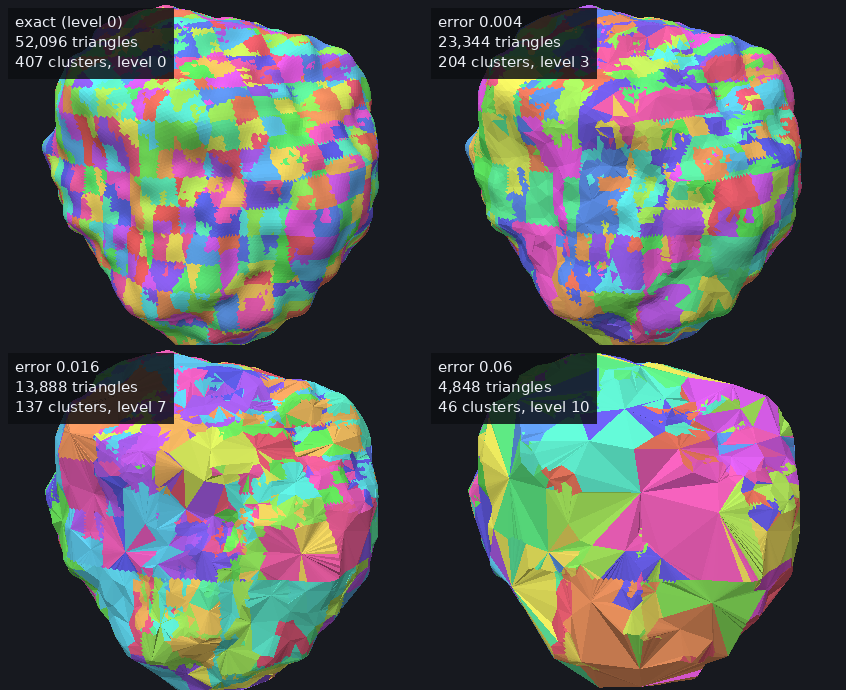

# Melhoria gráfica — Roadmap de Micromeshes e Photon

  Referência
  Engine
  Última atualização: <time datetime="2026-11-21">2026-11-21</time>
  Fonte: <a href="https://github.com/devscafecommunity/caffeine/blob/main/graphics-roadmap.md"><code>graphics-roadmap.md</code></a>

Como levar o renderer de "bom PBR forward com uma GI em espaço de ecrã" a geometria densa e
virtualizada (<strong>Micromeshes</strong>) e a iluminação global dinâmica em espaço do mundo
(<strong>Photon</strong>), usando apenas o que o SDL3 GPU consegue fazer em Vulkan, D3D12 e Metal.

Nomes: o sistema de geometria chama-se **Micromeshes** e o sistema de GI **Photon**. Ambos são designs nossos.
Não se aproveita código, texto de shaders nem disposição de dados de outros engines; a literatura pública (hierarquias de clusters,
radiance cascades, voxel clipmaps, visibility buffers) é a única referência. Esta página é a companheira gráfica de
[`photoreal-world-roadmap.md`](photoreal-world-roadmap.md), que a alimenta com terreno, natureza e
materiais.

> **Estado (2026-11-20):** **Os Micromeshes M-0, M-1 e M-2 estão concluídos** (a occlusion é de fase única), testados na GPU e desenhados através do renderer de cena
> real (veja [`micromeshes.md`](micromeshes.md)): draws indiretos e storage buffers no RHI, estatísticas de render e uma leitura no HUD, a hierarquia
> de clusters offline com normais, UVs, tangentes e cores de vértice, o corte na GPU com transformações por instância, o draw iluminado no G-buffer e
> o corte mais grosseiro próprio das cascatas do sol para uma arena de índices partilhada, e um teste de occlusion de fase única contra a profundidade do frame anterior. **Em aberto
> no M-2:** occlusion em duas fases e cortes para sombras de pontos de luz e de focos. **O P-A do Photon está quase feito** (P-A: primeiro o voxelizador conservador, porque a injeção de luz direta não podia ser verificada
> antes dele; depois os vetores de movimento, depois a luz direta real). O trabalho de GPU independente feito entretanto **não** faz parte destas fases:
> sombreamento e vento da vegetação, sombras com alpha test, modificadores de material em execução, água deslocada na GPU e o tempo (nuvens, névoa de altura e chuva; veja os guias de Natureza, de Água e de Environment).
> A base de mundo determinístico partilhada com o roadmap do mundo (`core/Hash.hpp`, o núcleo de scatter) está concluída.
>
> **O M-0 está completo.** **A seguir, por ordem:** P-A, cujo primeiro item é o voxelizador conservador. As próximas fases dos Micromeshes (M-3 streaming, a
> secção `.micromesh` no `.caf`, um caminho de clusters para terreno que supere a linha de base do benchmark) seguem-se quando o pipeline de conteúdo precisar delas.

<figure class="doc-figure">
  
  <figcaption>As fases M-1 e M-2 tal como funcionam hoje: uma rocha, quatro orçamentos de erro, cada cor um cluster (detalhes em
  <a href="micromeshes.md">micromeshes.md</a>).</figcaption>
</figure>

## 1. Veredito

**Photon: já em curso, terminá-lo.** O engine tem uma GI de radiance cascades em compute, com um campo distante de voxels de quatro níveis
e feedback de múltiplos bounces (`PhotonCascades.hpp`). A proposta de "construir uma GI" está em grande parte
feita; o trabalho que resta é qualidade, validação e os itens de precisão em espaço do mundo que o seu próprio header enumera.

**Micromeshes: construídos e a desenhar na cena, com um limite rígido que os moldou.** A hierarquia de clusters, o corte na GPU com
transformações por instância, o draw iluminado no G-buffer, as cascatas de sombras, a occlusion e o conjunto de benchmarks existem (`micromeshes.md`). O SDL3 GPU
tem draws indiretos, storage buffers e passos de compute, mas **não tem mesh shaders, nem atómicos de 64 bits portáveis, nem draw com contagem indireta**,
pelo que o corte é compactado numa arena de índices e desenhado com um draw de hardware por instância (grande ganho, baixo risco, como planeado). Um
rasterizador de software em compute para triângulos sub-pixel continua opcional (M-4), usando atómicos de 32 bits.

**Descartado tal como escrito:** uma GI baseada em SDF (o Photon já usa radiance cascades mais voxels; uma segunda GI
duplicaria a manutenção), e "triliões de triângulos". O objetivo realista são **dezenas de milhões de
triângulos de origem em vista com um custo limitado por frame**, que é o que os clusters entregam.

### Onde estamos (2026-11-20)

21 itens concluídos, 25 em aberto. **Os Micromeshes estão em grande parte concluídos; o P-A do Photon está quase feito** (cenas de regressão, voxelizador com regiões sujas, luz direta real, ganho do ressalto e painel do Photon feitos), pelo que o próximo
trabalho real nesta página são os vetores de movimento do P-A (veja a secção 8 para a ordem).

| Fase | Feito | Em aberto | Estado |
|---|---|---|---|
| P-A Photon: torná-lo correto | 4 | 1 | quase feito: cenas de regressão, voxelizador e luz direta real feitos; vetores de movimento em aberto |
| P-B Photon: qualidade | 0 | 5 | não iniciado |
| P-C Photon: escala e custo | 0 | 4 | não iniciado |
| M-0 RHI e ferramentas | 4 | 0 | concluído: draws indiretos, storage buffers, estatísticas, a leitura no HUD, o conjunto de benchmarks (faltam as entradas no Profiler) |
| M-1 Construção de clusters | 4 | 1 | concluído; a secção `.micromesh` no `.caf` e o packer vivem noutro repositório e estão em aberto |
| M-2 Cull e draw na GPU | 8 | 3 | concluído, exceto a occlusion em duas fases, os cortes para sombras de pontos de luz/focos e a adoção pelo terreno |
| M-3 Streaming e memória | 0 | 3 | não iniciado |
| M-4 Triângulos pequenos | 0 | 2 | opcional, não iniciado |
| M-5 Integração no editor | 1 | 2 | o interruptor no Inspector está feito; painel de estatísticas, vista de debug, exportação dos geradores e capturas do site em aberto |
| Itens partilhados (secção 6) | 0 | 4 | nenhum iniciado |

## 2. O que existe (verificado na árvore)

| Área | Estado | Onde |
|---|---|---|
| Campo próximo da GI | **Feito**: cascatas alinhadas ao mundo K-1..0, trace+merge fundidos, resolve SH-L1 | `PhotonCascades.cpp`, `photon_cascade.comp` |
| Campo distante da GI | **Feito (preenchimento de recurso)**: quatro níveis de clipmap 0.25/0.5/1/2 m, probes com SH, consultas de Chebyshev | `PhotonCascades.hpp`, `PhotonFarField.hpp` |
| Multi-bounce | **Feito**: a irradiância anterior realimentada com um limite e histórico reprojetado | notas P5 do header |
| AO pré-calculado | **Feito**: bake de AO por BVH/GPU | `PhotonAOBake.cpp`, `PhotonGpuBake.cpp` |
| Luz direta na GI | **Feito**: o sol, as luzes de ponto e os focos injetados nos voxels, com sombra por marcha no volume de materiais | `photon_inject.comp` |
| Voxelização | **Feito**: voxelizador conservador de triângulos com atualização por região suja, terreno, malhas com esqueleto e recortadas; teto de 1M de triângulos; o preenchimento pelo ecrã fica como recurso | `photon_voxelize_tri.comp`, `GpuSceneRenderer::updatePhotonGeometry` |
| Vetores de movimento | **Lacuna**: o histórico reprojeta apenas com a matriz anterior | P5 do header |
| LOD de geometria | **Feito para meshes opacas que optam por ele** (corte de clusters Micromesh); **parcial** para as restantes: 3 LODs de vértices agrupados por mesh, LODs de chunks de terreno, cull de frustum no CPU | `micromesh/`, `MicromeshGpu.cpp`, `MeshLOD.cpp`, `TerrainLodSystem.cpp` |
| Occlusion | **Parcial**: oclusores AABB grosseiros no CPU (máx. 16), pirâmide Min-Z para a GI e, para o Micromesh, uma pirâmide de profundidade máxima de fase única da profundidade do frame anterior | `CoarseOcclusion.hpp`, `MinZPyramid.cpp`, `MicromeshGpu.cpp` |
| Instanciação | **Feito, agrupada no CPU**: lotes de até 256 por chave | `InstanceBatch.hpp` |
| Sombras | **Feito**: 4 cascatas direcionais a 2048, mapas de pontos de luz e de focos | `GpuDirectionalShadowMap.hpp` |
| Pós-processamento | **Feito**: TAA, ACES, bloom, DOF, SSAO, motion blur, exposição automática | `PostProcessStack.cpp` |
| Compute e indirect no RHI | **Feito (M-0)**: draws e dispatch indiretos, storage buffers, buffers de compute de leitura e escrita, capacidades, `readBuffer` | `rhi/CommandBuffer.hpp`, `tests/test_rhi_indirect.cpp` |
| Página do site para o Photon | **Feito**: o guia do Photon e a página do editor | [`photon-guide.md`](photon-guide.md) |
| Céu, nuvens, névoa, chuva e relâmpagos | **Feito**: componentes refletidos `Volumetric Clouds` e `Weather`, névoa exponencial de altura, chuva no espaço do mundo com profundidade e salpicos no passo de composição, rajadas de vento partilhadas pela chuva, folhagem e nuvens, relâmpagos com raio, um clarão que ilumina a cena e o Photon, e eventos de trovão, sombras de nuvens em movimento no chão e no bounce do Photon, silver lining e sun shafts, humidade da cena inteira, sol e luz do céu do Photon que seguem o céu encoberto, o separador Environment | `WeatherSystem.hpp`, `sky.frag`, `post_composite.frag`, `photon_inject.comp`, [`environment-guide.md`](environment-guide.md) |
| Profiler e desempenho medido | **Feito**: uma árvore de scopes com tempo real de GPU por passo (`CF_GPU_SCOPE`), o separador Profiler, C ABI v18; primeira ronda: pesquisas da cache de texturas fora do ciclo de desenho (passo opaco 13.5 para 2.3 ms), probes do Photon limitadas à vista e distribuídas no tempo (25 para 9 ms), marcha para o sol das nuvens mais barata, pesquisas da cache de materiais fora do ciclo de desenho, casters de sombra descartados por cascata, gráficos de frame rate, CPU por core, GPU e memória (C ABI v19) | `Profiler.hpp`, `GpuProfile.hpp`, [`profiler-guide.md`](profiler-guide.md) |

## 3. Análise da proposta

* **"Fazer o cluster em Rust numa thread em segundo plano."** Lugar errado. O clustering tem de ser um módulo do **núcleo do engine** (`src/caffeine/micromesh`)
  por trás da C ABI, porque o renderer, o packer de `.caf` e o runtime (sem
  Rust) precisam todos dele. O editor em Rust apenas dispara um bake e mostra estatísticas. Os geradores produzem meshes normais;
  a construção de clusters é o último passo do pipeline de assets e é guardada em cache, nunca executada durante o jogo.
* **"128-256 triângulos por cluster, limites mais erro geométrico."** Correto. Usar 128 triângulos e no máximo
  128 vértices por cluster, uma esfera delimitadora, um cone de normais para culling de back-face e um **erro de
  simplificação** por grupo de clusters, com o erro do pai nunca menor do que o dos filhos (monótono), de modo a que o
  corte pela hierarquia seja sem fissuras e independente da vista.
* **"Compute shaders escolhem clusters visíveis e o detalhe."** Correto, e é o núcleo: culling em duas fases na GPU
  (primeiro os sobreviventes do frame anterior, depois os restantes contra uma pirâmide Min-Z nova) a escrever um buffer de argumentos
  indiretos. Já temos o código da pirâmide Min-Z da GI para reutilizar.
* **"Rasterização por software em compute."** Apenas para triângulos que cobrem menos de cerca de 4 pixéis, e só depois de o
  caminho de hardware funcionar. Precisa de um visibility buffer com atomic min sobre um valor empacotado. Sem atómicos de 64 bits,
  empacotar 24 bits de profundidade mais 8 bits de id local ao cluster em 32 bits e resolver o resto num segundo passo,
  ou dispensar o caminho por software. Tratá-lo como opcional.
* **"Elimina o pop-in de LOD."** Só com simplificação sem fissuras mais transições com dithering amigáveis para o TAA.
  Não elimina o custo de materiais nem de sombras: as cascatas de sombras têm de usar o mesmo corte de clusters (mais grosseiro).
* **"Triliões de polígonos."** Não. A memória (streaming de dados de clusters) e o custo por pixel limitam-no. Planear
  um orçamento fixo (clusters visíveis, pixéis rasterizados) e medir.
* **"Folhagem e alpha."** A renderização por clusters serve geometria opaca. Folhas e relva com alpha test ficam no
  caminho instanciado (com impostores) até um caminho de clusters com suporte a cutout se justificar.
* **GI "via A, SDF".** Não adotada: o Photon já a cobre com probes mais voxels. O que a ideia do SDF
  acrescenta e nos falta é **occlusion precisa a partir de geometria fora do ecrã e de faces traseiras**, que o voxelizador
  conservador de triângulos (abaixo) fornece dentro do design existente.
* **GI "via B, POM GI".** Apenas como termo de **micro-contacto**: os height maps já dão ao POM
  auto-sombra e um termo de cavidade (`material-pipeline.md`). Estendê-lo a um pequeno bounce indireto nas cavidades
  é barato e local, mas é uma camada de detalhe sobre o Photon, não uma GI.
* **"Filtragem anisotrópica, ACES, sRGB."** Já incluídos (ACES ajustado, sRGB, cadeias de mips). Só vale a pena verificar a
  definição explícita do sampler anisotrópico.

## 4. Roadmap — Photon (GI)

Photon primeiro: é o mais perto de estar concluído, beneficia todas as cenas já e os Micromeshes vão precisar dos seus voxels.

### Fase P-A — Torná-lo correto

> **Constatação (2026-11-20):** um protótipo injetou o sol no radiance do campo distante (um march de voxels em direção à luz em vez
> de shadow maps, em `photon_inject.comp`) e foi **revertido**: numa cena de parede e chão vermelhos o resultado foi idêntico com e
> sem ele, porque as cascatas em espaço de ecrã dominam todos os pixéis visíveis e o campo distante apenas preenche o que sai do
> ecrã, onde o preenchimento de voxels por profundidade do ecrã não tem geometria. A luz direta não pode ser testada, e por isso não compensa o seu custo,
> até o voxelizador conservador (terceiro item) fornecer geometria que o ecrã não vê. Ordenar em conformidade. O componente
> de GI Photon está agora refletido (Inspector, cenas, scripts: `Photon GI`, com `Debug view`), o que a próxima tentativa exige; note-se
> que o `Debug view` não alterou a imagem no caminho `ComputeC0` nesse teste: corrigido (2026-11-21), GI only e Fallback only funcionam agora aí.

- [x] Injetar **luz direta real** (sol, pontos de luz, focos) na radiância dos voxels (`photon_inject.comp`: `directLight`, com sombra
      marchada pelo volume de materiais, na convenção `radiância x N.L` do shader forward), com o ambiente de céu escalado pela
      visibilidade do céu de cada face. Teste: uma parede vermelha, uma branca e uma verde atrás da câmara (fora do ecrã) tingem o cubo
      branco que as encara de vermelho, neutro e verde (cerca de 40 em 255, nada sem a parede). Três erros encontrados pelo caminho, todos
      no campo distante: as sondas decodificavam as direções duas vezes (a consulta lia direções diferentes das que as sondas traçaram), as
      cascatas faziam o mesmo, e o **volume de materiais era cycled** (descartado) por cada passo de compute (`CommandBuffer::beginComputePass(..., cycle)`).
      Este último deixava o preenchimento pelo ecrã apagar os voxels de triângulos a cada frame: uma sala fechada lia 90 em 255 de luz de céu, agora cerca de 15 em média (1 a 3 nos frames mais calmos).
- [ ] Passo de **vetores de movimento** (matrizes por objeto, frame anterior), usado pelo histórico do Photon, pelo TAA e pelo motion
      blur. Remover a lacuna de "sem vetores de movimento"; invalidar o histórico na desoclusão por teste de profundidade/normal.
- [x] **Voxelizador conservador de triângulos** (`photon_voxelize_tri.comp`, `PhotonCascades::updateGeometryVoxels`): uma invocação por
      triângulo, teste de eixos separadores triângulo/caixa nos voxels da sua caixa, nos quatro níveis do clipmap; os triângulos opacos da
      cena são reunidos com o seu albedo (`GpuSceneRenderer::updatePhotonGeometry`, um hash por objeto a cada frame, uma comparação com o conjunto anterior) e um
      nível é limpo e refeito quando a sua origem do clipmap se move ou a geometria muda. **Regiões sujas:** um
      objeto em movimento limpa e revoxeliza só as caixas onde esteve e onde está (no máximo 8, senão os níveis refazem-se por inteiro); o terreno, as malhas com esqueleto (na sua pose) e, a pedido, as recortadas entram no volume; acima de 1 milhão de triângulos o voxelizador pára e o preenchimento pelo ecrã trabalha sozinho, e o painel di-lo. Uma
      superfície com textura conta com a cor média da sua imagem (`GpuTextureCache::averageColor`). Testes de GPU: `test_photon_voxelizer.cpp`.
      O preenchimento pelo ecrã fica, como recurso e para o terreno.
- [x] Cenas de regressão headless: Cornell box, luz através de uma porta, fuga por parede fina (módulo `photon_gi` em `windows/main/tests.rs`, limiares
      de imagem sobre a diferença entre GI desligado e ligado). Medido em 2026-11-21: a cor passa de uma superfície à outra (um chão branco ganha cerca de +8 de vermelho junto
      à parede vermelha, +6 de verde junto à verde). Uma sala sem abertura tinha fugas: com a câmara dentro dela o interior ficava iluminado como o céu
      aberto (ganhos de 60 a 90 em 255, fosse qual fosse a intensidade do céu); agora está selada (cerca de 15 em média nos frames; cada frame oscilava entre 3 e 25 até as probes terem desvios de amostragem próprios, veja a média temporal no guia do Photon), com o ressalto do sol por uma fresta em 7 a 16 no chão
      do fundo contra cerca de 170 na mancha iluminada, e uma divisória deixa esse ressalto fora do lado de lá (4,3 -> 1,5). O campo distante é consultado a 0,4 m
      da superfície (os voxels da própria superfície têm até 0,5 m de espessura) e a partir da origem do raio, não do seu ponto de saída do ecrã.
      Todos são testes normais.
- [x] **Ganho do ressalto e painel do Photon** (C ABI v17: `caffeine_session_photon_stats`, `caffeine_session_photon_rebuild`). O `Bounce gain` escala o que os voxels guardam: no chão do fundo da sala com fresta
      (só GI, em 255) lê 13 com ganho 0, 18 com 1 e 24 com 4; as cascatas do ecrã escalam com `Intensity`. O separador **Photon** edita o componente, os interruptores da
      geometria dos voxels e as predefinições, com estatísticas dos voxels ao vivo; veja [`photon-guide.md`](photon-guide.md).

### Fase P-B — Qualidade e estabilidade

- [ ] Denoise espaço-temporal sensível às normais do resolve SH; limitar fireflies; métricas de ghosting nos testes.
- [ ] Superfícies emissivas como luzes (os materiais já têm emissive maps).
- [ ] O céu como fonte própria: alimentar o ambiente pré-filtrado (split-sum) ao campo distante do Photon e ao
      IBL especular, uma só fonte de verdade.
- [ ] Reflexos glossy a partir do campo de probes quando o tracing em espaço de ecrã falha (substitui os
      cubemaps de probe por objeto como recurso, para que os reflexos fora do ecrã fiquem estáveis).
- [ ] Recursos de scratch por vista (o header refere uma instância de scratch partilhada); necessário para as
      pré-visualizações do editor e para a vista dividida.

### Fase P-C — Escala e custo

- [ ] Níveis de qualidade com orçamentos de GPU medidos (Eco/Low/Balanced/High) e um regulador de tempo de frame.
- [ ] Far field em clipmap a seguir a câmara com atualizações toroidais; mundos maiores sem picos de repreenchimento.
- [ ] Alimentar o volume de voxels com chunks de terreno e vegetação (do roadmap do mundo) à medida que entram em streaming.
- [ ] Atualizar a página do Photon no site para o estado real e acrescentar os novos parâmetros à UI do editor com `UiId`s.

## 5. Roadmap — Micromeshes (geometria virtual)

Cada fase é entregue sozinha e mantém o caminho antigo como recurso, por trás de uma flag.

### Fase M-0 — Pré-requisitos de RHI e ferramentas

- [x] `rhi/CommandBuffer` envolve draws indiretos (`drawIndirect`, `drawIndexedIndirect`, multi-draw com contagem), dispatch indireto,
      **storage buffers** gráficos para os estágios de vértice e fragmento e passos de compute com **buffers** de storage de
      leitura e escrita; `BufferUsage::{Indirect, IndirectWrite, GraphicsStorage, GraphicsStorageWrite}`;
      `RenderDevice::capabilities()` (draw e dispatch indiretos, storage, sem mesh shaders, sem atómicos de 64 bits) e
      `readBuffer`. Testado na GPU em `tests/test_rhi_indirect.cpp`: os argumentos indiretos decidem o que é desenhado, e um
      passo de compute escreve os argumentos do draw (uma miniatura do culling na GPU). Os testes são ignorados sem GPU ou `glslc`.
- [x] Temporizadores de passos no CPU por estágio (gather, shadows, opaque, translucent, total) e contadores (meshes, eliminadas por frustum,
      draw calls, draw calls instanciados, triângulos) em `GpuSceneRenderer::lastFrameStats()`; C ABI **v11**
      `caffeine_session_render_stats`, o `Engine::render_stats()` em Rust e a consulta de agente `render_stats`.
      O SDL3 GPU não tem timestamps de GPU portáveis, pelo que os tempos são de codificação, não de GPU.
- [x] O HUD do viewport mostra os triângulos, draws e draws Micromesh do último frame (contadores baratos, sem leitura de volta). Ainda em aberto: entradas no Profiler e um painel com os contadores de clusters.
- [x] **O conjunto de benchmarks reproduzível** (`./scripts/benchmark-micromesh.sh`): um campo denso de rochas, uma floresta de 300 árvores densas e um terreno com dois
      tamanhos de grelha, caminhos de câmara fixos, conteúdo gerado em código (sem assets, idêntico byte a byte em cada execução, testado), todos os caminhos do renderer que se aplicam.
      As contagens de triângulos e de draws reproduzem-se exatamente; o tempo wall é um frame inteiro incluindo a leitura de volta, o tempo de encode o do CPU. Resultados em
      [`micromeshes.md`](micromeshes.md): o Micromesh desenha 6,1x (rochas) e 3,3x (floresta) menos triângulos e um frame mediano de 0,56 e
      0,75 do instanciado, mas a floresta custa mais CPU (um draw por árvore); a linha de base do terreno é de 0,2 a 0,8 M de triângulos em 100 a
      400 draws. O antigo `assets/benchmarks` (uma cena não usada de 43 KB) não faz parte dele.

### Fase M-1 — Construção de clusters (offline, núcleo)

- [x] Módulo `micromesh` (`src/caffeine/micromesh/Micromesh.hpp`): clusters de no máximo 128 triângulos e 128 vértices ao longo de uma curva de
      Morton (nossa, mais simples do que uma divisão gulosa por adjacência), cada um com uma esfera delimitadora justa, um cone de normais de back-face e um
      remapeamento local de vértices (um byte por índice).
- [x] **Hierarquia**: os clusters são agrupados (4 de cada vez, alargados quando um grupo não consegue encolher), cada grupo é fundido, simplificado por
      **colapso de arestas com quádricas com a sua fronteira bloqueada** (e arestas não-manifold), e dividido de novo, até uma raiz. O
      erro de um grupo é o maior entre o seu erro de colapso e o dos filhos, mais um epsilon, pelo que é **estritamente** monótono; a sua
      esfera contém as dos filhos. Um corte é "erro próprio <= limiar < erro do pai" (opcionalmente dividido pela distância à
      esfera para um erro projetado).
- [x] Bytes POD versionados: `serialize` / `deserialize` (com verificação de limites), reconstruções idênticas byte a byte. C ABI **v12**
      `caffeine_micromesh_build` (posições, índices, estatísticas, bytes) e o `Engine::micromesh_build` em Rust, para que os geradores e um
      packer possam fazer bake. **Não feito:** a secção `.micromesh` dentro do `.caf` e uma CLI do `caf-pack` (um repositório submodule separado).
- [x] Testes (`tests/test_micromesh.cpp`, 9 casos): limites por cluster, cada nível mais grosseiro, uma raiz em meshes fechadas, erros monótonos
      e contenção de esferas, **cada corte de uma esfera e de um toro é fechado e manifold (cada aresta em exatamente dois
      triângulos) em 12 limiares**, cortes dependentes da vista sem fissuras e mais grosseiros ao longe, uma grelha aberta mantém a sua fronteira e
      termina, os cones de back-face nunca escondem um cluster voltado para a câmara, entrada degenerada, reconstruções idênticas byte a byte e a ABI.
- [ ] Limites conhecidos: os grupos são vizinhos numa curva de Morton, não um grafo de adjacência, pelo que um nível remove cerca de metade dos
      triângulos em meshes compactas e menos em meshes finas ou ramificadas; as meshes abertas param onde a sua fronteira bloqueada fixa
      tudo (várias raízes); um colapso escolhe o melhor entre os dois extremos e o ponto médio (sem posição ótima);
      medido em meshes até 82 k triângulos (cerca de um segundo para construir 80 000); as costuras de UV bloqueadas limitam até onde uma mesh com muitas ilhas
      reduz. (Normais, UVs, tangentes e cores de vértice são transportadas agora.)

### Fase M-2 — Culling na GPU e draw por hardware

- [x] Carregamento para buffers da GPU (`render/MicromeshGpu`): um storage buffer de registos de clusters (limites, esferas de erro, cone, intervalo de índices),
      um buffer de posições, um buffer de índices com os índices globais de cada cluster e um buffer de argumentos indiretos.
- [x] Transformações por instância: `MicromeshGpu::setInstances`, índice de cull `instance * clusterCount + cluster`, corte, frustum
  e cone por instância, um dispatch e um draw indireto para o campo inteiro (196 rochas, 16 M triângulos de origem: 0,15 a 0,5 M desenhados por frame, 10x
  menos do que a mesh exata em média). Imagens e GIF em [`micromeshes.md`](micromeshes.md). Continua a ser uma hierarquia por objeto e uma escala uniforme por instância.
- [x] Passo de compute 1 (`shaders/micromesh_cull.comp`): por cluster, o teste de corte (erro próprio dentro do limiar, o do pai não,
      opcionalmente projetado pela distância), teste de frustum e cone de back-face; escreve um conjunto de argumentos de draw indexado por cluster
      com `indexCount` 0 quando eliminado, pelo que o CPU emite o mesmo `drawIndexedIndirect(args, 0, clusterCount)` em cada frame
      sem leitura de volta e sem atómicos.
- [x] **Occlusion, fase única**: a cada frame o depth buffer anterior torna-se uma pirâmide de profundidade máxima (`MicromeshHzb`, um storage
      buffer) e o cull compactante da câmara descarta os clusters cuja esfera está atrás dela (Mesh Renderer -> Micromesh occlusion, desativada
      por omissão). Atrás de uma parede: 1,5x a 2,5x menos triângulos (2,1x em média), diferença de imagem de 0,11 / 255 em média; um cluster que se torna
      visível aparece um frame atrasado nos contornos das silhuetas. Imagens em [`micromeshes.md`](micromeshes.md).
- [ ] **Occlusion em duas fases** (desenhar os clusters visíveis do frame anterior, reconstruir a pirâmide a partir dessa profundidade, testar os restantes): elimina o
      atraso de um frame; exige dividir o passo opaco em dois.
- [x] O draw indireto funciona na GPU: `MicromeshGpu::draw` liga os buffers e emite um multi-draw sobre todos os clusters.
      **Testado na GPU** (`tests/test_micromesh_gpu.cpp`): o corte que o passo de compute seleciona **é igual ao `selectCut` do CPU**
      a 4 distâncias x 3 limiares, o filtro de cone é igual a `isBackFacing`, o teste de frustum é igual ao mesmo teste esfera-plano no
      CPU, uma câmara mais afastada escolhe um corte mais grosseiro, e um corte renderizado cobre o disco da esfera (fino e grosseiro por igual).
- [x] Pré-requisito para isso: **normais de sombreamento** transportadas por todos os colapsos e desenhadas com `MicromeshGpu::drawLit`; um corte grosseiro sombreia
  a 1,6 a 10 / 255 da mesh exata (facetas: 2,9 a 13). Os **UVs** também são transportados (as costuras ficam bloqueadas): um bump map e um checker de UV
  ficam a 1,2 a 11,7 / 255 do render exato ao longo dos cortes. Imagens em [`micromeshes.md`](micromeshes.md). Tangentes,
  cores de vértice e um segundo conjunto de UVs ainda faltam.
- [x] **Desenhar os clusters visíveis para os alvos existentes do G-buffer através do pipeline da cena** (Photon, SSAO, TAA e pós-processamento continuam
      a funcionar sem alterações): Mesh Renderer -> **Micromesh** (+ erro em px) desenha a mesh como um corte através de `scene_lit.frag`, um draw
      indexado por instância (o passo de cull compacta o corte: o SDL3 GPU não tem draw com contagem indireta). 81 rochas iluminadas e com sombras: 5,3x a 7,1x
      menos triângulos por frame para a câmara, 10,8x vistas do ar, diferença de imagem de 1,5 / 255. Detalhes, a tabela de benchmark e os
      limites em [`micromeshes.md`](micromeshes.md). Também corrigido pelo caminho: uma mesh densa sem materiais relia o seu ficheiro em
      cada draw de cada frame (4 a 8 ms de CPU por draw).
- [x] **As cascatas de sombras desenham o seu próprio corte mais grosseiro** (a mesma hierarquia, logo sem fissuras): as cascatas do sol são cortadas a quatro texels de sombra por
      `shadow_micromesh.vert`, para uma **arena de índices partilhada** que cresce sozinha (32 MB para 81 rochas em vez de um buffer de índices de tamanho completo
      por rocha). As sombras de pontos de luz e de focos ainda desenham a mesh completa. Também: escala não uniforme, uma hierarquia por sub-mesh, cores de vértice
      transportadas. O viewport do editor renderiza sem shadow maps, a menos que `ViewportSettings::shadows` esteja ativo (C ABI v14).
- [ ] Os shadow maps de pontos de luz e de focos também desenham o seu próprio corte mais grosseiro (só as cascatas do sol o fazem).
- [ ] Tiles de terreno e rochas/troncos da Natureza são os primeiros adotantes; a folhagem fica instanciada. (Rochas e troncos podem optar por ele através do Mesh
      Renderer, e o gerador de Natureza ativa-o para as partes sólidas que coloca (3 000 triângulos ou mais); o terreno não tem caminho de clusters:
      a sua linha de base está no conjunto de benchmarks.)

### Fase M-3 — Streaming e memória

- [ ] Carregar e descarregar dados de clusters por páginas, por distância e erro, com um orçamento de memória fixo e uma fila de
      carregamento assíncrona; nunca bloquear um frame.
- [ ] Compressão de geometria (posições quantizadas e normais octaédricas) e uma LRU de páginas.
- [ ] Ligar aos chunks do mundo: as meshes pré-calculadas de um chunk são agrupadas em clusters quando entram em cache pela primeira vez e reutilizadas depois.

### Fase M-4 — Caminho de triângulos pequenos (opcional, medir primeiro)

- [ ] Rasterizador em compute para clusters cujos triângulos têm menos de ~4 pixéis, a escrever um visibility buffer
      com atómicos de 32 bits e um passo de resolve que obtém os atributos. Condicionar a um ganho medido face ao
      caminho de hardware em cenas densas de rochas/casca de árvore.
- [ ] Resolve de materiais em tiles de ecrã para evitar um passo por material.

### Fase M-5 — Integração no editor

- [x] Interruptor "Micromesh" no Inspector num Mesh Renderer (a reflexão expõe `Micromesh` e `Micromesh error (px)`); ainda em aberto: um painel de estatísticas e uma vista de debug (cores de cluster,
      corte de erro, clusters eliminados), entradas no catálogo de `UiId` para o interruptor e ações MCP.
- [ ] Os geradores de Natureza, Terreno e Água exportam através da construção de clusters. **A Natureza está feita**: a sua opção *Micromesh* coloca as partes sólidas de
      3 000 triângulos ou mais com o Micromesh ativo, e *Merge parts* dá a uma árvore uma só mesh com um slot de material por parte. Terreno e Água estão em aberto.
- [ ] Documentação e capturas headless (vista de debug de clusters) no site.

## 6. Itens partilhados

- [ ] **Uma só fonte de visibilidade**: o cull de clusters e a voxelização do Photon leem os mesmos dados de instâncias.
- [ ] **Frame graph leve**: lista explícita de passos com tempos de vida dos recursos para que culling, G-buffer, Photon,
      sombras e pós-processamento fiquem ordenados e a memória seja reutilizada; hoje a ordem é escrita à mão.
- [ ] **Regulador de qualidade**: uma definição mapeia para o nível do Photon, a resolução das sombras, o limiar de erro dos clusters
      e os scalers em execução (resolução, upsampling do TAA).
- [ ] **Cenas de referência** com seeds fixas renderizadas headless e comparadas como baselines visuais.

## 7. Riscos

| Risco | Mitigação |
|---|---|
| Sem mesh shaders nem atómicos de 64 bits no SDL3 GPU | primeiro draws indiretos por hardware; rasterização por software opcional e de 32 bits |
| Fissuras entre grupos de LOD | fronteiras de grupo bloqueadas, erro monótono, testes que cortam a limiares aleatórios |
| Fantasmas no histórico do Photon com objetos em movimento | vetores de movimento, testes de desoclusão, cenas de regressão |
| Custo do voxelizador em geometria dinâmica | estática pré-calculada uma vez, apenas atualizações por região suja na dinâmica |
| Dois caminhos de geometria divergem | atrás de flag, mesma saída no G-buffer, testes partilhados |
| Âmbito | O P-A do Photon e o M-0/M-1 dos Micromeshes são independentes e podem avançar em paralelo |

## 8. Ordem sugerida

Concluídos: **M-0**, **M-1** e **M-2** (Micromeshes, até à occlusion de fase única). A partir daqui:

1. **P-A** (Photon correto): primeiro o voxelizador conservador, depois os vetores de movimento, depois a luz direta real e as cenas de regressão.
   Nada do Photon está feito, e todos os itens de Micromesh e de mundo que querem GI esperam por ele.
2. **M-5**, a parte barata: os geradores de Terreno e de Água a ativarem o Micromesh (a Natureza já ativa), painel de estatísticas e vista de debug, `UiId`s, capturas do
   site. Também a secção `.micromesh` no `.caf` (uma cache para a construção do primeiro frame) e um caminho de clusters para terreno que supere o benchmark.
3. **P-B**, depois **M-3** (streaming e compressão) ligado aos chunks do mundo do roadmap do mundo.
4. **P-C**, occlusion em duas fases e cortes para sombras de pontos de luz/focos, e **M-4** só se o profiling o pedir.

## 9. Relacionado

- [`micromeshes.md`](micromeshes.md): o que está construído dos Micromeshes, com renders do caminho da GPU.
- [`photoreal-world-roadmap.md`](photoreal-world-roadmap.md): o conteúdo gerado para este renderer.
- [`material-pipeline.md`](material-pipeline.md): POM, displacement e AO derivado de height maps.
- [`nature-generator-guide.md`](nature-generator-guide.md): lacunas de LOD e instanciação da vegetação.
- [`terrain-generator-guide.md`](terrain-generator-guide.md): terrenos em tiles e de grandes dimensões.
