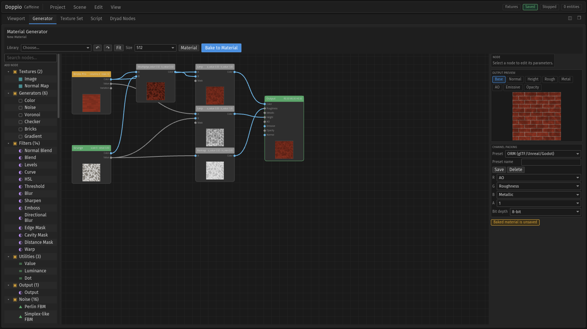

# Pipeline de materiais, texturas e geradores — backlog

  Referência
  Doppio
  Última atualização: <time datetime="2026-11-20">2026-11-20</time>
  Fonte: <a href="https://github.com/devscafecommunity/caffeine/blob/main/material-pipeline.md"><code>material-pipeline.md</code></a>

A lista de verificação viva para materiais, texturas, bake de mapas,
geradores de nós e texture sets, mantida atualizada para que a próxima alteração parta
da base real e não do histórico.

<figure class="doc-figure">
  
  <figcaption>O grafo atómico com bake para cor base, height, roughness, metallic, AO e mapas empacotados, atribuído depois ao material selecionado.</figcaption>
</figure>

Lista de verificação viva da stack de materiais do Doppio. Atualize as caixas à medida
que o trabalho for integrado; mantenha a secção da **base atual** correta para que um
futuro agente possa continuar sem reler todo o histórico.

Regra clean-room: o MaterialCraft, o TextureCraft e o MistyEngine em `reference/` são
lidos apenas pelo comportamento público, formatos e convenções de interface. Não copie
código-fonte, texto de shaders, definições de nós nem assets incluídos.

## Base atual (concluída)

- [x] Assets `.mat` PBR: `MaterialSurface` completo, presets, carregar/guardar, atribuir
      ao Mesh Filter, slot do Inspector, atribuição à cena com undo.
- [x] Pré-visualização em esfera pelo motor (`MaterialPreviewRenderer`) através da C ABI,
      com rotação por arrasto e atualização limitada.
- [x] Utilitários de mapas de textura: normal a partir de height (OpenGL/DirectX), AO a
      partir de height, roughness/metallic a partir de albedo, ORM, máscara Unity HDRP,
      metallic-smoothness do Unity. As normais DirectX são invertidas pelo shader.
- [x] Material Studio: cartões de superfície/mapas/UV/avançado, seletor de texturas, baker
      de mapas, atribuição de mapas gerados.
- [x] Assets: filtro de textura/material/mesh/cena, pesquisa, miniaturas de imagem e
      amostras de albedo dos materiais.
- [x] Componente reutilizável `node_canvas`: nós no espaço do grafo, portas tipadas, fios
      cúbicos, arrastar, pan, zoom, seleção e eventos de ligação.
- [x] Grafo de material atómico: Color, Image, Noise (value/Perlin), Voronoi,
      Checker, Bricks, Gradient, Blend, Levels, Curve, HSL, Threshold, Blur,
      Warp, Value, Luminance, Dot e Output (Color/Roughness/Metallic/Height/
      AO). Portas tipadas de cor/escalar, máscaras de blend e 13 modos de blend.
- [x] Bake do grafo → cor base, height, roughness, metallic, AO, normal e mapas
      empacotados; guardar e atribuir automaticamente à entidade selecionada.
- [x] Bake em worker em segundo plano com progresso/cancelamento; a interface mantém o último
      resultado e nunca bloqueia o viewport. O Generator também executa um bake ao vivo de baixa
      resolução do nó Output, com debounce, após cada edição do grafo.
- [x] Mapas gerados a 8/16 bits e um editor de channel packing (ORM, Unity HDRP,
      Unity metallic-smoothness, fontes R/G/B/A personalizadas).
- [x] Ficheiro auxiliar `<name>.mgraph` por material (texto `CAFMGRAPH2` versionado, lê
      `CAFMGRAPH1`) com nós, ligações, parâmetros, posições e resolução.
- [x] Consultas/ações MCP e `material-smoke` / `material-generator-smoke`.

## Fase 1 — Completar a base do gerador

- [x] Histórico do grafo, seleção/eliminação/religação de fios, reroute dots, pesquisa
      na palette, snap de 16 unidades, copiar/colar, fit-to-graph, ações MCP de undo/redo,
      testes Rust e o flow `material-generator-smoke`.

### Undo/redo para edições do grafo — concluído

- [x] Adicionar uma pilha de histórico do grafo por material (snapshots ou comandos
      reversíveis). `MaterialGraph` é `Clone`, pelo que os snapshots são o primeiro
      passo mais simples; mantê-los pequenos e limitar a memória.
- [x] Agrupar edições contínuas com uma chave estável: `generator:move:<node>`,
      `generator:param:<node>:<param>`, para que um arrastar seja um único passo.
- [x] Cobrir Add/Delete node, Connect/disconnect, Move, todos os parâmetros, atribuição
      de outputs, resolução e carregar/limpar o grafo.
- [x] `Ctrl+Z` / `Ctrl+Shift+Z` e `Ctrl+Y` enquanto o painel Generator tem foco;
      os botões Undo/Redo do cabeçalho continuam disponíveis.
- [x] `generator_undo` / `generator_redo` do MCP, mais `can_undo`, `undo_name`,
      `can_redo`, `redo_name` na consulta `generator`.
- [x] Testes: adicionar→undo, ligar→undo/redo, arrastar agrupado, eliminar ligação, dot,
      copiar/colar e encaminhamento dos atalhos de cena.

### Edição de fios — primeira passagem concluída

- [x] Hit-test dos fios cúbicos (amostrar a bézier; tolerância de ~5 px) e manter um estado
      de seleção de fios separado da seleção de nós.
- [x] Delete/Backspace remove um fio selecionado num único passo de histórico; clicar com o botão direito
      num fio e o botão Delete link do painel de propriedades fazem o mesmo. Arrastar uma
      entrada ligada desliga a sua origem para religação.
- [x] Adicionar um nó **reroute dot**: uma entrada/uma saída, passagem direta; inserir com
      duplo clique num fio ou com `insert_generator_dot`.
- [ ] Menu de contexto do fio e troca da origem de exatamente dois fios.
- [ ] Realce ao passar o rato + feedback do ponteiro; o canvas só é redesenhado quando há alterações.
- [x] Testes para a distância de hit do fio, substituição de entrada única, rejeição de
      ciclos, round-trip do reroute e undo.

### Acabamento do canvas — primeira passagem concluída

- [x] Snap da colocação de nós a uma grelha de 16 unidades; alternável na caixa de ferramentas do canvas.
- [x] O campo de pesquisa filtra a palette de nós por nome ou categoria; a
      palette está agrupada por categoria na tree view partilhada, com grupos
      recolhíveis. Uma pesquisa modal com Space/Tab continua a ser um refinamento futuro.
- [x] Copiar/colar o nó selecionado (botões da caixa de ferramentas e MCP); a duplicação
      de ligações internas/duplicar seleção continua pendente.
- [ ] Frames/comentários opcionais; mantê-los fora do primeiro marco de undo.
- [x] Fit-to-graph (botão "Fit" / `fit_generator`).
- [x] Os cartões de nó mostram uma miniatura ao vivo de 72 px (96 px avaliados) da sua própria saída avaliada,
      calculada no worker de pré-visualização com debounce; os erros limitam-se a omitir
      essa miniatura e nunca bloqueiam a edição.

## Fase 2 — Biblioteca de nós ao estilo MaterialCraft

### Nós de imagem e textura

- [x] Nó de textura de projeto: escolher um asset de imagem, amostrar UV, expor tiling
      e offset; reutilizar o seletor de texturas e o resolvedor de caminhos do motor.
- [x] Nó Image sampler com nearest/linear e clamp/repeat.
- [x] Opções de projeção UV: UV, planar, tri-planar (domínio esférico
      sintético até haver UVs no espaço da mesh), cilíndrica e esférica.
- [x] Nó de entrada de normal map e normal blend (whiteout/linear) para
      combinações de height/normal.
- [x] A descodificação de imagens corre no worker de bake; os erros de descodificação abortam com uma
      mensagem. Continua a faltar um aviso para resolução 4K.

### Mais geradores/filtros atómicos

- [x] Voronoi/células com saídas de distância e de cor da célula.
- [x] Ruído Perlin e value com octaves, persistence e lacunarity;
      variantes simplex/Worley e escala/rotação anisotrópicas continuam por fazer.
- [x] Curve, levels (brightness/contrast/gamma/invert), HSL, blur e warp.
- [x] Sharpen, emboss e directional blur.
- [x] Threshold/soft mask, distance, edge-detect e máscaras de cavity/curvature;
      máscaras do tipo dirt continuam por fazer.
- [x] Adições ao blend: variantes de overlay, soft light/hard light, subtract,
      difference, darken/lighten, color dodge/burn; alpha por canal continua por fazer.
- [x] Constantes escalares e um nó value, portas tipadas de cor/escalar; os nós
      aritméticos continuam por fazer.
- [ ] Nós de função/grupo apenas depois de o grafo atómico estar estável; não adicionar
      uma VM de scripting nesta fase.

### Bake e output

- [x] Bake numa thread worker com progresso/cancelamento; a interface mantém o último
      resultado. Nunca congelar o viewport durante o cozinhado.
- [x] Mapas gerados a 16 bits, mais PNG de 8 bits por omissão; o cook em float continua por fazer.
- [x] Editor de channel packing: destino R/G/B/A ← AO, roughness, metallic,
      height, smoothness, luminância da base ou constantes; presets integrados ORM, Unity
      HDRP e Unity metallic-smoothness, mais canais personalizados, presets de
      utilizador guardados em `~/.config/caffeine/packing-presets.txt`.
- [x] AO derivado do height map e AO da geometria da cena através do Photon
      (`caffeine_session_bake_ao`, Material → AO from scene); o bake de height
      para displacement continua por fazer.
- [x] As saídas do grafo geram mapas base, normal, roughness, metallic, AO e height
      e empacotam-nos para o material; as saídas emissive/opacity continuam por fazer.

## Fase 3 — Interoperabilidade com o MaterialCraft

- [x] Importar `.mcmat`: manifesto, mapas cozinhados, parâmetros e `source.sbs` → um
      `.mat` do Doppio, ficheiros de mapas, origem `.sbs` e ficheiro auxiliar `.mgraph`.
- [x] Interpretar grafos `compNode` de XML SBS (mapeamento de filtros conhecidos para color, noise,
      voronoi, checker, bricks, gradient, blend, levels, HSL, threshold, blur,
      sharpen, emboss, directional blur, warp, máscaras edge/cavity/distance,
      normal blend, nós image/normal-map e outputs).
- [x] Preservar filtros desconhecidos e outputs de grafo não suportados como
      placeholders `NodeKind::Unknown`; manter todas as ligações e reportar avisos no
      estado/log do gerador.
- [x] Exportação `.mcmat` portátil primeiro: mapas com bake + manifesto + `source.sbs`
      mínimo, com validação de round-trip de nós/ligações antes de escrever.
- [ ] Paridade total da exportação SBS nativa. O escritor atual emite o subconjunto do Doppio
      e valida-o com o nosso próprio leitor; não alegar paridade com o Substance.
- [x] CLI headless `doppio-material` (`import`, `import-sbs`, `export`,
      `bake-graph`, `inspect`) e ações MCP `import_materialcraft` /
      `export_materialcraft` que usam os mesmos auxiliares suportados pelo motor.
      `bake-graph <file.mgraph> [--size N] [--out DIR]` imprime os tempos por fase
      e é a forma mais rápida de reproduzir um bake lento fora do editor.

### Mapeamento explícito de nós

| Filtro SBS | Nó do Doppio | Notas |
|---|---|---|
| `uniformcolor` / `solidcolor` | Color | parâmetro de cor |
| `noise`, `perlin_noise`, `fractal_*` | Noise | value/Perlin, scale, octaves, seed |
| `voronoi` | Voronoi | scale, jitter, seed, mode |
| `checker` / `checkerboard` | Checker | scale e duas cores |
| `bricks` / `brick` | Bricks | rows, columns, mortar, cores |
| `gradient*` | Gradient | ângulo e duas cores |
| `blend` | Blend | entradas de destino/origem, opacidade, modo de blend |
| `normal_blend` | Normal Blend | whiteout/linear |
| `levels`, `hsl`, `threshold`/`mask` | Levels, HSL, Threshold | parâmetros correspondentes |
| `blur`, `sharpen`, `emboss`, `directional_blur`, `warp` | nó de filtro correspondente | raio/intensidade mapeados de forma heurística |
| `edge_detect`, `curvature`/`cavity`, `distance` | Edge/Cavity/Distance Mask | strength/threshold/radius |
| `image` / `normalmap` | Image / Normal Map | caminho, projeção, tiling, offset, filtro, wrap |
| `value`, `luminance`, `curve`, `dot` | Value, Luminance, Curve, Dot | constantes/utilitários |
| output bridge | Output | o usage seleciona a porta Color/Roughness/Metallic/Height/AO |
| anything else | **Unknown placeholder** | ligações e ordem das portas preservadas, aviso reportado |

Os parâmetros de nomes conhecidos que não podem ser representados mantêm o nó como placeholder
em vez de descartar dados em silêncio. O escritor SBS nativo cobre esta tabela e
é validado importando a sua própria saída; não é anunciado como paridade total com
o Substance Designer.

## Fase 4 — Texture sets e pintura ao estilo TextureCraft

Este é um pipeline separado dos grafos de material. Não finja que o baker de mapas de
material é um pintor de texturas. A base de texture sets abaixo está implementada
em `uikit/texture_set.rs`, `uikit/panels/texture_set.rs` e
`uikit/components/uv_canvas.rs`; os itens por assinalar são a profundidade
que ainda falta ao pintor.

- [x] Texture sets com tiles UDIM (1001–1010), definições de canais e
      recursos RGBA por tile.
- [x] Pilha de layers: layers de pintura/preenchimento, visibilidade, opacidade, 13 modos de blend,
      reordenar/eliminar e máscaras de tile por layer. Layers de pasta e miniaturas
      continuam por fazer.
- [x] Canvas de pintura UV 2D, seleção de canal e um modo de pintura 3D que
      faz ray-pick da mesh selecionada e pinta no UV do ponto de impacto. Entrada de pressão/stylus,
      máscaras de stamp, pintura por projeção e tratamento de seams continuam por fazer.
- [x] Bakes de mapas a partir da mesh: AO/curvature a partir de height, importação de AO de cena através
      do Photon, e bakes de world-normal, world-position e object-ID a partir dos UVs da
      mesh selecionada. Os bakes de thickness e bent-normal continuam por fazer.
- [x] Presets de exportação integrados (mapas separados, glTF ORM, máscara Unity HDRP) e um
      CLI `texset-export`; templates de saída definidos pelo utilizador continuam por fazer.
- [x] Undo/redo a partir de snapshots por tile e o formato de projeto `.texset`
      (manifesto ZIP + tiles/máscaras PNG).
- [ ] Integração: uma textura largada torna-se um material; os mapas gerados podem ser
      usados pelo baker de mapas e pelos nós de imagem do Generator.

## Fase 5 — Renderização de materiais e acabamento de assets

- [x] Formas de pré-visualização Sphere/Cube/Plane e um ambiente HDRI + controlos
      de exposição, renderizados a 512 px com enquadramento contain-fit; a esfera continua a ser
      a opção rápida por omissão.
- [x] Pré-visualização de material assíncrona com readback begin/poll e sem bloquear a interface. O
      ponto de entrada síncrono da C ABI continua disponível para ferramentas/testes.
- [x] Descodificação de miniaturas pelo motor (`caffeine_texture_load_thumbnail`) como
      caminho principal das miniaturas de assets/materiais, com o carregador do Iced como alternativa;
      as entradas da cache são invalidadas pelo carimbo de modificação do ficheiro. A cache de
      texturas da GPU também recarrega a quente um ficheiro cujo carimbo mudou, mesmo que a cena ou a
      pré-visualização ainda guarde o ponteiro antigo, retirando essa textura em vez de
      a destruir enquanto está em uso.
- [x] Apply guarda os materiais com bake alterados antes da atribuição e cria uma mesh de
      pré-visualização em cubo nas entidades vazias, para que máscaras/tijolos cheguem ao ficheiro `.mat`.
- [x] Seletor de materiais no Inspector com uma lista `.mat` pesquisável; o
      drag/drop interno de assets atribui materiais/texturas, e os drops de ficheiros do SO também funcionam.
- [ ] Arrastar presets para o canvas do gerador e reordenar os mapas do material.
- [x] Importação de materiais glTF/OBJ: base color, metallic-roughness, normal,
      occlusion, emission, alpha e transformação UV do glTF para `.mat` + `.mgraph`.
- [x] Overlays da pré-visualização do material: DirectX/OpenGL, modo alpha, presença de mapas e
      distintivos de resolução por mapa/ficheiro em falta.
- [x] Versão da C ABI aumentada para **2** com `caffeine_capi_version()` e um distintivo na
      barra de estado; os testes da C API cobrem-na.
- [x] **Foliage** (C ABI **9**): `wind_strength` (oscilação por metro de altura acima da origem do objeto),
      `wind_speed`, `wind_flutter` e `translucency` no `.mat`, na C ABI, no painel Material e no
      renderer. O vento é um deslocamento de vértices aplicado de forma idêntica nos vertex
      shaders de cor, instanced e de sombra (as sombras oscilam com as folhas); a translucência acrescenta luz através de superfícies finas na face
      virada para longe do sol. Veja o guia Nature para os valores que o gerador escreve.

## Biblioteca procedural e presets (sem assets de terceiros)

Guia de utilizador com imagens renderizadas: [materials-guide.md](materials-guide.md).

- [x] `uikit/procedural/`: ~123 ops orientadas a dados, tileable, com seed e multithread
      (`NodeKind::Proc`) — Noise 16, Natural 17, Patterns 18, Shapes 8,
      Math 25, Geometry 8, Height & PBR 14, **Realistic 17** (`realistic.rs`). Cada op é uma linha `OpDef` (portas,
      `ParamSpec`s, cores, `eval`); a palette, o painel de propriedades, o `.mgraph`
      (`proc <id> …`) e o MaterialCraft (`doppio_proc`) são gerados a partir dela.
- [x] Nó Output: entradas Emissive / Opacity / Normal acrescentadas depois de
      Color..AO, mais `auto_height` (height a partir da luminância da base quando Height não
      está ligado), `normalize_height` e `height_contrast`, para que o height nunca seja
      um plano plano. `BakedMaterial` ganhou `emissive(16)`, `has_emissive`,
      `opacity(16)`, `has_opacity`, `normal`.
- [x] `uikit/material_library.rs`: 78 presets parametrizáveis (Stone, Brick,
      Concrete, Ground, Wood, Metal, Fabric, Organic, Sci-fi, Misc e as famílias Realistic
      Rock/Water/Nature/Ground/Wood/Man-made com camadas de acento opcionais
      e ligação de emissive), escolhidos a partir do
      dropdown **Library** do cabeçalho do gerador (um passo com undo, resolução
      mantida). Os testes fazem bake de todos os presets a 64² e verificam a variância da base,
      desvio-padrão do height > 0.02, determinismo e round trip do `.mgraph`.
- [x] Seletor de canal da pré-visualização do Output (Base, Normal, Height, Roughness, Metal,
      AO, Emissive, Opacity). Cada cartão de nó mostra uma miniatura ao vivo de 72 px (96 px avaliados) da sua
      própria saída avaliada, atualizada com a mesma passagem do worker com debounce.
- [x] Botão **Reseed** no cabeçalho do gerador: cada nó com seed (Noise, Voronoi, Warp e toda a op procedural com um parâmetro `seed`)
      recebe uma nova seed derivada do grafo; um passo de undo, determinístico para um dado grafo.
- [ ] A escala / desgaste dos presets ainda não estão expostos na interface.

Plano à escala do mundo (seed, scatter, streaming): [`photoreal-world-roadmap.md`](photoreal-world-roadmap.md).

## Definição de concluído para "a base está completa"

- O undo/redo das edições do grafo do gerador e a edição de fios nunca perdem trabalho.
- Um material e o seu grafo sobrevivem a guardar/reabrir, e o bake de um grafo é
  reprodutível byte a byte à mesma resolução.
- A importação do MaterialCraft cobre o conjunto de nós que expomos; os dados não suportados são
  reportados, não descartados.
- Os texture sets/a pintura têm o seu próprio formato de projeto e undo; os mapas de material
  podem consumir as suas exportações.
- A pré-visualização e o navegador de assets funcionam sem bloquear a thread da interface.
- `check-rust-ui.sh`, os testes Rust, `[capi]`/`[material]` e todos os smokes
  MCP passam; a documentação e as legendas da interface são regeneradas.

## Profundidade, bake e empacotamento de height

- [x] Parallax occlusion mapping em `scene_lit.frag`; height no alpha do normal map
      (limite de 16 samplers); `MaterialSurface::heightScale/parallaxSteps`,
      chaves do `.mat`, C ABI v3, `Material` em Rust, sliders do painel Material. O
      ray-march avança em direção à câmara nos texels rebaixados (alpha 1 = superfície,
      0 = mais fundo), pelo que as cavidades se leem como profundidade em vez de picos
      invertidos. O self-shadowing do POM aplica-se a luzes directional, point e spot; a
      cavidade do height também atenua a luz direta, ambiente, IBL e refletida, para que o
      relevo não fique achatado como plástico quando o sol não é rasante. O
      specular direto usa D*V*F sem o fator PI extra que estourava os realces.
- [x] O tamanho do bake do gerador é selecionável entre 128/256/512/1024/2048 px. 2048 é
      o máximo seguro; 4K precisa de um avaliador em tiles/paralelo (a memo de CPU atual
      ultrapassa a memória prática a 4096×4096 com mapas de 16 bits).
- [x] O progresso do bake conta apenas os nós alcançáveis e nomeia as fases
      de finalização (`Packing maps`, `Baking occlusion`, `Writing maps`, `Done`). O
      AO automático usa um box blur separável (O(pixels), não O(pixels ×
      radius)), pelo que os bakes 2K terminam em segundos em vez de parecerem bloqueados.
- [x] O bake do gerador empacota o height no alpha da normal e ativa a profundidade;
      os outputs Normal / Emissive / Opacity criados manualmente são escritos e ligados.
- [x] A chave da cache de pré-visualização inclui os carimbos dos ficheiros de textura, e um novo bake que
      reescreve os mesmos caminhos PNG recarrega agora essas texturas da GPU no próprio sítio
      (`doppio/crates/engine/tests/material_preview.rs`).
- [x] **Pack a height map into the normal…** (imagens de height externas).
- [x] Parallax self-shadowing (`parallaxSelfShadow`) e uma moldura UV baseada em derivadas
      (corrige o aspeto oblíquo/deformado causado por tangentes procedurais não alinhadas com u).
- [x] Displacement geométrico: `displacement_mode geometric`, `displacement_scale` (m),
      `mesh_subdivisions` no `.mat`; a mesh é subdividida por pontos médios
      (`assets/MeshSubdivide.hpp`) e `scene_displace.vert` / `shadow_displace.vert` empurram
      os vértices ao longo das normais com o alpha do normal map através do sampler do estágio de vértices
      (set 0, pelo que os 16 samplers de fragmento ficam intactos). As normais são reconstruídas por diferenças
      finitas e a passagem de sombras usa a mesma fórmula, pelo que o relevo projeta sombras reais.
      C ABI versão 4. Painel Material: caixa "Geometric displacement" + profundidade + subdivisões.
- [x] Pré-visualização do material: direção/altura/intensidade do sol e um botão Shadows (C ABI v5,
      `caffeine_session_set_material_preview_light`, ação de agente `set_material_preview_sun`),
      render a 768 px, câmara mais próxima, chão mais claro, preenchimento de céu.
- [x] A passagem de sombras é independente da ordem (`BlendMode::Min`); os shadow maps obsoletos são limpos quando
      as sombras estão desligadas; o self-shadow do POM multiplica-se com o termo do shadow map.
- [x] Correção entre sessões: a cache de texturas da GPU a nível de processo, as meshes procedurais e a cache de meshes são
      libertadas no encerramento da sessão (o dispositivo é deixado vazar de propósito).
- [x] Correção de re-bake: `GpuTextureCache` recarrega um ficheiro reescrito no próprio sítio (carimbo alterado) mesmo
      enquanto a sua contagem de referências não é zero.
- [x] Os UVs seguem a escala do objeto (`uv_object_scale`, ativo por omissão; C ABI v6): os vertex
      shaders medem o estiramento da matriz do modelo ao longo da tangente / bitangente e os shaders de fragmento e
      de displacement multiplicam o UV com tiling por esse fator, para que um quad escalado mantenha a densidade da textura.
      Os draws instanced e a pré-visualização do material mantêm os UVs originais. Caixa de seleção no painel Material.
- [x] Classe de nós **Variation** (`procedural/variation.rs`, 6 ops): Noise Variation (Perlin / Simplex),
      Cell Variation (grelha, Voronoi ou os ids de célula de um padrão), Patch Blend, Tile Shuffle, Wave
      Function Collapse (modelo de sobreposição, saída periódica) e Diamond-Square (toroidal). Sete
      presets `Varied` usam-nos; também no Texture Generator (dois presets `Procedural`).
- [ ] Variation: WFC simple-tiled com um conjunto de tiles explícito e regras de adjacência; restrições de WFC
      (células fixas, máscaras de região); Diamond-Square com uma passagem de erosão.
- [ ] Expandir os limites de culling pela profundidade do displacement; subdivisão adaptativa à distância.
- [x] Seed do preset na interface (o botão **Reseed**); escala e desgaste continuam por fazer.

## Texture Generator (ferramenta separada, ver `texture-generator-guide.md`)

- [x] Painel próprio, ficheiro `.texgraph` (`CAFTEXGRAPH1`), nó `Texture Output` (cor + alpha, ou
      R/G/B/A empacotados), palette e presets; os carregadores de material e de textura recusam os
      ficheiros um do outro, e a palette de materiais esconde as ops de VFX & Shapes.
- [x] 10 ops de VFX & Shapes (leaf, feather, droplet, shockwave ring, flame, smoke puff, sparks,
      radial burst, soft glow, colour ramp) e 16 presets.
- [x] Pré-visualização sobre um tabuleiro de xadrez com vistas Colour / Alpha / R / G / B.
- [x] Exportação PNG (8 e 16 bits, alpha straight) e flipbook sheets que fazem loop de cada parâmetro `phase`;
      `doppio-material bake-texture`; consulta de agente `texture_generator` e ações.
- [ ] Saída Float / EXR para heightmaps e LUTs.
- [ ] Nó leitor de imagem e modo de exportação seamless (tiled) no Texture Generator.
- [ ] Seed do preset / variação de cor na interface; mais presets (decals, runas, riscos, nuvens
      estilizadas).

## Nature Generator (ferramenta separada, ver `nature-generator-guide.md`)

- [x] Rochas guiadas por receitas (icosphere + noise + planos de corte), árvores (tubos recursivos, folhosa /
      conífera / morta) e plantas (relva, feto, arbusto, flor); qualidade estilizada / equilibrada / detalhada.
- [x] Pré-visualização 3D por software, exportação `.obj` (um ficheiro por parte) e receitas `.nature`, **Place in scene** como um
      grupo com uma entidade por parte e materiais com bake (presets da biblioteca, cartões do Texture Generator).
- [x] Correção no motor: `propagateTransforms` já não falha em filhos sem matriz de mundo.
- [x] Vento (oscilação de vértices + flutter das folhas, também na passagem de sombras), translucência das folhas, conjuntos de casca gerados,
      normal maps de cartões de folhas e sombreamento do interior da copa (ver o guia, secção 4c).
- [x] **Modificadores em tempo de execução** (C ABI **10**): tint, wetness, snow, age no material e no Mesh Renderer, aplicados em
      `scene_lit.frag` sem novo bake; ver `runtime-modifiers.md`.
- [x] Sombras com alpha-test para cartões recortados, cor por vértice (tint de oclusão + peso de flutter pintado, lidos
      de `v x y z r g b a` do OBJ para uma segunda stream de vértices) e colocação de scatter instanciado na GPU.
- [ ] Slots de material por submesh (ABI), LOD / impostors, escritor de `.glb`.
- [x] Variantes de uma receita Nature com seed e em cache (`doppio-material variants`, `uikit/recipe_ref.rs`).
- [ ] Scatter sobre terreno e biomas (pertence ao gerador de terreno).

