# Materiais no Doppio: biblioteca procedural, profundidade real e bake

<div class="doc-meta">
  <span class="doc-badge doc-badge--stable">Estável</span>
  <span class="doc-badge">Doppio</span>
  <span>Última atualização: <time datetime="2026-11-18">2026-11-18</time></span>
</div>

<p class="doc-lede">Um guia prático para criar materiais PBR tileable com a biblioteca de nós procedurais, profundidade e bake de mapas.</p>

> À procura de sprites, folhas, chamas ou máscaras de VFX empacotadas em vez de um material PBR? Isso é o
> **Texture Generator**, uma ferramenta separada: veja [texture-generator-guide.md](texture-generator-guide.md).

Este guia cobre o que precisa para criar materiais PBR realistas e tileable
**sem descarregar assets de terceiros**: a biblioteca de nós procedurais, a
biblioteca de presets, o nó Output, a profundidade parallax e como funciona o bake.
As imagens são renderizadas pelo próprio motor e capturadas em modo headless; os comandos para
as regenerar estão no fim.

## 1. A biblioteca procedural

O separador Generator é um grafo de nós que faz bake para os mapas do material. Além
dos nós originais, tem agora **129 operações orientadas a dados** (`uikit/procedural/`),
todas com seed, tileable e multithread:

| Category | Examples |
|---|---|
| Noise (16) | Perlin / Simplex-like / Value FBM, Ridged, Billow, Turbulence, Worley variants, Domain-warped, Clouds, Gabor-like |
| Natural (17) | Dirt, Scratches, Cracks, Rust, Moss, Strata, Sand ripples, Wood grain, Marble veins, Leather pores, Brushed metal, Caustics |
| Patterns (18) | Tiles, Hex tiles, Bricks (running bond), Herringbone, Basket weave, Stripes, Rings, Scales, Cobblestones, Planks, Diamond plate, Perforated, Knurl |
| Shapes (8) | Linear / radial / angular / diamond gradients, Circle, Rectangle, Polygon, Star |
| Math (25) | Add, Multiply, Lerp, Remap, Clamp, Power, Smoothstep, Posterize, Gradient Map, Channel Split/Merge… |
| Geometry (8) | Transform 2D, Mirror, Polar, Twirl, Pixelate, Slope Blur, Tile Sampler, Warp |
| Height & PBR (14) | Height-to-Normal, Height Blend, Terrace, Bevel, Curvature, multi-scale AO, Edge Wear, Dust |
| **Variation (6)** | Noise Variation, Cell Variation, Patch Blend, Tile Shuffle, Wave Function Collapse, Diamond-Square |
| **Realistic (17)** | Rock Fracture, River Pebbles, Grass Blades, Water Waves, Foam, Bark Fissures, Soil Clumps, Leaf Litter, Lichen, Wet / Puddle Mask, Cavity Grime, Ice, Lava, Asphalt, Carbon Fibre, Paint Chips, Water Droplets |

Aparecem na palette de nós agrupados por categoria (com pesquisa) e os seus
parâmetros recebem automaticamente sliders, seletores de cor e dropdowns no
painel de propriedades, porque cada op é uma linha de tabela (`OpDef`).

### Biblioteca de presets (85 materiais)

O dropdown **Library** no cabeçalho do Generator parte de um grafo pronto
(um passo com undo; a sua resolução é mantida). Os presets são grafos normais,
pelo que pode continuar a editá-los. Todos os presets têm variação real de height
e fazem tiling sem costuras.

<figure class="doc-figure">
  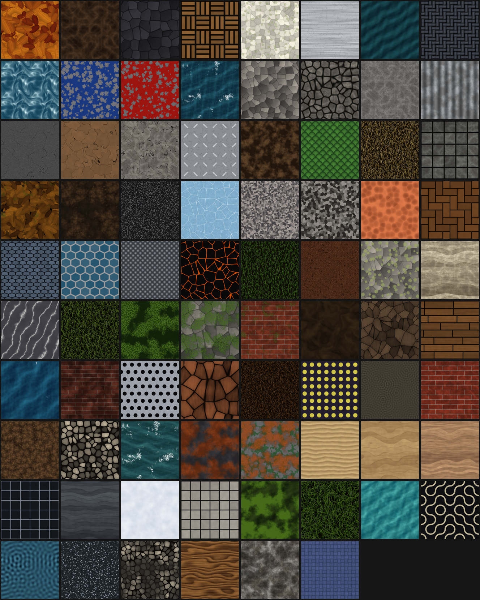
  <figcaption>Todos os presets, cor base</figcaption>
</figure>


Os mesmos presets como height maps (branco = superfície, preto = mais fundo) e como
normal maps:

<figure class="doc-figure">
  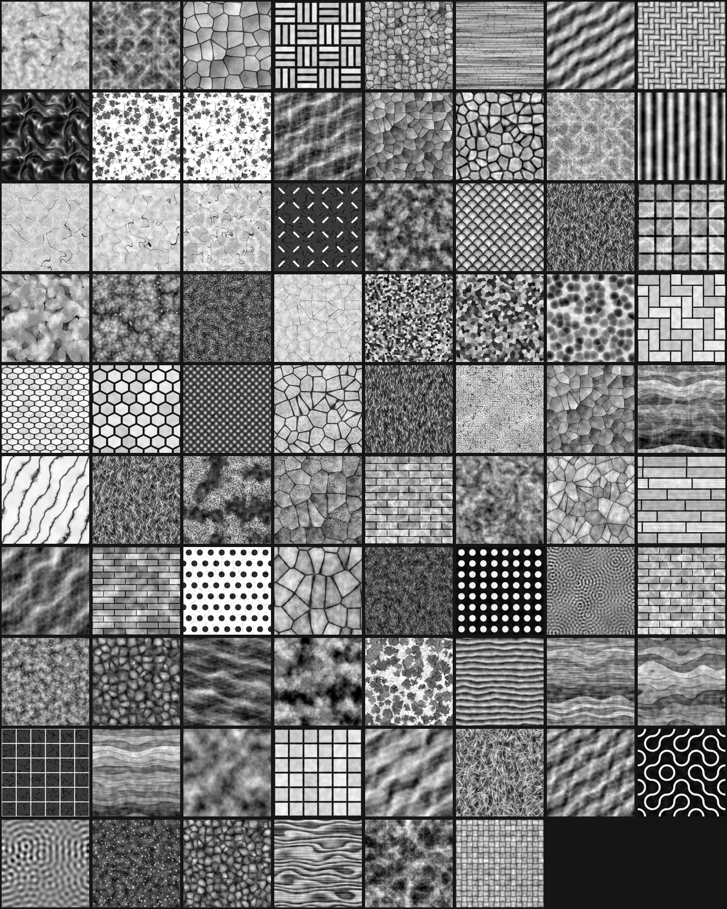
  <figcaption>Height maps</figcaption>
</figure>


<figure class="doc-figure">
  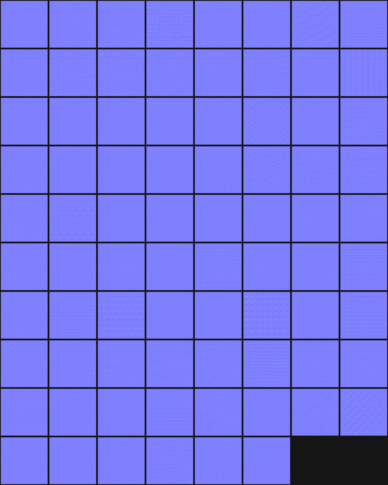
  <figcaption>Normal maps</figcaption>
</figure>


### Biblioteca Realistic: PBR de rocha, água, folhagem, solo e estruturas artificiais

A categoria *Realistic* reúne os blocos de construção ao estilo Substance por trás dos presets
fotorrealistas. Todos fazem tiling, têm seed e vivem em `uikit/procedural/realistic.rs`:

| Op | What it makes | Notable outputs |
|---|---|---|
| Rock Fracture | facetas angulares, cada uma um plano inclinado com fissuras vincadas | Colour, Height, Facet id |
| River Pebbles | pedras arredondadas muito juntas, com espaços entre elas | Colour, Height, Pebble id |
| Grass Blades | lâminas em camadas, afiladas, inclinadas e encaracoladas sobre o solo | Colour, Height, Blade id |
| Water Waves | soma de ondas direcionais (vetores de onda inteiros, por isso faz tiling) mais ondulações capilares | Colour, Height |
| Foam | espuma de crista com rendilhado, a partir de qualquer entrada de height ou do seu próprio ruído | Mask |
| Bark Fissures | placas esticadas na vertical, separadas por fissuras | Colour, Height |
| Soil Clumps | torrões, migalhas e pequenas pedras | Colour, Height |
| Leaf Litter | folhas sobrepostas com nervuras, de três a quatro camadas de profundidade | Colour, Height |
| Lichen | colónias irregulares | Mask |
| Wet / Puddle Mask | as zonas baixas de uma entrada de height enchem-se de água | Mask |
| Cavity Grime | sujidade a acumular-se nas frestas de uma entrada de height | Mask |
| Ice, Lava, Asphalt, Carbon Fibre, Paint Chips, Water Droplets | superfícies de finalidade única | Lava também produz **Emissive** |

<figure class="doc-figure">
  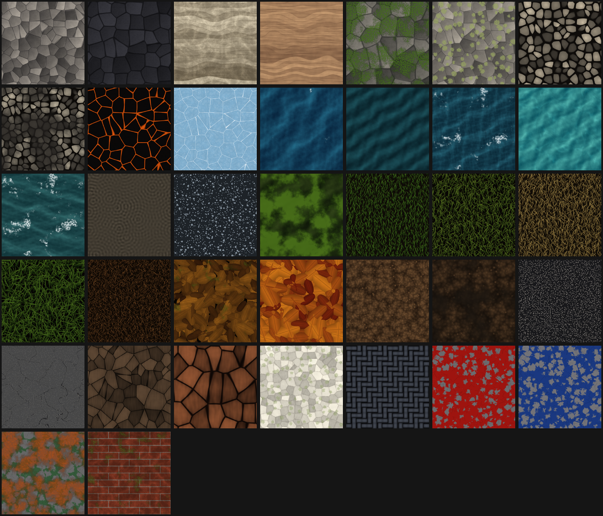
  <figcaption>Presets Realistic, cor base</figcaption>
</figure>


Renderizado pelo motor sobre um chão com profundidade parallax, um sol real e sombras:

<figure class="doc-figure">
  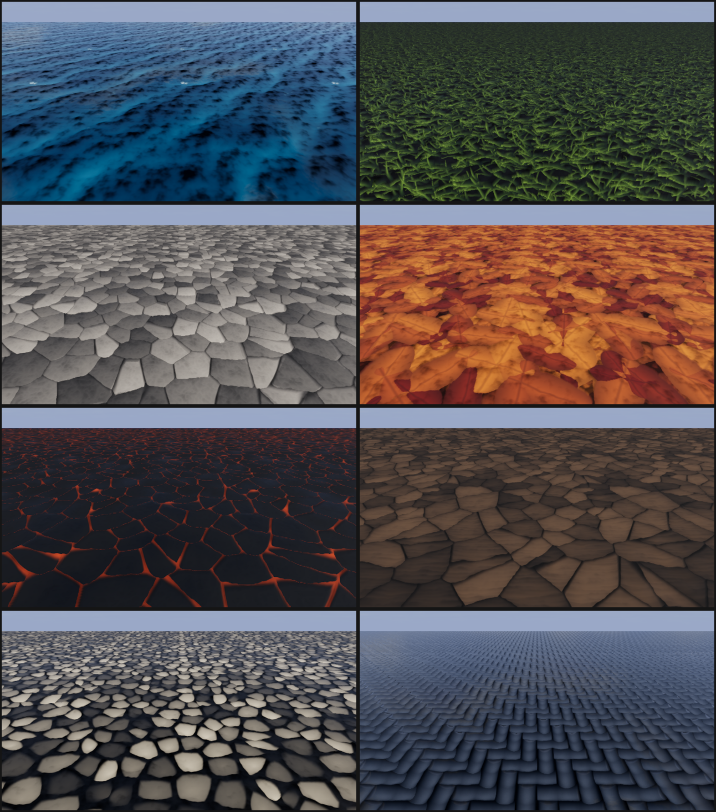
  <figcaption>Presets Realistic renderizados</figcaption>
</figure>


**Camadas de acento.** Um preset pode ter uma terceira camada (musgo, espuma, ferrugem, líquen, humidade...).
O valor do acento é a máscara: mistura a sua cor sobre a superfície, conduz o roughness
para um alvo (molhado = brilhante) e acrescenta um pouco de height. Os presets construídos assim são grafos
normais (nós `Lerp` controlados pelo acento), pelo que pode reequilibrar ou substituir o acento no
editor de nós. `wear` também escala o acento.

Famílias de presets: **Realistic Rock** (granite cliff, basalt columns, limestone, sandstone,
mossy boulder, lichen granite, river and wet pebbles, lava flow, frozen lake), **Realistic
Water** (ocean swell, choppy sea, calm lake, tropical shallows, river rapids, rain puddle,
droplets on glass, swamp), **Realistic Nature** (lawn, meadow, dry and tall wild grass, pine
needles, forest floor, autumn leaves), **Realistic Ground** (soil, forest mud, fresh and cracked
asphalt), **Realistic Wood** (oak, pine and birch bark) e **Realistic Man-made** (carbon fibre,
chipped red and blue paint, rusty painted panel, mossy brick wall).

### Variation: padrões vivos que nunca se repetem

Um tile repetido ou um ruído limpo parece mecânico. A classe **Variation** acrescenta aleatoriedade
controlada para que as superfícies pareçam usadas. Cada op tem seed (uma nova seed é uma nova variação do mesmo
material), é determinística e mantém os resultados sem costuras sempre que a sua entrada as tem (`uikit/procedural/variation.rs`).

<figure class="doc-figure">
  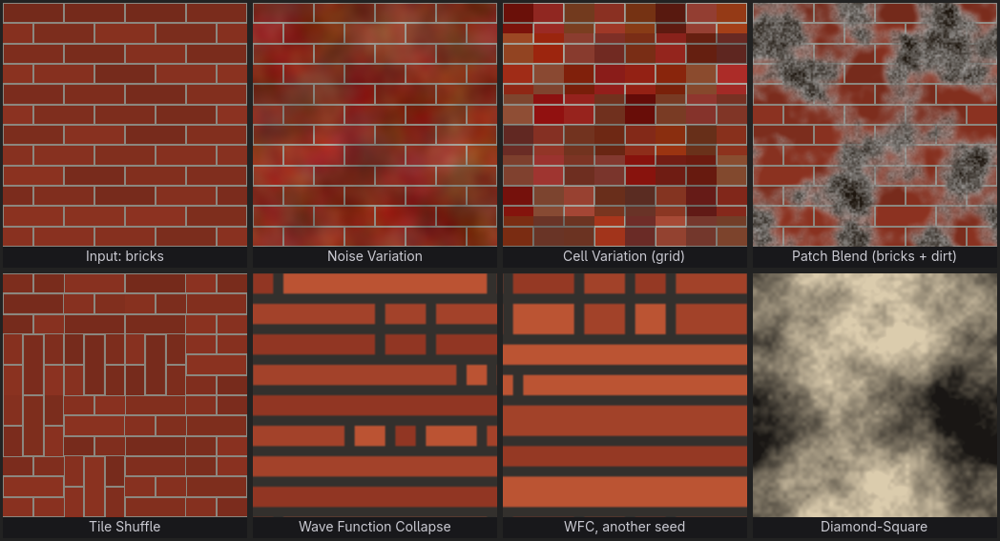
  <figcaption>Nós Variation aplicados à mesma entrada de tijolo</figcaption>
</figure>


| Node | What it does | Main controls |
|---|---|---|
| **Noise Variation** | o ruído **Perlin** ou **Simplex** desloca o brilho, a tonalidade e a saturação da entrada em manchas grandes e suaves, cada canal com o seu próprio campo de ruído | noise kind, patch size, octaves, brightness / hue / saturation drift, contrast |
| **Cell Variation** | cada célula recebe o seu próprio tom aleatório e, opcionalmente, o seu próprio offset na entrada (stochastic tiling). As células são uma grelha, Voronoi, ou **os ids de célula do próprio padrão**: ligue a saída *Variation* de um padrão de tijolo / pedra / tile a **Cell ID** e cada tijolo varia individualmente | cells, brightness / hue / saturation variation, texture shift, jitter |
| **Patch Blend** | mistura duas entradas (A, B) em manchas orgânicas moldadas por ruído Perlin / Simplex: limpo e gasto, molhado e seco, musgo e rocha | noise kind, patch size, coverage of B, edge softness |
| **Tile Shuffle** | corta a entrada em células e troca, roda e inverte-as ao acaso | cells, swap chance, rotate, flip |
| **Wave Function Collapse** | constrói um novo arranjo, de qualquer tamanho, em que cada vizinhança local já existe numa *amostra*: tijolos, tiles, runas... veja abaixo | output cells, sample cells, pattern size (2 or 3), tone levels, symmetry, softness |
| **Diamond-Square** | o clássico heightfield fractal (nuvens, dunas, relevo de rocha), calculado num toro para fazer tiling | grid (2^n), roughness (Hurst exponent), contrast, bicubic smoothing |

**Wave Function Collapse (modelo de sobreposição).** A amostra (a entrada ligada, ou uma parede de
tijolo integrada quando nada está ligado) é reduzida a `sample x sample` células e quantizada em
`levels` bandas de tom; cada janela `N x N` da amostra (opcionalmente invertida / rodada) torna-se um *padrão*
com um peso (a frequência com que ocorre). O solver preenche depois uma grelha de saída periódica: colapsa repetidamente
a célula com menor entropia para um dos seus padrões restantes (escolhido por peso) e
propaga as consequências aos vizinhos, recomeçando com uma seed derivada em caso de contradição
(até 14 tentativas, recorrendo depois a um sorteio aleatório dos tons da amostra). Como a saída é
periódica, **faz tiling**, e o teste `wave_function_collapse_only_builds_arrangements_the_sample_allows`
verifica que cada janela do resultado existe na amostra. A saída *Value* é a banda de tom: ligue-a
a um Gradient Map para resultados nítidos e recoloríveis.

Dicas: o WFC precisa de uma amostra com **características robustas** (poucos tons, características com várias células de largura). As linhas
finas desaparecem quando a amostra é reduzida, pelo que uma linha de argamassa de 1 px se perde; aumente *Sample cells* (até 32) ou
engrosse previamente a amostra. Um pattern size de 3 segue a amostra de perto, 2 explora mais. Os padrões são
limitados a 420 para que o solver se mantenha rápido (cerca de 0,6 s extra num bake de 1024 px).

**Presets Varied.** Sete presets mostram a classe em ação (categoria `Varied`): *Varied Brick Wall*,
*Varied Cobblestone*, *Varied Planks*, *Varied Hex Tiles* (cada tijolo, pedra, tábua ou tile recebe o seu próprio
tom a partir dos ids de célula do padrão, mais um drift Simplex ao longo da parede), *WFC Brick Remix*,
*Diamond-Square Badlands* e *Diamond-Square Moss Rock*. São grafos normais, pelo que os nós Variation
podem ser reequilibrados ou substituídos no editor de nós.

<figure class="doc-figure">
  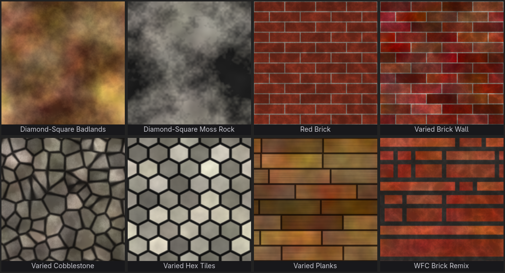
  <figcaption>Presets Varied ao lado do Red Brick simples</figcaption>
</figure>


## 2. O nó Output

Entradas, por ordem (os grafos mais antigos continuam a funcionar: as novas portas são acrescentadas no fim):

| Port | Meaning |
|---|---|
| Color, Roughness, Metallic, Height, AO | como antes |
| **Emissive** | cor → com bake para `<name>_gen_emissive_*.png`, define o mapa de emissão do material |
| **Opacity** | escalar → com bake para o alpha da cor base; o material passa a *Cutout* se era opaco |
| **Normal** | normal opcional criada manualmente (OpenGL); prevalece sobre a derivada do height |

Opções: `auto_height` (ativa por omissão: quando **Height** não está ligado, o height
é derivado da luminância da cor base, para que os heights nunca sejam um plano plano),
`normalize_height` (estica para o intervalo completo 0..1) e `height_contrast`.

O **Output preview** do gerador tem um seletor de canais para poder ver
todos os mapas com bake, não apenas a cor:

| Height | Normal |
|---|---|
| 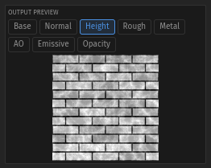 | 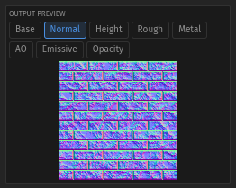 |
| **Roughness** | **AO** |
| 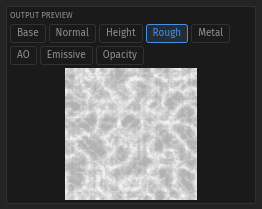 | 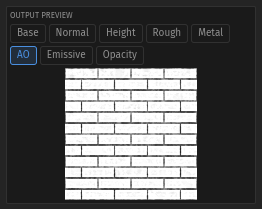 |

<figure class="doc-figure">
  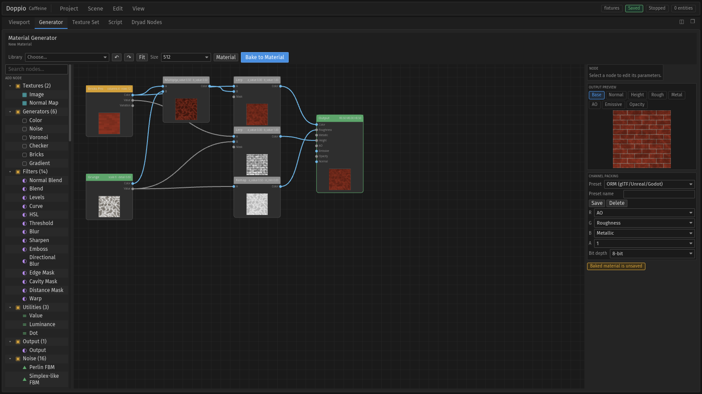
  <figcaption>Generator com o preset Red Brick</figcaption>
</figure>


## 3. Profundidade real: parallax occlusion mapping

Antes, um height map só alimentava o normal map, pelo que as superfícies eram iluminadas como relevo
mas continuavam geometricamente planas. O renderer faz agora **parallax occlusion
mapping** (POM) no shader PBR: o raio de visão é avançado através do campo de
height, o UV é deslocado para onde encontra pela primeira vez a superfície, e todas as texturas
(albedo, normal, ORM, emission) são amostradas aí. Os tijolos ocultam a argamassa,
as pedras sobrepõem-se às juntas.

Esquerda: profundidade desligada. Direita: profundidade ligada (mesmos mapas, mesmas luzes).

<figure class="doc-figure">
  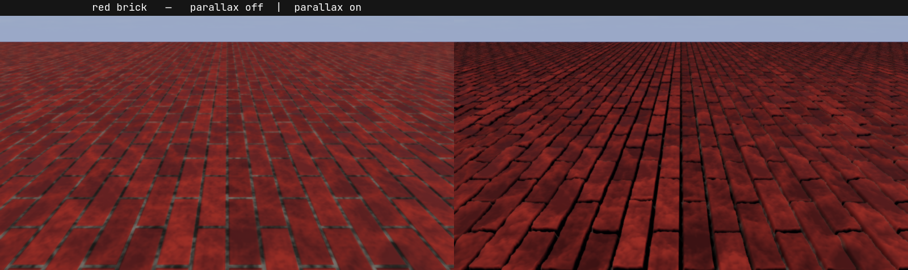
  <figcaption>profundidade do red brick</figcaption>
</figure>

<figure class="doc-figure">
  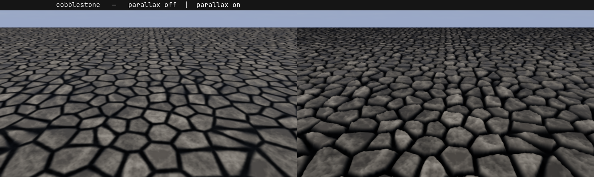
  <figcaption>profundidade do cobblestone</figcaption>
</figure>

<figure class="doc-figure">
  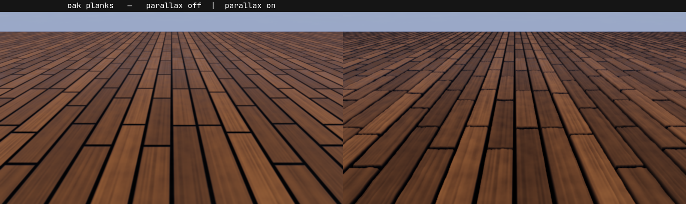
  <figcaption>profundidade do oak planks</figcaption>
</figure>

<figure class="doc-figure">
  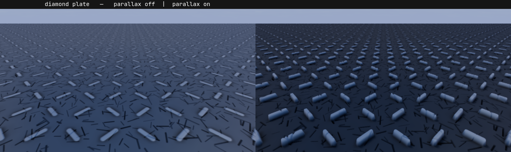
  <figcaption>profundidade do diamond plate</figcaption>
</figure>

<figure class="doc-figure">
  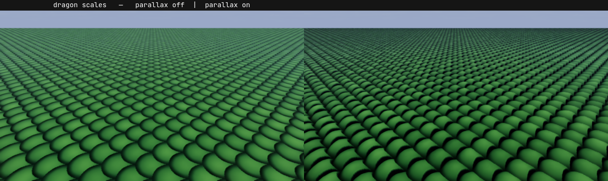
  <figcaption>profundidade do dragon scales</figcaption>
</figure>

<figure class="doc-figure">
  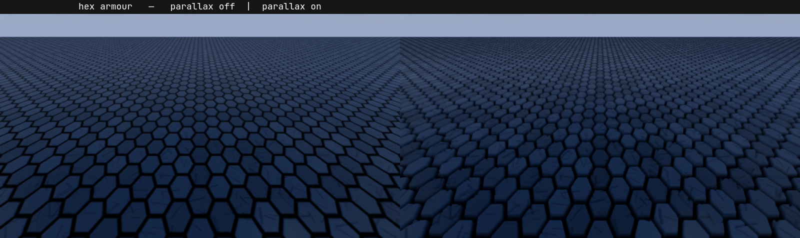
  <figcaption>profundidade do hex armour</figcaption>
</figure>

<figure class="doc-figure">
  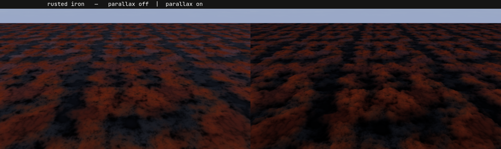
  <figcaption>profundidade do rusted iron</figcaption>
</figure>

<figure class="doc-figure">
  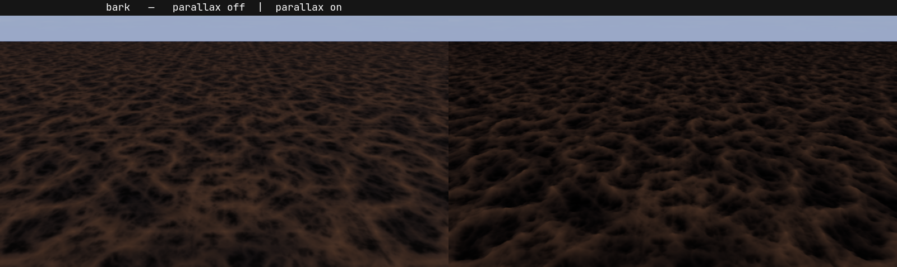
  <figcaption>profundidade do bark</figcaption>
</figure>


### Como o height é guardado

O renderer tem 16 samplers de fragmento e o shader PBR já usava todos
(um limite do SDL GPU), pelo que o height vive no **canal alpha do
normal map** (`1` = superfície, `0` = mais fundo). Sem textura nem sampler extra.

* O **bake do Generator** escreve o normal map com o height no alpha
  e ativa o parallax (`height_scale` 0.035) quando o height tem relevo. Um valor
  que já tenha ajustado é mantido.
* **Height map externo**: no painel Material prima **Pack a height map into
  the normal…**, escolha uma imagem, e o Doppio escreve `<material>_height_normal.png`
  (height reamostrado para o tamanho da normal) junto ao material. O seu normal map
  original nunca é substituído; se o material ainda não tiver normal, é primeiro
  derivada uma a partir do height.

### Controlos

<figure class="doc-figure">
  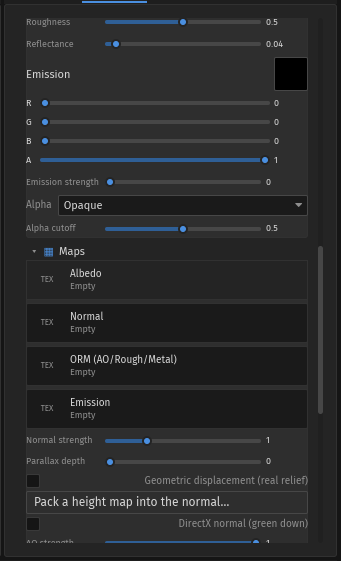
  <figcaption>Painel Material: profundidade parallax</figcaption>
</figure>


| Setting (`.mat`) | Meaning |
|---|---|
| **Parallax depth** (`height_scale`) | profundidade em unidades UV da textura com tiling; 0 = desligado, típico 0.02 – 0.06 |
| **Parallax steps** (`parallax_steps`) | máximo de passos do ray-march (4 – 96); o shader usa menos quando se olha de frente |

Notas e limites: o efeito precisa de um normal map cujo alpha guarde o height
(os normal maps externos têm normalmente alpha 255 = plano, pelo que nada acontece até
empacotar um height); os ângulos rasantes têm o offset limitado para evitar esborratamento; as silhuetas
dos polígonos e as sombras não são deslocadas (é uma técnica no espaço da textura).
`height_scale` e `parallax_steps` fazem parte da C ABI (versão 3), do
ficheiro `.mat` (`height_scale`, `parallax_steps`) e da chave da cache da pré-visualização.

## 4. Bake, repetidamente

O bake escreve `<material>_gen_*.png` sobre os mesmos nomes de ficheiro de cada vez. A
pré-visualização do material usava apenas o caminho como chave da cache, pelo que um segundo bake parecia
inalterado. A pré-visualização calcula agora também o hash da data de modificação e do tamanho de cada textura,
pelo que **cada bake atualiza a pré-visualização** (e qualquer ferramenta que reescreva um mapa no
próprio sítio também). Coberto por `generator_bake_can_run_again_and_stores_height_as_real_depth`.

**Porque é que um re-bake ainda podia parecer inalterado.** O hash da pré-visualização estava certo, mas a cache de
texturas da GPU do motor só atualizava um ficheiro alterado em disco quando a sua contagem de referências era zero.
A contagem sobe a cada acquire e nunca desce enquanto um mapa está em uso, pelo que o primeiro bake
ficava no ecrã. A cache recarrega agora sempre que a data de modificação do ficheiro muda (coberto por
`preview_reloads_a_map_rewritten_in_place`).

Os grafos puramente procedurais também têm pré-visualização e bake **sem uma sessão do motor**;
só os grafos que leem imagens do projeto precisam de uma para as localizar.

## 5. A pré-visualização do material: luz, sombras e resolução

A esfera de pré-visualização tem agora o seu próprio sol. Por baixo dos controlos de forma / ambiente / exposição:

| Control | Effect |
|---|---|
| Light direction | yaw do sol em torno do objeto (-180..180 graus) |
| Light height | elevação do sol (2..89 graus) |
| Light intensity | brilho do sol |
| Shadows | alterna o shadow map |

Os agentes usam `set_material_preview_sun` (`yaw`, `elevation`, `intensity`, `shadows`). A pré-visualização
renderiza a 768 px com a câmara mais próxima, sobre um chão mais claro com um preenchimento suave de céu, para que o relevo
de um material, a sua sombra projetada e o seu brilho molhado ou seco possam ser avaliados de imediato.
Com *Geometric displacement* ativado, a esfera é subdividida e realmente deslocada, e a sua
silhueta e sombras mostram-no.

**Correção no motor encontrada durante o desenvolvimento.** A passagem de sombras direcionais não tem anexo de profundidade, pelo que
a última mesh desenhada sobrepunha-se às outras: um chão desenhado depois de uma esfera apagava a
sombra da esfera. A passagem usa agora `BlendMode::Min`, que mantém o oclusor mais próximo
independentemente da ordem de desenho. As caches de GPU a nível de processo (texturas, meshes procedurais, cache de meshes)
também são libertadas quando uma sessão termina, pelo que uma segunda sessão já não herda handles
de um dispositivo morto.

## 6. Escalar um objeto: manter a densidade da textura

Os UVs de uma mesh são criados 1:1, pelo que um quad escalado para o dobro do tamanho esticava o seu material para
o dobro do tamanho também. Os materiais têm agora **Scale UVs with the object** (chave do `.mat`
`uv_object_scale`, **ativa por omissão**, no cartão UV do painel Material):

<figure class="doc-figure">
  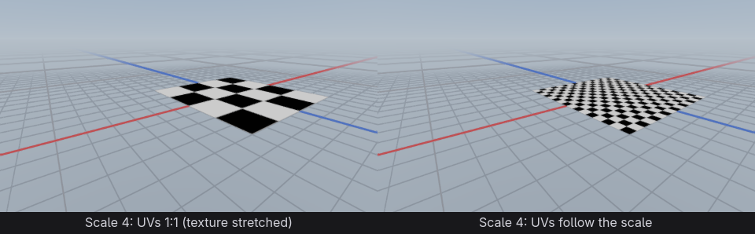
  <figcaption>UVs 1:1 versus UVs que seguem a escala, plano escalado 4x</figcaption>
</figure>


Como funciona: o vertex shader mede quanto a matriz do modelo estica as direções da tangente
(U) e da bitangente (V) da mesh e o fragment shader multiplica o UV com tiling por esse fator.
Um plano escalado 4x repete a textura 4x, um cubo esticado mantém a sua densidade em todas as faces, e a
escala 1 nada muda (`scaled_objects_keep_their_texture_density_when_uvs_follow_the_scale` verifica
ambos). O mesmo fator é usado pelos shaders de vértice e de sombra do geometric displacement, pelo que o relevo
se mantém alinhado com a cor.

| Case | Behaviour |
|---|---|
| Scale 1 | idêntico ao anterior |
| Uniform scale | a textura repete-se segundo a escala |
| Non-uniform scale on a box or plane | cada face usa o seu próprio estiramento U / V |
| Curved mesh with non-uniform scale | o fator varia suavemente com a direção da tangente, pelo que estiramentos muito fortes podem mostrar uma ligeira alteração de densidade |
| Instanced draws (batched vegetation) | mantêm os UVs originais |
| Material preview | mostra sempre os UVs originais (as suas formas têm tamanhos fixos) |
| `Tiling` / `Offset` | continuam a aplicar-se por cima: o UV final é `uv * tiling * objectScale + offset` |

Desative-o para materiais cujos UVs já estão em unidades do mundo (um atlas alinhado com o mundo, um decal).
Os materiais escritos antes de a chave existir comportam-se como os novos (ativo). `uv_object_scale` faz parte da
C ABI (versão 6), do ficheiro `.mat`, da chave da cache da pré-visualização e da consulta `material` do agente.

## 7. Regenerar as imagens

```bash
./rebuild.sh                              # engine + Doppio (needs ImageMagick for the sheets)
./scripts/render-material-gallery.sh      # bakes all presets, renders sheets + depth comparisons
./scripts/render-variation-docs.sh        # the Variation node and preset sheets
./scripts/capture-material-docs.sh        # headless UI screenshots (generator, channels, panel)
doppio/target/release/doppio-material bake-preset "Red Brick" --out /tmp/brick   # one preset to disk
doppio/target/release/doppio-material bake-graph path/to/material.mgraph --size 2048  # time one graph
```

* `doppio-material bake-graph <file.mgraph> [--size N] [--out DIR]` faz o bake de um
  grafo existente com tempos de progresso por fase; útil quando um bake 2K parece
  bloqueado no editor.

* `doppio-material bake-preset <name|--all> --out DIR [--size 512] [--depth 0.04] [--list]`
  escreve `*_base.png`, `*_normal.png` (height no alpha), `*_orm.png`, `*.mat`
  e `*_flat.mat` (mesmos mapas, profundidade desligada) — utilizáveis em qualquer cena.
* Os renders de profundidade usam `caffeine-render-snapshot` com
  `SNAP_FLOOR_MAT=<file.mat> SNAP_ONLY_FLOOR=1` e a vista predefinida 4.
* As capturas de ecrã da interface vêm do driver headless (veja
  [headless-testing.md](headless-testing.md)); o flow é
  `caffeine-website/captures/flows/capture-material-docs.json`.
