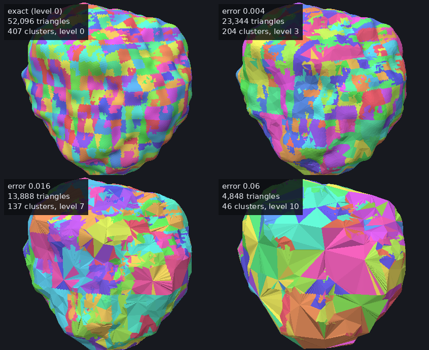
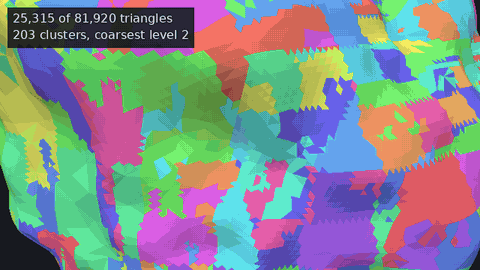
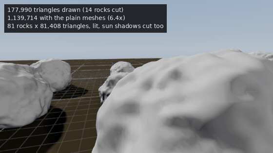
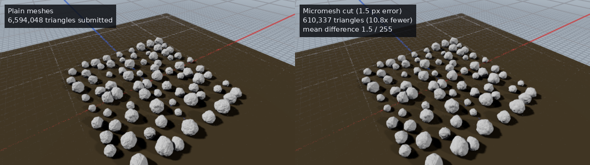
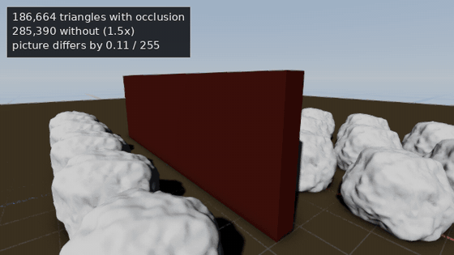
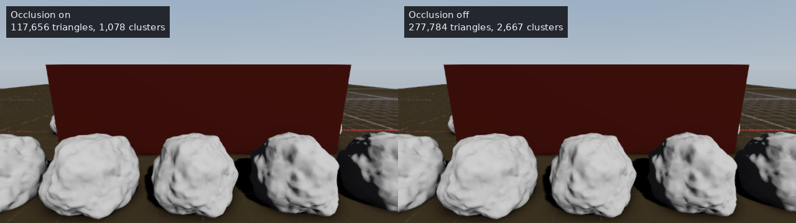
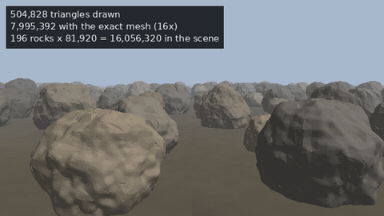
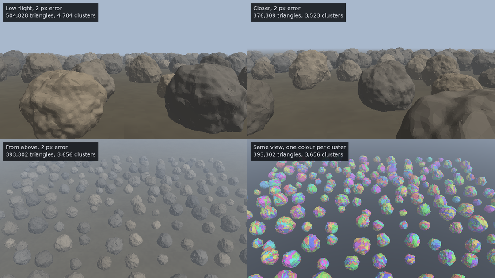
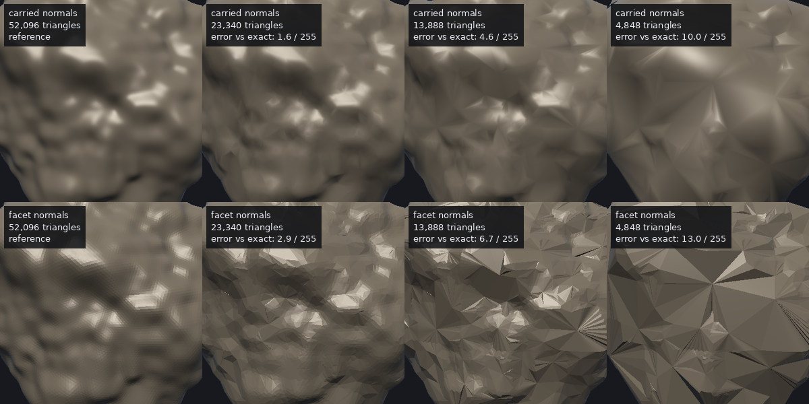
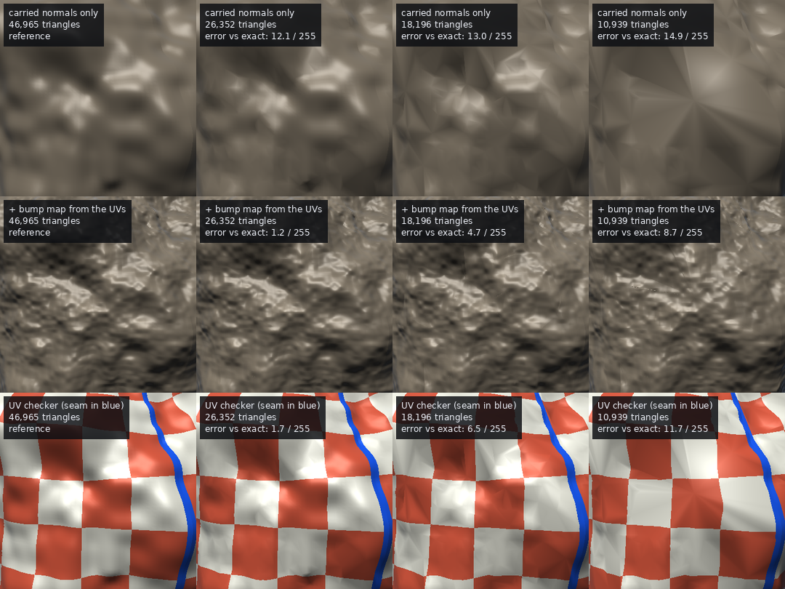

# Micromeshes: clusters, cortes e o draw na GPU

<div class="doc-meta">
  <span class="doc-badge doc-badge--reference">Referência</span>
  <span class="doc-badge">Engine</span>
  <span>Última atualização: <time datetime="2026-11-21">2026-11-21</time></span>
  <span>Fonte: <a href="https://github.com/devscafecommunity/caffeine/blob/main/micromeshes.md"><code>micromeshes.md</code></a></span>
</div>

<p class="doc-lede">Uma mesh é dividida em clusters de, no máximo, 128 triângulos e numa hierarquia de níveis simplificados. A cada
frame, um passo de compute escolhe o corte mais grosseiro cujo erro é invisível e um único draw desenha-o, agora através do
renderer de cena iluminado e do seu G-buffer. Esta página mostra o que existe, com renders do caminho real da GPU, e o que ainda falta.</p>

Os Micromeshes são um design nosso (veja [`graphics-roadmap.md`](graphics-roadmap.md) para o plano e a análise da
proposta original). Tudo o que está nesta página está implementado e testado, exceto os itens em *O que falta*.

## 1. O que está a ver

<figure class="doc-figure">
  
  <figcaption>Uma rocha de 81 920 triângulos, quatro orçamentos de erro. Cada mancha de cor é um cluster (no máximo 128 triângulos). As
  contagens são os clusters que sobrevivem aos testes de frustum e de back-face, pelo que o corte exato mostra apenas a metade voltada
  para a câmara. Os cortes mais grosseiros usam clusters planos maiores, feitos de grupos fundidos e simplificados.</figcaption>
</figure>

<figure class="doc-figure">
  
  <figcaption>O mesmo orçamento de erro enquanto a câmara se afasta e regressa: a GPU escolhe sozinha um corte mais grosseiro, e o
  contador de triângulos no canto acompanha-o. Os frames são renderizados por <code>MicromeshGpu</code>: o passo de compute de cull, depois um
  <code>drawIndexedIndirect</code> sobre todos os clusters.</figcaption>
</figure>

## 2. Na cena: o draw iluminado no G-buffer

Ative **Micromesh** num Mesh Renderer (o Inspector mostra-o com o seu **Micromesh error (px)**; os scripts e as cenas veem
os mesmos dois campos) e o renderer de cena desenha essa mesh como um corte de clusters em vez de uma mesh normal: o mesmo shader iluminado
(`scene_lit.frag`), o mesmo G-buffer, pelo que o Photon, o SSAO e o TAA não precisam de nada de novo.

<figure class="doc-figure">
  
  <figcaption>O renderer de cena real (o shader iluminado, o G-buffer, as cascatas de sombras do sol): 81 rochas de 81 408 triângulos cada, 6,6 milhões de
  triângulos na cena. Com o corte ativo, são desenhados por frame, pela câmara, entre <strong>178 000 e 833 000</strong> triângulos, face a
  <strong>1,1 a 5,9 milhões</strong> nas meshes normais (<strong>5,3x a 7,1x menos, 6,2x em média</strong>, com um erro de 1,5 px), e
  as sombras vêm do corte mais grosseiro próprio das cascatas. Renderizado por <code>./scripts/render-micromesh-scene-docs.sh</code>.</figcaption>
</figure>

<figure class="doc-figure">
  
  <figcaption>A mesma vista aérea das duas formas: 6 594 048 triângulos submetidos face a 610 337 (<strong>10,8x menos</strong>), e as duas
  imagens diferem em <strong>1,5 / 255</strong> em média, incluindo as sombras do sol e o sombreamento (as sombras da imagem da direita
  vêm do corte mais grosseiro da cascata).</figcaption>
</figure>

| Peça | O que faz |
|---|---|
| `MeshRendererComponent::micromesh`, `micromeshPixels` | o interruptor e o orçamento de erro em pixéis de ecrã (convertido em unidades do mundo por metro com a projeção da câmara e a altura da vista) |
| `GpuSceneRenderer::micromeshAssetFor` | uma vez por asset de mesh e revisão de geometria: solda os vértices que coincidem em posição, normal e UV (as meshes são muitas vezes guardadas sem índices), constrói a hierarquia com as normais, UVs e tangentes da própria mesh e carrega-a |
| `beginMicromeshFrame` | uma vez por frame, quando os draws estão finais: agrupa as entidades por asset de mesh (cada entidade de uma mesh é uma **instância** dela), carrega um buffer de matrizes por asset e repõe a arena de índices |
| `cullMicromeshView` | compute, fora de qualquer render pass: **uma cadeia de dispatch por asset e vista** (primeiro a câmara, depois cada cascata do sol) corta todas as instâncias da mesh de uma só vez |
| `micromesh_compact.comp` | o mesmo corte e os mesmos testes de frustum e de back-face do passo por cluster, em quatro passos (reset, count, reserve, copy): cada cluster selecionado acrescenta os seus índices a uma **arena de índices partilhada**, pelo que cada instância é **um draw indexado** e a memória acompanha o que está visível |
| `scene_micromesh.vert`, `shadow_micromesh.vert` | o vertex shader da cena (posições, normais, UVs, tangentes e cores de vértice em cinco slots, normais pela transposta da inversa) e o shader de cascata só com posições; ambos leem a matriz do buffer de instâncias |
| `caffeine_session_micromesh_stats` (C ABI v14) | draws, clusters selecionados, triângulos selecionados e de origem do último frame (leitura bloqueante, para ferramentas e testes); `CaffeineRenderStats::micromesh_draws` é o contador barato |

Pormenores que vale a pena conhecer:

* **Sombras.** As cascatas do sol também cortam a mesh: a mesma hierarquia com um orçamento de erro de **quatro texels de sombra** (uma
  distância no mundo, já que uma cascata é ortográfica, sem teste de back-face e com um teste de frustum por cascata), desenhada por `shadow_micromesh.vert`
  no mesmo atlas de sombras. A mesma hierarquia significa sem fissuras; um corte mais grosseiro significa bastantes menos triângulos no passo de sombras. As sombras
  de pontos de luz e de focos ainda desenham a mesh completa. **O viewport do editor renderiza sem shadow maps por omissão** (uma escolha deliberada
  de custo do editor); `ViewportSettings::shadows` (C ABI v14, `CaffeineViewportSettings::shadows`) ativa-as, e é
  assim que as imagens e os testes aqui são feitos.
* **A arena.** Um único buffer de índices serve todas as meshes e vistas de um frame, pelo que a memória acompanha o que está visível, não o que existe: esta
  cena pede 1,8 a 8,2 milhões de índices por frame nas suas 6 vistas (a câmara e 5 cascatas) e a arena estabilizou em
  **32 MB** para 81 rochas, quando um buffer de índices de tamanho completo por rocha seria de 80 MB e cresceria com o número de rochas. Começa com
  16 MB e cresce sozinha (duplicando, até 256 MB) quando uma leitura de contador a cada 15 frames mostra que era pequena demais; um corte que
  não cabe **não é desenhado nesse frame** (`overflowed` nas estatísticas), pelo que o crescimento se nota como alguns frames sem sombras ou
  rochas, nunca como um draw corrompido. A câmara é cortada primeiro, por isso é a última a perder.
* **Sub-meshes, escala, cores.** Uma mesh com vários materiais recebe uma hierarquia por sub-mesh, desenhada com o seu material. Os grupos `usemtl` de um OBJ são
  sub-meshes, e os **Material slots** do Mesh Filter (`a.mat;b.mat`) dão a cada uma um material autoral: o renderer faz então um draw por slot, pelo que
  um slot pode ter alpha test ou vento (desenha-se normal) enquanto os outros continuam a ser Micromeshes.
  Uma escala não uniforme é tratada: os erros e os limites usam a maior escala (conservador) e o teste de back-face é ignorado para
  essa instância. As cores de vértice são transportadas ao longo da construção (em média num colapso). Isto também corrigiu os shaders
  de cena normais, que transformavam as normais pela matriz do modelo e sombreavam mal uma mesh esticada (agora pela transposta da inversa).
* **Um multi-draw de clusters não é grátis no CPU.** O SDL3 GPU não tem draw com contagem indireta (indirect-*count*), pelo que o caminho por cluster
  (um draw indireto por cluster, usado pelo campo instanciado abaixo) custa tempo de codificação que cresce com o número de clusters. O
  caminho da cena compacta em vez disso: um draw por instância, seja o que for que o corte selecione. Um teste verifica que o corte compactado mantém exatamente os mesmos
  clusters e triângulos que o por cluster.
* **Meshes densas sem materiais eram lentas a desenhar, ponto.** Para uma mesh sem material nem PNG irmão, `resolveMeshAlbedo`
  relia e percorria o ficheiro inteiro da mesh à procura de nomes de texturas **em cada draw de cada frame** (4 a 8 ms de CPU por draw). Agora
  fica memorizado até a data de modificação do ficheiro mudar (isto acelera qualquer mesh deste tipo, Micromesh ou não).
* **Um limite do renderer descoberto pelo caminho:** a descrição do pipeline guardava apenas 4 vertex buffers; o quinto era descartado em silêncio
  (as cores de vértice liam-se como preto). Agora são 8.

### Occlusion

Uma instância também pode ser eliminada com base no **que o depth buffer do frame anterior mostra**: Mesh Renderer -> **Micromesh occlusion**. A cada frame,
o depth buffer anterior é reduzido a uma **pirâmide de profundidade máxima** (`MicromeshHzb`, `micromesh_hzb.comp`: um storage buffer, nível
após nível, cada texel o máximo dos quatro abaixo; a pirâmide Min-Z do Photon guarda a profundidade mais próxima, a redução oposta).
O cull compactante da câmara projeta então a esfera delimitadora de cada cluster com as matrizes do frame anterior, escolhe o nível da pirâmide em que
a sua pegada ocupa no máximo dois texels, e descarta o cluster quando a profundidade mais próxima da esfera está além da profundidade máxima de todos os
texels por baixo dela. Tudo o que for indecidível permanece visível: uma esfera perto ou atrás da câmara, uma que ultrapasse a margem do ecrã.

<figure class="doc-figure">
  
  <figcaption>A câmara roda 1,8 radianos em torno de uma parede de 10 m com 18 rochas densas (45 696 triângulos cada) atrás e 6 à frente. Cada
  frame é desenhado duas vezes a partir da mesma câmara, com occlusion ativa e desativada. Com ela ativa, o corte da câmara mantém entre <strong>112 000 e
  280 000</strong> triângulos face a <strong>277 000 a 297 000</strong> (<strong>1,5x a 2,5x menos, 2,1x em média</strong>; 2,2x menos
  clusters), e as duas imagens diferem em <strong>0,11 / 255</strong> em média. Renderizado por
  <code>./scripts/render-micromesh-scene-docs.sh</code>.</figcaption>
</figure>

<figure class="doc-figure">
  
  <figcaption>O meio da rotação: a parede esconde a maior parte das rochas que estão atrás dela, e a imagem é a mesma com e sem o teste.</figcaption>
</figure>

**Este é um teste de fase única, não o de duas fases do roadmap.** Usa a imagem do frame anterior, pelo que um cluster que estava escondido no frame
anterior e se torna visível neste (a câmara moveu-se, ou um oclusor afastou-se) aparece **um frame atrasado**. Na rotação acima, isso
custa alguns pixéis de contorno: o pior pixel isolado de um frame difere até 250 / 255 (o contorno de uma rocha a chegar um frame atrasado), enquanto a
diferença média nunca excede 0,15 / 255. É por isso que o interruptor vem **desativado por omissão** e é por instância. Um verdadeiro teste de duas fases (desenhar os
clusters vistos no frame anterior, reconstruir a pirâmide a partir dessa profundidade, testar os restantes) exige dividir o passo opaco em dois, e não está feito. Apenas
o corte da câmara é testado; as cascatas de sombras não (a sua vista é a da luz). Precisa de um frame anterior da mesma vista com o mesmo
tamanho, pelo que o primeiro frame após um redimensionamento não elimina nada; a pirâmide custa uma leitura de profundidade e cerca de 1,3x o depth buffer em memória.

### Benchmark

`./scripts/render-micromesh-scene-docs.sh` também imprime esta tabela (uma cena fixa: 81 rochas de 81 408 triângulos, um voo de 72 frames,
corte da câmara a 1,5 px, cascatas a quatro texels, e depois o mesmo voo com meshes instanciadas normais). As contagens de triângulos são exatas e
reproduzíveis; os tempos são **tempo de codificação no CPU** (o SDL3 GPU não tem timestamps de GPU portáveis), pelo que nada dizem sobre o custo na GPU.

| por frame | mín | média | máx |
|---|---|---|---|
| triângulos, corte da câmara | 177 990 | 551 593 | 833 381 |
| triângulos, meshes normais | 1 139 714 | 3 516 375 | 5 861 378 |
| menos triângulos (x) | 5.3 | 6.2 | 7.1 |
| rochas cortadas (draws) | 14 | 43 | 72 |
| clusters selecionados | 1 710 | 5 457 | 8 335 |
| arena de índices usada (índices, as 6 vistas) | 1 800 487 | 5 303 878 | 8 186 050 |
| CPU encode ms, corte | 6.0 | 9.7 | 20.7 |
| CPU encode ms, normal | 4.9 | 10.4 | 18.8 |

### Conjunto de benchmarks

`./scripts/benchmark-micromesh.sh` executa o **conjunto de benchmarks reproduzível**: um campo denso de rochas, uma floresta de árvores densas e um terreno, cada
um percorrido por um caminho de câmara fixo de 40 frames a 640x360 com as sombras do sol ativas, por todos os caminhos do renderer que se aplicam. O conteúdo é
gerado em código a partir de hashes (sem assets; um teste verifica que os ficheiros OBJ são idênticos byte a byte entre execuções e que as suas contagens de triângulos são fixas),
pelo que **as contagens de triângulos e de draws são exatamente as mesmas em todas as execuções** (duas execuções aqui coincidiram até ao último dígito). Os tempos não: *wall*
é um frame inteiro, incluindo a leitura da imagem, pelo que acompanha a GPU mas também a máquina (duas execuções aqui concordaram com cerca de
5%): compare linhas de uma mesma execução, não números entre máquinas. *Encode* é o tempo de gravação de comandos no CPU. `BENCH_OUT=<dir>` guarda os números em bruto
por frame (`benchmarks.json`).

**Campo de rochas**: 81 rochas x 81 408 triângulos (6,6 M), um voo rasante.

| configuração | triângulos (mín / mediana / máx) | draw calls | wall ms | encode ms |
|---|---|---|---|---|
| meshes normais (instanciadas) | 1 139 714 / 3 215 618 / 5 861 378 | 2 / 2 / 2 | 15.1 / 23.8 / 40.8 | 4.3 / 5.2 / 12.0 |
| Micromesh | 177 992 / 527 412 / 833 391 | 15 / 40 / 73 | 8.9 / 13.3 / 19.5 | 5.9 / 8.6 / 13.8 |

6,1x menos triângulos, tempo wall mediano de 0,56 do das meshes normais.

**Floresta**: 300 árvores x 47 808 triângulos (um tronco rugoso e três copas irregulares, cores de vértice castanhas e verdes; 14,3 M), um voo entre elas.

| configuração | triângulos (mín / mediana / máx) | draw calls | wall ms | encode ms |
|---|---|---|---|---|
| meshes normais (instanciadas) | 908 354 / 5 139 362 / 10 756 802 | 2 / 2 / 2 | 24.4 / 49.4 / 93.5 | 14.8 / 15.5 / 28.1 |
| Micromesh | 313 828 / 1 570 378 / 2 864 164 | 20 / 108 / 226 | 23.1 / 37.3 / 58.0 | 18.2 / 26.9 / 39.5 |

3,3x menos triângulos, tempo wall mediano de 0,75 do das meshes normais, mas **o CPU paga**: a codificação mediana passa de 15,5 para 26,9 ms porque
cada árvore é o seu próprio draw (108 face aos dois lotes instanciados). A floresta aqui é opaca; os cartões de folhas com alpha ficam no
caminho instanciado por design, pelo que uma floresta real é uma mistura e esta é o melhor caso para o Micromesh.

**Terreno**: um terreno de 800 m com duas dimensões de grelha, um voo sobre ele. Apenas o caminho de terreno em chunks do engine (o Micromesh ainda não desenha terreno).

| grelha | triângulos de origem | triângulos submetidos (mín / mediana / máx) | draw calls | wall ms | encode ms |
|---|---|---|---|---|---|
| 513 x 513 | 524 288 | 192 512 / 227 328 / 313 344 | 94 / 111 / 153 | 11.2 / 15.5 / 29.2 | 6.1 / 9.6 / 22.1 |
| 1025 x 1025 | 2 097 152 | 724 992 / 839 680 / 1 173 504 | 354 / 410 / 573 | 21.3 / 32.5 / 38.7 | 12.9 / 22.6 / 28.0 |

O LOD de chunks do terreno já submete 43 % (513) e 40 % (1025) dos triângulos de origem, um draw por chunk visível. Quatro vezes os
triângulos custam cerca do dobro do tempo de frame. (Escrever este benchmark mostrou que os draws de terreno não estavam nos contadores de frame, que
indicavam 0 triângulos e 0 draws para um terreno; agora são contados.) Esta é a linha de base que um caminho de clusters para terreno tem de superar.

O HUD do viewport mostra os mesmos contadores em tempo real: `... · 610.3k tris · 74 draws · 72 micromesh` (triângulos submetidos, draws e
quantas meshes foram desenhadas como corte).

O que ainda não faz: meshes com skinning (os seus vértices mexem-se a cada frame, pelo que clusters na pose de repouso estariam errados: desenham-se normais,
por design), materiais com alpha test ou translúcidos e folhagem animada pelo vento (ficam no caminho instanciado, por design: o roadmap
mantém a folhagem aí), e sombras de pontos de luz e de focos (mesh completa). Cada instância continua a ser o seu próprio draw (as instâncias de uma mesh partilham
geometria, o dispatch e a arena, não um draw: isso exigiria vertex pulling). A hierarquia é construída na primeira vez que uma mesh é
vista, cerca de um segundo para 80 000 triângulos; uma secção `.micromesh` offline no `.caf` é a forma planeada de não pagar esse custo em execução.

## 3. Instâncias num só dispatch: um campo de rochas

Uma hierarquia pode ser desenhada muitas vezes. Cada instância tem uma transformação afim com escala uniforme, e o passo de
cull decide **por instância**: o seu próprio corte (erro e distância), o seu próprio teste de frustum e o seu próprio teste de back-face.
O campo inteiro é **um dispatch de compute e um `drawIndexedIndirect`**.

<figure class="doc-figure">
  
  <figcaption>Um voo sobre 196 instâncias da rocha de 81 920 triângulos (16 056 320 triângulos na cena), todas através de
  <code>MicromeshGpu</code>. Os contadores são lidos dos argumentos do draw: são desenhados por frame entre <strong>149 000 e 508 000</strong>
  triângulos, face a <strong>0,6 a 8,0 milhões</strong> se a mesh exata fosse desenhada com o mesmo
  culling de frustum e de back-face (<strong>4x a 16x menos, 10x em média</strong>, com um erro de 2 px).</figcaption>
</figure>

<figure class="doc-figure">
  
  <figcaption>O mesmo campo em quatro vistas. De cima, são desenhados 393 302 triângulos em vez de 8 542 464 (<strong>22x menos</strong>);
  em baixo à direita veem-se os clusters escolhidos: as rochas próximas são cortadas em muitos clusters pequenos, as distantes em
  poucos clusters grandes e planos.</figcaption>
</figure>

| Item | Onde |
|---|---|
| `MicromeshGpu::setInstances(transforms)` | carrega quatro vec4 por instância (as três primeiras linhas da matriz e depois a escala) como buffer de compute e como storage buffer gráfico |
| Índice de cull | invocação `g = instance * clusterCount + cluster`; as esferas, os erros e o eixo do cone são levados para o espaço do mundo antes dos testes |
| Argumento de draw | `firstInstance = g`; o vertex shader lê `instance = g / clusterCount`, `cluster = g % clusterCount` e a matriz de `instanceBuffer()` |
| `readStats()` | clusters e triângulos visíveis em todas as instâncias (leitura bloqueante, para ferramentas e testes) |

Uma instância distante é cortada de forma mais grosseira do que uma próxima, mesmo quando é maior, e uma instância atrás da câmara ou muito
para o lado não contribui com nenhum draw.

## 4. Normais de sombreamento

Um corte só é útil se *sombrear* como a mesh exata. A construção transporta agora uma **normal de sombreamento unitária por vértice**:
normais suaves, ponderadas pelo ângulo, para os vértices de origem, e, para cada vértice que um colapso cria, a soma normalizada
dos dois que substituiu. As normais fazem parte dos bytes (`.micromesh` versão 2) e `MicromeshGpu::drawLit` liga-as
como segundo vertex buffer (slot 1, `Float3`).

<figure class="doc-figure">
  
  <figcaption>Os mesmos quatro cortes (exato, depois 23 340, 13 888 e 4 848 triângulos), iluminados com um sol, um brilho e um contorno de luz.
  Em cima: as normais que a construção transportou. Em baixo: normais por triângulo (faceta), o aspeto de um corte grosseiro sem elas.
  O erro médio face ao render exato é de <strong>1,6, 4,6 e 10,0</strong> (em 255) com normais transportadas, contra
  <strong>2,9, 6,7 e 13,0</strong> com facetas, e as facetas mostram cada triângulo simplificado como uma aresta dura.</figcaption>
</figure>

O que não faz: as normais são calculadas em média, pelo que o detalhe abaixo do corte é suavizado (a imagem mais à direita perdeu
as pequenas saliências). Um normal map no pipeline iluminado é o que o repõe; transportar UVs através dos colapsos é o
atributo seguinte.

## 5. Coordenadas de textura

`build(positions, indices, uvs)` também transporta **coordenadas de textura**. Um vértice que um colapso cria assume o UV do
ponto mais próximo da aresta que substituiu. **Nunca se simplifica através de costuras de UV**: uma costura é uma fronteira de vértices divididos (uma
aresta usada por um triângulo) e a construção já bloqueia todas as fronteiras em todos os níveis, pelo que as duas pontas de uma aresta colapsada
estão sempre na mesma ilha de UV. `MicromeshGpu::drawTextured` liga os UVs como terceiro vertex buffer (slot 2, `Float2`).

<figure class="doc-figure">
  
  <figcaption>Uma rocha em latitude / longitude com uma costura real (81 664 triângulos), em quatro cortes (46 965, 26 352, 18 196 e 10 939
  triângulos; a costura impede que os cortes desçam mais). Em cima: só normais transportadas. No meio: o mesmo mais um bump map
  avaliado a partir dos UVs em cada pixel (derivative bump mapping, pelo que não são precisas tangentes). Em baixo: um checker de UV com a
  costura a azul. O bump map repõe o detalhe que as normais em média perdem (erro face ao render exato
  <strong>1,2, 4,7, 8,7</strong> em vez de <strong>12,1, 13,0, 14,9</strong> em 255), e o checker mantém-se firme ao longo da
  costura e de todos os cortes (<strong>1,7, 6,5, 11,7</strong>): a textura não "nada" quando o corte muda.</figcaption>
</figure>

O preço das costuras bloqueadas: uma mesh com muitas ilhas de UV simplifica menos. Esta rocha tem uma costura e ainda assim pára em cerca de
11 000 de 82 000 triângulos nesta vista; um atlas com dezenas de ilhas pára mais cedo. Meça nas suas meshes.

## 6. Como funciona

| Fase | Onde | O que acontece |
|---|---|---|
| Cluster | `micromesh/Micromesh.cpp` | triângulos ordenados ao longo de uma curva de Morton, divididos em clusters de, no máximo, 128 triângulos e 128 vértices; cada um recebe uma esfera delimitadora, um cone de back-face e um remapeamento local de vértices |
| Hierarquia | o mesmo | os clusters são agrupados (4 de cada vez), cada grupo é fundido, simplificado por colapso de arestas com quádricas com a sua **fronteira bloqueada**, e dividido de novo, até uma raiz |
| Erro | o mesmo | o erro de um grupo é o maior entre o seu erro de colapso (uma distância RMS, em unidades do mundo) e o dos seus filhos, mais um epsilon: **estritamente** monótono, com uma esfera que contém as dos filhos |
| Corte | `selectCut`, `micromesh_cull.comp` | um cluster é desenhado quando o seu próprio erro está dentro do orçamento e o do seu pai não (opcionalmente dividido pela distância à sua esfera, um erro projetado) |
| Cull | `micromesh_cull.comp` | o mesmo passo testa o frustum e o cone de back-face, e escreve um conjunto de argumentos de draw indexado por cluster, com `indexCount` 0 quando eliminado |
| Draw | `render/MicromeshGpu` | um `drawIndexedIndirect(args, 0, clusterCount)`: a mesma chamada em cada frame, sem leituras de volta, sem atómicos |

Como a fronteira de um grupo é bloqueada em todos os níveis, e um cluster e o seu pai nunca são ambos selecionados, **qualquer corte
cobre a superfície sem fissuras**. Isto é testado, não assumido: todos os cortes de uma esfera e de um toro são uma variedade fechada
(cada aresta em exatamente dois triângulos) em doze limiares.

## 7. Utilização

```text
C ABI v12   caffeine_micromesh_build(positions, indices, &stats, &bytes, &size)   -> versioned .micromesh bytes
C ABI v14   caffeine_session_micromesh_stats(session, &stats)   -> draws, clusters, triangles, source triangles, views,
                                                                   arena use and capacity, cuts that did not fit
            CaffeineRenderStats::micromesh_draws, CaffeineViewportSettings::shadows, stats.occlusion
Inspector   Mesh Renderer -> Micromesh, Micromesh error (px), Micromesh occlusion; the viewport HUD shows tris, draws and micromesh draws
Rust        Engine::micromesh_build(&positions, &indices) -> MicromeshBake { bytes, clusters, levels, root_clusters, max_error, ... }
C++ core    Micromesh::build(positions, indices, {normals, uvs, tangents, colors}) / selectCut / serialize / deserialize
            Render::MicromeshGpu::upload, then either the per-cluster path (setInstances / cull / draw* / readStats)
            or the scene path (setSceneInstances / cullScene / drawSceneSlot / readSceneView) with a MicromeshArena
            and, for occlusion, a MicromeshHzb built from the previous depth (MicromeshCullParams::occlusion)
```

A construção é trabalho **offline** (um bake): é determinística, pelo que a mesma mesh dá um resultado idêntico byte a byte, e demora
menos de um segundo para uma mesh de 20 000 triângulos. Nunca a chame a cada frame.

A consulta de agente `render_stats` (e `Engine::render_stats()`, C ABI v13) indica o que um frame desenhou: meshes, eliminadas pelo
frustum, draw calls, draw calls instanciados, triângulos e tempos de passos no CPU.

Regenere as imagens e os GIFs das secções 1, 3, 4 e 5 com `./scripts/render-micromesh-docs.sh` (testes ocultos com as etiquetas
`[.micromesh-docs]`, `[.micromesh-field]`, `[.micromesh-normals]` e `[.micromesh-uv]` renderizam os frames na GPU;
`scripts/compose_micromesh_docs.py` compõe-nos), e as da secção 2 com `./scripts/render-micromesh-scene-docs.sh` (um teste de engine do
Doppio, ativado por variável de ambiente, através do renderer de cena real, mais a tabela de benchmark).

## 8. O que os testes provam

* **No CPU** (`tests/test_micromesh.cpp`): os clusters respeitam os limites, cada nível é mais grosseiro, uma mesh fechada termina numa
  só raiz, os erros só crescem em direção à raiz e as esferas contêm as dos filhos, os cortes não têm fissuras, os cortes dependentes da vista são
  mais grosseiros ao longe, uma mesh aberta mantém a sua fronteira e termina, os cones de back-face nunca escondem um cluster voltado para a câmara, as reconstruções
  são idênticas byte a byte, bytes truncados são recusados.
* **Na GPU** (`tests/test_micromesh_gpu.cpp`, `tests/test_rhi_indirect.cpp`): o corte que o passo de compute seleciona **é igual ao do
  CPU** a quatro distâncias e três orçamentos, o filtro de cone é igual a `isBackFacing`, o teste de frustum é igual ao mesmo teste
  esfera-plano no CPU, os argumentos indiretos decidem o que é desenhado, e um passo de compute pode escrevê-los.
* **Caminho da cena**: o teste de engine do Doppio `micromesh_draw_matches_the_plain_mesh_and_submits_fewer_triangles` renderiza uma rocha OBJ densa
  sobre um chão sob o sol, com shadow maps ativos, através do renderer real das duas formas: a imagem (sombra incluída) fica a poucos
  / 255 da da mesh normal, o corte mantém cerca de um terço dos triângulos de perto, a câmara e pelo menos uma cascata foram cortadas
  para uma arena sem nada a transbordar, `micromesh_draws` é 1 com o interruptor ligado e 0 depois de o desligar, e a etiqueta do HUD
  di-lo. `micromesh_handles_non_uniform_scale_submeshes_and_vertex_colours` faz o mesmo para uma rocha esticada, uma rocha com dois
  materiais e uma rocha com cor de vértice. `[compact]` (GPU) verifica que o corte compactado da arena mantém exatamente os clusters e
  triângulos do corte por cluster para instâncias de várias escalas (uma não uniforme), em três câmaras e quatro orçamentos, para uma
  vista que não é a primeira (deslocamentos de slot), que a arena contém exatamente o corte, e que um corte que não cabe não é desenhado e
  é reportado. `[colors]` verifica que as cores de vértice sobrevivem a todos os níveis e aos bytes.
* **Normais** (`[normals]`): cada normal de vértice é um vetor unitário em todos os níveis e acompanha a superfície (numa esfera, a menos de
  26 graus da direção radial nos 16 níveis, incluindo o mais grosseiro), as normais sobrevivem à ida e volta pelos bytes,
  e na GPU um corte grosseiro iluminado com normais transportadas fica a menos de 6/255 do render exato, enquanto as normais de faceta ficam a mais do
  dobro da distância.
* **UVs** (`[uv]`): num toro com costuras reais, cada UV fica dentro do intervalo, cada vértice de cada nível está onde o seu UV
  indica, com uma margem de um pequeno múltiplo do erro de simplificação do seu nível, nenhum triângulo de nenhum corte atravessa uma costura (o maior
  salto de UV dentro de um triângulo fica abaixo de metade da textura), e os UVs sobrevivem à ida e volta pelos bytes. O teste de render da rocha
  verifica que o bump map e o checker ficam próximos do render exato em três cortes.
* **Occlusion** (`[occlusion]`, GPU): uma parede renderizada para um depth buffer, a sua pirâmide construída (o texel do canto é o 1,0 do céu, o
  do meio a profundidade da parede, o nível do topo guarda a mais distante), depois três instâncias da esfera: a que está atrás da parede é eliminada, a
  que está ao lado e a que está à frente ficam. No engine do Doppio, `micromesh_occlusion_hides_what_last_frames_depth_shows_behind_a_wall`
  coloca seis rochas de cada lado de uma parede: o corte da câmara desce para entre um quarto e três quartos do aberto, o corte foi
  testado (`occlusion` nas estatísticas), e a imagem fica a menos de 1,5 / 255.
* **Instâncias** (`[instances]`): com quatro transformações (escalas de 0,5 a 2, rotações, distâncias até 70 m) o corte na GPU de cada instância
  **é igual ao corte no CPU da mesma mesh vista da câmara no espaço dessa instância**, a três orçamentos de
  erro; uma instância distante é cortada de forma mais grosseira do que uma próxima; instâncias atrás da câmara ou ao lado do frustum não desenham
  nada; o teste do cone é igual a `isBackFacing` no espaço próprio de cada instância, incluindo uma rodada meia volta; e um
  draw indireto coloca duas instâncias onde as suas matrizes indicam (dois discos em imagem de espelho com um intervalo vazio).

## 9. O que falta

<details>
  <summary>Ainda não feito (também no roadmap)</summary>
  <ul>
    <li><strong>Sombras de pontos de luz e de focos.</strong> Só as cascatas do sol cortam; os shadow maps de pontos de luz e de focos desenham a mesh completa.</li>
    <li><strong>Um draw por instância.</strong> Agrupar as instâncias de uma mesh num único draw exige vertex pulling (a matriz escolhida por intervalo de índices); hoje partilham a geometria, o dispatch e a arena, mas não um draw.</li>
    <li><strong>Por design.</strong> Meshes com skinning, materiais com alpha test ou translúcidos e folhagem com vento desenham-se como meshes normais ou ficam instanciados.</li>
    <li><strong>Escala não uniforme no caminho por cluster.</strong> O caminho da cena trata-a; o caminho por cluster (o campo instanciado) ainda assume uma só escala.</li>
    <li><strong>Occlusion em duas fases.</strong> O teste de fase única contra a profundidade do frame anterior está feito (acima); desenhar primeiro os clusters visíveis do frame anterior, reconstruir a pirâmide e testar os restantes eliminaria o seu atraso de um frame nos contornos das silhuetas, mas exige dividir o passo opaco em dois.</li>
    <li><strong>Atributos.</strong> Normais, UVs, tangentes e cores de vértice são transportadas; apenas um conjunto de UVs. Os bytes mudaram com cada atributo (agora versão 5): os ficheiros mais antigos são recusados e têm de ser reconstruídos.</li>
    <li><strong>Meshes com muitas costuras.</strong> Cada costura de UV é uma fronteira bloqueada, pelo que atlas com muitas ilhas reduzem menos.</li>
    <li><strong>Agrupamento.</strong> Os grupos são vizinhos numa curva de Morton, não um grafo de adjacência, pelo que um nível remove cerca de metade dos triângulos em meshes compactas e menos em meshes finas ou ramificadas; as meshes abertas param onde a fronteira bloqueada fixa tudo.</li>
    <li><strong>Streaming e o packer.</strong> Sem page-in/out, e ainda sem secção <code>.micromesh</code> em <code>.caf</code> nem comando do <code>caf-pack</code>.</li>
    <li><strong>Escala.</strong> Medido em meshes até 82 k triângulos; nada maior.</li>
  </ul>
</details>
