# Nature Generator: rochas, árvores e plantas procedurais, construídas com nós

<div class="doc-meta">
  <span class="doc-badge doc-badge--stable">Estável</span>
  <span class="doc-badge">Doppio</span>
  <span>Última atualização: <time datetime="2026-11-21">2026-11-21</time></span>
</div>

<p class="doc-lede">Construa rochas, árvores e vegetação rasteira a partir de um grafo de nós, escolha um nível de qualidade e coloque o resultado na cena.</p>

O separador **Nature** (ao lado de Inspector e Material) constrói rochas, árvores e vegetação rasteira a partir de um **grafo
de nós**. O mesmo grafo serve um pinheiro low-poly com flat shading e uma floresta musgosa hi-fi: escolha uma **Quality**,
ligue os nós que quiser, dê a cada parte **o seu próprio material ou textura** e use **Place in scene**. O terreno é uma ferramenta à parte: nada aqui faz scatter automático sobre uma paisagem.

<figure class="doc-figure">
  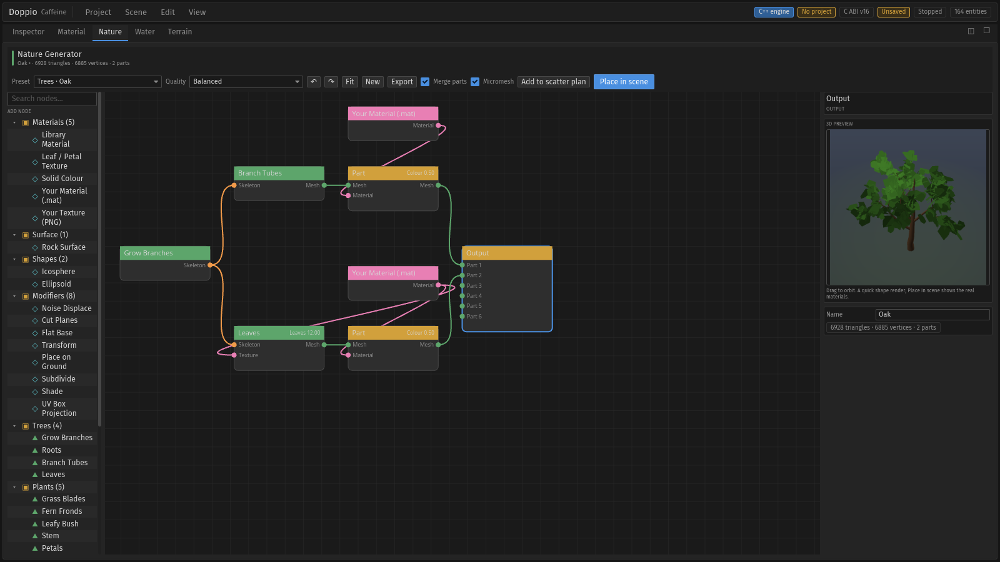
  <figcaption>O separador Nature com o grafo Oak</figcaption>
</figure>


<figure class="doc-figure">
  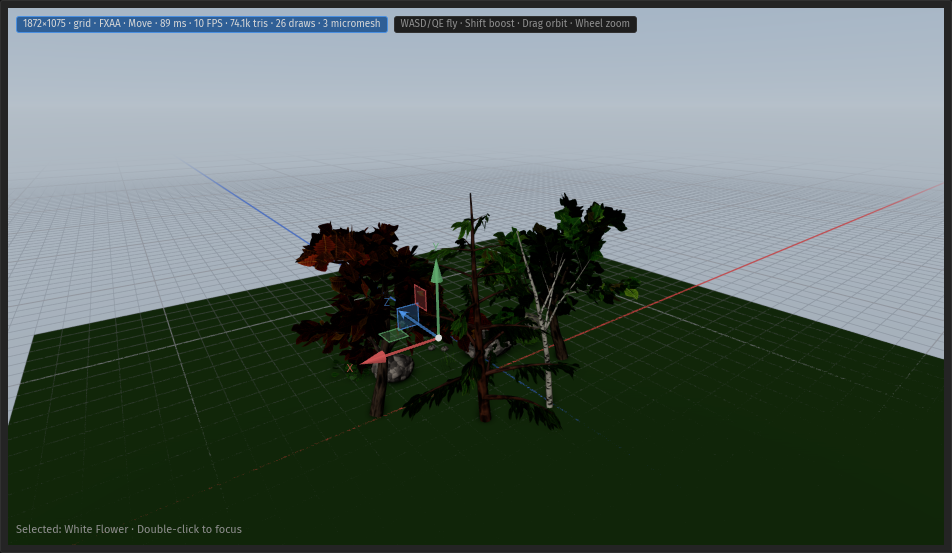
  <figcaption>Árvores geradas colocadas na cena</figcaption>
</figure>


<div class="doc-note">
<strong>Tudo é guardado e nada se perde.</strong> <em>Place in scene</em> e <em>Export</em> escrevem as meshes, um
material (e as suas texturas) por parte, <code>generator.nature</code> (com a lista dos ficheiros que escreveu),
<code>generator.material</code> para cada material de biblioteca e <code>Prefabs/&lt;name&gt;.prefab</code>. Faça duplo clique na
receita, no modelo do prefab ou chame <code>open_generator</code> para recuperar o grafo; faça duplo clique no prefab para colocar
outra cópia. Veja <a href="generator-recipes.md">Receitas de geradores</a>.
</div>

## 1. Como funciona um grafo

Três portas tipadas, desenhadas em três cores; uma ligação só une portas do mesmo tipo e nunca fecha um
ciclo (a linha de estado diz porque é que uma ligação foi recusada):

| Porta | Transporta |
|---|---|
| **Mesh** | geometria (posições, normais, UVs, índices) |
| **Skeleton** | uma árvore de ramos (tronco, ramos, raízes) que *Branch Tubes* e *Leaves* transformam em meshes |
| **Points** | posições, orientações e escalas produzidas por *Scatter Points* |

Toda a mesh que deva acabar no modelo passa por um nó **Part** até ao nó **Output** (uma entrada
por parte). Uma Part é uma mesh **e o seu material, ambos ligados**: a sua porta *Material* aceita um nó da
categoria **Materials**, e nada é escolhido dentro da Part. Uma parte sem material recusa-se a construir ("The
trunk part has no material: wire a material node..."). O motor dá um material por mesh, por isso cada parte
torna-se a sua própria entidade quando é colocada.

Interação: adicione nós a partir da paleta à esquerda (caixa de pesquisa, categorias) ou arraste-os dela; arraste os nós pelo
cabeçalho; arraste de uma porta de saída para uma porta de entrada; **Fit** enquadra o grafo; undo/redo cobrem todas as edições.
Selecionar um nó mostra os seus parâmetros na coluna da direita, ao lado da pré-visualização 3D em direto (arraste para orbitar).
Tudo é determinístico: o mesmo grafo, qualidade e seeds constroem sempre o mesmo modelo.

## 2. Catálogo de nós

| Categoria | Nós |
|---|---|
| Shapes | **Icosphere**, **Ellipsoid** |
| Modifiers | **Noise Displace** (altos e baixos fractais), **Cut Planes** (faces de rocha facetadas), **Flat Base**, **Transform**, **Place on Ground**, **Subdivide**, **Shade** (smooth / flat / ângulo de crease), **UV Box Projection** |
| Combine | **Merge** |
| Trees | **Grow Branches** (skeleton), **Roots**, **Branch Tubes**, **Leaves** (cards dobrados e caídos com um atlas de formas de folha, ou blobs) |
| Plants | **Grass Blades**, **Fern Fronds**, **Leafy Bush**, **Stem**, **Petals** |
| Scatter | **Scatter Points**, **Instance on Points** (musgo, seixos, folhas pequenas sobre qualquer mesh) |
| Output | **Texture** (imagens somadas num material), **Material** (definições de superfície), **Part**, **Output** |
| Materials | **Library Material** (presets de rocha, casca, chão), **Leaf / Petal Texture** (cards e atlas), **Solid Colour**, **Your Material (.mat)**, **Your Texture (PNG)** |
| Output | **Part**, **Output** |

As rochas são `Icosphere → Noise Displace → Cut Planes → Noise Displace (grain) → Flat Base → Transform → Place
on Ground → Shade → UV Box → Part`. As árvores são `Grow Branches → Branch Tubes → Part` mais
`Grow Branches → Leaves → Part` (e **Roots**). Como as etapas são nós, pode inserir as suas:
um segundo noise para desgaste, um Merge de duas rochas, um Scatter de seixos sobre um rochedo.

## 3. Qualidade: de low poly a alta fidelidade

A qualidade é uma propriedade do grafo (o seletor da barra de ferramentas); os nós leem-na, por isso **um só grafo cobre todo o
intervalo**.

| Quality | O que muda |
|---|---|
| **Stylized (low poly)** | no máximo 2 subdivisões da icosphere, rochas facetadas, copas em blob e troncos de 5 lados com flat shading, metade das contagens; os materiais passam para **cores sólidas** (não são precisas texturas) |
| Balanced | o grafo tal como foi criado |
| **Detailed** | mais uma subdivisão, troncos mais redondos, 1,6x os segmentos, folhas e lâminas, raízes e musgo que ficam desligados em qualidade inferior |

Regra testada: Stylized < Balanced < Detailed em contagem de triângulos para rochas, árvores e plantas.

<figure class="doc-figure">
  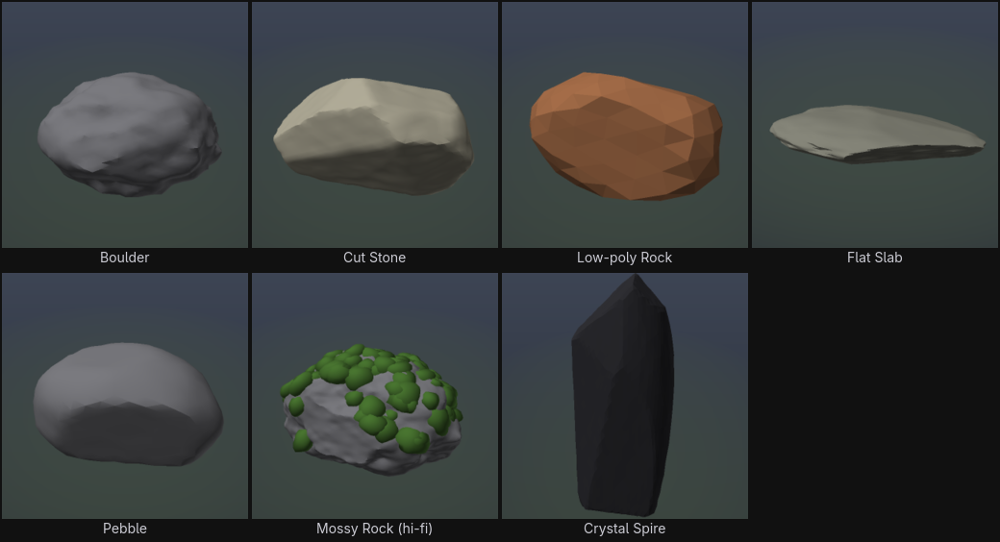
  <figcaption>Presets de rochas</figcaption>
</figure>


<figure class="doc-figure">
  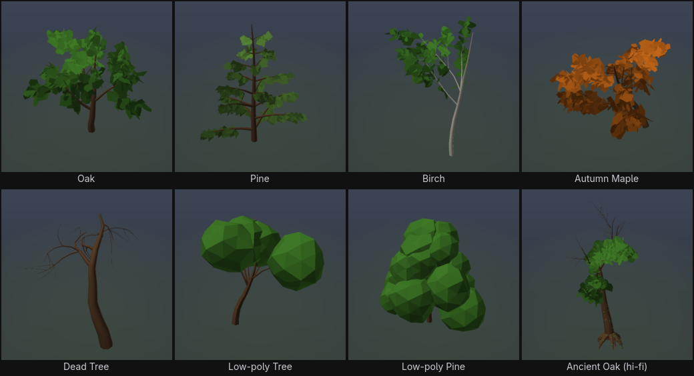
  <figcaption>Presets de árvores</figcaption>
</figure>


<figure class="doc-figure">
  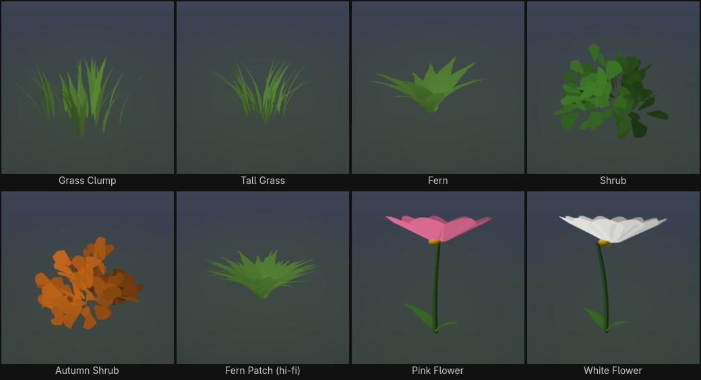
  <figcaption>Presets de plantas</figcaption>
</figure>


Os presets também são grafos (23 deles; abra um e todos os nós estão lá para editar). Os hi-fi mostram para que
serve o grafo: **Mossy Rock** (cards de musgo espalhados sobre a rocha), **Ancient Oak** (raízes, ramos grossos
e uma copa densa) e **Fern Patch** (um scatter de tufos de feto). Presets low-poly: Low-poly Rock,
Low-poly Tree e Low-poly Pine.

## 4. Os materiais são nós, e são assets reais

Nada de um material fica escondido dentro de um objeto gerado. Cada parte tem um **nó de material** ligado à sua
Part, e os grafos dos presets mostram-nos (um nó de casca a alimentar o tronco, uma textura de folha a alimentar as folhas):

| Nó | Dá |
|---|---|
| **Library Material** | um preset da biblioteca PBR (rocha, casca, chão), cozinhado uma vez em `Nature/Materials/` |
| **Leaf / Petal Texture** | um card recortado procedural (folha, pétala) ou um **atlas** (*Broadleaf Mix*, *Autumn Mix*: oito formas e tons de folha numa só imagem) cozinhado para RGBA |
| **Solid Colour** | uma cor simples e roughness, ideal para low poly |
| **Your Material (.mat)** | qualquer `.mat` do projeto, usado **tal como está**, nunca copiado nem recozinhado |
| **Your Texture (PNG)** | um PNG com alpha; é criado um material **Cutout** à sua volta (`Nature/Materials/project_<name>.mat`) |
| **Edit Library Material** | recebe um *Library Material* ou *Leaf / Petal Texture* (ou outro nó de edição) e passa-o adiante com alterações por cima; veja abaixo |

Quando usa **Place in scene**, o material de cada parte é escrito no projeto como um asset normal e atribuído à
entidade: abra-o no separador **Material** ou no Texture Generator e altere-o. Troque um nó (um Solid Colour
pelo seu próprio `.mat`) para mudar o que o modelo inteiro usa. O low poly (*Stylized*) transforma os materiais de biblioteca e de
cards em cores sólidas, mas **os seus próprios assets nunca são substituídos**.

O nó **Leaves** também recebe a textura da folha na sua porta *Texture* (o mesmo nó que alimenta a
Part das folhas), é assim que ele conhece a disposição do atlas, e dimensiona as folhas como uma **percentagem da altura da árvore**
(*Leaf size*, por defeito 7 %), para que as proporções acompanhem a árvore em vez de serem um número em metros.

As UVs vêm dos nós (UV Box para rochas, UVs de tubo para troncos, UVs de card para folhas), para que as suas texturas façam tiling
como esperado. Os ficheiros `.nature` guardados antes desta alteração não têm nós de material e precisam de um ligado.

### Editar um material de biblioteca ou uma textura de folha

Um asset de biblioteca é só de leitura: é a mesma casca ou o mesmo atlas de folhas para todas as árvores. Para o alterar para *este* modelo, selecione
o nó **Library Material** ou **Leaf / Petal Texture** e prima **Edit this material** (ação de agente
`nature_edit_material`). O Doppio adiciona um nó **Edit Library Material** a seguir a ele e liga-o entre o nó de biblioteca e
o que o usava, pelo que a árvore mantém o aspeto até mover um slider. O nó só aceita um nó de biblioteca, outro nó
de edição, ou um nó **Your Material** que aponta para um material que a biblioteca cozinhou para o projeto (`Materials/Nature/…`:
aplicar um preset num projeto transforma os nós de biblioteca nestes) na sua porta *Material*: qualquer outra coisa é recusada, por isso
o que ele edita é sempre um asset de biblioteca. Uma cadeia de nós de edição aplica-se por ordem.

<figure class="doc-figure">
  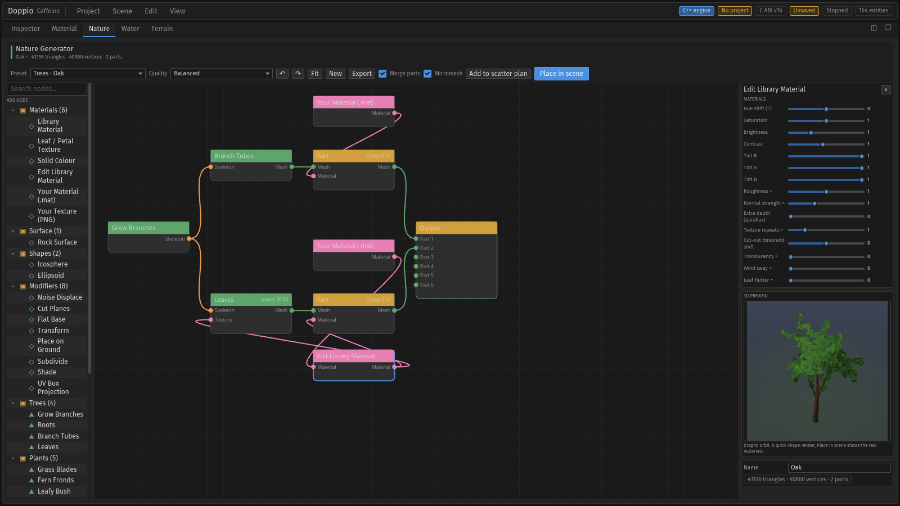
  <figcaption>O material das folhas do Oak depois de <strong>Edit this material</strong>: o nó novo fica por baixo do grafo, ligado entre
  o material e o Part das folhas, com os seus sliders à direita. Capturado por
  <code>docs/flows/capture-nature-docs.json</code>.</figcaption>
</figure>

Os outros geradores não têm um nó destes porque não têm um asset de biblioteca fixo para proteger: um preset de Material, Textura, Água ou
Terreno carrega-se como um grafo inteiro, e todos os nós dele já são editáveis.

| Slider | O que faz |
|---|---|
| **Hue shift**, **Saturation**, **Brightness**, **Contrast**, **Tint R/G/B** | uma correção de cor do mapa de cor (um atlas de folhas mantém o seu alpha). É escrita uma cópia graduada da imagem; uma base *Solid Colour* muda antes a sua cor. |
| **Roughness ×**, **Normal strength ×**, **Extra depth (parallax)** | a superfície: multiplica a roughness base e a força da normal; a profundidade é somada à altura do parallax (a altura vive no alpha do mapa de normais, por isso folhas e casca têm alguma). |
| **Texture repeats ×** | multiplica o tiling de UV do material (uma casca ou um chão mais apertado ou mais largo). |
| **Cut-out threshold shift** | faz crescer ou afina as formas das folhas de um material cut-out. |
| **Translucency +**, **Wind sway +**, **Leaf flutter +** | somados ao que a parte já tem. |

Colocar escreve o resultado como `<base>_e<hash>.mat` e `<base>_e<hash>_albedo.png` ao lado do material base; o hash é dos
valores dos sliders, por isso cada conjunto de alterações é o seu próprio par de ficheiros e o material de biblioteca por baixo nunca é tocado.
Um preset mantém os seus nós de biblioteca vivos quando um nó de edição os lê (a *regra de ouro* abaixo transforma os outros em
ficheiros *Your Material*), pelo que pode voltar ao nó e continuar a editar.

### Nós Texture e Material

As texturas vão **depois do objeto**: ligue a mesh (Leaves, Branch Tubes, uma rocha...) a um nó **Texture** e depois
a uma **Part**. Uma Part nova mantém *From nodes (Material / Texture)*, por isso o que os nós fizeram é o que é colocado;
escolher qualquer outro material na Part substitui-os.

* **Texture** recebe uma imagem através de um **asset slot**: uma miniatura com o nome do ficheiro, um **×** para limpar, **arraste uma imagem do painel Assets para cima dele**, ou clique nele para abrir o **seletor com pré-visualizações** (pesquisa incluída); continua a existir um campo de caminho para escrever e coloca-a num **mapa**:
  *Albedo*, *Normal* ou *Occlusion / Roughness / Metal*. Encadeie vários nós Texture e eles são **somados**
  por mapa, pela ordem de ligação, cada um com um **blend** (*Replace*, *Add*, *Multiply*, *Overlay*), uma força, os seus próprios
  repeats e (para o albedo) uma tint: uma cor de casca, depois uma textura de musgo multiplicada por cima, depois um mapa de normais de
  fissuras somado a um segundo. As normais somam as suas inclinações em vez das suas cores.
* **Fit to the object** reprojeta as UVs da parte a partir do seu próprio tamanho, para que a textura se adapte ao objeto:
  *Fit to object* repete-a N vezes ao longo da parte inteira, *Per metre* mantém a densidade de texels seja qual for o
  tamanho. *Keep mesh UVs* deixa as UVs do nó (os cards de folhas mantêm a sua célula do atlas).
* Uma imagem de albedo com transparência torna o material **cut-out** automaticamente (um PNG de folha); o cut-out também
  projeta sombras testadas por alpha.
* **Material** tem um slot **Base material (.mat)** (o mesmo seletor, arrastar e largar, apenas materiais): o material colocado parte desse `.mat` (os seus mapas e definições mantêm-se) e só as camadas e os interruptores que definir o alteram. Define a superfície da mesh: cor (a base sobre a qual as camadas fazem blend), roughness, metallic,
  cut-out, força da normal, translucência, wind sway e flutter. Ponha-o antes ou depois dos nós Texture: as
  camadas mantêm-se.

Colocar faz o bake dos mapas somados para `Textures/Nature/custom_<hash>_{albedo,normal,orm}.png` mais um `.mat` em `Materials/Nature/` (o
hash vem das definições, por isso definições diferentes nunca se sobrepõem). As imagens de origem são lidas a partir
do projeto e nunca são copiadas nem alteradas.

## 4b. Superfícies geradas: um conjunto de texturas cozinhado a partir do próprio modelo

O nó **Rock Surface** (categoria *Surface*, entre o último nó de mesh e **Part**) substitui um preset de biblioteca
por um **conjunto de texturas PBR gerado** (albedo, normal + height, occlusion/roughness/metal), para que uma
rocha tenha a superfície de um scan em vez de uma só textura repetida.

<figure class="doc-figure">
  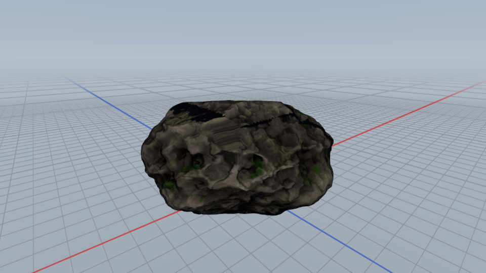
  <figcaption>O preset Photoreal Rock, colocado no motor</figcaption>
</figure>


Como funciona (`uikit/nature/bake.rs`, `surface.rs`):

1. **Atlas**: a mesh é desdobrada de novo em seis charts sem sobreposição (um cube map a partir do centro do modelo),
   cada um encaixado na sua própria célula. Os mapas cozinhados precisam de UVs únicas; as UVs de box-projection dos outros nós repetem-se.
2. **Mapas da mesh**: para cada texel, a posição, a normal suave, a **curvature** (arestas convexas vs fendas),
   a **ambient occlusion** (oclusores em disco num spatial hash, sem ray casting) e a altura são rasterizadas para o espaço UV.
3. As **camadas** leem esses mapas e ruído 3D nas posições cozinhadas, por isso nada parte nas costuras: tons de pedra
   e estratos, grão, **fissuras** que se aprofundam nas fendas, **desgaste das arestas** na curvatura convexa, crostas de **líquen**
   nas faces expostas, **musgo** nas cavidades e no topo, **pó** nas faces voltadas para cima.
4. A altura torna-se o mapa de normais (e o seu alpha, para parallax/displacement geométrico); a occlusion e a
   roughness são empacotadas no mapa ORM. Colocar escreve `Textures/Nature/rock_*_{albedo,normal,orm}.png`
   mais um `.mat`, reutilizado até um parâmetro mudar.

<figure class="doc-figure">
  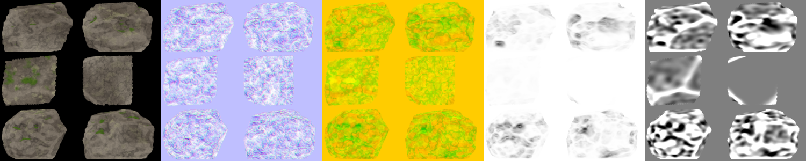
  <figcaption>Albedo, normal, ORM, ambient occlusion e curvature do Photoreal Rock</figcaption>
</figure>


Parâmetros: moss, lichen, cracks, edge wear, dust, pattern scale, warmth (de cinzento a arenito), texture size
(256-2048; Stylized limita-o a 512) e seed. Tudo é determinístico e testado (cobertura, sinal da curvature,
mais musgo significa mais verde, as mesmas entradas dão os mesmos mapas).

O motor amostra as linhas das texturas como `v * height` (sem inversão de V) e aplica `ORM` sobre os escalares do material com
a AO escalada pela força de AO do material; o bake segue ambos.

## 4c. Realismo: casca, folhas, vento e translucência

Colocar um modelo escreve agora materiais que fazem mais do que transportar uma textura plana.

<figure class="doc-figure">
  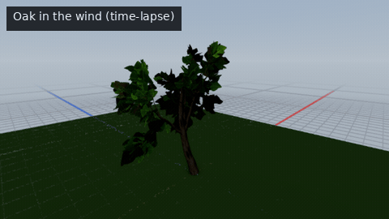
  <figcaption>Um carvalho colocado no motor, numa rajada constante. A copa inclina-se mais do que a base do tronco (o balanço cresce com a altura
  acima da origem), os cards de folhas cintilam por cima disso, e a sombra move-se com eles. Renderizado por
  <code>./scripts/render-world-docs.sh</code>.</figcaption>
</figure>

| O quê | Como |
|---|---|
| **Bark** | As escolhas de casca *Oak*, *Pine* e *Birch* são **geradas**, não o bake plano da biblioteca: um albedo com tiling, um mapa de normais com a altura no seu alpha (parallax e micro auto-sombreamento nos sulcos) e um mapa de occlusion/roughness. O Oak tem sulcos profundos e sinuosos com um pouco de musgo nas fendas, o pinheiro placas grandes cortadas por fissuras horizontais, o vidoeiro casca lisa e pálida com lenticelas escuras. Um repeat cobre o tronco uma vez à volta. |
| **Leaf normals** | Cada card de folha e de pétala recebe um **mapa de normais derivado do card**: nervuras a partir da luminância, um perfil de lâmina arredondado a partir da aresta do alpha. A roughness desce para 0,55 para que as folhas apanhem um brilho. |
| **Crown depth** | Os cards no fundo da copa escolhem a **folha madura escura** do atlas com mais frequência do que a casca exterior, e cada vértice de folha leva **occlusion cozinhada** (mais escuro dentro da copa, um pouco diferente por folha) na sua cor pintada. |
| **Alpha-tested shadows** | Os cards cut-out (folhas, pétalas, lâminas) **projetam sombras através do seu alpha**: a passagem de sombras do motor lê o albedo e descarta os buracos, por isso o sol passa pela copa e cada folha faz sombra às de baixo. |
| **Painted colour and flutter weight** | Os cards de folhas e as lâminas de relva/feto são exportados com uma **cor de vértice** (`v x y z r g b a` no `.obj`): o rgb tinge o albedo (occlusion, variação por folha), o alpha é o **peso do flutter** pintado ao longo da lâmina: 0 no caule ou na raiz (rígido, segue o seu ramo), 1 na ponta (cintilação total). O motor lê-o para um segundo stream de vértices; a inclinação com o vento segue sempre o objeto, só o flutter é pintado. |
| **GPU-instanced scatter** | As partes *Instance on Points* (musgo, seixos, plantas pequenas sobre uma superfície) são colocadas como **uma mesh modelo mais uma entidade por cópia**, agrupadas sob uma entidade contentora. As cópias partilham mesh e material, por isso o renderer faz batch delas numa só draw call instanciada, e cada cópia tem a sua própria fase de vento. A geometria fundida continua a ser o que a pré-visualização e o **Export** usam. Isto também vale para meshes com um stream de cor pintada (um terceiro vertex buffer alimenta o pipeline de folhagem instanciada). |
| **Translucency** | Folhas, lâminas, frondes e pétalas deixam passar a luz: a face virada para longe do sol brilha na cor da folha (as copas com luz por trás deixam de ficar pretas), mais forte quando se olha na direção do sol. Valores: folhas 0,55, lâminas e frondes 0,45, pétalas 0,4. |
| **Wind** | `wind_strength` é o balanço **por metro de altura acima da origem da entidade**, por isso uma copa alta mexe-se mais do que a base do tronco e a relva mexe-se nas pontas. Tronco, ramos e folhas usam o mesmo 0,012 (uma copa de 6 m inclina-se cerca de 20 cm numa rajada, com fase por árvore para que uma floresta não se mova em uníssono); as folhas somam `wind_flutter` 0,6 (cintilação rápida por vértice). As plantas baixas usam 0,25. A passagem de sombras aplica o mesmo deslocamento, por isso as sombras movem-se com a folhagem. |

Desde esta passagem a biblioteca está mais nítida e as folhas assentam melhor na árvore:

| O quê | Agora |
|---|---|
| **Resolution** | Casca, chão e rocha fazem bake a **1024 px** (eram 512); o atlas de folhas é **2048 x 1024** (oito folhas de 512 px). Os materiais escritos no tamanho antigo são **reconstruídos uma vez** da próxima vez que colocar. |
| **Leaf height map** | O mapa de normais da folha leva uma **altura** no seu alpha (as nervuras sobressaem da lâmina, a lâmina sobe a partir da sua aresta) e o material usa um pouco de parallax (0,02), por isso uma folha tem profundidade em vez de ser um card plano. |
| **Bark is not stretched** | A imagem da casca dá a volta a um ramo um número inteiro de vezes e o seu comprimento segue a circunferência do próprio ramo, para que os texels fiquem quadrados num raminho como num tronco (`bark_scale`: repeats à volta por metro de circunferência). |
| **Leaf size** | Os presets de folhosas usam folhas de 0,28 a 0,38 m numa árvore de 5 a 7 m (eram 0,5 a 0,75 m), com mais folhas e mais níveis de ramos; o **orçamento de triângulos** é distribuído por igual pelos ramos, para que a copa fique preenchida em vez de os primeiros ramos ficarem com tudo. |
| **Round crown** | O nó Grow Branches tem dois parâmetros novos, **Extra main limbs** (`scaffold`) e **Limbs sweep up** (`lift`), ambos a 0 por omissão, pelo que todos os outros presets e ficheiros antigos crescem como antes. O Oak usa 4 e 0,5: oito ramos mestres distribuídos por igual à volta do tronco (azimutes de ângulo de ouro, a começar mais acima) que saem dele a subir e a abrir, para que a copa encha em vez de ser meia dúzia de braços finos. |
| **Leaf shape** | As folhas em Balanced têm 3 filas (5 em Detailed) e os presets de folhosas curvam-nas em concha e em arco (*Fold* 0,55, *Droop* 0,4), por isso uma folha tem perfil em vez de ficar plana; continua a ser um cartão, com o relevo do seu mapa de altura. |
| **Brighter leaves** | A imagem da folha é aclarada (brilho x1,45, saturação x1,12) quando é cozinhada, para `<nome>_leaf.png` e `_leaf_n.png`; os ficheiros `_cards` antigos são refeitos uma vez. |
| **Shade** | As superfícies translúcidas (folhas, pétalas, lâminas) recebem no shader um mínimo de luz de céu dispersa, para que o lado de uma copa afastado do sol seja verde escuro em vez de preto. Use *Brightness* num nó de edição para ir mais longe. |

Estas definições também são sliders no separador **Material** (*Translucency*, *Wind sway*, *Wind speed*, *Leaf
flutter*) para os seus próprios materiais, e vivem no `.mat` como `wind_strength`, `wind_speed`, `wind_flutter` e
`translucency` (C ABI v9). O vento depende do tempo, por isso toca no viewport enquanto o motor renderiza.

**Stylized (low poly)** mantém tudo isto: as cores sólidas continuam a balançar, a cintilar e a deixar passar a luz, de modo que um
tronco de 5 lados com copas em blob se move e brilha como o modelo detalhado. As partes chamadas `rock`, `moss`, `ground`
e `body` ficam quietas.

Os ficheiros de material escritos por versões anteriores não são reutilizados: o perfil de vento faz parte do nome do ficheiro
(por exemplo `green_leaf_w12f60t55.mat`), por isso colocar de novo escreve os novos.

## 4d. Pastas de assets

Todos os geradores perguntam a um único sítio (`uikit/asset_folders.rs`) onde escrever, e esse sítio **reutiliza uma pasta
existente seja qual for a capitalização** (um projeto com `textures/` continua a usá-la) e só cria o nome com maiúscula
quando não existe nenhuma:

| Conteúdo | Pasta |
|---|---|
| Meshes Nature e receitas `.nature` | `Models/Nature/` |
| Ficheiros `.mat` Nature | `Materials/Nature/` |
| Mapas cozinhados desses materiais | `Textures/Nature/` |
| `.png` + `.texgraph` do Texture Generator | `Textures/` |
| Projetos Texture Set | `TextureSets/` |
| Resultado do Material Generator | `Materials/` |

## 5. Colocar modelos na cena

**Export** escreve `Models/Nature/<name>_<part>.obj` (um por parte) e a receita editável
`Models/Nature/<name>.generator.nature` na pasta de assets do projeto (veja *Pastas de assets* abaixo). **Place in scene** faz isso e constrói o modelo como uma **entidade de grupo** com um
filho por parte:

* a mesh vai para um **Mesh Filter** (primitiva Custom) mais um Mesh Renderer;
* todas as partes projetam sombras; os cards cut-out usam sombras testadas por alpha (veja 4c);
* as partes com scatter tornam-se uma entidade contentora com um filho por cópia (veja 4c, GPU-instanced scatter);
* o grupo aparece no foco do viewport, fica selecionado, e a colocação é um único passo de undo.

### Merge parts: uma entidade, um slot de material por parte

Com **Merge parts** ligado (por defeito, uma checkbox na barra de ferramentas ao lado de *Place in scene*; ação de agente `nature_merge_parts`) as partes que não são cópias de scatter
são colocadas como **no máximo duas entidades**: uma para as partes sólidas (tronco, ramos, raízes, rochas) e outra para as partes cut-out (folhas, pétalas,
lâminas; mantêm a sua definição sem sombra). Cada entidade fundida tem **uma mesh com uma sub-mesh por parte**: Place escreve
`<name>_solid.obj` / `<name>_foliage.obj` com um grupo `usemtl <part>` por parte (o motor transforma cada grupo numa sub-mesh), e preenche os
**Material slots** do Mesh Filter com o `.mat` de cada parte, pela mesma ordem (`a.mat;b.mat`, um slot vazio usa o material da própria entidade).
Os material slots são uma funcionalidade do motor, não um truque do Nature: qualquer OBJ com grupos `usemtl` ou um glTF com várias primitivas os aceita (veja
`micromeshes.md` e o roadmap). Desligue Merge parts para voltar a ter uma entidade por parte.

### Micromesh ao colocar

Com **Micromesh** ligado (também na barra de ferramentas; ação de agente `nature_micromesh`) uma parte sólida com **3 000 triângulos ou mais** é colocada com o interruptor Micromesh do Mesh
Renderer ligado, para que rochas e troncos densos sejam desenhados como um corte de clusters escolhido pela GPU (veja `micromeshes.md`). Os cards cut-out e
as cópias de scatter nunca o recebem (os caminhos testados por alpha e instanciados mantêm-se como estão); uma parte com wind sway volta por si a um draw simples.

### Add to scatter plan: de uma árvore a uma floresta

**Add to scatter plan** (barra de ferramentas; ação de agente `nature_add_to_scatter`) escreve o modelo no `Scatter/default.scatter` do projeto como uma **classe
composta**: as meshes sólida e de folhagem são escritas como OBJs fundidos com os seus material slots, e a classe lista-as como linhas `part`, de modo que cada
instância que a ação de scatter coloca é uma entidade vazia com um filho por parte. O espaçamento vem da pegada do modelo (uma copa de 6 m recebe cerca de 2,4 m de
raio e 7 m entre células), o intervalo de escala é 0,8 a 1,3, e *where* começa em encostas suaves; edite o plano para alterar qualquer um deles
(separador *Terrain* > *Edit scatter plan*). Veja *Scatter on a terrain* em `terrain-generator-guide.md`. Testado de ponta a ponta: um Oak adicionado a partir do separador Nature
é plantado pelo *Scatter* do separador Terrain como uma floresta de árvores de duas partes (`nature_models_scatter_from_the_terrain_tab_as_composite_instances`).

<figure class="doc-figure">
  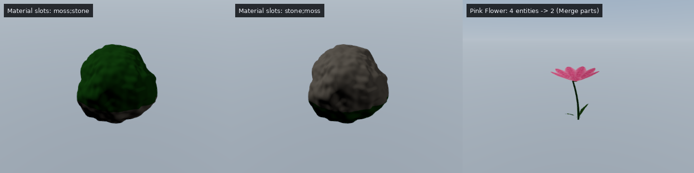
  <figcaption>Material slots no motor. Esquerda e meio: a mesma rocha de dois grupos, <code>Material slots</code> = <code>moss;stone</code> e
  <code>stone;moss</code>. Direita: a Pink Flower colocada com Merge parts, 4 entidades passam a 2 (caule e folha partilham uma, pétalas e centro a
  outra), cada uma com a sua própria lista de slots. Regenere com <code>scripts/render-material-slots-docs.sh</code>.</figcaption>
</figure>

## 6. Ficheiros, scripting e agentes

`.nature` é texto: o cabeçalho `CAFNATURE2`, o nome e a qualidade, depois as linhas de nós e ligações `NATUREGRAPH1`
(incluindo quaisquer caminhos de assets do projeto). Carregá-lo reconstrói exatamente o mesmo modelo. Sem janela nem motor:

```bash
doppio-material nature --list
doppio-material nature Oak --out /tmp/nature --quality 2
doppio-material nature --all --out /tmp/nature --seed 7
```

MCP (`--features agent`): consulta `nature` (grafo, nós, parâmetros, presets); ações `nature_apply_preset
{ name }`, `nature_add_node { op }`, `nature_connect { from, output, to, input }`, `nature_set { node, param,
value | string, quality, name }`, `nature_export` e `nature_place`. Headless: a fixture `nature` constrói uma
cena com motor de modelos gerados (`reset` aceita um `preset`).

### Variantes a partir de uma receita

A receita guardada também é uma entrada para outras ferramentas. `doppio-material variants Oak.generator.nature --out DIR --count 8 --seed 3`
cozinha oito variantes determinísticas: o `seed` de cada nó é movido por um hash da seed da variante, e as partes OBJ vão para
`DIR/<name>_<key>/`, onde a chave faz o hash do grafo da receita, da sua `generator_version`, da seed e da qualidade. Executá-lo
de novo reutiliza as pastas; editar a receita muda a chave. Um gerador de scatter ou de vegetação deverá chamar a mesma
função (`uikit::recipe_ref::nature_variants`). Veja [`generator-recipes.md`](generator-recipes.md).

## 7. Correções do motor encontradas ao construir isto

* **Um crash em `propagateTransforms`**: um grupo cujos filhos ainda não tinham matriz de mundo adicionava o componente
  enquanto a hierarquia estava a ser iterada, o que invalidava a iteração. As matrizes novas são agora recolhidas
  primeiro e escritas depois (teste C++ em `tests/test_scenemanager.cpp`).
* As meshes custom são desenhadas a partir do **Mesh Filter**, não do caminho `Mesh` do Mesh Renderer, por isso a colocação
  define o filter.

## 8. Limites e roadmap

### Folhas: o que está feito, o que ainda falta

<figure class="doc-figure">
  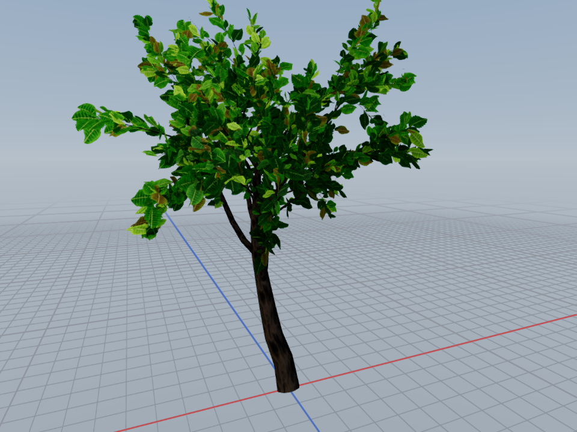
  <figcaption>O Oak colocado num projeto, tal como o motor o desenha, com a copa redonda, as folhas mais pequenas em concha e a
  imagem da folha aclarada. Renderizado a partir das entidades colocadas, com uma luz direcional.</figcaption>
</figure>

<figure class="doc-figure">
  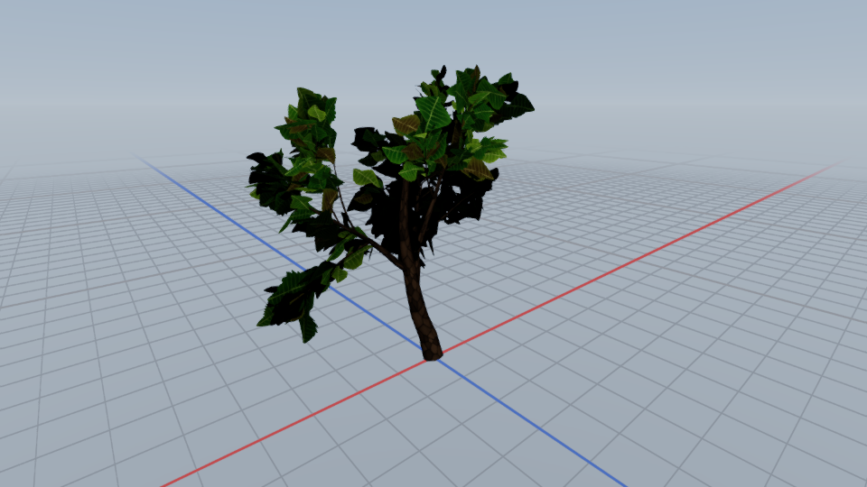
  <figcaption>Um carvalho com o atlas de folhosas: formas, tons, dobras e queda diferentes</figcaption>
</figure>


**Feito (o primeiro refinamento da vegetação):**

* **Folhas de muitas formas.** A opção *Leaf shapes* do nó Leaves usa um **atlas 4 x 2** cozinhado a partir do operador de folha do
  Texture Generator: folhas ovadas, serrilhadas, estreitas, arredondadas, maduras escuras, jovens verde-amareladas, de bordo seco e
  lobadas (*Broadleaf Mix*), ou a paleta de outono (*Autumn Mix*). Cada card escolhe uma célula aleatória, por isso uma copa
  mistura formas e tons; os tamanhos dos cards variam de 0,55x a 1,35x. Oak, Birch, Autumn Maple, Ancient Oak e os
  outros presets de folhosas usam-no.
* **Folhas que não são um quad plano.** Cada card é uma **lâmina dobrada e caída**: três vértices na largura (as
  bordas ficam mais baixas do que a nervura central, um V pouco profundo), 2-4 segmentos ao longo dela consoante a qualidade, a ponta a cair sob o seu
  peso e uma ligeira torção. *Fold* e *Droop* são parâmetros do nó. Um teste verifica que o atlas é amostrado por inteiro,
  que a lâmina não é plana e que Detailed tem mais segmentos do que Balanced.

**Ainda falta:**

* **Meshes de folha 3D reais** para as folhas mais próximas. (A face de trás translúcida e o mapa de normais do card estão feitos,
  veja 4c.)
* **Folhas compostas e tufos de agulhas** como células do atlas (o atlas é só de folhosas; as coníferas continuam a usar o
  card único). A tint por folha vem agora também da cor de vértice pintada, além das células do atlas.
* **Casca a partir do bake da mesh.** A casca gerada (4c) faz tiling no espaço UV; o mesmo bake usado pelo Rock Surface
  (curvature, AO, height) poderia gerar nós, descasque, musgo no lado sombrio, raízes que se alargam para o chão,
  ramos partidos e tocos (a referência é um toco podre e musgoso).
* **Cobertura de solo que se mistura.** Tapetes de musgo e relva baixa misturados com folhada, ramitos, pinhas e plantas
  pequenas, como um **material de solo misturado mais instâncias**: o musgo como camada de superfície (já o é nas rochas)
  e como tufos grossos; a relva como lâminas GPU-instanced com variação de cor e manchas secas.
* **Árvores como um modelo mais um conjunto de texturas**: uma mesh de tronco com o seu conjunto de casca, tubos de ramos com o seu próprio, e
  aglomerados de folhas, tudo conduzido pelo mesmo grafo e intervalo de qualidade.

Referências para o objetivo: um toco musgoso fotorrealista com fetos, trevo e folhada à volta; uma copa densa de
carvalho com folhas variadas e curvas.

* O nó Rock Surface cobre **apenas rocha** por agora; as superfícies de casca, cards de relva e solo usam o mesmo bake com outras camadas. As faces íngremes de uma rocha muito irregular ainda esticam um pouco no atlas em cubo (um desdobramento com noção de costuras resolveria isso).
* Os material slots já existem (veja *Merge parts*); o que falta para a vegetação hi-fi é o alargamento das raízes e a mistura no contacto com o solo.
* A lista de slots é um campo de texto de no máximo ~250 bytes: cerca de sete slots com caminhos relativos ao projeto. A colocação mantém os slots que cabem inteiros
  e reporta os restantes.
* O preset Low-poly Pine continua a ser uma pilha de blobs em vez de cones em níveis; é desejado um nó de níveis cónicos.
* A cor pintada existe apenas em cards de folhas e lâminas (troncos e rochas são brancos), não há cadeia de LOD nem
  impostor billboard para árvores distantes.
* A pré-visualização é um render rápido de formas sem texturas nem sombras; **Place in scene** mostra a coisa real.
* Apenas `.obj` (ainda não há escritor de `.glb`).
* O scatter sobre terreno, os biomas e os mapas de densidade pertencem ao gerador de terreno, que é separado.

Scatter, LOD e impostores estão planeados em [`photoreal-world-roadmap.md`](photoreal-world-roadmap.md).

## 8b. Árvores quase fotorrealistas com o que existe hoje

Uma árvore fotorrealista não é uma funcionalidade: é uma **silhueta** irregular, **casca** com relevo real, uma copa
cujas folhas diferem e se sombreiam umas às outras, **luz que atravessa as folhas**, **movimento**, e sobretudo
**variedade** (não há duas árvores iguais). A ferramenta já tem resposta para a maioria destes pontos; esta secção é a receita para
os combinar, seguida de uma lista honesta do que ainda fica aquém de uma fotografia de perto.

<table class="doc-table">
  <thead><tr><th>Ingrediente</th><th>Estado</th><th>Como obter agora</th></tr></thead>
  <tbody>
    <tr><td>Esqueleto irregular</td><td>Feito</td><td><strong>Grow Branches</strong>: <em>Gnarl</em>, <em>Droop</em>, 3-4 níveis, <em>Branches start at</em> 0,3-0,4, um orçamento alto de segmentos, seeds diferentes</td></tr>
    <tr><td>Relevo e cor da casca</td><td>Feito (espaço UV)</td><td>casca gerada de carvalho, pinheiro ou vidoeiro: sulcos com parallax, occlusion nas fendas, musgo nas fendas do carvalho; empilhe os seus próprios scans com nós <strong>Texture</strong></td></tr>
    <tr><td>Raízes e base do tronco</td><td>Parcial</td><td>nó <strong>Roots</strong> (o alargamento é geometria, não uma saia misturada)</td></tr>
    <tr><td>Folhas variadas</td><td>Feito</td><td>atlas de folhas 4 x 2, cards dobrados e caídos, tamanhos de 0,55-1,35x, folhas interiores escuras</td></tr>
    <tr><td>Sombreamento das folhas</td><td>Feito</td><td>occlusion da copa cozinhada na cor de vértice, mapa de normais a partir do card, sombras testadas por alpha, <em>translucency</em></td></tr>
    <tr><td>Movimento</td><td>Feito</td><td>wind sway partilhado por tronco e copa, flutter pintado nas pontas das folhas, fase por árvore</td></tr>
    <tr><td>Variedade numa floresta</td><td>Feito na ferramenta, ainda não no mundo</td><td>variantes com seed (<code>doppio-material variants</code>) e o núcleo de scatter (tint, escala, variante por instância)</td></tr>
    <tr><td>Estação, chuva, neve, idade</td><td>Feito</td><td>modificadores em tempo de execução no Mesh Renderer ou no material: tint, wetness, snow, age</td></tr>
    <tr><td>Massa de árvores</td><td>Parcial</td><td>cópias instanciadas em batch; ainda sem cadeia de LOD nem impostores</td></tr>
  </tbody>
</table>

### A receita (uma folhosa madura, cerca de 12 m)

1. **Quality: Detailed.** Acrescenta segmentos, troncos mais redondos e as raízes; mantenha a pré-visualização em Balanced enquanto edita.
2. **Skeleton.** *Grow Branches*: Height 12, Trunk radius 0,35-0,45, Branch levels 4, Branches per limb 4-5, Branch angle
   40-55, Child length 0,55-0,65, Taper 0,85, **Gnarl 0,4-0,55**, **Droop 0,2-0,3**, Branches start at 0,35, Segment budget
   4000-6000. Gnarl e droop é o que separa uma árvore de um diagrama; mude apenas a seed para obter uma irmã.
3. **Tronco.** *Branch Tubes* com ~10-12 lados, depois um nó **Roots** (6-9 raízes, Dive below ground 0,4) fundido na mesma
   parte para que a base se alargue. Acrescente a seguir um nó *Texture* (veja abaixo) em vez de um preset de casca plano.
4. **Material da casca.** Um *Library Material* para a casca de carvalho gerada dá relevo e occlusion. Para um plano de perto, ligue
   nós *Texture* por esta ordem ao tronco: **Albedo** (o seu scan de casca, *Per metre* 0,5), **Normal** (o mapa de
   normais do scan, *Add*), **ORM** (a sua roughness e occlusion), depois um segundo **Albedo** com uma imagem de musgo ou líquen
   (*Multiply*, força 0,4, tint para o verde) para que o tronco inferior à sombra não tenha a mesma cor que os ramos superiores.
   *Per metre* mantém a mesma densidade de texels num tronco de 12 m e num ramo de 2 m.
5. **Folhas.** *Leaves* nos ramos exteriores e ~0,45 nos interiores, **Leaf shapes: Atlas**, Leaf size cerca de 5-7 % da
   altura da árvore, Fold 0,35, Droop 0,3, orçamento de triângulos 15000-30000. O atlas dá oito formas e tons; as folhas
   interiores usam automaticamente a célula escura e levam occlusion cozinhada, que é a maior parte da "profundidade" da copa.
6. **Material da folha.** Uma *Leaf / Petal Texture* com o atlas de folhosas, ou o seu próprio PNG com alpha através de um nó *Texture*
   (torna-se cut-out e projeta sombras através do seu alpha). Acrescente um nó *Material*: **Translucency 0,5-0,6, Wind sway
   0,012 (o mesmo do tronco), Leaf flutter 0,5-0,7**. O sway tem de coincidir com o do tronco ou as folhas descolam-se dos
   ramos.
7. **Contacto com o solo.** Ponha a árvore no terreno com *Place on Ground*; faça scatter de partes *Instance on Points* de musgo, feto e
   folhada à volta da base (são colocadas como cópias em batch com a sua própria fase de vento).
8. **Variantes.** Guarde a receita e cozinhe de oito a dezasseis seeds (`doppio-material variants Oak.generator.nature --count 12`)
   para que um grupo de árvores não seja doze cópias. A escala (0,8-1,25) e uma variação de tint de alguns por cento por canal são a segunda
   metade da variedade; o núcleo de scatter gera ambas por instância.

### Definições de iluminação e renderização que importam

* Uma **luz direcional com cascaded shadows** e o céu de ambiente: as folhas só ficam bem quando a luz lhes chega
  por trás. A translucency é o que impede uma copa com luz por trás de ficar preta.
* Mantenha as **sombras testadas por alpha** ligadas (por defeito): a copa faz sombra a si própria e ao tronco.
* Deixe o **Photon** ou a ambient occlusion ligados para o escurecimento de contacto entre o tronco e o solo.
* Use os **modificadores em tempo de execução** em vez de voltar a fazer bake: *Age* 0,2-0,4 numa árvore velha, *Wetness* depois da chuva (casca mais escura,
  folhas brilhantes), *Snow* por estação, uma *Tint* quente para o outono.

### O que ainda fica aquém de uma fotografia de perto

<details>
  <summary>Lista honesta, e que roadmap resolve cada ponto</summary>
  <ul>
    <li><strong>As folhas são cards, não meshes.</strong> A um metro a silhueta é um card com borda de alpha; estão planeadas meshes de folha 3D reais para as folhas mais próximas (secção 8, <em>Real 3D leaf meshes</em>).</li>
    <li><strong>A casca faz tiling no espaço UV.</strong> Sem nós, placas a descascar, tocos partidos nem musgo que siga o lado sombrio: o bake da mesh que conduz o Rock Surface poderia fazê-lo (<em>Bark from the mesh bake</em>).</li>
    <li><strong>Um material por tipo de superfície.</strong> Uma entidade fundida tem um material slot por parte (tronco, ramos, raízes, cada um com a sua casca), mas as partes sólidas e cut-out continuam a ser duas entidades porque as sombras são por entidade.</li>
    <li><strong>Sem modelo de subsurface scattering.</strong> A translucency é um termo de luz por trás, não luz a difundir-se dentro de uma folha ou casca.</li>
    <li><strong>Sem cadeia de LOD nem impostores.</strong> Uma árvore hero é cara e uma floresta delas ainda não é possível (<a href="photoreal-world-roadmap.md">photoreal-world-roadmap.md</a>, fase 4).</li>
    <li><strong>Nada coloca árvores sobre o terreno por si.</strong> O núcleo de scatter existe e está testado, mas nenhuma ferramenta do editor nem máscara de terreno o alimenta ainda (fases 1, 2 e 6).</li>
    <li><strong>A iluminação global é em screen-space para a luz direta.</strong> A luz que ressalta sob uma copa é aproximada até o Photon injetar as luzes reais (<a href="graphics-roadmap.md">graphics-roadmap.md</a>, fase P-A).</li>
    <li><strong>Geometria densa.</strong> Um tronco de 100k triângulos com geometria de casca real precisa do renderer de clusters, e ele existe: ligue o <strong>Micromesh</strong> no Mesh Renderer de uma parte opaca colocada (rochas, troncos, rochedos) e ela é desenhada como um corte de clusters escolhido pela GPU com sombras, cores de vértice e sub-meshes (veja <a href="micromeshes.md">micromeshes.md</a>; 6x menos triângulos em rochas densas, 3x numa floresta densa). Colocar liga-o para partes sólidas de 3 000 triângulos ou mais (a checkbox <strong>Micromesh</strong>), e os cards de folhagem testados por alpha e as partes animadas por vento ficam no caminho instanciado por desenho.</li>
  </ul>
</details>

### Checklist de qualidade antes de colocar uma árvore hero

| Verificação | Objetivo |
|---|---|
| Triângulos | 40-120 k para uma árvore hero em Detailed, 8-20 k em Balanced, menos de 2 k em Stylized |
| Silhueta | dois ramos nunca paralelos, taper e gnarl visíveis a 30 m |
| Casca | relevo visível com luz rasante, pelo menos duas camadas de cor, sem tiling visível a 5 m |
| Copa | interior escuro, rebordo claro, sol a brilhar através das folhas por trás |
| Movimento | tronco e copa balançam juntos, só as pontas cintilam |
| Floresta | 8+ variantes, escala e tint por instância, wetness ou age definidos pelo mundo, não cozinhados |

## 9. Regenerar as imagens

```bash
./scripts/render-nature-docs.sh       # the three preview sheets (software renderer, no engine)
./scripts/capture-nature-docs.sh      # headless screenshots of the tab and the placed scene (needs libcaffeine-capi)
```

## Regra de ouro: todo o material é um asset

Os nós Library Material, Leaf / Petal Texture e Solid Colour (e todos os presets) são apenas
**moldes**. Aplicar um preset, ou colocar um modelo, escreve a imagem e o `.mat` de cada material em
`Nature/Materials/` no seu projeto e transforma o nó em **Your Material (.mat)** a apontar para
eles. Nada fica escondido no menu: abra o `.mat` no separador Material, repinte o PNG, ou
aponte o nó para outro ficheiro. Um material só é escrito uma vez, por isso as suas edições são mantidas.
Your Material e Your Texture trazem *Shapes across / down*, a disposição do atlas da imagem, que
o nó Leaves lê para saber quantas formas de folha contém.

### Abrir ficheiros `.nature` antigos

Os ficheiros guardados antes de os materiais passarem a nós (`NATUREGRAPH1`) são migrados quando carregam. Cada Part recebe o
nó de material que a sua escolha antiga significava (biblioteca, textura, cor sólida com a sua cor antiga, o seu `.mat` ou o seu
PNG com o seu caminho antigo). O nó Leaves é ligado à textura da sua parte de folhas para ler o atlas a partir dela,
e o seu tamanho antigo em metros torna-se uma fração da altura da árvore (medida nessa árvore), com fold e droop
mantidos. Guardar escreve o novo formato (`NATUREGRAPH2`), que as versões antigas não conseguem abrir. Uma escolha de forma de folha
de "atlas" numa textura de imagem única não é transportada: a disposição vem agora da textura.

## Usar num mundo

O [World Composer](world-composition.md) coloca receitas de natureza por referência: uma linha `class` indica uma
receita `*.generator.nature` e o composer faz o bake do seu conjunto de variantes, por isso editar a receita muda
todas as árvores do mundo. Exponha um parâmetro do grafo e uma composição pode controlá-lo a partir do
terreno com `adapt param.<name> <mask>`: uma copa que cresce mais perto da água, por exemplo. O texto do grafo
declara-o com uma linha por parâmetro, `expose <name> <node>.<param> [min max]` (por exemplo
`expose rough 2.amount 0.1 1.25`); sem intervalo aplica-se o do próprio parâmetro, e um grafo sem nada exposto fica
igual, por isso as receitas antigas e as suas caches de bake continuam válidas. Uma classe com
`unique on` é gerada uma vez por instância, para objetos hero.
