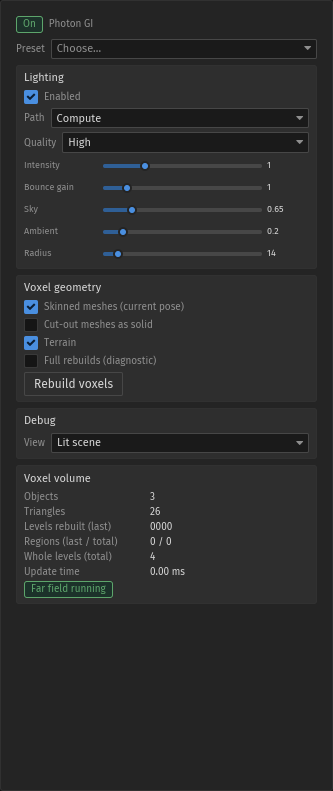

# Photon: iluminação global no Doppio

<div class="doc-meta">
  <span class="doc-badge doc-badge--stable">Estável</span>
  <span class="doc-badge">Doppio</span>
  <span>Última atualização: <time datetime="2026-11-21">2026-11-21</time></span>
</div>

<p class="doc-lede">Luz indireta, cor que passa de uma superfície à outra e oclusão do céu sem hardware de ray tracing, e o separador Photon que a gere.</p>

O Photon é a iluminação global (GI) do motor. O Doppio edita-o no separador **Photon** (menu View, junto aos
geradores) e no componente `Photon GI` do Inspetor: os dois escrevem os mesmos campos, por isso nunca discordam.

<figure class="doc-figure">
  
  <figcaption>O separador Photon: iluminação, geometria dos voxels, vista de depuração e as estatísticas dos voxels ao vivo</figcaption>
</figure>

## 1. Como funciona o Photon

| Parte | O que faz |
|---|---|
| Campo próximo | Cascatas de radiância ancoradas ao ecrã (K até 0) traçadas contra o buffer de profundidade, fundidas da frente para trás e resolvidas em probes SH-L1 (`photon_cascade.comp`, `photon_c0.comp`) |
| Campo distante | Quatro níveis de clipmap de voxels (células de 0,25, 0,5, 1 e 2 m, 64 ao cubo cada) com uma grelha de probes por nível; os raios que saem do ecrã consultam-no |
| Volume de materiais | O albedo e a cobertura das superfícies da cena, escritos pelo **voxelizador de triângulos** (`photon_voxelize_tri.comp`) e pelo preenchimento pelo ecrã |
| Injeção | O sol, as luzes de ponto e os focos, e o céu, são injetados nas faces dos voxels com uma sombra marchada no volume de materiais (`photon_inject.comp`) |
| Realimentação | A irradiância do frame anterior volta a entrar com um limite e um histórico reprojetado, que é o multi-bounce |
| Média temporal | Cada probe desloca as suas direções traçadas por um valor fixo próprio, por isso o ruído não é coerente; o resolve junta à irradiância deste frame a do anterior, reprojetada (peso 0,4 enquanto a cena muda, 0,07 parada, mais rápido nas diferenças grandes), e as probes distantes seguem o mesmo peso |

As cascatas do ecrã dominam o que a câmara vê. O campo distante é o que ilumina uma superfície com coisas que a câmara
não vê: a parede atrás dela, a face de baixo de um teto, o ressalto do sol por uma fresta.

## 2. O separador Photon

O separador edita o primeiro componente `Photon GI` da cena (o renderizador lê o último ativo, por isso mantenha um só). **Add Photon GI**
cria-o numa entidade nova (ligado, caminho de compute, qualidade High) quando a cena não tem nenhum.
Cada edição passa pela API de componentes do motor e regista um passo de desfazer (um slider é um passo por campo, não por valor).

| Controlo | Campo | O que faz |
|---|---|---|
| **Enabled** | `Enabled` | Photon ligado ou desligado |
| **Path** | `Path` | A recolha de recurso no ecrã, ou as cascatas de compute com o campo distante de voxels |
| **Quality** | `Quality` | Off, Low, Balanced, High ou Eco: espaçamento das probes e número de cascatas |
| **Intensity** | `Intensity` | Multiplicador da luz indireta, do campo próximo e do distante |
| **Bounce gain** | `Bounce gain` | Escala a luz que os voxels guardam (veja a secção 4) |
| **Sky** | `Sky intensity` | A luz do céu que um raio encontra quando sai do ecrã e dos voxels |
| **Ambient** | `Ambient` | Um ressalto ambiente extra somado ao recurso |
| **Radius** | `Radius` | Alcance das cascatas do ecrã, em unidades do mundo |
| **Skinned meshes** | `Voxel skinned meshes` | Malhas com esqueleto no volume, na sua pose atual |
| **Cut-out meshes as solid** | `Voxel cut-out meshes` | Os cartões de folhagem contam como blocos sólidos (desligado por omissão) |
| **Terrain** | `Voxel terrain` | Malhas de terreno no volume |
| **Full rebuilds** | `Full rebuilds` | Diagnóstico: refazer todos os níveis a cada alteração |
| **Rebuild voxels** | | Deita o volume fora; o frame seguinte voxeliza a cena outra vez |
| **View** | `Debug view` | Cena iluminada, só a GI, ou só o recurso do céu |

## 3. O que está no volume de voxels

O voxelizador de triângulos escreve a geometria da cena no volume, incluindo o que a câmara nunca vê:

* **Malhas opacas** sempre, com a cor do seu material vezes a cor média da sua imagem (cinzento médio quando a
  imagem não pode ser lida), por ranhura de material. As superfícies com blend não são sólidas e ficam de fora.
* **Terreno** a partir da sua malha, com uma cor de terra tirada do seu tint (as suas camadas de splat não são uma imagem só).
* **Malhas com esqueleto** na pose do frame; são revoxelizadas onde se movem.
* **Malhas recortadas** só quando o interruptor está ligado: os cartões de folhagem passam a sombrear como blocos sólidos.
* A água e as luzes volumétricas nunca.

### Regiões sujas

Cada objeto tem um hash da sua malha, transformação, pose e cor. Um frame em que nada mudou custa um hash por objeto.
Quando um objeto se move, o voxelizador limpa e revoxeliza só as caixas onde ele esteve e onde está, nos quatro níveis
(cada caixa alargada por uma célula do nível); no máximo oito caixas, acima disso os níveis refazem-se por inteiro. Um nível também se refaz
por inteiro quando a origem do seu clipmap se move. O painel mostra as duas contagens.

### O teto de 1 milhão de triângulos

Acima de 1 milhão de triângulos o voxelizador não corre e fica só o preenchimento pelo ecrã (que cobre o que a câmara vê).
O painel mostra **Over 1M triangles: screen fill only** e o motor devolve `over_budget`. Nada é descartado em silêncio.

### O que custa: probes fora da vista e níveis grossos

O far field traça 16 384 probes (4 níveis de 16 ao cubo), cerca de 100 raios cada, por isso era o maior custo do Photon (25 ms a 720p na cena de
benchmark). Uma superfície que a câmara vê lê as probes a cerca de um espaçamento dela, por isso:

* Uma probe a mais de 1.8 espaçamentos fora do frustum da câmara não é traçada: o seu tile é transportado do frame anterior e o seu SH fica como estava. Uma probe que esteve fora de vista mais
  de 120 frames começa de um traço novo quando volta.
* Enquanto a cena está calma (o peso temporal abaixo de 0.2) o nível 1 e o nível 2 são traçados de dois em dois frames e o nível 3 de quatro em quatro, com o peso do frame anterior elevado ao período para
  convergirem tão depressa por segundo. Enquanto algo muda todos os níveis seguem todos os frames.

* Os texels da borda do tile de uma probe repetem a mais próxima das direções interiores 8 por 8, por isso copiam o que o interior traçou em vez de traçar mais 36 raios.
* Enquanto a câmara está parada e a cena calma, as cascatas de ecrã do 2 para cima também são traçadas em frames alternados (mantêm o atlas entretanto); uma câmara em movimento reconstrói-as todos os frames.

O passo das probes desceu de 25 para cerca de 7 ms, o campo próximo de 12.7 para cerca de 7 ms, e as cenas de regressão da secção 8 continuam a passar. O [Profiler](profiler-guide.md) lista cada passo (`Photon::probes`, `Photon::inject`, um scope por
cascata); com o GPU timing ligado são tempos reais de GPU.

## 4. Ganho do ressalto

O `Bounce gain` multiplica a luz injetada nos voxels (o sol, as luzes e o ambiente do céu), de modo que o ressalto entre
superfícies cresce sem tocar na luz direta. Não escala as cascatas do ecrã, que seguem o `Intensity`.
Medido no chão do fundo de uma sala fechada com uma fresta no teto, só GI, em 255:

| Bounce gain | 0 | 1 | 4 |
|---|---|---|---|
| Chão do fundo | 13 | 18 | 24 |

Com ganho 0 o que resta são as cascatas do ecrã e o recurso do céu; o ganho move a parte do campo distante (o que fica acima do nível com ganho 0).

### O tempo e o bounce

O tempo do separador Environment chega ao Photon pela luz que ele já lê, por isso nada é cozido:

* **Sombras de nuvens em movimento.** Com as sombras das nuvens no chão ligadas, o passo de injeção multiplica o sol pela sombra das nuvens em cada voxel
  (a mesma função que os shaders forward usam), por isso o bounce do chão segue a sombra da nuvem enquanto ela deriva. O campo próximo
  lê a luz direta do passo forward e já a segue.
* **Relâmpagos.** Um clarão acrescenta uma luz direcional fria durante o seu tempo, que o Photon injeta como o sol, e multiplica a sua radiância de céu
  (o céu também pisca), por isso o bounce pisca com o raio e volta ao normal com ele.
* **Céu encoberto e névoa** acinzentam e tingem a luz do céu do Photon (veja o [guia de Environment](environment-guide.md)).

A deriva das sombras das nuvens não faz de propósito parte do hash das luzes (manteria a média temporal no modo rápido o tempo
todo): o resolve segue sozinho uma grande diferença entre histórico e presente, por isso uma deriva lenta fica suave, enquanto um clarão acrescenta
uma luz, muda o hash e é seguido de imediato.

## 5. Predefinições

Todas as predefinições ligam o Photon, no caminho de compute.

| Predefinição | Quality | Radius | Sky | Ambient | Bounce gain | Notas |
|---|---|---|---|---|---|---|
| **Balanced** | Balanced | 14 | 0,65 | 0,2 | 1 | O aspeto por omissão |
| **Interior (strong bounce)** | High | 10 | 0,35 | 0,1 | 2 | Salas iluminadas por aberturas |
| **Outdoor** | High | 40 | 0,8 | 0,25 | 1 | Alcance longo, céu forte |
| **Fast (Eco)** | Eco | 14 | 0,65 | 0,2 | 1 | Malhas com esqueleto e terreno fora do volume |
| **Diagnostic (GI only)** | High | 14 | 0,65 | 0,2 | 1 | Vista só GI e reconstruções completas |

## 6. Estatísticas dos voxels

O cartão **Voxel volume** lê os contadores do motor a cada frame (sem leitura da GPU):

| Linha | Significado |
|---|---|
| Objects, Triangles | Aquilo de que o volume foi construído (os triângulos são 0 enquanto está acima do teto) |
| Levels rebuilt (last) | Um bit por nível refeito por inteiro na última atualização |
| Regions (last / total) | Caixas revoxelizadas na última atualização, e desde que a sessão começou |
| Whole levels (total) | Reconstruções de níveis desde que a sessão começou |
| Update time | Tempo de CPU para codificar a última atualização |
| Far field running | O campo distante correu no último frame |

O que custa, e o que não: cada vista que usa o Photon (o Viewport do editor, o separador Gameplay, o separador Camera) tem a **sua** instância, porque os
alvos têm o tamanho da vista e o campo distante está centrado na sua câmara; uma instância partilhada fazia duas vistas de tamanhos ou posições diferentes
refazerem os alvos e os voxels uma da outra a cada frame. Numa cena parada com a câmara parada o campo distante fica como está depois de convergir (48 frames,
com um traço real a cada 240), e enquanto a câmara só roda, numa cena calma, é traçado de dois em dois frames. O motor conta ambos (`far_skipped`,
`far_half_rate` e `target_rebuilds` nas estatísticas Photon da C ABI). Com um sol, uma câmara e um cubo a 1158 x 536 o frame do editor passou de 14,4 ms para 4,1 ms
parado e 10,0 ms a rodar, e três vistas de 43,5 ms para 9,2 ms paradas; `cargo test -p doppio-ui --lib -- --ignored --nocapture frame_budget::` imprime-os com o profiler do motor.

## 7. Para agentes e testes

Os mesmos comandos são ações de agente (`--features agent`), cada uma devolve uma `Message`:

| Ação ou consulta | Argumentos |
|---|---|
| `show_photon`, `photon_add`, `photon_rebuild` | nenhum |
| `photon_set` | `{ "field": "Bounce gain", "value": 2.5 }` (um bool, um número, ou o nome ou índice de uma opção) |
| `photon_preset` | `{ "name": "Interior (strong bounce)" }` |
| consulta `photon` | As definições e as estatísticas, ou `{ "present": false }` |

Os fluxos headless são `doppio/tests/ui-flows/photon-panel.json` e `photon-scene.json`; as imagens desta página vêm
de `caffeine-website/captures/flows/capture-photon-docs.json` (`./scripts/capture-photon-docs.sh`).

### C ABI v17

```c
CaffeineResult caffeine_session_photon_stats(const CaffeineSession*, CaffeinePhotonStats* out);
CaffeineResult caffeine_session_photon_rebuild(CaffeineSession*);
```

`CaffeinePhotonStats` tem `objects`, `triangles`, `over_budget`, `far_enabled`, `full_rebuilds`, `region_rebuilds`,
`last_level_mask`, `last_regions` e `last_update_ms`. O Rust lê-a como `Engine::photon_stats()`.

## 8. Testes e limites

* Testes de GPU (`tests/test_photon_voxelizer.cpp`): voxels de um triângulo, uma parede atrás da câmara, o clipmap a mover-se, a
  injeção do sol, probes à frente de uma parede vermelha, uma sala fechada, a cor média de uma imagem, um **objeto em movimento revoxelizando
  só a sua caixa** (idêntico, voxel a voxel, a uma reconstrução do zero) e o **teto**.
* Cenas de regressão (`photon_gi` em `windows/main/tests.rs`): cor que passa de uma superfície à outra, uma parede iluminada fora do ecrã, uma sala selada, uma
  parede fina, as vistas de depuração e o ganho do ressalto; e `photon_panel`: adicionar, editar, desfazer, reconstruir e um objeto em movimento.
* Limites: ainda sem vetores de movimento (o histórico reprojeta com a matriz anterior), o terreno tem uma só cor, uma malha
  recortada é um bloco sólido, e uma alteração (uma luz que se moveu) demora cerca de vinte frames a assentar, porque o resolve faz a média dos frames.

Veja também o [roteiro gráfico](graphics-roadmap.md) e a [página do editor para o Photon](../editor/photon.md).
