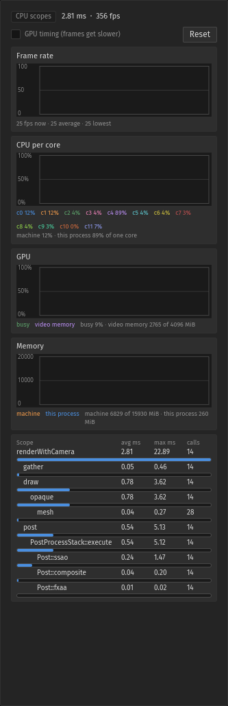

# Profiler: para onde vai o tempo de um frame

<div class="doc-meta">
  <span class="doc-badge doc-badge--stable">Estável</span>
  <span class="doc-badge">Doppio</span>
  <span>Última atualização: <time datetime="2026-11-21">2026-11-21</time></span>
</div>

<p class="doc-lede">Uma árvore de scopes cronometrados para o renderer, com tempo real de GPU por passo quando o pede, no separador Profiler, pela C ABI e para agentes.</p>

Os frames lentos eram adivinhados. O profiler dá os números: cada etapa do renderer é um scope, e o separador Profiler (menu View) mostra-os como uma árvore com a média, o pior caso e quantas vezes cada um correu.

<figure class="doc-figure">
  
  <figcaption>O separador Profiler: o tempo do frame, os dois controlos e a árvore de scopes com uma barra por scope</figcaption>
</figure>

## 1. O que cronometra

O motor tem uma árvore de scopes para todo o processo (`Debug::Profiler`). O renderer abre um scope para cada etapa: reunir a cena,
as sombras, os passos opaco e translúcido, reflexos, os passos do Photon um a um, e a stack de pós-processamento.

| Modo | O que é o tempo de um scope |
|---|---|
| **CPU scopes** (predefinido) | O tempo que o CPU gastou a gravar essa etapa. A GPU corre atrás, por isso não é o custo da GPU |
| **GPU timing** | O tempo que a etapa realmente leva: os passos de GPU esperam pela GPU nos seus extremos, por isso o scope cobre gravação mais execução |

O SDL3 GPU não tem queries de timestamp portáteis, por isso o GPU timing funciona submetendo o que foi gravado e esperando por isso no início e
no fim de cada scope de GPU (`CF_GPU_SCOPE`). Isso serializa o CPU e a GPU: **os frames ficam mais lentos enquanto está ligado**. É um modo
de medição, desligado por omissão. Um scope dentro de um render pass (os scopes por mesh e de terreno) não pode esperar, por isso mostra sempre tempo de CPU.

## 2. O separador Profiler

O separador tem quatro gráficos sobre o último minuto (quatro amostras por segundo), e depois a árvore de scopes.

| Gráfico | O que desenha |
|---|---|
| **Frame rate** | As frames por segundo do viewport; a legenda dá a última, a média e a mais baixa |
| **CPU per core** | A parte ocupada de cada core lógico, uma cor por core (a legenda sob o gráfico repete as cores com o último valor de cada core), e depois a máquina inteira e este processo (em percentagem de um core) |
| **GPU** | A parte ocupada da GPU e a memória de vídeo em uso como parte do seu tamanho (NVML na NVIDIA, o contador `gpu_busy_percent` na AMD); vazio onde a plataforma não o consegue dizer |
| **Memory** | A memória em uso na máquina e por este processo, em MiB, até ao tamanho da máquina |

Os números de CPU, GPU e memória vêm de `caffeine_system_metrics` (C ABI v19). São lidos de `/proc`, NVML e sysfs em Linux, dos contadores de desempenho do processador, de `GlobalMemoryStatusEx` e de `nvml.dll` em Windows, e dos contadores do host Mach em macOS (sem valores de GPU aí). As leituras de Windows e macOS foram escritas sem essas máquinas para correr: só o cálculo partilhado das percentagens é testado aí.
Onde uma plataforma não consegue dizer, o gráfico diz por baixo o que falta.

| Controlo | O que faz |
|---|---|
| **GPU timing** | Liga ou desliga o modo acima |
| **Reset** | Esquece todas as amostras (scopes e gráficos) |
| Linha do frame | A média do scope de topo do renderer e a taxa de frames que implica |
| Tabela | Uma linha por scope, indentada pela profundidade, pela ordem em que correram pela primeira vez: os milissegundos médios e do pior caso das suas últimas 120 chamadas (cerca de dois segundos de um scope a 60 fps), o número de chamadas, e uma barra contra o tempo do frame |

Os gráficos amostram nos frames do viewport, e o separador lê os scopes ao mesmo ritmo enquanto está visível.

## 3. Ler um perfil

A cena de benchmark (`assets/benchmarks/dense_outdoor.caf`, 287 entidades, 1,1M triângulos) a 1280 x 720, antes e depois da primeira ronda de
descobertas:

| | Antes | Depois |
|---|---|---|
| Frame, tempo real | 22.7 ms (44 fps) | 10.7 ms (93 fps) |
| Reunir a cena (CPU) | 1.7 ms | 0.3 ms |
| Passo opaco | 13.5 ms | 2.3 ms |
| Sombras | 2.8 ms | 3.3 ms |
| Pós-processamento | 1.3 ms | 1.3 ms |

O que o perfil mostrou, e o que foi feito:

* **Cada desenho de terreno custava 0.7 ms de CPU.** Cada desenho pedia as suas imagens à cache de texturas, e cada pedido resolvia o caminho e lia
  o timestamp do ficheiro: um punhado de chamadas ao sistema de ficheiros por desenho por frame, e o mesmo outra vez para uma imagem que não existe. A cache
  agora responde da memória, volta a olhar para o disco só de meio em meio segundo (um ficheiro reescrito continua a aparecer), e lembra-se das imagens que
  faltam. O passo opaco desceu de 13.5 para 2.3 ms.
* **As probes do far field do Photon custavam 25 ms.** A cada frame, 16 384 probes traçavam cerca de 100 raios cada. As probes a mais de 1.8 espaçamentos fora do frustum da câmara não têm
  leitor no ecrã, por isso não são traçadas (os seus tiles são transportados); os níveis grossos, que mudam devagar, são traçados de dois em dois ou de quatro em quatro frames enquanto a cena
  está calma. O passo das probes desceu para 9 ms e todas as cenas de regressão do Photon continuam a passar. Veja o [guia do Photon](photon-guide.md).
* **As nuvens custavam cerca de 5 ms** com o céu à vista. A marcha para o sol lê agora a forma barata da nuvem (4 oitavas de ruído em vez de 7) em 3 passos, o que a baixou para cerca de 2.7 ms.
* **Os materiais tinham o mesmo problema.** O reunir da cena pedia à cache de materiais o material de cada desenho, a cada frame, e cada pedido canonizava o caminho e lia o timestamp do ficheiro. Com 600
  arbustos o gather levava 1.3 ms e 150 arbustos 2.9 ms; agora responde da memória com a mesma revisão de meio segundo.
* **As cascatas de sombra do sol desenhavam todos os casters.** Um caster totalmente fora dos lados de uma cascata é agora saltado (era cortado de qualquer forma, por isso nenhum pixel muda). Com 600 arbustos a abanar na cena de benchmark as sombras
  passaram de 10.8 para 6.6 ms, e o frame de 19.6 para 16.6 ms. As estatísticas de render reportam `shadow_draws` e `shadow_draws_culled`.
* **A borda do tile da probe já não traça raios.** Cada probe mantém um tile de 10 por 10 (8 por 8 direções e uma borda de um texel que repete a direção mais próxima); a borda eram 36 raios a mais por probe, um terço do
  passo, e agora copia o que o interior acabou de calcular. Com as cascatas grossas do 2 para cima traçadas em frames alternados, o Photon em High passou de 34 para 23 ms e as cenas de regressão continuam a passar.
* **As duas cascatas mais grossas do Photon** são traçadas em frames alternados enquanto a câmara está parada e a cena calma (mantêm o atlas entretanto): o campo próximo desceu de 12.7 para 9.7 ms.
* **Criar muitas entidades do mesmo tipo era cúbico.** Escolher o nome da n-ésima "Sphere" pedia ao motor todas as entidades uma vez por sufixo: 150 esferas levavam 14 s. Agora é uma só passagem (600 levam 3 s).
* **Uma neblina de nuvens acima de 0 liga a névoa volumétrica do passo forward** (mais 4 ms a 720p), por isso as predefinições do Environment deixam a neblina em 0; a névoa de altura cobre a bruma.

## 4. Acrescentar scopes, a C ABI e agentes

```cpp
void Renderer::drawThing(RHI::CommandBuffer* cmd) {
    CF_GPU_SCOPE(cmd, "Thing::draw");      // GPU pass: real time with GPU timing on, CPU time otherwise
    // ...
    CF_PROFILE_SCOPE("Thing::prepare");    // CPU work: always CPU time
}
```

Ponha um `CF_GPU_SCOPE` fora de render e compute passes: ele faz flush da command buffer nos seus extremos.

C ABI v18 e v19: `caffeine_system_metrics` (v19), `caffeine_profiler_report` (scopes em profundidade), `caffeine_profiler_reset`, `caffeine_profiler_set_gpu_timing` e
`caffeine_profiler_gpu_timing`. O crate Rust do motor embrulha-as como `Engine::profiler_scopes`, `profiler_reset`, `set_profiler_gpu_timing`
e `profiler_gpu_timing`.

Os agentes (`ICED_MCP=1`, feature `agent`) leem a query `profiler`, e usam `show_profiler`, `profiler_gpu_timing` e `profiler_reset`:

```json
{ "action": "profiler_gpu_timing", "args": { "enabled": true } }
{ "action": "profiler_reset", "args": {} }
```

## 5. Medir a partir dos testes

As medições acima vêm de testes ignorados que imprimem a árvore: corra-os na máquina que lhe interessa.

```bash
cd doppio
cargo test -p doppio-ui --lib zz_profile_dense_outdoor -- --ignored --nocapture
PERF_ALL=1 cargo test -p doppio-ui --lib zz_profile_features -- --ignored --nocapture
```

`zz_profile_features` imprime o tempo real e os scopes de topo da cena de benchmark com a base, as nuvens, a névoa, a tempestade e o Photon
ligados, um a seguir ao outro. Nada ali falha por velocidade: a velocidade depende da máquina.

## 6. Limites e o que vem a seguir

* O GPU timing é por passo, não por desenho: um scope que cobre muitos desenhos não diz qual é lento. Acrescente um scope, ou compare duas corridas.
* Os gráficos de CPU, GPU e memória de Windows e macOS não foram testados; o uso da GPU precisa de NVML (NVIDIA) ou de um contador sysfs do amdgpu (Linux), por isso AMD e Intel em Windows, e todos os Mac, não mostram valores de GPU.
* A cena de benchmark com 600 arbustos a abanar corre a cerca de 60 fps a 720p; as sombras (6.6 ms) e o passo opaco (4.3 ms) são para onde vai o tempo. Um mar de 400 por 400 m custa cerca de 4 ms (incluindo o lado CPU da
  simulação da água). O Photon em High custa 23 ms nesta máquina (eram 34), dos quais as probes do far field (7 ms) e o campo próximo (7 ms) são o maior.
  O campo próximo já traça uma probe por 4 por 4 pixéis em todos os níveis de qualidade (o nível não muda o espaçamento; o `s0` muda), por isso um campo próximo a meia resolução é uma definição, não uma poupança gratuita, e não foi tornado automático.
* A tabela segue as últimas 120 chamadas de cada scope, por isso mostra o que a cena faz agora; `avg_ms` e `max_ms` na C ABI continuam a cobrir tudo desde o último reset.
