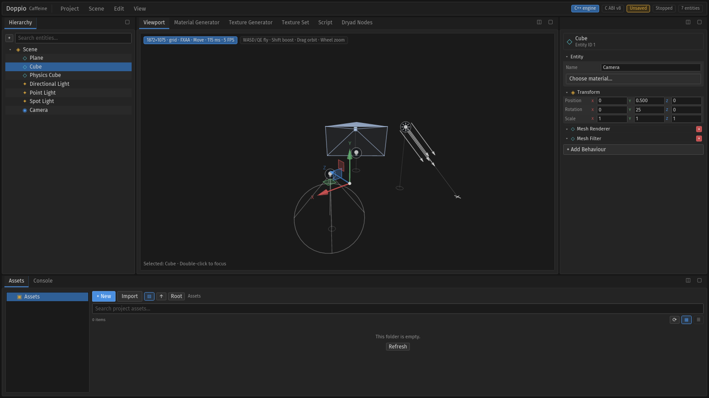

# Frontend Rust UI (Iced)

<div class="doc-meta">
  <span class="doc-badge doc-badge--stable">Estável</span>
  <span class="doc-badge">Doppio</span>
  <span>Última verificação: <time datetime="2026-11-21">2026-11-21</time></span>
  <span>Fonte: <a href="https://github.com/devscafecommunity/caffeine/tree/main/doppio"><code>doppio/</code></a></span>
</div>

<p class="doc-lede">Arquitetura do editor ativo em Rust/Iced: workspace, painéis,
componentes, a fronteira da C ABI e as verificações que a mantêm coerente.</p>

<figure class="doc-figure">
  
  <figcaption>O editor Rust em execução. Cada painel é uma vista Iced sobre o estado de <code>App</code>; a renderização do motor chega através de <code>libcaffeine-capi</code>.</figcaption>
</figure>

Estado: **o editor ativo**. O `caffeine-core` é compilado sem ImGui/ImNodes;
os adaptadores de draw-list do ImGui vivem em `caffeine-editor-support`. O
workspace Rust em `doppio/` é o frontend Doppio em produção e comunica com o motor
através de `libcaffeine-capi`. O antigo editor C++ está congelado em `doppio-archived/`
e já não faz parte da compilação CMake.

## Porquê o Iced

- Licença MIT, adequada a um motor/editor que outras pessoas possam redistribuir.
- Renderer `wgpu`, docking com `PaneGrid`, árvores de widgets dinâmicas em Rust puro.
- Simulador headless oficial `iced_test` (`click`, `typewrite`, `find`,
  snapshots) para testes de CI determinísticos.
- O `iced-mcp` (MIT, iced 0.14) expõe a árvore de widgets em execução aos agentes via MCP:
  snapshots, cliques, escrita, asserções, flows e `run-suite`.

## Workspace

```
doppio/
  crates/engine/            libloading bindings to libcaffeine-capi
  crates/ui/
    src/windows/            main.rs (app state + PaneGrid), projectloader.rs
    src/uikit/components/   button, panel, toolbar, status, text_field, field_editor,
                            tree_view, component_card/picker, viewport_surface,
                            viewport_shader, rendering_canvas, gizmo, scene_markers,
                            viewport_math, asset_preview,
                            breadcrumb, code_editor
    src/uikit/theme.rs      colours, borders and spacing for the whole workspace
    src/uikit/panels/       hierarchy, sceneviewport, assetmanager, asset_wizard,
                            inspector, console, material, material_generator,
                            texture_generator, texture_set, nature_generator,
                            water_generator, terrain_generator, project_manager,
                            script, dryad_nodes
    src/uikit/project.rs    project.caffeine manifest, recursive scan, recent list
    src/uikit/script.rs     open script documents, editor buffers and save/revert
    src/uikit/dryad.rs      Dryad graph, catalog, emitter, .node.json and round-trip
```

- O estado da app/UI vive em `windows/main.rs`; os painéis e componentes são
  módulos de biblioteca reutilizáveis.
- **Os painéis compõem componentes; nunca constroem widgets interativos inline.**
  Campos de texto, editores de campos, cartões/seletores de componentes e botões vivem em
  `uikit/components/`; o `scripts/check-rust-ui.sh` rejeita chamadas diretas a `text_input`,
  `checkbox`, `pick_list`, `slider` ou `button` em `uikit/panels/`.
- Os crates de UI nunca tocam em FFI diretamente: só o `doppio-engine` carrega a
  biblioteca partilhada.
- um layout `PaneGrid` de quatro regiões: Hierarchy à esquerda; Viewport (+ Material,
  Texture e outros geradores, Texture Set, Script, Dryad Nodes) ao centro;
  Material, Nature, Water e Terrain são editores, por isso são separadores do espaço de trabalho central); Inspector
  (+ Profiler, Photon, Environment, Audio) sozinho à direita, só o que fica aberto enquanto se trabalha; e uma doca inferior ao estilo Project
  com **Assets** (árvore de pastas + grelha de ficheiros) junto à Console, alta o bastante para manter a Hierarchy curta (uma faixa de separadores mais larga do que o painel desliza para os lados e o painel larga o botão de dividir, por isso os separadores nunca se escondem);
- **docking**: arrastar um separador para fora do seu cabeçalho mostra guias em todos os painéis
  (`uikit/components/dock_overlay.rs`): o centro adiciona o separador ao grupo desse painel,
  as guias dos bordos dividem o painel e fixam-no nesse lado. Os painéis têm também
  um botão de maximizar/restaurar; os menus abertos só fecham com um clique fora, Escape
  ou ao escolher um item (as atualizações de hover de widgets por trás nunca os fecham);
- o separador **Performance** (`uikit/panels/performance.rs`, `windows/main/performance.rs`, View → Performance): onde vivem as opções de renderização.
  O componente `Forward Render Features` da cena (instancing, occlusion culling, sondas de reflexão e reflexões em espaço de ecrã, luz volumétrica,
  luz difusa do céu e os seus números; **Add render features** põe-no numa nova entidade) e a escala de renderização, o anti-aliasing, as sombras das luzes e a
  grelha do viewport do editor. As edições da cena são passos de undo; as opções do viewport são do editor e não são. O editor arranca o viewport com
  escala 1,0 (o valor do motor continua 1,5 para outros anfitriões). Os agentes usam `performance`, `performance_set`, `performance_add` e
  `show_performance`. O Photon mantém o seu separador. Com o Photon desligado, ou o componente desativado, nenhum passo do Photon corre (um teste verifica
  o profiler do motor), embora uma linha do profiler guarde os totais desde o último **Reset**;
- **compilar o editor**: o editor calcula o layout e desenha a janela toda a cada tick, por isso uma build sem otimização custa um núcleo inteiro e deixa a GPU
  à espera (uma cena que o motor desenha em 2 ms corria a 7 fps). O `Cargo.toml` do workspace compila por isso as dependências com `opt-level = 3` e as
  crates do editor com 1 mesmo no perfil dev, com informação de debug só de tabelas de linhas; a primeira compilação demora minutos, as seguintes são
  incrementais, e o layout da janela inteira passou de cerca de 20 ms para cerca de 3 ms;
- **Play e as vistas da cena**: ▶ / ⏸ e ⏹ ficam ao centro da barra superior (`uikit/components/transport.rs`, `windows/main/sceneview.rs`).
  O Play tira um snapshot da cena e arranca a simulação de jogo do motor (C ABI v23, `GameSimulation`): os sistemas que o `caffeine-runtime` corre
  entre frames (animação, efeitos, fluidos, navegação, física 2D e 3D, scripts Lua e Dryad, mundos procedurais, UI) sobre o mundo do próprio
  editor, mostrada no separador **Gameplay** através da câmara ativa da cena com o teclado e o ponteiro a chegar aos scripts. O Pause congela-a,
  o Stop termina-a e repõe a cena como estava: o que o jogo fez, e o que se editou entretanto, é desfeito, e o Play não deixa histórico de undo.
  O separador **Camera** mostra a cena através da Camera 3D selecionada (ou da ativa) sem jogar. Ambas as imagens são vistas de cena do motor com
  o seu próprio alvo de renderização e desenham a pedido como o viewport do editor. A simulação não pertence a uma vista: o jogo avança
  qualquer que seja o separador visível, e o relógio da imagem (nuvens, tempo, vento, água, som) avança uma vez por tick do jogo pela vista
  que desenhar primeiro (o Viewport do editor, o Gameplay ou o Camera), por isso todas as vistas visíveis mostram o mesmo instante e nenhuma o
  conta duas vezes; sem nenhuma visível a física e os scripts continuam e só o que depende da imagem espera. O profiler do motor lista o trabalho:
  `Game::tick` com `Game::animation`, `effects`, `physics2d`, `physics3d`, `scripts` e `world_and_ui`, e `SceneView::game` / `SceneView::camera`. Os agentes usam `toggle_play`, `stop_play`, `game_key`,
  `show_gameplay`, `show_camera_preview` e a consulta `play`;
- **destacar**: o botão ⧉ na barra de título de um painel transforma o separador ativo numa janela própria (o editor
  corre como um `iced::daemon`; `windows/main/detach.rs`). Um separador destacado é a mesma vista sobre o mesmo motor e
  os mesmos documentos, por isso nada é copiado: sai do layout do dock e é desenhado noutra janela do sistema operativo com um
  botão **Dock back**. Fechar essa janela devolve o separador ao dock, fechar a janela principal sai, um comando "mostrar este
  separador" levanta a janela em vez de acoplar uma segunda cópia, e o último separador do editor não pode sair. Os agentes usam
  `detach_tab`, `attach_tab` e a consulta `windows`; a build da ponte de agente, de janela única, recusa destacar;
- o **Assets wizard** (`+ New` / `Import` na barra de ferramentas de Assets,
  `uikit/asset_wizard.rs` + `uikit/panels/asset_wizard.rs`): Create (pasta,
  Lua, script Dryad; o material e o texture set abrem os seus editores), Import
  (copia ficheiros ou pastas para a pasta atual, sem nunca sobrescrever; a fila marca
  cada ficheiro com o seu tipo e assinala os que serão ignorados; um ficheiro largado na janela fora do
  wizard é importado diretamente para a pasta que está a ser vista) e Pack (`caf-pack --input <asset root> --output
  <project>.cap`, encontrado através de `CAF_PACK`, `CAFFEINE_ENGINE_ROOT`, um
  `caf-pack/build/src` vizinho ou `PATH`);
- o **navegador de ficheiros** (`uikit/file_browser.rs` + `uikit/panels/file_browser.rs`, **Browse…** no separador Import):
  o seletor próprio do Doppio para ficheiros e pastas deste computador, igual em Linux, macOS e Windows e controlável por
  testes e agentes porque é `std::fs` simples (sem diálogo do sistema operativo). Tem locais (home, Desktop, Documents,
  Downloads, todas as unidades no Windows, `/` e os pontos de montagem nos outros), um trilho do caminho, uma caixa que aceita
  caminhos escritos ou colados (`~`, relativo, entre aspas, `file://`), um filtro por nome, interruptores de ficheiros ocultos
  e de tipos importáveis e uma multisseleção que sobrevive à passagem entre pastas; um ficheiro com duplo clique é tomado de
  imediato e o Browse seguinte abre onde o anterior terminou;
- **tipos de asset, cartões e o seletor partilhado**: `uikit/asset_kind.rs` é a única tabela de extensões
  (texturas incluindo bmp/psd/pnm, malhas, áudio incluindo flac, tipos de letra, prefabs, cenas,
  grafos de terreno/água/natureza, texture sets e ficheiros de dados como .json, .csv, .mtl e .bin);
  a grelha de Assets desenha um cartão por asset com uma barra na cor do seu tipo, uma miniatura ou um ícone
  e uma etiqueta da extensão. Cada campo de asset compõe `asset_field` (miniatura, caminho editável, **…** e **×**)
  e abre a única sobreposição `asset.pick.*`: os assets compatíveis com filtros por tipo, pesquisa, o valor atual
  primeiro e uma linha *None*. Os campos de texto do Inspector são reconhecidos pelo nome (`Mesh Path`, `Clip Path`,
  `Script`…); os slots dos geradores de Terreno e Água usam-no também; os agentes usam `asset_pick_*` e `asset_kinds`;
- ids de widget estáveis para a barra de ferramentas, os campos do inspector e as linhas de entidades;
- um harness headless `iced_test` que cobre edição, painéis, filtros da consola,
  pesquisa na hierarchy, gestos do viewport e voo;
- uma feature opcional `agent` que encaminha o `main` através de `iced_mcp::run`.

A fronteira C++:

- `caffeine-core`: apenas o motor, sem ImGui/ImNodes.
- `caffeine-editor-support`: adaptadores ImGui para os helpers de render do motor.
- `caffeine-capi`: a C ABI usada pelo Rust (e por qualquer outro frontend externo).

Execute-o com:

```bash
cd doppio
cargo run -p doppio-ui -- ../assets/benchmarks/dense_outdoor.caf
```

Materiais, biblioteca procedimental e profundidade real: [`materials-guide.md`](materials-guide.md). O catálogo atual de widgets e as capturas de ecrã estão publicados como [UI reference](https://github.com/devscafecommunity/caffeine/blob/main/caffeine-website/content/en/docs/editor/ui-reference.md).

Controle e inspecione a UI sem janela (qualquer agente, CI ou pessoa; JSON simples
por stdin/stdout, veja [`headless-testing.md`](headless-testing.md)):

```bash
./scripts/doppio-headless.sh widgets                      # what is on screen
./scripts/doppio-headless.sh run doppio/tests/ui-flows --format text
./scripts/doppio-headless.sh screenshot --annotate --out /tmp/shots
```

Execute as verificações usadas pelo CI/agentes:

```bash
./scripts/check-rust-ui.sh
# cargo fmt --check, cargo test, cargo check --features agent, clippy -D warnings
# plus the caffeine-core ImGui coupling audit
```

## Estado da migração

### Separação motor / ImGui — concluída

- O `caffeine-core` compila sem ImGui/ImNodes; o `nm` reporta 0 símbolos
  ImGui/ImNodes em `libcaffeine-core.a`.
- O `caffeine-editor-support` contém os adaptadores ImGui do motor
  (`Overlay2D::draw`, `SkyboxRenderer`).
- 18 headers do UI-kit e 1 header de UI do editor ainda referenciam o ImGui; esse é o
  lado do SDK/editor legado, não o core.
- O `caffeine-runtime` ainda é um frontend ImGui e precisa de um caminho de render
  RHI antes de poder ficar livre de UI.

Meça o acoplamento com:

```bash
python3 scripts/audit_core_ui_coupling.py
python3 scripts/audit_core_ui_coupling.py --fail-on-leaks
```

### C ABI / fronteira orientada a dados — primeira fatia concluída

- header: `include/caffeine/capi/EngineAPI.h`
- implementação: `src/caffeine/capi/EngineAPI.cpp`
- versão: `CAFFEINE_CAPI_VERSION` 2; `caffeine_capi_version()` é exposta aos
  frontends e mostrada como badge na barra de estado.
- teste: `tests/test_capi.cpp` (`[capi]`, 318 asserções / 13 casos)
- `CaffeineSession`, `CaffeineEntity` opacos e `CaffeineResult` versionado;
- criação/destruição de sessões e carregamento de cenas `.caf`;
- contagem/lista/nome de entidades, criar, destruir, renomear e selecionar;
- obter/definir posição/rotação/escala (definir uma transformação cria-a quando a
  entidade não a tem), além de posições de mundo resolvidas
  (`entity_world_position`, `set_entity_world_position`) para que os grupos componham
  posição, rotação e escala; o renderer offscreen chama
  `Scene::propagateTransforms` em cada frame antes de desenhar;
- estado dirty e gravação `.caf`; a barra de ferramentas Rust tem Save + um marcador de dirty;
- listagem de assets do projeto (`set_asset_root`, `refresh_assets`, `asset_at`); o
  Asset Manager em Rust mostra ficheiros reais e a contagem de ficheiros;
- ligações da hierarchy (`entity_parent`, `set_entity_parent`) com rejeição de ciclos;
  o **+** da Hierarchy abre uma paleta de criação de entidades com prefabs integrados
  (vazio/pasta, primitivas de mesh, luzes, câmara, props de física, jogador,
  terreno/água) mais uma receita de duplicar a seleção. Os prefabs são aplicados através
  dos mesmos componentes da C ABI e são anuláveis (undo);
- o painel Hierarchy compõe o componente reutilizável `tree_view`: linhas compactas
  de largura total, ícones semânticos, setas de expandir/recolher, estados de hover/seleção
  e menus de contexto por linha. As linhas são arrastáveis: largar uma sobre
  outra muda-lhe o pai, e largá-la na raiz da cena retira-lhe o pai. O
  navegador de Assets partilha os componentes breadcrumb, campo de texto e asset-preview;
- assets de material PBR (`.mat`): `CaffeineMaterial` espelha a superfície do motor
  (albedo, metallic, roughness, reflectance, emission, transmission, clearcoat,
  sheen, iridescence, reflection e tiling/offset de UV), carregar/gravar, presets
  integrados, atribuição ao Mesh Filter da entidade selecionada e uma pré-visualização
  síncrona em esfera renderizada pelo `MaterialPreviewRenderer`.
  `caffeine_texture_generate_map` deriva mapas de normal, AO, roughness, metallic e
  height; `caffeine_texture_pack_maps` escreve os packings ORM, Unity HDRP mask e
  Unity metallic-smoothness; `caffeine_texture_save_rgba` escreve a saída
  dos geradores. `asset_path`, `asset_project_path` e
  `resolve_path` fazem a ponte entre caminhos relativos ao asset, relativos ao projeto e absolutos;
- schema e valores de componentes (`component_type_*`, `entity_component_*`,
  `add/remove_component`); o Inspector é genérico e edita todos os componentes
  registados (Transform, Camera 3D, luzes, renderers, física, colliders,
  scripts) com campos escalares, vetoriais, bool, string e enum;
- a pré-visualização Dryad (`caffeine_session_run_dryad`) executa `onCreate` + um
  `onUpdate` numa entidade sem entrar em modo de jogo; `caffeine_dryad_available`
  indica se o interpretador foi ligado;
- render não bloqueante (`render_begin` / `render_poll`): submete uma cópia de download
  e consulta a sua fence em vez de esperar pela GPU;
- snapshots de cena em memória (`snapshot` / `restore`): o mundo inteiro serializado
  em bytes, usado pela timeline de undo/redo do editor;
- obter/definir câmara (`CaffeineCamera`), controlada por gestos do viewport e WASD;
- definições do viewport (`set/get_viewport_settings`): grelha de referência, FXAA/TAA e
  escala de render interna;
- contabilidade de tick/estatísticas de frame (os sistemas serão ligados de forma incremental);
- sem ImGui nem headers do editor na ABI;
- biblioteca partilhada `libcaffeine-capi.so` (alvo CMake `caffeine-capi`);
- uma ponte Rust com `libloading` em `doppio/crates/engine/src/lib.rs`, com um
  teste de integração round-trip que é ignorado quando a biblioteca não existe;
- o Inspector Rust mostra a posição real em C++ e pode ajustá-la com `+X`;
- 222 testes Rust: 2 testes da ponte do motor/snapshot, 3 testes de integração da
pré-visualização de materiais, 216 testes de UI/widgets (1 gerador de docs ignorado) e 1 doctest.

A app carrega uma cena real através da ABI:

```bash
cd doppio
cargo run -p doppio-ui -- ../assets/benchmarks/dense_outdoor.caf
```

A hierarchy mostra então as entidades C++ reais (Rock/Tree/...). Sem a
biblioteca partilhada recorre a dados falsos, para que os testes de UI não dependam do CMake.

Ainda por adicionar até a UI Rust ficar totalmente ligada:

- schemas de componentes e snapshots de campos em arrays POD;
- comandos/undo/redo/play-pause e as restantes operações sobre assets;
- eventos (estado dirty, seleção, logs, alterações de assets).

O `PluginHostApi` existente é um bom precedente de tabela de funções. O loop JSON
`DOPPIO_TEST_MODE` existente (`TestRequestHandler`) é um bom precedente de testes
do lado do motor.

### Schema de componentes e Inspector genérico

- A C ABI expõe um catálogo de componentes (id, nome, campos com tipo/limites/
  opções de enum) além de instâncias por entidade e get/set/add/remove de campos.
- O registo cobre Transform, Position/Rotation/Scale 3D, Camera 3D,
  Light mais directional/point/spot, Mesh Renderer, Mesh Filter, Rigid Body
  3D/2D, Collider 3D/2D e Script.
- O Inspector é genérico mas composto como um editor de propriedades: um cabeçalho de entidade,
  um cartão Transform combinado (eixos de posição/rotação/escala), cartões de
  componentes recolhíveis com ícones e ações de remoção compactas, linhas de propriedades às riscas,
  etiquetas alinhadas à direita, sliders com valores, grupos de eixos vetoriais e um seletor
  de cor. Cada componente tem um botão de remoção compacto e o painel tem um seletor
  Add Component. Cada edição é um passo de undo.
- O próprio painel apenas compõe componentes do uikit (`text_field`,
  `field_editor`, `component_card`, `component_picker`); não contém nenhum
  `text_input`/`checkbox`/`pick_list` direto. O `scripts/check-rust-ui.sh` garante-o.
- A moldura da janela é uma **barra de menus** (`Scene`, `Edit`, `View`) mais chips de `status`;
  o corpo de cada painel é envolvido pelo componente `panel` com um título e um
  subtítulo esbatido. As cores e o espaçamento vêm de `uikit/theme.rs` (a verificação rejeita
  cores fixas fora dele).
- Prefira a manipulação direta a filas de botões: as linhas da hierarchy suportam clique,
  duplo clique (focar) e clique direito (menu de contexto: add/focus/delete);
  os gestos do viewport são arrastar/pan/roda/duplo clique/clique direito. As entradas de menu
  e os atalhos `Ctrl` cobrem o resto.

### Project Manager e Assets

- Quando não é passada nenhuma cena `.caf` na linha de comandos, o Doppio abre o seu próprio
  **Project Manager** sobre o workspace (os fixtures do editor e as execuções de capturas
  passam uma cena, por isso mantêm-se determinísticos). O menu Project e
  `Ctrl+O` reabrem-no a qualquer momento.
- O launcher também pode passar uma raiz de projeto ou `project.caffeine` como primeiro
  argumento. O Doppio abre-o diretamente, define a raiz de assets do motor, carrega
  `last_scene` e mostra o chip do projeto ativo em vez do diálogo de arranque.
- O gestor tem os separadores **Create New**, **Open Recent** e **Browse Projects**,
  espelhando o diálogo de arranque arquivado. Create valida o nome, cria
  `Assets/Raw/{Animations,Audio,Generators,Materials,Models,Prefabs,Sky,TextureSets,Textures}`, `Assets/Processed`, `Scripts`,
  `scenes`, `materials`, `texture_sets` e `build`, escreve `project.caffeine`
  e abre o projeto. Browse analisa recursivamente uma pasta até seis níveis à procura de
  `project.caffeine`, e Recent lê `~/.config/caffeine/recent.txt`
  (`$CAFFEINE_RECENT_PROJECTS` substitui o ficheiro para testes e execuções portáteis).
  As linhas selecionam-se com um clique e abrem-se com duplo clique; a ação principal abre a
  seleção.
- Abrir um projeto define a raiz de assets do motor a partir de `paths.assets_raw`, carrega
  `last_scene` quando existe, ou limpa o mundo e grava um `scenes/main.caf` inicial
  para um projeto novo. Gravar a cena atualiza `last_scene` no
  manifesto. O projeto ativo é mostrado como um chip na barra de título.
- O formato do manifesto é a estrutura JSON `project.caffeine` já existente
  (`project_name`, `engine_version`, `paths`, `template_type`, `last_scene`),
  por isso os projetos criados pelas ferramentas C++ e pelo Doppio são intercambiáveis.
  `uikit::project` é responsável pelos helpers de criar/carregar/analisar/recentes e injeta o ficheiro
  de recentes nos testes, para que nenhum estado real do utilizador seja tocado.
- O template **Sample** é o projeto fixo em que a equipa faz benchmarks e experimenta o Doppio: as pastas padrão e
  mais nada, chamado `Sample` a menos que se escreva um nome. A sua cópia canónica é `samples/Sample` no repositório do motor, e um
  teste falha quando o template e essa cópia se afastam (`cargo test -p doppio-ui zz_write_sample -- --ignored` reescreve-a).
- O painel **Assets** é agora um navegador real: breadcrumbs clicáveis, Up/Root,
  atualizar, navegação com pastas primeiro e um comutador Grid/List. A navegação por pastas é
  derivada de `AssetInfo.relative_path`; não é necessária nenhuma nova chamada à C ABI.
  A pesquisa percorre toda a raiz de assets (não apenas a pasta atual), as miniaturas
  e as cores dos materiais são reutilizadas, e o caminho interno de arrastar e largar existente mantém
  os índices originais dos assets, pelo que largar um `.mat` ou uma imagem na Hierarchy ou
  no Inspector continua a funcionar.

### Editor de scripts e nós Dryad

- O painel **Script** abre ficheiros `.lua` e `.dyd` como separadores, com controlo de dirty
  por ficheiro, Save/Revert/Close, números de linha, colorização de sintaxe e o
  caminho de projeto partilhado. Os scripts abrem-se a partir de Assets (clique simples para `.lua`;
  duplo clique para o código-fonte de um `.dyd`), do menu Scene, de `Ctrl+Shift+E`, ou da
  ação MCP `open_script`.
- O `text_editor` de origem do Iced 0.14 aparece vazio com o renderer deste
  workspace, por isso `uikit/components/code_editor.rs` envolve o widget
  `iced-code-editor` baseado em canvas. O painel continua a ser dono do estado do documento,
  das verificações de dirty e do I/O em disco; o componente é o único sítio que conhece a
  implementação do editor.
- **Attach Selected** escreve o caminho do script relativo ao projeto no componente `Script`
  da entidade selecionada (adicionando o componente quando falta);
  **Detach** limpa-o. Ambos são edições de cena anuláveis.
- O painel **Dryad Nodes** (`Ctrl+Shift+D`, menu Scene, ou um asset `.dyd`)
  edita o mesmo `.dyd` mais o `.node.json` vizinho. O módulo Rust `dryad`
  corresponde byte a byte aos formatos C++ `NodeEmitter`/`NodeGraphIO`/`NodeRoundTrip`:
  marcadores `// @node` determinísticos, ids/arestas JSON ordenados e
  números `%.17g`. Suporta OnUpdate, Set/Get Position, Set/Get Scale,
  Translate, DeltaTime, Constant, Branch e Log, mais os nós de runtime Key
  Down, Action Down, Input Axis (nome no painel de propriedades), Total Time e
  Destroy Self, com portas exec/data tipadas, validação de ligações, valores
  de entrada inline por omissão, Add motion e Sync from `.dyd`. Os novos nós existem apenas no
  catálogo Rust; o `NodeCatalog` C++ (editor arquivado) ainda lista os
  dez originais.
- **Tooltip de referência.** Passar o rato sobre um nome no painel Script mostra a sua assinatura
  e descrição num cartão flutuante. `uikit/script_reference.rs` contém uma
  tabela por linguagem (Lua `caffeine.*`, Dryad `caffeine_*`); um teste lê os
  fontes dos bindings C++ e falha quando um nativo Dryad falta na tabela.
  Os ficheiros `.dyd` usam a gramática JavaScript para colorização (o Dryad é uma
  linguagem de chavetas); a colorização dos próprios nomes da API do motor não está disponível
  porque o `iced-code-editor` não aceita uma gramática personalizada.
- **Attach** e **Run once** reutilizam o componente de script e a pré-visualização
  `caffeine_session_run_dryad` da C ABI (onCreate + um onUpdate). Gravar o
  grafo escreve os dois ficheiros; abrir um `.dyd` também coloca o seu código no
  painel Script para edição manual. Fontes sem marcadores `// @node` continuam a ser
  Dryad válido e o editor de grafos reporta a discrepância em vez de as reescrever.

### Material studio

- Os ficheiros `.mat` são assets de primeira classe. Clicar num `.mat` em Assets abre o
  painel **Material** (um separador junto ao Inspector); clicar numa textura cria um
  material não gravado cujo mapa de albedo aponta para ela. O painel é uma composição reutilizável
  `panels/material` de componentes `material_preview`, `texture_slot`,
  `card`, `slider`, `color_picker`, `dropdown` e `checkbox`.
- A pré-visualização é uma esfera real renderizada pelo motor
  (`caffeine_session_render_material_preview`), 256 px, limitada a ~8 Hz e
  só enquanto o painel está visível. Arrastar a imagem faz-a orbitar. O renderer
  de pré-visualização tem os seus próprios alvos, por isso nunca redimensiona o alvo do viewport da cena.
- Os controlos de superfície cobrem toda a superfície CAFMAT3: albedo/alpha, metallic,
  roughness, reflectance, emission, modo alpha/cutoff, tiling/offset de UV,
  intensidade de normal/AO, transmission/IOR, clearcoat, sheen, iridescence e
  reflection. Os presets mantêm o nome do material, os mapas e o layout de UV. Os mapas de normal
  podem ser marcados como DirectX (verde para baixo); o renderer inverte o verde antes do
  shading em espaço tangente.
- Os slots de textura (albedo, normal, ORM, emission) abrem um seletor de projeto
  pesquisável com miniaturas de imagem. O painel Assets filtra por texturas, materiais,
  meshes e cenas e tem o seu próprio campo de pesquisa, pelo que um material ou mapa está a poucas
  teclas de distância em vez de ser preciso percorrer ficheiros de origem. Os cartões de material
  recorrem a uma amostra de albedo quando uma miniatura não pode ser descodificada.
- O baker de mapas escreve junto ao `.mat` gravado: normal a partir de uma fonte de
  height/cor (verde OpenGL ou DirectX), AO a partir de cavidade por média de anel, roughness
  (luminância do albedo invertida) e metallic (máscara de superfícies claras), e depois empacota
  ORM, Unity HDRP mask ou Unity metallic-smoothness. Os mapas normal/ORM gerados
  são atribuídos de volta ao material; os packings Unity servem apenas para exportação porque
  o slot ORM do renderer espera R=AO, G=roughness, B=metallic.
- O Inspector mostra um slot Material compacto para o Mesh
  Filter da entidade selecionada; clicar abre o material, `×` remove a atribuição (anulável).
- Apply atribui o material aberto através da C ABI (passo de undo
  `Assign Material`). As edições de cena nunca reescrevem ficheiros `.mat`, e as edições
  de material permanecem por gravar até Save.
- Os caminhos de textura são guardados relativos ao projeto, tal como os ficheiros de cena/material
  existentes. `asset_path`, `asset_project_path` e `resolve_path` fazem a ponte entre os caminhos do navegador de
  assets, os caminhos `.mat` e os caminhos absolutos; o `MeshCache` também aceita o prefixo
  `assets/...` relativo ao repositório dos materiais de exemplo.
- O fluxo de trabalho segue as convenções públicas usadas pelo TextureCraft e
  pelo MaterialCraft (canais PBR, slots de textura, packing ORM/Unity, pré-visualização em direto)
  mas é implementado a partir da C ABI e do renderer do próprio Caffeine; nenhum código
  ou asset de referência foi copiado.

### Gerador de materiais (node canvas)

- `uikit/components/node_canvas.rs` é um componente de canvas reutilizável: os nós são
  cartões no espaço do grafo com portas de entrada/saída tipadas, fios cúbicos, seleção,
  arrastar nós, pan em espaço vazio e zoom com a roda. Emite os eventos
  `Select`, `MoveNode`, `Connect` e `Viewport`; quem o chama é dono do modelo do grafo.
  O mesmo componente pode servir de base a outras ferramentas de nós.
- `uikit/generators.rs` é um pequeno grafo atómico clean-room: Color, Image,
  Normal Map, Noise (value/Perlin), Voronoi (cells/distance), Checker, Bricks,
  Gradient, Blend (13 modos mais uma entrada escalar de máscara), Normal Blend (whiteout/
  linear), Levels, Curve, HSL, Threshold, Blur, Sharpen, Emboss, Directional
  Blur, máscaras Edge/Cavity/Distance, Warp, Value, Luminance, Dot, um nó Output
  com entradas Color/Roughness/Metallic/Height/AO e marcadores `Unknown`
  importados. As portas são tipadas como cor/escalar; as entradas escalares leem a luminância
  dos mapas de cor ligados e recorrem às constantes do Output. A avaliação é
  em CPU, tileable a 128–2048 px, segura contra ciclos e com memoização; 2K é o máximo
  seguro até o avaliador ter um caminho 4K em tiles/paralelo.
- O separador **Generator** (aberto a partir de Material → Generate…, do menu Scene, ou
  da ação MCP) coloca a paleta, o canvas e as propriedades do nó selecionado lado
  a lado e maximiza o painel durante a edição. Os nós Image e Normal Map usam o
  seletor de texturas partilhado e suportam projeção UV/planar/tri-planar/cilíndrica/esférica,
  tiling, offset, filtragem linear/nearest e wrapping clamp/repeat.
  **Bake to Material** corre numa worker thread com progresso e
  cancelamento; a descodificação de imagens também acontece nessa worker. A barra de progresso segue
  os nós alcançáveis e depois reporta `Packing maps`, `Baking occlusion`,
  `Writing maps` e `Done`, de modo que o AO final e o packing de mapas já não parecem
  bloqueados no último nó. A oclusão usa um box blur separável (O(píxeis)
  em vez de O(píxeis × raio)), o que mantém os bakes a 2K rápidos. Escreve
  `<material>_gen_base_<bits>.png`, mapas height/roughness/metallic/packed,
  deriva um mapa de normal a partir do height e atribui os mapas ao `.mat` aberto
  antes de o marcar como não gravado. Um bake bem-sucedido passa a gravar o `.mat` e a atribuí-lo
  automaticamente à entidade selecionada, para que o viewport 3D e o
  **3D PREVIEW** do gerador (a esfera de pré-visualização do material em direto) mostrem exatamente
  o que o grafo produziu. O **OUTPUT PREVIEW** do gerador é um bake em baixa resolução
  e em direto do nó Output, atualizado após cada edição do grafo com um debounce de 160 ms;
  não é preciso bake manual para ver alterações de parâmetros/tijolos/máscaras. O
  especular direto é normalizado em energia e o campo de height escurece a luz direta, ambiente,
  IBL e refletida (e as sombras POM de point/spot), pelo que uma face virada para
  o sol mantém os seus sulcos em vez de ficar achatada numa placa de plástico branco. Cada
  nó mostra também uma miniatura de 72 px em direto da sua própria saída avaliada, calculada
  na mesma passagem da worker. O painel da direita edita o preset/fontes de channel-packing,
  grava presets de utilizador com nome e escolhe saída de 8/16 bits.
- Gravar um material escreve também o seu sidecar `<name>.mgraph` (texto versionado)
  junto ao `.mat`; reabrir restaura nós, ligações, parâmetros, posições e
  resolução. Os grafos são por material, não estado de sessão partilhado.
- As edições do grafo têm a sua própria timeline de snapshots (`GraphHistory`), separada do
  undo da cena. Adicionar/apagar nó, ligar, desligar, mover, parâmetros,
  resolução, copiar/colar, atribuição de imagem e pontos de reroute são anuláveis;
  os arrastos e as alterações repetidas de parâmetros fundem-se. `Ctrl+Z` / `Ctrl+Shift+Z` /
  `Ctrl+Y` encaminham para o histórico do grafo enquanto o painel Generator está ativo, e o
  cabeçalho tem botões ↶/↷.
- Os fios são testados por hit como curvas de bézier. Clicar seleciona um fio (o
  painel de propriedades oferece Delete link); o clique direito apaga-o; arrastar uma
  entrada ligada separa a sua origem para que possa ser largada noutra entrada.
  Duplo clique num fio insere um nó de reroute **Dot** de passagem, com a
  origem e o destino originais religados num único passo de undo.
- A paleta usa o `tree_view` partilhado agrupado por categoria (Textures,
  Generators, Filters, Utilities, Output), com grupos recolhíveis e filtragem por
  pesquisa. Os nós encaixam numa grelha de 16 unidades (comutável), **Fit** enquadra todo o
  grafo, e Copy/Paste duplica o nó selecionado com um deslocamento de 24 unidades.
- O `node_canvas` ignora cliques do rato cujo cursor está fora dos seus limites, a menos que
  um arrasto já esteja ativo, para que clicar nos sliders de propriedades nunca inicie um
  pan do canvas vazio nem limpe o nó selecionado.
- O botão **AO from scene** do painel Material chama o bake de AO BVH/GPU do Photon
  para a entidade selecionada e atribui o mapa ORM resultante ao material
  aberto (`caffeine_session_bake_ao`).
- `uikit/materialcraft.rs` lê/escreve arquivos portáteis `.mcmat` (ZIP com
  `material.json`, mapas cozinhados e `source.sbs`), analisa o subconjunto XML do SBS e
  exporta um fonte SBS mínimo que é reimportado e verificado antes de escrever.
  Filtros/saídas desconhecidos tornam-se nós marcadores `Unknown` com avisos.
- `uikit/materialcraft_io.rs` mapeia os mapas importados para um `.mat` (empacotando mapas
  AO/roughness/metallic separados em ORM) e escreve ficheiros `.sbs`, `.mgraph` e de
  mapas. O editor expõe as ações MCP `import_materialcraft` /
  `export_materialcraft`; o binário headless é `doppio-material`.
- O gerador segue o fluxo de trabalho público de editor de primitivas do MaterialCraft
  (paleta → canvas → propriedades, portas tipadas, nó de saída, mapas gerados em direto)
  sem partilhar o seu código, as suas definições de nós nem os seus assets.
- O trabalho restante de materiais/texturas/geradores está registado em
  [`material-pipeline.md`](material-pipeline.md): bakes de cena/geometria,
  importação SBS do MaterialCraft e texture sets/pintura ao estilo TextureCraft.

### Texture sets (base ao estilo TextureCraft)

- `uikit/texture_set.rs` gere os tiles UDIM 1001–1010, seis canais por omissão
  (baseColor, roughness, metallic, height, AO, curvature), camadas de pintura/preenchimento,
  máscaras de camada por tile, definições de pincel, composição e snapshots de undo por tile.
- O painel **Texture Set** (barra de ferramentas Material → Texture Set, ou a
  ação MCP `new_texture_set`) empilha tiles/camadas à esquerda, um `uv_canvas`
  reutilizável ao centro e controlos de canais/pincel/exportação à direita.
  O painel maximiza-se durante a pintura; Material restaura o layout normal.
- O `uv_canvas` pinta toques RGBA ou de máscara de camada com raio, dureza,
  opacidade e cor do pincel. **3D paint** ativa a pintura no viewport: `pick_uv` na
  C ABI faz ray-pick da mesh selecionada contra a câmara do editor e devolve a
  UV atingida; os traços são escritos no tile/camada ativos e a cor
  base resultante é aplicada à entidade para feedback no viewport.
- **AO from height** e **Curvature** geram novas camadas; **AO from scene** chama o
  Photon e importa o canal vermelho do ORM. **Normal**, **Position** e **ID**
  chamam `caffeine_session_bake_mesh_map` e importam mapas UV de normal de mundo,
  posição de mundo ou ID de objeto para os canais correspondentes. Todas as importações mantêm
  o undo por tile.
- O projeto `.texset` é um ZIP com `texture-set.json`, tiles PNG RGBA e
  PNGs de máscara em escala de cinzentos. O `TileHistory` guarda snapshots apenas do tile afetado (limite 64)
  para que o undo nunca copie o projeto inteiro.
- Presets de exportação: mapas PBR separados, glTF ORM e Unity HDRP mask. A CLI
  `doppio-material texset-*` e a ação MCP `export_texture_set` usam o mesmo código.

### Polimento da fase 5

- Pré-visualização de materiais: sujeitos esfera/cubo/plano, caminho HDRI + controlos de
  exposição, e uma leitura assíncrona begin/poll (`render_material_preview_begin` /
  `_poll`) para que os arrastos de órbita e as edições não bloqueiem a UI. Renderiza a 512 px
  e usa contain-fit com uma câmara mais larga para que o sujeito nunca fique cortado.
  O ponto de entrada síncrono antigo mantém-se para ferramentas e testes.
- As miniaturas passam a ser descodificadas pelo motor (`caffeine_texture_load_thumbnail`)
  antes de recorrer ao carregador de caminhos do Iced, o que corrige os assets PNG/JPG/HDR que
  o Iced não conseguia descodificar. A grelha de assets, os slots de material e os seletores partilham este
  caminho; a cache usa como chave o caminho resolvido + a marca de modificação, de modo que atualizar
  uma lista de assets só volta a descodificar as miniaturas que mudaram.
- O **Choose material…** do Inspector abre o seletor `.mat` pesquisável. Os assets podem
  ser arrastados da grelha de Assets para uma entidade da Hierarchy (atribuição de material
  ou material a partir de textura) ou para os slots de mapa do Material (atribuição de textura).
  Os drops de ficheiros do SO continuam a atribuir `.mat`/texturas e a importar ficheiros de mesh.
- `uikit/mesh_material_import.rs` importa materiais OBJ/MTL e `.gltf`/`.glb`
  (albedo, normal, oclusão, fatores e mapas de roughness/metallic, emission,
  alpha e tiling/offset de UV `KHR_texture_transform`) para assets `.mat` e
  escreve um sidecar `.mgraph` com um nó Image para o albedo. A ação MCP
  `import_mesh_materials` e o drop de ficheiros usam o mesmo importador.
- Os badges de material mostram a presença de mapas com a resolução descodificada ou **missing**,
  além da convenção de normal e do modo alpha; a barra de estado mostra a versão
  da C ABI (agora **v2**).
- **Apply material** grava primeiro o material aberto, para que os mapas gerados e
  as máscaras complexas cheguem ao ficheiro `.mat` antes da atribuição. Aplicar a uma entidade
  sem Mesh Filter passa a criar uma mesh de pré-visualização em cubo visível em vez de
  falhar em silêncio.

### Undo e redo

- `doppio/crates/ui/src/history.rs` mantém uma timeline de estados do editor: a lista
  de entidades da UI, um snapshot opcional do motor, a flag dirty e a seleção.
- Os estados são snapshots completos da cena em vez de comandos por campo, pelo que o undo cobre
  também componentes que a UI ainda não edita.
- Os passos têm nome (`Add Entity 3`, `Rename Boss`, `Move Rock to x=…`), escrever num
  campo funde-se num único passo, e uma nova edição descarta o ramo de redo.
- Limite: 200 passos / ~128 MB; os passos mais antigos são descartados primeiro.
- Undo/Redo da barra de ferramentas, Ctrl+Z, Ctrl+Shift+Z / Ctrl+Y, e ações MCP `undo` /
  `redo`. A query `history` devolve a timeline, o cursor e can-undo/redo.
- O restauro de snapshots remapeia os ids das entidades, pelo que a UI volta a ler a hierarchy; o
  serializador escreve e recria as entidades em ordem estável de id para a preservar.

### Viewport — leitura assíncrona em CPU

- `RenderDevice::initOffscreen()` cria um dispositivo SDL_GPU headless.
- `caffeine_session_render()` é o caminho bloqueante (ferramentas/testes): renderiza com
  `GpuSceneRenderer::renderWithCamera` para um alvo RGBA8 e lê-o de volta.
- `caffeine_session_render_begin()` renderiza, inicia um download texture→transfer-buffer
  e devolve de imediato com uma fence. `RenderDevice::endOffscreen()`
  **não** chama `SDL_WaitForGPUIdle`; a C API mantém um frame offscreen
  em voo e liberta os buffers de upload quando a fence da sua leitura é sinalizada.
- `caffeine_session_render_poll()` devolve `PENDING` até a fence ser
  sinalizada, e então mapeia o transfer buffer e copia os píxeis.
- O transfer buffer é reutilizado entre frames em vez de ser alocado e
  destruído a cada frame. Um intervalo de render de 33 ms e uma atualização do HUD uma vez por segundo
  evitam que a thread de UI seja inundada.
- Os frames concluídos são desenhados por `uikit/components/viewport_shader.rs`, e não por um
  novo handle de imagem Iced por frame. O shader é dono de uma textura wgpu persistente
  e só escreve nela quando o id do frame muda, pelo que as atualizações animadas já
  não criam/destroem texturas nem cintilam no compositor.
- `doppio-engine::Engine::{render, render_begin, render_poll}` envolvem a ABI.
- `uikit/components/viewport_surface.rs` é dono da superfície interativa: imagem ou
  estado vazio, chips do HUD (resolução, grelha, latência, FPS, câmara), tratamento do rato
  (arrastar com o botão esquerdo orbita, arrastar com o direito/meio faz pan, roda faz zoom, duplo clique
  foca) e feedback de cursor grab/grabbing.
- O viewport da cena reporta o tamanho real do seu painel através de um `sensor` do Iced; a
  app renderiza a 2x píxeis lógicos (limitado a 3 megapíxeis) para que a imagem se mantenha
  nítida depois de o Iced a reduzir. A C ABI acrescenta supersampling interno de 1.5x
  e FXAA (TAA/desligado também são expostos), e ativa a grelha de referência na GPU com espaçamento de célula
  adaptativo e eixos X/Z coloridos. A grelha desvanece entre 1,500 e 5,000
  unidades de alcance visível: com zoom extremo as suas linhas em espaço de ecrã ficam quase
  coplanares com o terreno distante e fazem aliasing em confetis tracejados. O plano
  near também escala com a distância de órbita para que um far plane de 50k não destrua a
  precisão de profundidade. O menu View (ou `G` sobre o viewport) comuta a grelha.
- `WASD` voa ao longo da direção da vista, `Q`/`E` movem na vertical e `Shift`
  aumenta a velocidade. O foco da câmara nunca é limitado em altura; o pitch da órbita só
  pára um pouco antes do polo para que o `lookAt` se mantenha estável. Isso permite alcançar
  as camadas de nuvens e orbitar além do antigo limite de zoom de 5,000 unidades.
- `uikit/components/gizmo.rs` desenha o gizmo de transformação da entidade selecionada sobre
  a superfície do shader usando a mesma projeção da câmara orbital (matemática partilhada em
  `components/viewport_math.rs`). `1`/`2`/`3` (ou View → Move/Rotate/Scale Tool)
  alternam os modos. Move tem setas 3D sombreadas e handles de plano, Rotate tem
  anéis sombreados em profundidade com uma cunha de ângulo varrido, e Scale segue os eixos **locais** do objeto e tem
  um cubo central para escala uniforme. O handle sob o cursor é realçado. As edições passam
  pelo caminho normal de commit e fundem-se num único passo de undo por arrasto de handle. A
  sobreposição projeta a posição de mundo resolvida da entidade, pelo que um filho permanece preso a um
  grupo movido/rodado/escalado, e as edições de move são convertidas de volta através da
  transformação do pai. Projeta com o snapshot da câmara do frame que está atualmente no ecrã, não
  com a câmara mais recente da UI, pelo que um mundo em órbita e o seu gizmo permanecem alinhados apesar da
  leitura assíncrona.
- `uikit/components/scene_markers.rs` desenha marcadores para entidades sem mesh: raios,
  lâmpadas e cones de luz, frustums de câmara, colliders e localizadores. Ficam sob o gizmo,
  podem ser clicados para selecionar a sua entidade e são comutados no menu View. Detalhes, limites
  e imagens: [`gizmos-and-markers.md`](gizmos-and-markers.md).
- O `ViewportTick` continua a disparar a cada 16 ms, mas o viewport submete no máximo um
  frame por 33 ms; o HUD mostra a latência medida e um FPS móvel. A textura persistente
  do shader é mantida quando um frame não muda, pelo que frames descartados
  nunca podem mostrar um viewport parcial ou vazio.
- A matemática da câmara (órbita, base de pan, movimento de voo, zoom, focar a seleção) vive em
  `windows/main.rs`; não existe nenhuma fila de botões da câmara. Gestos e atalhos
  (`Ctrl+F` focar, `Ctrl+0` repor, `Ctrl+R` render) controlam-na.

O viewport mostra a cena C++ real (terreno, rochas, céu) no Iced.

### Geradores: um workspace e um aviso

Os separadores Nature, Water, Terrain e Texture (e a ação Scatter) partilham dois serviços (`windows/main/workspace.rs`):

* **Um workspace sem projeto.** Os geradores escrevem meshes, materiais, terrenos e planos como assets do projeto. Sem projeto aberto,
  `App::ensure_workspace` dá ao motor um **projeto temporário** (`$CAFFEINE_SCRATCH`, ou então `<data dir>/caffeine/doppio/scratch`) da primeira vez que uma
  ação precisa de ficheiros, e avisa disso; os ficheiros aparecem no painel Assets. Entretanto, a barra superior mostra um chip *No project*. (Antes disto, *Place in scene*
  sem projeto respondia com uma pequena linha num painel lateral, e o separador Texture escrevia numa pasta `Textures` relativa ao diretório de trabalho.)
  O motor trata também a pasta temporária como raiz do projeto (`caffeine_session_set_asset_root` define a raiz quando nenhuma cena o fez), porque é ela que resolve os
  caminhos de assets relativos que os geradores guardam; sem isso a árvore colocada estava na cena mas não desenhava nada.
* **A raiz do projeto é a pasta com `project.caffeine`.** `caffeine_session_load_scene` sobe a partir da cena (quatro níveis) até ao
  `project.caffeine` mais próximo, e só depois recorre à pasta acima de um diretório `scenes` / `Scenes` (o Doppio cria `Scenes/`; o motor só conhecia o
  nome em minúsculas e tomava `Scenes/` como raiz). A sua procura de `assets/raw` também ignora maiúsculas/minúsculas (`Assets/Raw`). Os geradores guardam as meshes como **caminhos de projeto**
  (`Assets/Raw/Models/Nature/oak_trunk.obj`, a partir de `asset_project_path`), tal como os materiais e as texturas, porque o motor resolve um caminho relativo contra a
  raiz do projeto, não contra a raiz de assets. Cada escrita de receita volta a analisar os assets, pelo que o ficheiro aparece de imediato no painel Assets.
* **Um aviso que qualquer pessoa vê.** Cada alteração da linha `status` de um gerador (e da ação Scatter) torna-se um chip na barra superior durante 12 segundos e uma
  entrada na Console, colorida consoante o resultado (`status::tone_for_text`: sucesso, aviso para "placed with problems", perigo para falhas). Os
  painéis mostram a mesma linha sob o seu inspector, com quebra de linha e cor, através de `status::note`.

Também nos separadores de geradores: o dropdown de presets mostra o preset em uso (antes dizia *Choose…* mesmo com o Oak carregado), os grafos que carregam ajustam-se ao canvas
até 1.4x, os títulos dos nós e as portas são maiores e um resumo de parâmetros que sobreporia um título longo é deixado ao inspector, as checkboxes põem a etiqueta junto à caixa
(`checkbox::property`, e `checkbox::inline` para barras de ferramentas), e os controlos Place/Scatter vivem na barra de ferramentas, onde a longa lista de parâmetros de um nó selecionado não os pode empurrar
para fora de vista. Testado por `generators_work_without_a_project_and_say_what_happened`, `status_lines_get_a_tone_from_what_they_say` e pelo flow `generators-interconnect.json`.

### Console

As entradas são tipadas como Errors, Log, Actions, Engine ou UI e têm prefixo na
lista. Os chips de filtro mostram/escondem cada categoria de forma independente; o scrollable
ancora-se à entrada mais recente.

### Atalhos

| Atalho | Ação |
|----------|--------|
| `Ctrl+Z` / `Ctrl+Shift+Z` / `Ctrl+Y` | undo / redo |
| `Ctrl+N` | adicionar entidade vazia |
| `Ctrl+Shift+N` | abrir a paleta de criação de entidades |
| `Ctrl+Shift+M` | novo material |
| `Ctrl+S` | gravar a cena |
| `Ctrl+Enter` | play / pausa |
| `Ctrl+F` | focar a seleção |
| `Ctrl+0` | repor a câmara |
| `Ctrl+R` | renderizar o viewport agora |
| `G` (sobre o viewport) | alternar a grelha de referência |
| `1` / `2` / `3` (sobre o viewport) | gizmo de mover / rodar / escalar |
| `X` (sobre o viewport) | snapping do gizmo ligado / desligado (0.25 m, 15°, 0.1) |
| `W` / `A` / `S` / `D` | voar ao longo da vista / deslocar lateralmente |
| `Q` / `E` | voar para baixo / para cima |
| `Shift` | aumentar a velocidade de voo |
| `Ctrl+1` / `Ctrl+2` | layout de painéis por omissão / de viewport |
| clique direito numa linha da hierarchy | menu de contexto add / focus / delete |
| duplo clique numa linha da hierarchy ou no viewport | focar a seleção |
| arrastar à esquerda / arrastar à direita / roda | orbitar / pan / zoom |

### Porque ainda não há uma textura GPU partilhada

O SDL_GPU não expõe handles de recursos nativos (nem `VkImage`, nem recurso D3D12, nem
handle partilhado), pelo que o Iced/wgpu não consegue importar o alvo de cor do motor através da
API pública. A leitura assíncrona acima elimina a paragem da GPU; a cópia
mantém-se. O verdadeiro zero-copy exige uma de:

1. um backend RHI wgpu para o motor (ou renderizar a cena diretamente em wgpu);
2. memória externa Vulkan através de um patch/extensão personalizado do SDL_GPU;
3. uma estratégia de embedding com uma janela de viewport SDL3 separada.

Até lá, mantenha o caminho de leitura responsivo e trate a passagem da textura como
um projeto ao nível do renderer, não como uma alteração de UI.

### Plugins

Os plugins são C++ e desenham ImGui. A UI Rust precisa de uma de:

- uma janela anfitriã ImGui legada para plugins antigos; ou
- um contrato de plugin v2 (dados/comandos, isolamento opcional por processo/WASM).

Este é o maior custo escondido e deve ser desenhado antes de remover o ImGui
do runtime e do SDK legado.

### Testes e agentes

Os testes de UI são ao estilo Playwright mas headless: controlam a árvore real de widgets Iced,
clicam por id, escrevem nos campos, aplicam as mensagens resultantes e verificam
o frame seguinte. Não é necessária nenhuma janela, GPU nem compilação do motor.

- `crates/ui/src/windows/main/tests.rs` tem um `Harness` com `click`, `type_into`,
  `shows`, `has`, `bounds`, `capture` e `wait_for`, além de testes focados e um
  cenário end-to-end `editor_workflow` (add → select → rename → move → delete).
- Os fixtures (`App::empty` e o de duas entidades do editor) mantêm os testes determinísticos.

### Ids de UI, limites e capturas visuais

Os ids do Iced são strings planas, o que não escala para centenas de widgets. O Doppio
usa uma taxonomia tipada em `uikit::id`:

```
group.subgroup.object        e.g. editor.toolbar.add_entity
                                  inspector.entity.name
                                  hierarchy.list.entity_row.3
                                  assets.grid.asset_card.7
```

- `UiId` implementa `Into<iced::widget::Id>`, pelo que os componentes recebem ids diretamente.
- Os ids estáticos são constantes (`id::ADD_ENTITY`, `id::PANE_INSPECTOR`, …).
- As linhas de lista usam `id::entity_row(index)` / `id::asset_card(index)`; o grupo
  e o subgrupo mantêm-se estáveis enquanto o objeto transporta o índice.
- `id::CATALOG` documenta cada widget estável com uma descrição e um tipo, e
  `id::description(key)` resolve também as linhas dinâmicas.
- Os painéis são envolvidos num container com id, pelo que uma captura de ecrã pode ter como alvo
  `editor.pane.inspector` tão naturalmente como um botão.

O harness nativo expõe o layout de qualquer id (`Harness::bounds`) e escreve
PNGs anotados:

- `Harness::capture(id, path, caption)` recorta um frame headless do `iced_test` ao
  alvo, adiciona uma borda de destaque e uma legenda renderizada com o
  JetBrains Mono incluído (`assets/jetbrains-mono/`).
- `Harness::capture_group(&[(id, label)], …)` recorta a união de vários
  widgets, desenha caixas coloridas numeradas e uma legenda — o formato de
  "painel anotado".

O gerador de galeria percorre o catálogo, captura todos os widgets que existem no
fixture, e escreve imagens, um manifesto JSON e Markdown em
inglês/português:

```bash
./scripts/generate-doppio-ui-docs.sh            # doppio/target/doppio-ui-docs
./scripts/generate-doppio-ui-docs.sh --publish  # update caffeine-website
```

As descrições e traduções vivem em `caffeine-website/captures/ui-captions.json`, para que um
agente possa melhorar o texto sem tocar em Rust. O manifesto
(`manifest.json`) transporta id/group/kind/bounds/image de cada entrada.

Os agentes obtêm as mesmas vistas através do iced-mcp: `snapshot` devolve ids e limites,
`screenshot` aceita um id alvo mais `highlight` (ou uma região) e grava um
PNG, e `ui_catalog` lista os ids, grupos e descrições documentados.

### Agentes (MCP)

O `iced-mcp` está atrás da feature `agent` e só se liga com `ICED_MCP=1`:

```bash
cargo install iced-mcp-server        # once
cd doppio
ICED_MCP=1 cargo run -p doppio-ui --features agent
```

O cliente MCP (Claude Code, Cursor, qualquer cliente MCP) lança a app, lê
a árvore de widgets (`snapshot`), clica/escreve por id ou texto, grava flows e
reproduz-os com `iced-mcp run-suite`. Além das ferramentas de widgets, o Doppio
regista queries e ações ao nível da cena:

| Tipo | Nome | O que faz |
|------|------|--------------|
| state | — | ligação ao motor, contagens de entidades/assets, seleção, estado de play, flag dirty, câmara |
| query | `entities` | todas as entidades com id, nome, transformação e seleção |
| query | `selection` | a entidade selecionada (transformação local e `world_position`) |
| query | `scene` | caminho da cena, flag dirty, contagens e o log da consola |
| query | `assets` | assets do projeto com caminho, tipo, tamanho e flag de diretório |
| query | `project` | projeto ativo, separador do gestor, resultados de recentes/procura e navegação de assets |
| query | `script_editor` | documentos de script abertos, separador ativo, caminhos e estado dirty |
| query | `dryad` | script Dryad, nós/arestas do grafo, seleção, estado dirty e estado |
| query | `camera` | yaw, pitch, distância e foco do viewport |
| query | `viewport` | tamanho do painel/render, grelha, AA, escala de render e hover |
| query | `gizmo` | ferramenta de transformação ativa e transformação selecionada |
| query | `markers` | marcadores de cena (id, nome, tipo, posição de mundo) e a sua visibilidade |
| action | `toggle_scene_markers` | mostra ou esconde os marcadores de cena |
| action | `select_marker` | `{ "id": entity id }`, como clicar no ícone do marcador |
| query | `prefabs` | categorias e receitas de prefabs integrados |
| query | `materials` | assets `.mat` do projeto |
| query | `material` | superfície, mapas, caminho e estado dirty do material aberto |
| query | `material_presets` | nomes e categorias dos presets PBR integrados |
| query | `generator` | nós do grafo do gerador, portas tipadas, packing, resolução e estado do bake |
| query | `texture_set` | tiles UDIM, canais, camadas, máscaras, pincel e estado de undo |
| query | `layout` | lista e tipos de painéis |
| action | `toggle_grid` | mostra ou esconde a grelha de referência |
| action | `open_project_manager` | abre o diálogo do Project Manager |
| action | `create_project` | `{ "name", "location"?, "template"?: "Empty"\|"2D"\|"3D"\|"Sample" }` |
| action | `open_project` | `{ "path": "project root or project.caffeine" }` |
| action | `open_script` / `open_dryad` | `{ "path": "script.lua" \| "script.dyd" }` |
| action | `dryad_add_node` / `dryad_connect` / `dryad_set_number` / `dryad_set_bool` / `dryad_set_text` | edição do grafo |
| action | `dryad_save` / `dryad_sync` / `dryad_delete` / `dryad_fit` / `dryad_add_motion` | ações de ficheiro e layout do grafo |
| action | `dryad_attach` / `dryad_run` | anexa ou pré-visualiza o script Dryad aberto |
| action | `asset_navigate` / `asset_up` / `asset_root` | navegação de pastas do navegador de assets |
| action | `refresh_assets` / `set_asset_view` | voltar a analisar assets / `{ "mode": "grid"\|"list" }` |
| action | `create_prefab` | `{ "key": "cube" \| "light" \| ... }` |
| action | `open_material` | `{ "path": "materials/name.mat" }` |
| action | `import_mesh_materials` | `{ "path": "model.obj\|model.gltf\|model.glb" }` |
| action | `new_material` / `save_material` / `apply_material` | fluxo de trabalho de materiais |
| action | `set_material_texture` | `{ "slot": "albedo\|normal\|orm\|emission\|source", "path" }` |
| action | `generate_material_maps` | `{ "operation": "normal\|ao\|roughness\|metallic\|orm\|all" }` |
| action | `open_generator` | abre o node canvas de materiais |
| action | `add_generator_node` | `{ "kind": "image\|noise\|voronoi\|checker\|bricks\|gradient\|blend\|levels\|curve\|hsl\|threshold\|blur\|warp\|value\|luminance\|color\|dot\|output" }` |
| action | `connect_generator` | `{ "from", "to", "input"? }` |
| action | `delete_generator_link` | `{ "to", "input" }` |
| action | `insert_generator_dot` | `{ "to", "input", "x"?, "y"? }` |
| action | `generator_undo` / `generator_redo` | histórico do grafo |
| action | `copy_generator_node` / `paste_generator_node` | clipboard de nós |
| action | `fit_generator` / `set_generator_snap` / `set_generator_search` | opções de vista do canvas |
| action | `set_generator_image` | `{ "node", "path" }` textura do nó Image |
| action | `set_generator_bits` | `{ "bits": 8 \| 16 }` profundidade dos mapas gerados |
| action | `set_generator_packing_preset` | `{ "preset": "orm\|hdrp\|metallic_smoothness\|custom" }` |
| action | `set_generator_packing_channel` | `{ "channel": "r\|g\|b\|a", "source": "ao\|roughness\|metallic\|height\|smoothness\|base_luminance\|zero\|one" }` |
| action | `bake_scene_ao` | `{ "resolution"?, "rays"?, "max_distance"? }` AO do Photon para a entidade selecionada |
| action | `new_texture_set` / `save_texture_set` / `open_texture_set` | fluxo de trabalho de projetos texture-set |
| action | `paint_texture_set` | `{ "tile"?: 1001, "u": 0..1, "v": 0..1 }` um toque de pincel |
| action | `texture_set_undo` / `texture_set_redo` | histórico de pintura por tile |
| action | `texture_set_bake_ao` / `texture_set_bake_curvature` | bakes derivados do height |
| action | `texture_set_bake_scene_ao` | AO do Photon para o texture set |
| action | `texture_set_bake_mesh_map` | `{ "kind": "normal"\|"position"\|"id" }` |
| action | `export_texture_set` | `{ "path"?: directory }` preset de exportação selecionado |
| action | `import_materialcraft` | `{ "path": "file.mcmat" }` |
| action | `export_materialcraft` | `{ "path": "file.mcmat" }` |
| action | `bake_generator` | inicia o bake em segundo plano |
| action | `cancel_generator_bake` | cancela o bake em execução |
| action | `open_prefab_palette` | abre a paleta de criação de entidades |
| action | `set_gizmo_mode` | `{ "mode": "move"\|"rotate"\|"scale" }` |
| action | `toggle_gizmo_snap` | liga ou desliga o snapping do gizmo; a query `gizmo` reporta `snap` |
| action | `set_viewport` | `{ "grid"?, "anti_aliasing"?, "render_scale"? }` |
| action | `set_entity_parent` | `{ "entity_id", "parent_id"?: number \| null }` |
| query | `ui_catalog` | todos os ids de widgets documentados com grupo, tipo e descrição |
| query | `component_types` | schema de componentes: campos, tipos, limites, opções de enum |
| query | `entity_components` | componentes e valores de uma entidade |
| query | `history` | timeline de undo/redo, cursor atual, nomes e tamanho |
| action | `add_component` / `remove_component` | edita os componentes da entidade selecionada |
| action | `set_component_field` | `{ "component", "field", "kind", "value" }` |
| action | `undo` / `redo` | percorre a timeline do editor |
| action | `add_entity` | `{ "name"?: string }` |
| action | `delete_selected` | apaga a entidade selecionada |
| action | `select_entity` | `{ "index"?: number, "name"?: string }` |
| action | `rename_selected` | `{ "name": string }` |
| action | `toggle_play` | alterna play/pausa e faz tick do motor |
| action | `save_scene` | grava o `.caf` atual |
| action | `set_camera` | `{ "yaw"?: number, "pitch"?: number, "distance"?: number }` |
| action | `reset_camera` | repõe a câmara por omissão |
| action | `close_scene` | descarta a sessão do motor e limpa o editor |
| fixture | `empty`, `editor` | estados iniciais determinísticos para flows |

Como cada ação é uma `Message` do iced, os agentes só podem fazer o que a UI
consegue fazer, e a ferramenta `messages` mostra exatamente o que cada chamada publicou. As edições
dos agentes são passos de undo normais (`undo` / `redo`), e a query `history` expõe a
timeline.

### Regressão visual

`doppio/.iced-mcp/scripts/visual-regression.luau` captura os painéis hierarchy,
assets, inspector e console com `screenshot_diff` (o viewport GPU é
excluído de propósito). As baselines são por máquina/GPU e vivem em
`.iced-mcp/baselines/`, que está no gitignore:

```bash
./scripts/check-doppio-visual.sh --update-baselines  # seed on this machine/image
./scripts/check-doppio-visual.sh                     # CI check
```

O script é ignorado sem erro quando não há `iced-mcp` nem ecrã.
Só deve fazer commit das baselines a partir de uma imagem de CI controlada se quiser diffs visuais entre máquinas.

Uma sessão completa com script está em `doppio/.iced-mcp/scripts/editor-smoke.luau`.
O `material-smoke.luau` cobre abrir um `.mat`, a pré-visualização renderizada, atribuí-lo
a uma entidade, presets e slots de textura; `material-generator-smoke`,
`materialcraft-smoke` e `texture-set-smoke` cobrem o node canvas, o round-trip
portátil e a pintura/exportação de texture sets; `project-smoke` cobre criar e
reabrir um projeto e a navegação de assets; `script-dryad-smoke` cobre o
Script Editor, a gravação de grafos Dryad e a pré-visualização de um frame; `prefab-smoke`,
`hierarchy-smoke`, `components-smoke`, `viewport-smoke` e `tabs-smoke` cobrem
o resto.
Carrega o fixture `editor`, renomeia através do campo de texto real, adiciona uma
entidade, controla a câmara e verifica a consola:

```bash
cd doppio
iced-mcp run-script .iced-mcp/scripts/editor-smoke.luau \
  --launch "./target/debug/doppio ../assets/benchmarks/dense_outdoor.caf"
```

O `scripts/doppio-agent.sh` compila a C ABI e lança a mesma app com
`ICED_MCP=1` para uma sessão interativa de agente.

### Ponte headless do MaterialCraft

```bash
cargo run -p doppio-ui --bin doppio-material -- \
  inspect ../assets/vegetation-kit/materials/celandine_01.mcmat
cargo run -p doppio-ui --bin doppio-material -- \
  import material.mcmat --out imported/
cargo run -p doppio-ui --bin doppio-material -- \
  import-sbs material.sbs --out imported/
cargo run -p doppio-ui --bin doppio-material -- \
  export materials/paint.mat --out paint.mcmat
cargo run -p doppio-ui --bin doppio-material -- \
  bake-graph materials/paint.mgraph --size 2048 --out maps/
cargo run -p doppio-ui --bin doppio-material -- \
  texset-info painted.texset
cargo run -p doppio-ui --bin doppio-material -- \
  texset-new --out painted.texset --size 1024
cargo run -p doppio-ui --bin doppio-material -- \
  texset-export painted.texset --out maps/ --preset "glTF ORM"
```

A CLI e as ações MCP do editor partilham o `materialcraft_io`; a exportação portátil
valida o seu próprio round-trip de nós/ligações SBS e reporta os marcadores importados.

O encerramento de sessões mantém o dispositivo SDL GPU durante o tempo de vida do processo de propósito:
`SDL_DestroyGPUDevice` descarrega pontos de entrada Vulkan que o renderer wgpu/Iced
do anfitrião ainda mantém. As sessões são criadas raramente, pelo que o editor deixa fugir um
pequeno dispositivo em vez de fazer crashar o anfitrião.

- Manter/estender o protocolo JSON do motor para asserções de cena/componentes/viewport.
- Adicionar fixtures para templates de projeto, cenas e schemas de componentes.

## Regras

- Não voltar a adicionar o editor C++ à árvore ativa; usar `doppio-archived/` apenas como
  referência de comportamento.
- Adicionar ids de widget a tudo o que um agente precise de encontrar.
- Preferir snapshots/arrays a chamadas FFI por campo.
- Manter o frontend Rust fora da compilação CMake; o `scripts/check-rust-ui.sh`
  compila primeiro a C ABI e depois o workspace.

## Cartão de referência de scripts

O cartão de hover mostra módulo, assinatura, parâmetros, tipo de retorno, um exemplo e funções relacionadas.
**Ctrl+click** num nome da API abre a sua página de referência: o checkout do `caffeine-website` quando encontrado
(`CAFFEINE_ENGINE_ROOT` ou um diretório pai do executável ou do diretório de trabalho), caso contrário o URL público é registado no log.
Um teste verifica que cada entrada documentada tem uma página na árvore do website.

## Receitas de geradores

Os geradores gravam ficheiros de receita `generator.*` junto ao que fazem bake e reabrem-nos com duplo clique.
Outros geradores referenciam receitas através de `uikit/recipe_ref.rs` (slots, variantes com seed em cache, hashing SplitMix64
partilhado com o `core/Hash.hpp` do motor); o caf-pack ignora as receitas por serem fontes só do editor.
Veja [`generator-recipes.md`](generator-recipes.md). Os cabeçalhos dos geradores têm um botão **Reseed**
(`generator.toolbar.reseed`, `texturegen.toolbar.reseed`): novas seeds para todos os nós com seed, num único passo de undo.

## Assistência do editor de scripts

Hover e Ctrl+click resolvem o nome pontuado completo (`caffeine.time.delta` a partir de qualquer segmento) e cobrem também
palavras da linguagem, hooks de ciclo de vida (`onUpdate`...) e funções ou variáveis declaradas no ficheiro.
Ctrl+click num nome declarado salta para a sua declaração; num nome da API abre a referência.
Ao escrever, são oferecidas completações a partir da API, das palavras-chave e dos símbolos do próprio ficheiro (Up/Down para mover, Enter ou Tab para aceitar).
O editor tem ainda correspondência e cores de parênteses, fecho e indentação automáticos, guias de indentação, folding, sticky scroll,
pesquisa/substituição (Ctrl+F / Ctrl+H), ir para a linha (Ctrl+G), a paleta de comandos, multi-cursor (Alt+click), mover e
duplicar linha e comentar/descomentar. Tudo isto corre no mesmo processo; não há language server.

## Catálogo de nós Dryad

58 nós. Além de eventos, transformação, tempo, input e mundo: Language / Math (Add, Subtract, Multiply, Divide, Negate,
Min, Max, Abs, Floor, Ceil, Round, Square Root, Power, Sign, Clamp, Clamp 0..1, Lerp, Inverse Lerp, Smoothstep),
Trigonometry (Sine, Cosine, graus/radianos), Compare (Less, Greater, Equal), Logic (And, Or, Not), Engine / Random
(Value, Range, Int, Chance), Engine / Input (Mouse X/Y/Delta X/Delta Y, Mouse Button), Engine / Time (Fixed Delta, Frame
Count) e Engine / World (This Entity, Is Alive, Distance).

Os operadores são escritos totalmente entre parênteses, para que o importador os leia de volta sem ambiguidade. Cada nó de chamada nativa é uma
linha de `NATIVE_NODES` em `uikit/dryad.rs` (tipo, etiquetas, nativo, número de argumentos, saída bool); os pins, o emissor, o importador
e o catálogo decorrem dessa linha. Do lado do motor são 20 novos nativos `caffeine_math_*` (`DryadRuntimeBindings.cpp`, documentados
em `script/api/math.json`, testados em `tests/test_dryad_host.cpp`). Por fazer: variáveis e ciclos (precisam de nós exec que
sejam donos de um scope, pelo que o emissor e o importador têm de mudar) e nós exec para os nativos de áudio, física e cena.
