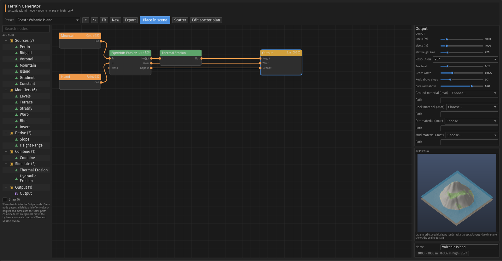
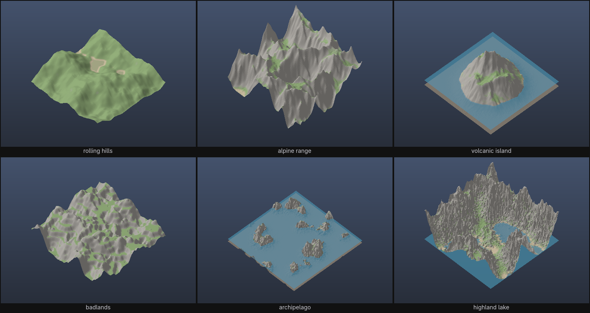
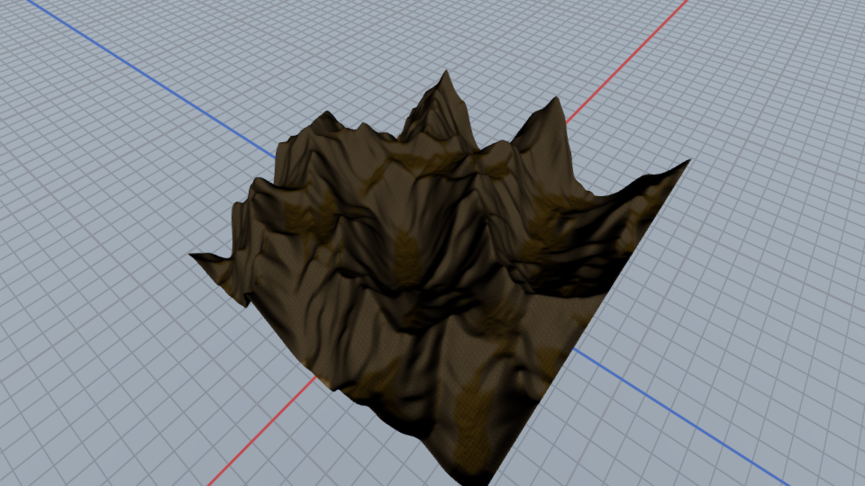
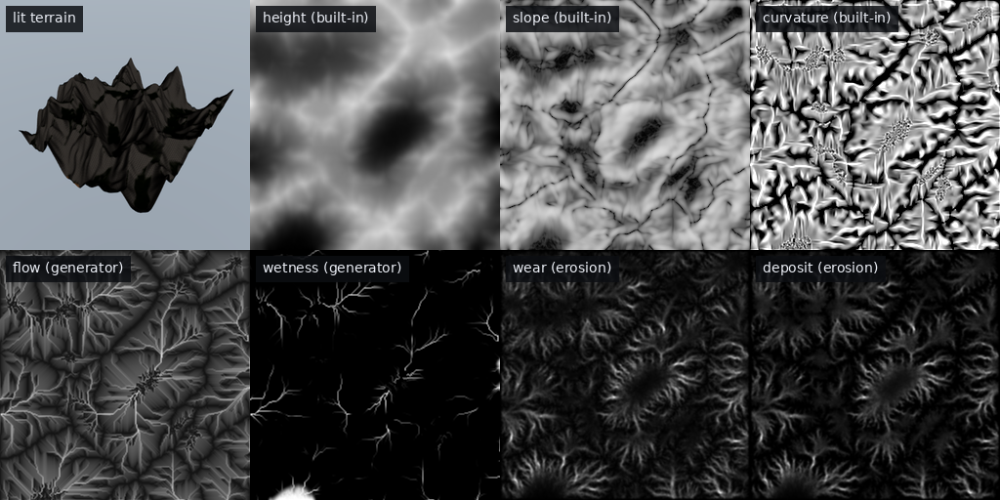
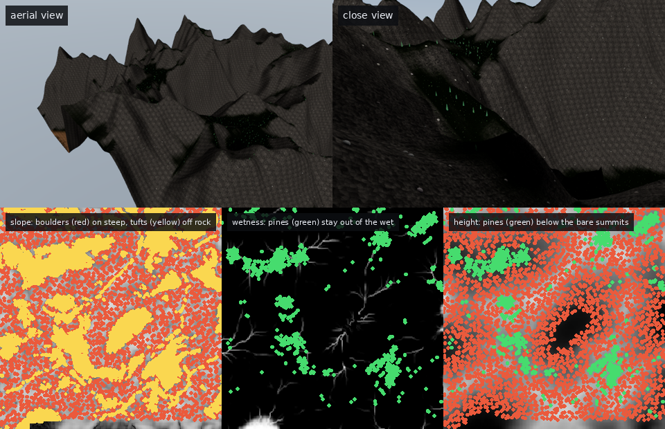

# Terrain Generator: heightfields construídos com nós

<div class="doc-meta">
  <span class="doc-badge doc-badge--stable">Estável</span>
  <span class="doc-badge">Doppio</span>
  <span>Última atualização: <time datetime="2026-11-21">2026-11-21</time></span>
</div>

<p class="doc-lede">Construa heightfields a partir de um grafo de nós e coloque-os como terreno do motor com camadas de splat de terra, rocha, solo e lama.</p>

O separador **Terrain** (menu View, junto a Nature e Water) constrói paisagens a partir de um **grafo de nós** e coloca-as
na cena como um terreno do motor com camadas de splat de terra, rocha, solo e lama. É o último dos
geradores (material, textura, nature, water, terrain) e inspira-se na forma das ferramentas de terreno baseadas em nós:
um grafo de fontes, modeladores, máscaras e erosão que termina num Output.

A pasta `reference/nerthus` (MIT, um gerador de terreno em Rust com cerca de 100k linhas e 25 famílias de nós) serviu de
mapa do que uma ferramenta completa precisa. **Nada foi copiado**; os nós aqui são implementações nossas de
técnicas bem conhecidas (ruído de gradiente, multifractais ridged, Voronoi, terraçamento, erosão térmica e erosão
hidráulica baseada em partículas), dimensionadas para o que o motor consegue usar hoje.

<figure class="doc-figure">
  
  <figcaption>O separador Terrain com o grafo Volcanic Island</figcaption>
</figure>


<figure class="doc-figure">
  
  <figcaption>Os seis presets, desenhados pela pré-visualização por software do separador</figcaption>
</figure>


<figure class="doc-figure">
  
  <figcaption>Alpine Range colocada no motor</figcaption>
</figure>


## 1. Como funciona um grafo

O grafo transporta um só tipo de dados, um **campo** (field): uma grelha quadrada de valores 0..1 que é um mapa de
alturas ou uma máscara. Cada padrão é definido no quadrado unitário, pelo que a pré-visualização em direto de 129 x 129 e o resultado de 513 x 513
mostram a mesma paisagem. Tudo é determinístico para as mesmas seeds.

| Categoria | Nós |
|---|---|
| Sources | **Perlin** (fBm), **Ridged** (cristas multifractais), **Voronoi** (células, distância, arestas, fendas), **Mountain** (um maciço com cristas), **Island** (máscara radial com costa irregular), **Gradient**, **Constant** |
| Modifiers | **Levels**, **Terrace**, **Stratify** (camadas sedimentares inclinadas), **Warp** (domain warp), **Blur**, **Invert** |
| Derive | **Slope** (máscara de inclinação), **Height Range** (máscara de uma faixa de altura) |
| Combine | **Combine** (Add, Subtract, Multiply, Maximum, Minimum, Blend, Screen, Difference, com máscara opcional) |
| Simulate | **Thermal Erosion** (deslizamento de talude), **Hydraulic Erosion** (gotas que transportam sedimento; também produz as máscaras **Wear** e **Deposit**) |
| Output | **Output**: tamanho X/Z, altura máxima, resolução (129/257/513), nível do mar, largura da praia, inclinação da rocha, linha de rocha nua; as entradas opcionais **Wear** e **Deposit** (da Hydraulic Erosion) tornam-se máscaras |

## 2. O nó Output e as camadas de splat

O Output transforma a altura final no terreno do motor e calcula as quatro **camadas de splat** a partir do
próprio terreno:

| Camada | Onde |
|---|---|
| 0 ground (grass, moss) | em todo o lado que não seja rocha, praia ou submerso |
| 1 rock | declives mais íngremes do que *Rock above slope* (subida real sobre a distância, a partir do tamanho e da altura máxima) e alturas acima de *Bare rock above* |
| 2 dirt | a faixa de praia logo acima do nível do mar |
| 3 mud | abaixo do nível do mar |

Os pesos são normalizados para somarem um; o motor reamostra-os para o seu splat map. O **nível do mar** é apenas uma
altura usada para as camadas e para a pré-visualização: coloque um corpo de **Water** a essa altura (o separador indica-a em
metros).

## 3. Presets

| Grupo | Presets |
|---|---|
| Gentle | **Rolling Hills** |
| Mountains | **Alpine Range**, **Highland Lake** |
| Coast | **Volcanic Island**, **Archipelago** |
| Arid | **Badlands** |

Cada um é um grafo normal que pode abrir e editar. Os testes verificam que todos os presets produzem um terreno válido (valores no
intervalo, relevo real, pesos de splat a somar um), que a erosão térmica suaviza a superfície conservando
o material, que a erosão hidráulica é determinística e produz máscaras de wear e deposit, que o mesmo grafo em
duas resoluções mostra a mesma paisagem, e que as seeds alteram o resultado.

## 4. Lado do motor (C ABI v8)

* `CaffeineTerrain` (POD) com `caffeine_session_set_terrain(entity, terrain, heights, splat_rgba)`,
  `caffeine_session_terrain` e `caffeine_session_terrain_height`. As alturas são 0..1 e multiplicadas pela altura
  máxima; os bytes de splat opcionais são reamostrados para o splat map. A crate Rust `doppio-engine` encapsula-os
  como `Terrain` e `Engine::set_terrain/terrain/terrain_height`.
* A sessão agora **sincroniza as malhas de terreno antes de desenhar** (antes não o fazia, por isso um terreno nunca era desenhado no editor)
  e dá à entidade os componentes de mesh que o renderer procura.
* A malha do terreno está **centrada na sua entidade**; `terrain_height(x, z)` mede a partir do canto, tal como as leituras de máscara.
* Colocar é um passo de undo, seleciona a entidade e indica o nível do mar; **Export** escreve
  `Terrain/<name>.generator.terrain` (uma receita que envolve o texto `CAFTERRAIN1` / `TERRAINGRAPH1`) e um **PNG de mapa de alturas
  de 16 bits** para outras ferramentas.

### Masks (C ABI v15)

Colocar um terreno envia ao motor mais do que uma altura e um splat map: envia **máscaras**, campos 0..1 com nome que o scatter, a tabela
de biomas e (mais tarde) os shaders leem para colocar coisas conforme aquilo que o terreno *é*.

<figure class="doc-figure">
  
  <figcaption>A Alpine Range colocada no motor e cada máscara lida de volta através da C ABI a 256 x 256: as três que o motor deriva do
  heightfield, as duas que o grafo deriva (linhas de drenagem em <em>flow</em>, os fundos de vale húmidos e o mar em <em>wetness</em>) e as duas
  que a erosão hidráulica deixou (<em>wear</em> onde cortou, <em>deposit</em> onde largou sedimento).</figcaption>
</figure>

| Máscara | Gerada por | Significado |
|---|---|---|
| `height` | motor, a partir do heightfield | altura normalizada |
| `slope` | motor | ângulo em relação à horizontal, 0 plano .. 1 = 90 graus |
| `curvature` | motor | 0.5 em terreno plano, tende para 1 num vale, tende para 0 numa crista (+-0.125 por metro é o intervalo completo) |
| `flow` | grafo (nó Output) | acumulação de fluxo D8: quanto do terreno drena através de um texel, em escala logarítmica |
| `wetness` | grafo | drenagem constante que não é íngreme, mais tudo o que está ao nível do mar ou abaixo |
| `wear`, `deposit` | grafo, **quando ligadas** | o que a erosão hidráulica retirou e deixou; o nó Output tem duas entradas opcionais para elas (os presets com erosão ligam-nas) |

As incorporadas não custam nada: o motor calcula-as a partir do heightfield a pedido. As guardadas têm 8 bits por texel na
grelha do heightfield (uma máscara é um peso, não uma altura), até 16 por terreno, **guardadas no ficheiro do terreno** (versão 3; um terreno
sem máscaras continua a ser escrito como versão 2 para que leitores mais antigos o abram).

* `caffeine_session_set_terrain_mask(entity, name, res_x, res_z, bytes)` (bytes NULL remove-a), `terrain_mask_count`, `terrain_mask_at`
  (nome, grelha, incorporada), `terrain_mask(entity, name, x, z)` para um ponto e `terrain_mask_rect(entity, name, x0, z0, x1, z1, w, h, out)` para
  reamostrar um retângulo. As coordenadas são metros a partir do canto do terreno, como `terrain_height`; fora do terreno lê-se a aresta mais próxima.
* `caffeine_session_terrain_normal(entity, x, z)`: a normal unitária da superfície.
* A crate Rust encapsula-as: `Engine::set_terrain_mask`, `remove_terrain_mask`, `terrain_masks`, `terrain_mask`, `terrain_mask_rect`,
  `terrain_normal`.

### A tabela de biomas

`terrain/TerrainBiome` transforma máscaras na densidade 0..1 de cada classe de scatter: a densidade de uma classe é `base x` um produto de termos, cada termo um
trapézio sobre uma máscara. É texto simples e liga-se diretamente ao callback de densidade do módulo de scatter:

```text
class 2 base 0.9            # trees: gentle, dry, above the beach
  slope     0.00 0.00 0.15 0.35
  wetness   0.00 0.00 0.30 0.60
  height    0.22 0.28 1.00 1.00
class 1 base 1              # rocks: steep ground
  slope     0.30 0.45 1.00 1.00
```

Uma classe sem regra tem densidade 1; um termo que nomeia uma máscara que o terreno não tem dá 0 (não se coloca nada em vez de
colocar em todo o lado) e `missingMasks` lista esses nomes. Testado de ponta a ponta: as árvores dispersas nunca ficam em terreno íngreme ou húmido e as rochas só
na crista. O editor lê uma tabela através do plano de scatter abaixo; um separador World que edite tabelas visualmente é a fase 6 do roadmap do mundo.

### Scatter on a terrain (C ABI v16)

**Scene > Scatter on Terrain** (id `editor.menu.scene.scatter_terrain`), ou o botão **Scatter** na barra de ferramentas deste separador (junto a *Place in scene*; faz scatter no terreno selecionado, ou então no último que colocou), coloca um plano completo de vegetação e rochas no terreno selecionado num
só passo de undo. O plano é um ficheiro de texto do projeto, `Scatter/default.scatter`, escrito a partir de um plano incorporado na primeira vez; edite-o e execute a ação
outra vez. Uma linha `class` diz *o quê* (forma, tamanho, espaçamento, escala, inclinação, afundamento, tinta, variantes, Micromesh), e as linhas por baixo são os termos
de bioma que dizem *onde*, os mesmos trapézios de cima:

```text
seed 7
class 1 name boulder primitive sphere color 0.45 0.43 0.40 size 1.6 1.1 1.4 cell 16 radius 2.2 density 0.9 priority 30 scale 0.7 1.6 tilt 0.8 sink 0.3 micromesh on
  slope 0.30 0.45 1.00 1.00
class 2 name pine primitive cone color 0.12 0.32 0.15 size 1.8 6 1.8 cell 8 radius 2.4 density 0.85 priority 20 scale 0.8 1.4 tilt 0.1 tint 0.1
  slope   0.00 0.00 0.15 0.35
  wetness 0.00 0.00 0.30 0.60
  height  0.12 0.20 0.70 0.85
```

**Edit scatter plan** (barra de ferramentas) abre o plano no editor de scripts. Uma classe também pode ser um **composite**: linhas indentadas `part mesh <path> [slots a.mat;b.mat]
[micromesh on|off] [cutout on|off]` fazem de cada instância uma entidade vazia com um filho por parte (uma árvore gerada é um sólido e uma mesh de folhagem);
o *Add to scatter plan* do separador Nature escreve-as por si.

Uma forma é `primitive <cube|sphere|cone|cylinder|capsule|pyramid|torus>` ou `mesh <path>` (um `{v}` no caminho é o número da variante, por isso um
conjunto de rochas `.nature` é disperso como variantes); `material <path>` e `color r g b` definem o aspeto. O plano é validado antes de se colocar fosse o que fosse:
uma linha inválida ou um termo de bioma para uma máscara que o terreno não tem reporta um erro na barra de estado e não altera nada.

<figure class="doc-figure">
  
  <figcaption>A Alpine Range com scatter do plano incorporado (20 000 instâncias: 2 692 boulders, 651 pines, 16 657 tufts). Em cima: vistas iluminadas, pinheiros
  nas bacias. Em baixo: onde cada classe ficou sobre a máscara que lê: boulders na vertente íngreme (clara), tufts fora da rocha, pinheiros só em wetness
  seca (preta) e abaixo dos cumes nus. Regenere com <code>scripts/render-scatter-docs.sh</code>.</figcaption>
</figure>

O que acontece por baixo:

* `scatterTerrain` (`src/caffeine/scatter/TerrainScatter`) executa o núcleo de scatter determinístico sobre uma região do terreno com a sua altura,
  normal e a densidade de bioma. O resultado depende apenas da seed, do plano e do terreno, não do tamanho do chunk: as duas metades de uma
  região somam o todo. Pára em `maxInstances` e indica o total, pelo que a linha de estado avisa quando o plano foi cortado
  (5 000 por omissão no editor; aumente-o com `max_instances`).
* `caffeine_session_scatter_terrain(session, entity, seed, classes, class_count, biome_text, region, out, capacity, out_total)` devolve a posição no mundo,
  `up` (a normal do terreno), a rotação de Euler em graus, a escala, a tinta e a variante de cada instância. `capacity` 0 só conta.
  `caffeine_biome_check(text, error, size)` valida uma tabela. A crate Rust encapsula-as como `Engine::scatter_terrain` e `biome_check`.
* O Doppio cria uma entidade contentora `Scatter <plan name>` e um filho por instância com Mesh Filter, Mesh Renderer (material, tinta = cor da classe
  x tinta da instância, Micromesh) e a posição, rotação e escala vindas do motor. Mesma seed e plano, mesma colocação.
* Limites: cada instância é uma entidade, por isso milhares são lentas de editar (os caminhos de desenho instanciado e Micromesh tratam delas, os buffers de instâncias
  por chunk são a fase 4); o plano é global ao terreno (ainda sem regiões pintadas); as rochas usam uma única amostra de altura no centro da instância.

## 5. Limites e roadmap

Esta é a primeira fatia de uma ferramenta que é muito maior noutros sítios (a referência tem cerca de 25 famílias de nós). Estado
honesto:

* **Cobertura de nós.** 19 nós contra as centenas da referência. Famílias em falta, aproximadamente por ordem de
  importância: **rios e lagos** (encaminhamento de fluxo, escavação, máscaras de água), **neve e glaciares**, simulações de **sedimento e
  escombros**, **detalhe de rocha** (afloramentos, pedra estilhaçada, arenito), **cartografia** (curvas de nível,
  hillshade), **scatter de vegetação e objetos** a partir de máscaras, **máscaras vetoriais** (splines, estradas), **entrada de ficheiros**
  (importar heightmaps e malhas), e uma fase **colorize** que pinta um mapa de cor a partir de paletas e máscaras.
* **Fidelidade.** A erosão é um modelo de partículas compacto, não um solver de produção: escava ravinas credíveis
  e deposita sedimento, mas não iguala ferramentas dedicadas em simulações grandes e demoradas; corre no CPU até
  513 x 513. O próprio motor aceita terrenos até 4097 x 4097 e o seu LOD por chunks desenha-os (um terreno de 1025 x 1025 submete cerca de 0.84 M dos seus 2.1 M de triângulos em cerca de 410 draws; veja o conjunto de benchmarks em `micromeshes.md`); o que falta é uma saída do gerador acima de 513 e tiling ou streaming de qualquer coisa maior do que um heightfield.
* **Texturas de splat.** As quatro camadas usam os caminhos de textura de camada do componente de terreno (os valores por omissão apontam para os
  conjuntos de chão de `hdr-assets-texture`). Num projeto sem eles o terreno aparece escuro; escolher as texturas
  de camada a partir do separador é o passo seguinte. **Não há camada de neve** (o motor tem quatro), por isso as montanhas mostram rocha, não
  neve.
* **Máscaras para o motor.** Só as quatro camadas de splat chegam ao motor. As máscaras wear, deposit e flow ficam no
  grafo; exportar máscaras como imagens e conduzir o scatter de vegetação a partir delas não está feito.
* **Uma cache global ao processo.** A cache de terrenos do motor é um singleton indexado pelo id da entidade e o encerramento de uma sessão limpa-a, por isso duas sessões do motor no mesmo processo não devem construir terrenos ao mesmo tempo (os testes do motor usam um lock para isto). Uma cache por sessão é a solução limpa.
* **Uma só saída.** Um terreno por grafo; sem tiling nem exportação de vários terrenos, sem fila de build/export.
* **Pré-visualização.** A pré-visualização 3D é um render por software das cores de splat e do plano do mar com um exagero vertical
  de 1.4x; a iluminação, as sombras e as texturas do motor são diferentes.
* **Água.** O nível do mar é um número, não um corpo de água; o separador Water coloca a superfície em separado.
* **Ajustes.** O relevo e os níveis do mar dos presets foram afinados com a pré-visualização por software e um único render do motor;
  espere ter de os ajustar (altura máxima, mar, inclinação da rocha) por projeto.

Plano ao nível do mundo (máscaras para o motor, scatter, streaming de chunks): veja [`photoreal-world-roadmap.md`](photoreal-world-roadmap.md).

## 6. Agentes e scripting

O separador é um painel como os outros (`editor.pane.terrain_generator`, ids `terraingen.*`). Headless: fixture
`terrain` (`reset` aceita um `preset`, por exemplo `Badlands`); não é preciso motor para o grafo e a pré-visualização. A colocação
e o rendering são cobertos por testes com o motor.

Os botões da barra de ferramentas são as ações MCP `terrain_scatter` e `terrain_edit_scatter_plan` (e `nature_add_to_scatter` do separador Nature). Os agentes colocam um scatter com a ação MCP `scatter_on_terrain` (`plan_text` ou `plan_file`, `seed`, `max_instances`, `terrain_id`); envia a mesma
mensagem que o menu, por isso também é um só passo de undo. Testes: `scatter_on_terrain_places_the_plan_by_the_terrains_masks` (com motor).

## 7. Regenerar as imagens

```bash
./scripts/capture-terrain-docs.sh                                              # the tab (headless, no engine)
./scripts/render-terrain-mask-docs.sh                                          # the mask sheet (engine renders and reads back every mask)
DOPPIO_TERRAIN_DUMP=/tmp/terrain cargo test -p doppio-ui --lib terrain_presets_dump   # preview of every preset
DOPPIO_TERRAIN_DUMP=/tmp/terrain cargo test -p doppio-ui --lib placing_a_terrain      # engine render of Alpine Range
```

## As camadas são materiais do projeto

O nó Output tem quatro slots de material (ground, rock, dirt, mud). Aplicar um preset, ou colocar,
preenche os slots vazios ao cozer uma imagem da biblioteca de materiais para `Terrain/Layers/<layer>.png` e escrever um
`Terrain/Layers/<layer>.mat` cujo mapa de albedo é essa imagem. O slot guarda o `.mat`; colocar
pinta os `Splat Layer Paths 1..4` do motor com o mapa de albedo de cada material. Um slot que já tem um
caminho, ou um ficheiro que já existe, nunca é tocado: repinte o PNG, edite o `.mat`, ou escolha outro
material na lista do nó. Um slot com uma imagem simples (grafos mais antigos) continua a funcionar.

Limite: o shader de splat do motor mistura apenas as quatro imagens de **albedo**. Normal, roughness e os
outros canais do `.mat` ficam guardados no ficheiro mas ainda não são usados nas camadas do terreno; isso precisa de uma
alteração ao shader.

Os ficheiros `.terrain-graph` antigos carregam como antes; os seus slots vazios são preenchidos da próxima vez que aplicar ou colocar.

## Usar num mundo

O [World Composer](world-composition.md) parte de uma receita de terreno: a sua linha `terrain` indica um
`*.generator.terrain`, o editor faz o bake e as classes da composição leem as suas máscaras (`slope`, `height`,
`curvature`, `flow`, `wetness`, ...) com os mesmos termos de bioma da tabela acima. O composer acrescenta uma máscara
própria, `water_distance`, e um rio com `carve` rebaixa o heightfield antes de qualquer classe o ler.
