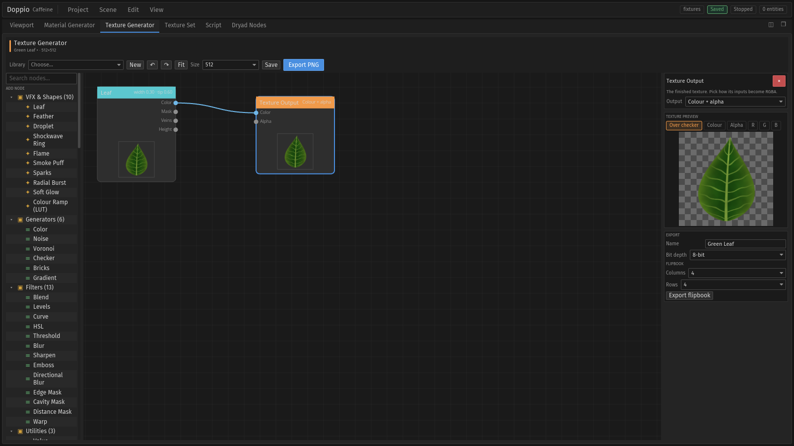
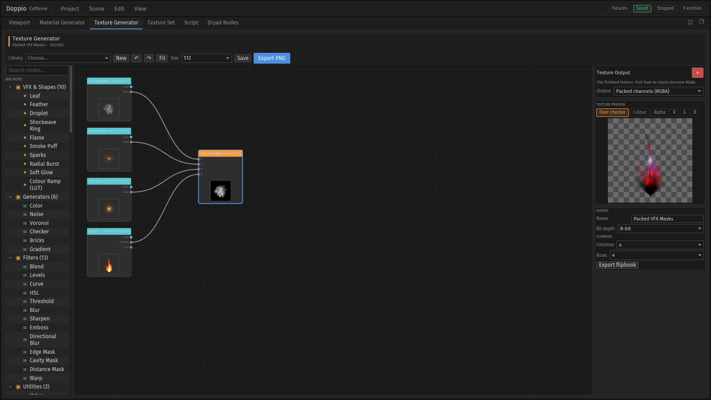
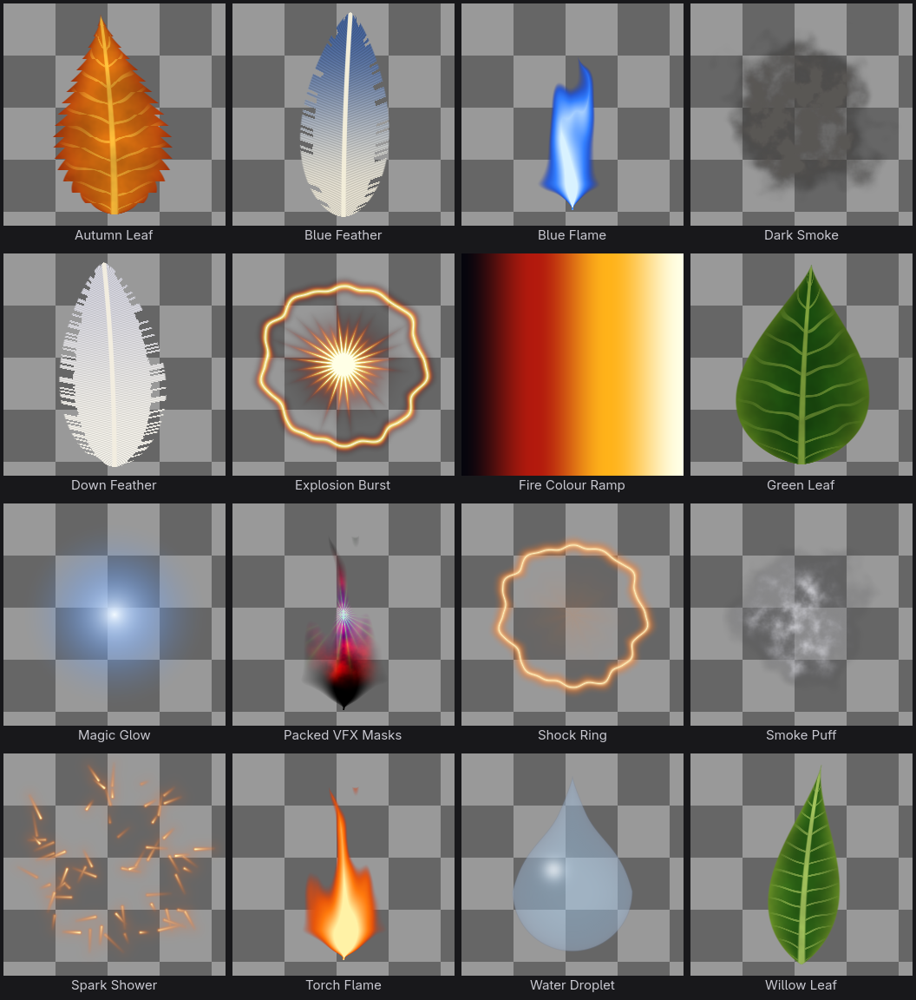
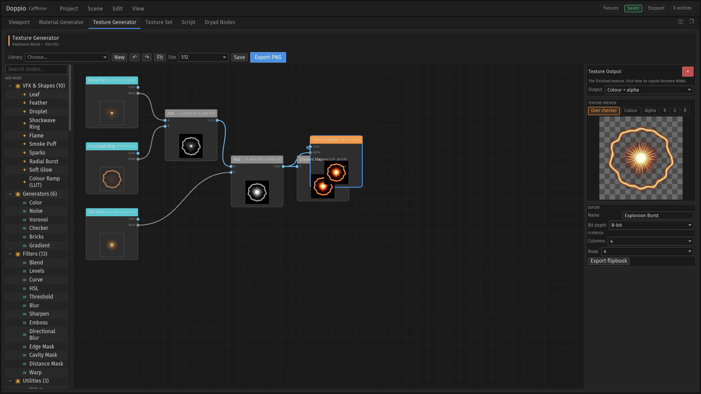
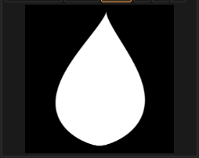
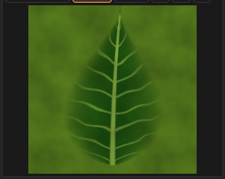
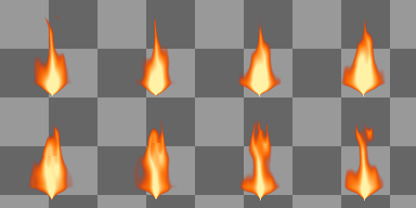
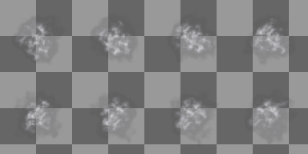

# Texture Generator: sprites procedurais, VFX e máscaras empacotadas

<div class="doc-meta">
  <span class="doc-badge doc-badge--stable">Estável</span>
  <span class="doc-badge">Doppio</span>
  <span>Última atualização: <time datetime="2026-11-20">2026-11-20</time></span>
</div>

<p class="doc-lede">Gere uma textura de cada vez — uma folha, uma pena, uma chama, uma máscara RGBA empacotada — com o grafo de nós do Texture Generator.</p>

O **Texture Generator** é um grafo de nós que gera **uma textura**: uma folha, uma pena, uma
chama, um anel de choque, uma máscara RGBA empacotada. É uma ferramenta própria, ao lado do
**Material Generator**, porque os dois trabalhos são diferentes.

| | Material Generator | Texture Generator |
|---|---|---|
| Produz | um material PBR (`.mat` mais mapas base, normal, ORM e emissive) | uma única imagem, com alfa |
| Nó de resultado | `Output` (Color, Roughness, Metallic, Height, AO, Emissive, Opacity, Normal) | `Texture Output` (Colour + alpha, ou R, G, B, A empacotados) |
| Tiling | sem costuras | opcional: um objeto fica na imagem com uma margem transparente |
| Pré-visualização | esfera ou plano do motor com iluminação real | xadrez, mais vistas de um só canal |
| Ficheiro | `<material>.generator.material` junto ao `.mat` | `<name>.generator.texture` em `Textures/`, com o `.png` |
| Biblioteca | 85 materiais | 21 texturas: folhagem, orgânico, fogo e fumo, efeitos, procedural, dados |
| Cor de destaque | ciano | laranja (barra de título e o nó Texture Output) |

Podem alimentar-se um ao outro (gere uma chama para PNG e use-a como mapa emissive), mas um grafo de textura
nunca abre como material e vice-versa: os carregadores recusam o outro formato.

<figure class="doc-figure">
  
  <figcaption>O separador Texture Generator</figcaption>
</figure>


As imagens são produzidas em headless pelas ferramentas do motor; os comandos para as regenerar estão no
fim.

## 1. O que é partilhado e o que não é

Ambas as ferramentas correm sobre a mesma sala de máquinas, por isso cada melhoria de uma ajuda a outra:

* o **armazém de nós e o avaliador** (`generators::MaterialGraph` é apenas o contentor de nós e
  ligações, avaliado de forma preguiçosa com memoização);
* a **biblioteca procedural** em `uikit/procedural/` (139 ops: 129 para materiais mais 10 novas ops de VFX &
  Shapes);
* o **canvas de nós**, o **editor de parâmetros** (sliders, seletores de cor, dropdowns gerados
  a partir da linha da tabela de cada op) e o **histórico de undo**.

O que é separado: o formato `.texgraph` (`uikit/texture_graph.rs`), o nó `TextureOutput`, a
paleta, os presets, o painel (`panels/texture_generator.rs`), o estado do editor e as mensagens
(`windows/main/texturegen.rs`), os ids (`texturegen.*`) e as ações de agente.
A paleta de materiais já não oferece as ops de VFX & Shapes, e a paleta de texturas esconde o `Output`
PBR, os leitores de imagem e os nós de normal map.

## 2. O nó Texture Output

| Modo | Portas | Utilização |
|---|---|---|
| **Colour + alpha** | Color, Alpha | sprites, folhas, decals. Sem uma entrada Alpha mantém-se o alfa da própria cor, que é como as ops de VFX & Shapes se mascaram a si próprias. |
| **Packed channels (RGBA)** | R, G, B, A | texturas de dados e VFX: quatro máscaras em tons de cinzento num só ficheiro. R, G e B não ligados valem 0, A vale 1. |

Mudar o modo remove as ligações a portas que já não existem. O nó não pode ser apagado: é o
resultado do grafo. A saída vai para um PNG de **8 ou 16 bits** com alfa direto.

<figure class="doc-figure">
  
  <figcaption>Quatro máscaras empacotadas em R, G, B e A</figcaption>
</figure>


## 3. Nós de VFX & Shapes

Dez ops, em `uikit/procedural/vfx.rs`. Nenhuma é repetível (tileable): cada uma desenha um objeto. As saídas de cor transportam
a máscara do objeto no alfa, e o RGB é mantido sob a área transparente para que os mip-maps não ganhem
halos escuros. Tudo é determinístico para uma seed.

| Op | Produz | Saídas | Parâmetros principais |
|---|---|---|---|
| Leaf | silhueta a partir de um perfil de largura, nervura central e nervuras laterais curvas | Color, Mask, Veins, Height | half width, tip sharpness, base roundness, serration, teeth, bend, side veins, vein sweep, texture |
| Feather | vexilo com barbas, fendas e um cálamo | Color, Mask, Barbs | width, vane curve, barbs, slant, splits, bend |
| Droplet | gota (união suave de um círculo e de um cone afunilado) | Color, Mask, Dome | radius, tail, join smoothing, highlight, tilt |
| Shockwave Ring | anel distorcido com um brilho interior | Color, Value | radius, thickness, softness, distortion, noise scale |
| Flame | gota deformada e erodida por ruído, rampa de fogo | Color, Intensity, Core | width, height, turbulence, stretch, sharpness, **phase** |
| Smoke Puff | nuvem de fumo suave e turbulenta | Color, Value | radius, turbulence, density, softness, **phase** |
| Sparks | brasas em rasto com uma cabeça quente | Color, Value | count, length, thickness, radial bias, glow |
| Radial Burst | raios de comprimentos aleatórios e um núcleo | Color, Value | rays, sharpness, reach, length variation, core size |
| Soft Glow | decaimento elíptico | Color, Value | radius, falloff power, intensity, aspect |
| Colour Ramp (LUT) | gradiente 1D ao longo de X, Y ou radial, quatro paragens | Color, Position | direction, stops B and C, smooth blend |

<figure class="doc-figure">
  
  <figcaption>Todos os presets sobre um xadrez</figcaption>
</figure>


As ops combinam-se com tudo o resto da biblioteca: o preset *Explosion Burst* é um burst, um
anel e um brilho somados e mapeados por um Gradient Map, com a soma também ligada à
porta Alpha.

<figure class="doc-figure">
  
  <figcaption>Grafo Explosion Burst</figcaption>
</figure>


## 4. Biblioteca

O dropdown **Library** substitui o grafo por um dos 21 presets (um passo de undo; o seu tamanho é
mantido). São grafos normais, por isso pode continuar a editá-los.

| Categoria | Presets |
|---|---|
| Foliage | Green Leaf, Autumn Leaf, Willow Leaf, Petal Pink / White / Yellow (o [Nature Generator](nature-generator-guide.md) usa-os para flores) |
| Organic | Blue Feather, Down Feather, Water Droplet |
| Fire & Smoke | Torch Flame, Blue Flame, Smoke Puff, Dark Smoke |
| Effects | Spark Shower, Shock Ring, Magic Glow, Explosion Burst |
| Procedural | Wave Function Collapse Bricks, Diamond-Square Clouds (ambos da classe **Variation**, veja o [guia de materiais](materials-guide.md#variation-padrões-vivos-que-nunca-se-repetem)) |
| Data | Fire Colour Ramp (uma LUT 1D), Packed VFX Masks (R smoke, G burst, B glow, A flame) |

## 5. Pré-visualização

A pré-visualização é gerada a 256 px após cada edição (miniaturas dos nós a 96 px), por isso acompanha os sliders
em direto. É desenhada **sobre um xadrez**, para que a transparência seja visível. Os chips alternam a vista:

| Sobre o xadrez | Cor | Alpha | R, G, B |
|---|---|---|---|
| o resultado real | RGB sem alfa | a máscara em cinzento | um canal em cinzento, para máscaras empacotadas |

| Alpha | Colour |
|---|---|
|  |  |

## 6. Guardar e exportar

Os ficheiros vão para `<project assets>/Textures/` (um `textures/` existente é reutilizado; `Textures/` relativo ao
diretório de trabalho quando não há projeto). A exportação corre numa thread de trabalho, por isso uma geração a 16 bits ou de flipbook não
bloqueia o editor, e a nova imagem aparece em Assets quando termina:

| Botão | Escreve |
|---|---|
| **Save** | `<name>.texgraph`, o grafo editável (`CAFTEXGRAPH1`, o mesmo formato de texto dos grafos de material) |
| **Export PNG** | `<name>.png` no tamanho e profundidade de bits escolhidos; o grafo é guardado com ele para que a imagem possa sempre voltar a ser editada |
| **Export flipbook** | `<name>_flipbook_<C>x<R>.png`, uma folha de `C x R` fotogramas |

**Flipbooks.** Flame e Smoke Puff têm um parâmetro **Phase** que faz loop de 0 a 1. O flipbook
gera o grafo uma vez por fotograma, avançando cada parâmetro `phase` do grafo de 0 até pouco menos de
1, e dispõe os fotogramas linha a linha; o último fotograma volta ao primeiro. Um grafo sem
parâmetro de fase dá fotogramas idênticos. Os fotogramas são quadrados de `size` píxeis, por isso uma folha de 4 x 2 a 128 tem
512 x 256.

<figure class="doc-figure">
  
  <figcaption>Torch flame, flipbook de 4 x 2</figcaption>
</figure>


<figure class="doc-figure">
  
  <figcaption>Smoke puff, flipbook de 4 x 2</figcaption>
</figure>


## 7. Para agentes e scripts

Linha de comandos (sem janela):

```bash
doppio-material bake-texture --list                                  # presets
doppio-material bake-texture "Torch Flame" --out /tmp/tex --size 512 --bits 16
doppio-material bake-texture "Torch Flame" --out /tmp/tex --size 128 --flipbook 4x2
doppio-material bake-texture my.texgraph --out /tmp/tex
doppio-material bake-texture --all --out /tmp/tex --size 256
```

MCP (`--features agent`): consulta `texture_generator` (nome, tamanho, nós, ligações, nomes dos presets);
ações `texture_generator_apply_preset { name }`, `texture_generator_configure { name | bits |
size | flipbook: [c, r] }` e `texture_generator_export { flipbook?: true }`. Tudo é uma
`Message`, por isso um agente não pode fazer mais do que a UI.

Driver headless: a fixture `texture` mostra o separador, com `preset` a indicar um preset de textura
(`Torch Flame`); o flow `tests/ui-flows/texture-generator.json` cobre-o.

## 8. Limites e próximos passos

* A pré-visualização é avaliada no CPU a 256 px; as exportações chegam até 2048 px (um flipbook de 4 x 4 a 512 é uma
  folha de 2048 px).
* Só PNG: a saída float / EXR para heightmaps e LUTs não está implementada.
* O Texture Generator ainda não tem um nó leitor de imagem, por isso não consegue ler bitmaps do projeto.
* O botão **Reseed** dá a cada nó com seed uma seed nova (uma variação do preset, um passo de undo); a variação de cor continua a ser editada nas propriedades do nó.
* Não é oferecido um modo de exportação em tiles (texturas sem costuras): use o Material Generator para tiles.

## 9. Regenerar as imagens

```bash
./scripts/capture-texture-docs.sh         # headless UI screenshots (tab, preview modes, graphs)
./scripts/render-texture-gallery.sh       # bakes every preset and two flipbooks (needs ImageMagick)
```

As capturas de ecrã da UI vêm do driver headless (veja [headless-testing.md](headless-testing.md));
o flow é `caffeine-website/captures/flows/capture-texture-docs.json`.
