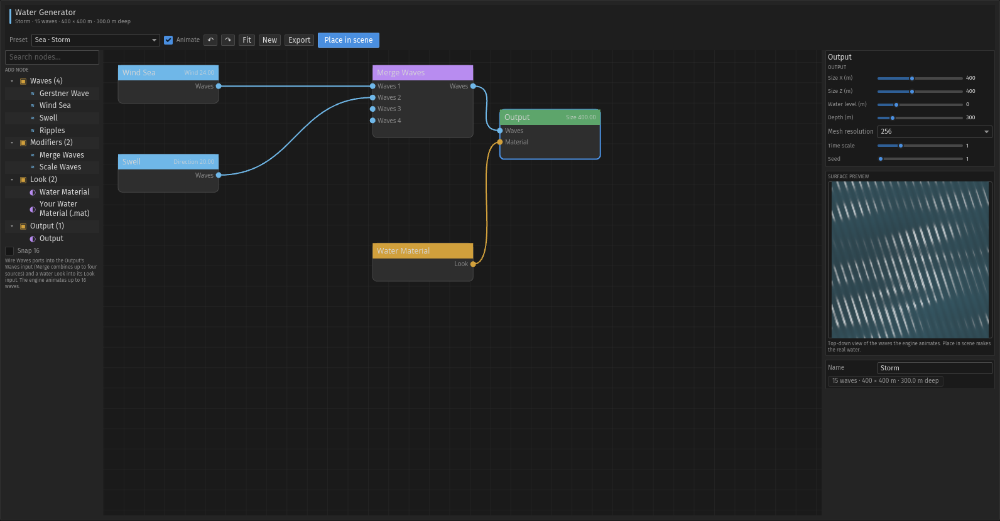
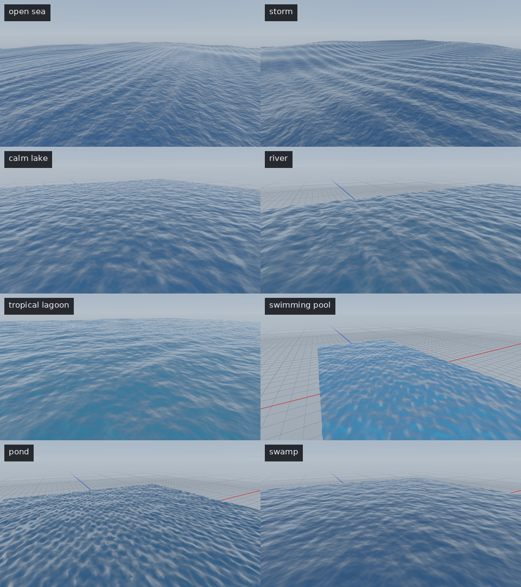
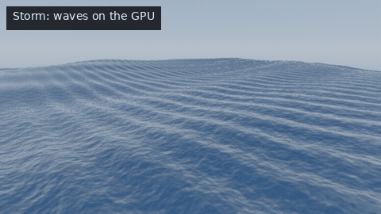

# Water Generator: corpos de água construídos com nós

<div class="doc-meta">
  <span class="doc-badge doc-badge--stable">Estável</span>
  <span class="doc-badge">Doppio</span>
  <span>Última atualização: <time datetime="2026-11-20">2026-11-20</time></span>
</div>

<p class="doc-lede">Monte lagos, rios, mares e tempestades a partir de um grafo de nós e coloque-os como uma superfície de água animada do motor.</p>

O separador **Water** (menu View, junto a Nature) constrói lagos, rios, mares e tempestades a partir de um **grafo de nós**
e coloca-os na cena como uma superfície de água animada do motor. Substitui o antigo bloco fixo de ondas de vento:
as ondas são agora *dados* que se montam, e as mesmas ondas conduzem a pré-visualização do editor, a malha do motor e
as consultas de gameplay (`water_height`, para objetos flutuantes).

<figure class="doc-figure">
  
  <figcaption>O separador Water com o grafo Storm</figcaption>
</figure>


<figure class="doc-figure">
  
  <figcaption>Os oito presets, desenhados pelo motor</figcaption>
</figure>

<figure class="doc-figure">
  
  <figcaption>O preset Storm em movimento. As ondas são deslocadas na GPU (<code>water.vert</code>) a partir da lista de ondas, por isso a
  superfície é uma grelha plana e a taxa de fotogramas não depende de quantas ondas o grafo tem (até 16). Gerado por
  <code>./scripts/render-world-docs.sh</code>.</figcaption>
</figure>


## 1. Como funciona um grafo

Duas portas tipadas (duas cores); uma ligação só liga portas do mesmo tipo e nunca fecha um ciclo:

| Porta | Transporta |
|---|---|
| **Waves** | uma lista de ondas de Gerstner (direção, comprimento de onda, amplitude, steepness, fase) |
| **Look** | o **Water Material**: cor, opacidade (baixa = límpida), roughness e limiar de espuma |

| Categoria | Nós |
|---|---|
| Waves | **Gerstner Wave** (uma onda explícita), **Wind Sea** (um espetro a partir da velocidade do vento, direção, dispersão e choppiness), **Swell** (trens longos e regulares vindos de longe), **Ripples** (ondas curtas de muitas direções) |
| Modifiers | **Merge Waves** (até quatro fontes; mantém as 16 mais fortes), **Scale Waves** (amplitude, comprimento de onda, choppiness, rotação) |
| Look | **Water Material** |
| Output | **Output**: tamanho X/Z, nível da água, profundidade, resolução da malha, escala de tempo, seed |

A interação é a mesma dos outros geradores: paleta à esquerda, canvas ao centro, parâmetros e
a **Surface preview** animada à direita. O undo/redo cobre todas as edições, *Export* escreve
`Water/<name>.generator.water` (uma receita que envolve o texto `CAFWATER1` / `WATERGRAPH1`), **Place in scene** cria
a entidade. A pré-visualização é um render vertical da mesma soma de Gerstner que o motor anima (vertentes iluminadas pelo sol, um
reflexo de céu de Fresnel, espuma onde as cristas se comprimem); é uma pré-visualização de forma, não o shading final.

## 1b. A água tem sempre o seu material

A água não pode existir sem material: a porta **Material** do Output precisa de um nó **Water Material**, e um grafo
sem ele não é construído ("The water has no material: wire a Water Material node..."). **Place in scene** escreve
esse nó como um asset real do projeto, `Water/<name>.mat` (cor e opacidade, roughness, uma refletância base baixa, um
clearcoat fino, transmissão e o índice de refração da água, alpha blend), e atribui-o à entidade de água, de modo que o
material fica visível no painel Assets e editável no separador **Material** como qualquer outro. O motor desenha a
água com o material da entidade sempre que existe um (sem material recorre a um aspeto de água incorporado).
Colocar outra vez regenera o `.mat` a partir do nó; mantenha as suas edições atribuindo depois o seu próprio material.

## 2. Porque é modular e barato

* **As ondas são a unidade de trabalho.** Um mar é um punhado de ondas bem escolhidas, não uma textura nem uma simulação. O
  motor avalia no máximo **16 ondas explícitas** numa malha com deslocamento de vértices, por isso o custo é
  `vértices x ondas` independentemente de como as construiu. *Merge* mantém as mais fortes; o limite de estabilidade
  de Gerstner (`sum(Q k A) < 1`, as cristas nunca se dobram sobre si próprias) é imposto pelas fontes e testado.
* **Um só modelo para tudo.** Lago, rio, piscina e oceano diferem apenas no grafo e no Output: um rio são duas
  ondas esticadas ao longo do fluxo mais ondulações cruzadas; uma tempestade é um espetro movido a vendaval mais uma swell alta.
* **O gameplay pode amostrá-la.** `caffeine_session_water_height(entity, x, z)` devolve a altura da
  superfície simulada, por isso barcos e objetos flutuantes seguem as mesmas ondas que vê.
* **Consciente da malha.** Uma malha de vértices não consegue mostrar uma onda mais curta do que cerca de três das suas células. Em vez de fazer aliasing
  em padrões aos blocos, essas ondas são **atenuadas** (entre 2.5 e 4 células) e o separador diz quantas.
  O detalhe fino precisa de uma *Mesh resolution* mais alta (até 256), de um corpo mais pequeno ou de ondas mais longas.

## 3. Presets

| Grupo | Presets |
|---|---|
| Still | **Calm Lake**, **Pond**, **Swimming Pool** |
| Coast | **Tropical Lagoon** |
| Inland | **River**, **Swamp** |
| Sea | **Open Sea**, **Storm** |

Cada um é um grafo que pode abrir e editar. Propriedades testadas: todos os presets produzem água válida, a tempestade é
mais alta do que o mar, que é mais alto do que o lago, um mar mais tempestuoso tem um limiar de espuma mais baixo, as seeds alteram
as ondas, e nenhum preset contém uma onda que a sua malha não consiga mostrar.

## 4. Lado do motor (C ABI v7)

* `NaturalFluidComponent` ganhou `customWaveCount` e `customWaves[16][6]`, **acrescentados** no fim: cenas
  mais antigas carregam sem alterações (o serializador copia o prefixo comum) e há testes a cobri-lo. Com ondas personalizadas o
  componente usa-as em vez do espetro de vento gerado (`WaveSettings::explicitWaves`; a relação de
  dispersão preenche a frequência angular em falta).
* `CaffeineWater` (POD, até 16 `CaffeineWaterWave`) com `caffeine_session_set_water`,
  `caffeine_session_water` e `caffeine_session_water_height`. A crate Rust `doppio-engine` encapsula-os como
  `Water`, `WaterWave`, `Engine::set_water/water/water_height`.
* `caffeine_session_tick` agora avança os fluidos naturais, e o editor faz tick do motor enquanto uma superfície de água está
  na cena, por isso a superfície anima no viewport (a aplicação runtime já o fazia).
* **As ondas correm na GPU.** A superfície era reconstruída no CPU a cada fotograma (uma grelha de 256 x 256 amostrada
  contra 16 ondas, normais incluídas, e depois enviada de novo: cerca de **28 ms por fotograma** a 256 x 256). Agora um
  mar analítico é uma **grelha plana enviada uma só vez**; `water.vert` avalia a soma de Gerstner (a mesma matemática de
  `WaveField::sample`, por isso `water_height` concorda com o que vê) e o custo de CPU por fotograma é praticamente zero.
  A caixa de culling é alargada pela amplitude das ondas e pela choppiness (`MeshGeometryComponent::boundsPadding`).
  As superfícies com **física de águas rasas** ou com mais de 16 ondas mantêm a malha no CPU, como antes.
* **Aspeto da água no shader** (`scene_lit.frag`, ativado para superfícies de água): duas camadas de **normais de ondulação**
  procedimentais que desaparecem com a distância (o detalhe fino e caótico que uma malha deslocada não consegue mostrar),
  **cor de profundidade** (águas rasas turquesa ao olhar para baixo, azul profundo em ângulos rasantes), **whitecaps** a partir do
  Jacobiano das ondas (cristas que se comprimem), quebrados por ruído, e brilhos do sol vindos das ondulações na
  superfície polida. O corpo continua a ser o caminho PBR transparente com o F0 baixo reajustado e o clearcoat fino.

### Artefactos que foram corrigidos (e porque não podem voltar)

<table class="doc-table">
  <thead><tr><th>O que se via</th><th>Causa</th><th>Correção e salvaguarda</th></tr></thead>
  <tbody>
    <tr>
      <td>Linhas finas, retas e brilhantes a formar uma grelha sobre a água</td>
      <td>As normais das ondulações vinham de ruído de <em>valor</em> com mistura suave. A sua inclinação é exatamente zero ao longo de cada linha da rede, por isso cada linha é uma faixa plana, brilhante como um espelho, num campo de ondulações inclinadas.</td>
      <td>As ondulações usam agora <strong>ruído de gradiente (Perlin)</strong> com um hash inteiro, com cada oitava rodada para que duas redes nunca se alinhem. Já não resta nenhuma linha sem inclinação.</td>
    </tr>
    <tr>
      <td>Grandes manchas pretas suaves com bordas duras e recortadas (muito visíveis na Storm)</td>
      <td>O traço de reflexo em espaço de ecrã da água lia a profundidade e a cor do fotograma anterior. A água não escreve profundidade, por isso o traço acertava em píxeis antigos ou pretos, e a borda da mancha seguia o limite do ecrã.</td>
      <td>A água não tem <strong>nenhum reflexo em espaço de ecrã</strong>: reflete apenas o céu/probe. A direção do espelho também é mantida acima do horizonte (<code>R.y = abs(R.y)</code>) para que uma ondulação inclinada nunca amostre a metade escura do ambiente, a do chão. Salvaguarda: <code>storm_water_has_no_dark_reflection_patches</code> desenha o mar e depois a tempestade e verifica que os 5&nbsp;% mais escuros do fotograma ficam dentro de 72&nbsp;% da mediana (era 64&nbsp;% antes da correção, 81&nbsp;% depois).</td>
    </tr>
    <tr>
      <td>Cristas que se dobram sobre si próprias</td>
      <td><code>Scale</code> (choppiness acima de 1) e <code>Merge</code> podem fazer <code>sum(Q&nbsp;k&nbsp;A)</code> passar de 1.</td>
      <td>A lista final de ondas é escalada para que <code>sum(Q&nbsp;k&nbsp;A) &le; 0.95</code>, tanto no editor (<code>limit_total_steepness</code>) como no motor para ondas criadas à mão (<code>WaveField::configure</code>). Salvaguarda: um teste C++ com oito ondas demasiado íngremes verifica que o Jacobiano e a normal se mantêm positivos numa grelha de pontos.</td>
    </tr>
  </tbody>
</table>

O compromisso: como a água não tem reflexo em espaço de ecrã, os objetos dentro da água ainda não são espelhados nela. Uma passagem de reflexo planar para a água é a forma de os obter (indicada abaixo).

## 5. Agentes e scripting

O separador é um painel como os outros (`editor.pane.water_generator`, ids `watergen.*`). Headless: fixture
`water` (`reset` aceita um `preset`, por exemplo `Storm`); não é preciso motor para o grafo e a pré-visualização. A colocação
e a animação são cobertas por testes com o motor.

## 6. Limites e roadmap

### Alvos de referência e o que dizem sobre a distância a percorrer

Quatro referências enquadram o ponto a que a água tem de chegar. São contexto, não assets: as imagens não estão guardadas aqui.

1. **Um bloco esculpido de mar estilizado** (cristas em camadas, dobradas, brilhantes, de turquesa a azul). A água real
   **não é uniforme**: as ondas ultrapassam-se, ficam mais íngremes, dobram-se e quebram umas contra as outras, e a cor muda com
   a profundidade e o ângulo. Os nossos grafos são uma *soma de 16 ondas de Gerstner regulares*, o que é suave e periódico; à
   distância lê-se como um padrão que se repete. Precisa de energia irregular e sem repetição: um espetro real com
   muitos mais componentes (FFT), amplitude e direção guiadas por ruído que variam no espaço, grupos de ondas,
   e rebentação/espuma onde as cristas se dobram.
2. **Um corte de piscina com caustics** (padrões de luz brilhantes em forma de rede no chão e nas paredes, uma esfera
   a flutuar na superfície). A água é um **volume**: a luz interessante acontece *por baixo* da superfície, por isso
   precisa de **absorção, refração e caustics baseadas na profundidade**, além de paredes e um chão que as recebam.
3. **Um pato de borracha numa superfície simulada, anotado**: *water simulation, object interaction, reflection,
   god rays, shadow, caustic*. Estas são as camadas que um sistema completo tem, e os objetos tanto flutuam como
   **perturbam a água**. Isso é acoplamento nos dois sentidos (deslocamento e impulsos dos corpos para o
   height field), que o solver de águas rasas do motor pode fornecer.
4. **Uma ondulação vista de cima, causada por um impacto** (anéis concêntricos que interferem, filamentos de caustics, uma
   borda mais brilhante). As ondulações são **uma simulação, não uma soma de ondas fixas**: espalham-se a partir de um ponto, refletem-se nas margens,
   interferem e desvanecem. As ondas de Gerstner não as conseguem fazer; um **solver de height field** (águas rasas ou uma
   equação de onda numa grelha) conduzido por gotas e objetos em movimento consegue.

O que isto muda no roadmap, por ordem:

* **Caos antes do polimento.** Adicionar ondas *com variação espacial* e *sem repetição*: um **nó de oceano FFT/espetro**
  com várias centenas de componentes, **amplitude e direção moduladas por ruído** (para que dois troços nunca sejam
  iguais), **grupos de ondas** e **espuma de rebentação**. Um Wind Sea feito à mão com 8-12 ondas terá sempre um aspeto arrumado.
* **A água como volume.** Absorção e cor baseadas na profundidade, refração do que está sob a superfície,
  **caustics** projetadas em chãos e paredes, e **god rays**. Um corpo de água passa então a precisar de uma **forma de contentor**
  (piscina, bacia, linha de costa), e não apenas de um retângulo plano.
* **Uma camada de simulação ao lado das ondas.** Um **nó de solver de height field** (gotas, impactos, chuva, reflexão
  nas fronteiras) adicionado por cima das ondas analíticas; os objetos acrescentam **flutuabilidade** e empurram a superfície de volta
  (**interação nos dois sentidos**), com `water_height` já disponível para a primeira metade.
* **Detalhe sem vértices.** Camadas de normal map e um **shader de água dedicado** para as ondulações
  finas e caóticas que uma malha deslocada não consegue mostrar (veja o limite da malha abaixo).
* **Reflexo e sombra.** Reflexo planar/em espaço de ecrã afinado para água, e a sombra dos objetos flutuantes
  na água e no chão por baixo.

### Limites da implementação atual

Esta é a base da reformulação, não a totalidade. Estado honesto:

* **O shading da água é um modo do shader iluminado, não um shader de água completo.** Feito: detalhe de ondulação, cor
  tipo profundidade a partir do ângulo de visão, whitecaps, ondas na GPU. Ainda em falta: **absorção real baseada na profundidade** (precisa
  da profundidade do chão), **refração** com um chão, **espuma na linha de costa**, **caustics**, **god rays**, e a
  **cor do nó Look ainda não varia com a profundidade**, e **não há reflexo de objetos** (veja a tabela
  acima: o traço em espaço de ecrã está desligado para a água, uma passagem de reflexo planar é a solução). A grelha do editor vê-se
  através de água límpida (faz parte da cena refratada).
* **Grelha com deslocamento de vértices**, até 256 x 256 células (alguns milhares de quads não custam nada agora; a grelha já não é
  reconstruída). Uma **malha clipmap/LOD** em torno da câmara é o que permite a um oceano chegar ao horizonte com o detalhe
  perto de si; as ondas já são dados simples para isso.
* **Pré-visualização sem órbita**: o separador pré-visualiza a superfície de cima; o aspeto 3D está no viewport depois de Place.
* Sem nó de **oceano FFT**, sem **flow maps** (os rios são ondas esticadas, não advetadas), sem **ondulações
  interativas** de objetos ainda (o solver de águas rasas existe no motor e é a forma de as obter), sem componente de
  **flutuabilidade**, e os corpos de água são retângulos planos (sem linhas de costa nem ilhas).
* Uma só cor de água por corpo; um Look não pode variar com a profundidade até o shader chegar.
* O Nature Generator pode dispersar plantas e rochas nas margens quando os corpos tiverem linhas de costa.

## 7. Regenerar as imagens

```bash
./scripts/capture-water-docs.sh                                   # the tab (headless, no engine)
DOPPIO_WATER_DUMP=/tmp/water cargo test -p doppio-ui --lib water_presets_render   # engine renders of every preset
```

## O material é um asset desde o início

O nó Water Material é um molde. Aplicar um preset (ou colocar) escreve `Water/<name>.mat` no
projeto e transforma o nó em **Your Water Material (.mat)** a apontar para ele. Um ficheiro existente nunca
é sobrescrito, por isso repintá-lo no separador Material, ou apontar o nó para o seu próprio `.mat`,
fica guardado. As camadas de splat do terreno continuam a ser sombreadas pelo motor; torná-las
materiais do projeto precisa de uma alteração ao motor e está na lista.

### Abrir ficheiros `.water` antigos

Um grafo guardado antes de o material ser obrigatório não tem nó Water Material. Recebe o nó por omissão ligado
ao Output quando carrega, por isso volta a construir-se; aplique ou coloque para o transformar no `.mat` do projeto.
Os grafos guardados com *Your Water Material* mantêm o caminho do seu `.mat` (guardado com o grafo, espaços escapados).
