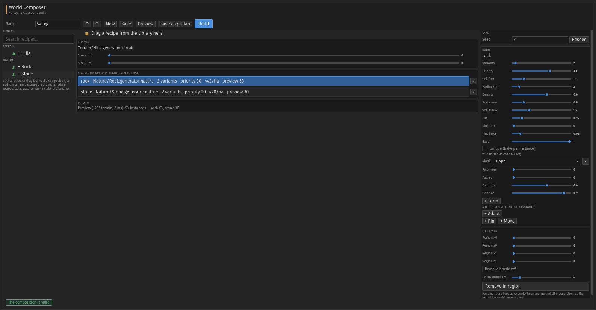
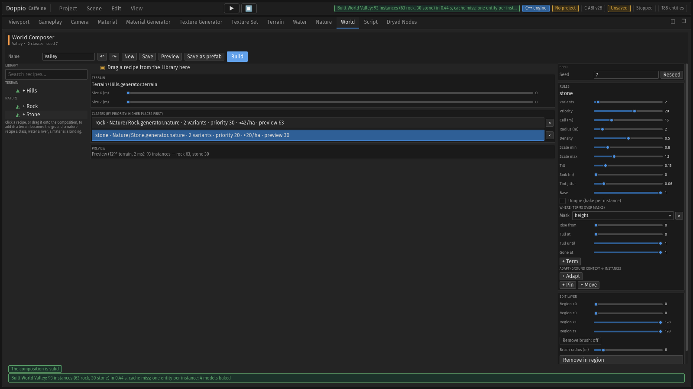

# World Composer: construir um mundo prefab a partir de receitas de geradores

<div class="doc-meta">
  <span class="doc-badge doc-badge--reference">Guia</span>
  <span class="doc-badge">Doppio</span>
  <span>Última atualização: <time datetime="2026-11-25">2026-11-25</time></span>
  <span>Fonte: <a href="https://github.com/devscafecommunity/caffeine/blob/main/content/en/docs/doppio/world-composition.md"><code>world-composition.md</code></a></span>
</div>

<p class="doc-lede">Um ficheiro que diz <em>de que é feito o mundo</em>: um terreno, as árvores, rochas e erva
que nele crescem, os rios e lagos que o atravessam e os materiais que o revestem. Escolhe a composição;
o sistema constrói o mundo, e cada planta adapta-se ao sítio onde está porque a sua aleatoriedade vem de um
hash das suas coordenadas. É um <strong>complemento do Terrain Generator</strong>, não um substituto: o terreno
continua a ser um grafo, a composição decide o que vive nele.</p>

> **Estado: construído.** A construção no núcleo (`src/caffeine/world`), a C ABI (v28), o bake `.cinst` e o seu
> caminho de desenho, a cache de bakes e o separador World no Doppio existem; a secção 8 lista o que está feito e as
> poucas coisas ainda em aberto. Substitui as partes "arquitetura alvo" e "separador World" de
> [`photoreal-world-roadmap.md`](photoreal-world-roadmap.md), que fica como a validação da ideia e das fases de
> motor e de renderização.

## 1. A ideia numa imagem

```text
Valley.generator.world                         ← the composition (one file, you edit it)
  seed 1234, generator_version 2
  terrain   Terrain/Alpine.generator.terrain   ← height + masks (slope, wetness, flow, ...)
  water     Water/River.generator.water        ← follows the terrain's flow mask
            Water/Lake.generator.water         ← fills basins under a level
  classes   (what grows where, in priority order)
    boulder  Nature/MossRock.generator.nature   where slope > 0.3
    oak      Nature/OakTree.generator.nature    where gentle, dry, near water
    grass    Nature/LowerGrass.generator.nature where flat, not rock
  materials Materials/Moss.generator.material   ground layers, rock moss, ...
        │
        ▼  build (deterministic)
  placement per cell:  sub-seed = hash(world seed, class, cell x, cell z)
        │                → variant, yaw, scale, tint, lean — all from that one number
        ▼
  prefab world: terrain + water + instances, always identical for the same inputs
```

Três propriedades definem-no:

1. **Composição, não geração.** O utilizador escolhe peças (receitas `.generator.*`) e regras; nada é aleatório
   a menos que uma seed o diga. Abra o mesmo ficheiro amanhã e obtém o mesmo mundo.
2. **Tudo num só sítio.** Terreno, natureza, água, materiais e texturas são listados num ficheiro e num
   separador, em vez de cinco ferramentas que colocam cada uma o seu próprio resultado.
3. **Adapta-se à posição.** Uma árvore não é uma cópia de um modelo largada em (x, z). A sua variante, tamanho,
   inclinação e tonalidade derivam do hash da sua célula *e* do que o terreno é ali (declive, altura, humidade,
   distância à água). A mesma receita de carvalho tem um aspeto diferente numa crista seca e numa margem húmida.

**Não** é um streamer de mundo aberto (esse é o caminho de runtime do roadmap do mundo). O composer constrói um
mundo limitado e de autor. Está desenhado para que a mesma função de construção possa mais tarde correr por chunk
para streaming.

## 2. O que já existe

Verificado contra o `main` do motor (C ABI versão 27).

| Peça | Onde | Estado |
|---|---|---|
| Ficheiros de receita, um por gerador | `Oak.generator.nature`, `Lake.generator.water`, ... (`uikit/recipe.rs`, [`generator-recipes.md`](generator-recipes.md)) | feito; `generator_version` em todos |
| Resolvedor de receitas e variantes | `uikit/recipe_ref.rs`: `nature_variants`, `bake_nature_variant(recipe, seed, quality, cache)` | feito, cache indexada por grafo + versão + seed + qualidade |
| Hash inteiro | `core/Hash.hpp`: SplitMix64 `deriveSeed(parent, salt, x, z)`, `toUnit`; gémeo em Rust em `recipe_ref.rs`; testes golden | feito |
| Máscaras do terreno | C ABI v15: `height`, `slope`, `curvature` (motor), `flow`, `wetness`, `wear`, `deposit` (grafo) | feito |
| Tabela de biomas | `terrain/TerrainBiome`: `base x` produto de trapézios sobre máscaras, texto simples | feito |
| Núcleo de scatter | `src/caffeine/scatter`: grelha com jitter, prioridade, raio de exclusão, propriedade de células, resultado independente do chunk | feito |
| Scatter sobre um terreno | C ABI v16, `Scatter/default.scatter`, **Scene > Scatter on Terrain**, classes compostas (`part mesh ...`) | feito, uma entidade por instância |
| Saída da natureza para scatter | cor por vértice, peso de flutter, slots de material por submalha, tonalidade e intervalo de escala por instância | feito |
| Renderização de muitas instâncias | LOD por clusters Micromesh para partes opacas, vento, translucidez das folhas | parcial (sem impostores, sem buffers por chunk) |
| Água | superfície e `water_height`, ondas de Gerstner na GPU | feito como colocação separada |
| Prefabs | árvore de entidades `.prefab` que se lembra da receita de origem (`uikit/prefab_file.rs`) | feito |

Portanto, o trabalho é a **camada que os liga**, a que o roadmap chamava "a camada do mundo".

## 3. O ficheiro de composição

`<Name>.generator.world`, um novo tipo de receita da mesma família, de modo que um duplo clique reabre o Composer.
O caf-pack já o ignora como fonte só de editor: `Registry::isEditorOnly` corresponde a qualquer nome com `.generator.`.
O ficheiro é o cabeçalho JSON habitual das receitas; como em todos os geradores, o composer é dono da forma de texto
do seu `graph`, e esse texto partilha a gramática do plano `.scatter` e da tabela de biomas (uma linha `key value` por
coisa, termos de bioma indentados sob uma classe). O núcleo analisa-o em
[`WorldComposition.hpp`](https://github.com/devscafecommunity/caffeine/blob/main/src/caffeine/world/WorldComposition.hpp),
por isso não precisa de biblioteca JSON.

```json
{
  "format": "caffeine-generator", "version": 1, "kind": "world",
  "name": "Valley", "product": "", "generator_version": 2,
  "graph": "seed 1234\nterrain Terrain/Alpine.generator.terrain size 1024 1024\n..."
}
```

O texto de `graph`, sem escapes:

```text
seed 1234
water_distance 64
terrain Terrain/Alpine.generator.terrain size 1024 1024
water Water/River.generator.water follow flow min 0.8 carve 1.5
water Water/Lake.generator.water fill basins level 0.18
material terrain.layer0 Materials/Moss.generator.material
class boulder ref Nature/MossRock.generator.nature variants 6 priority 30 cell 16 radius 2.2 density 0.9 scale 0.7 1.6 tilt 0.8 sink 0.3
  slope 0.30 0.45 1.00 1.00
class oak ref Nature/OakTree.generator.nature variants 8 priority 20 cell 9 radius 3 density 0.8 scale 0.8 1.4 tilt 0.1 tint 0.1
  slope   0.00 0.00 0.15 0.35
  wetness 0.20 0.40 0.80 1.00
  adapt size wetness
  adapt lean slope 0.3
  adapt wetness water_distance
  adapt param.crown wetness
override remove oak 12 -4
override move oak 3 7 120.5 88.25
override pin boulder 5 5 2
```

Linhas de topo: `seed`, `water_distance <metres>` (onde a máscara `water_distance` chega a 1; 64 por omissão),
`terrain <ref> [size <x> <z>]`, `water <ref> [follow <mask> min <value>] [carve <metres>] [fill basins level <value>]`,
`material <slot> <ref>`, `class` e `override`.

Propriedades de classe: `ref` (obrigatória), `variants`, `priority`, `cell`, `radius`, `density`, `scale <min> <max>`, `tilt`,
`sink`, `tint` (jitter), `base` (a densidade base da regra) e `unique on|off`. As linhas indentadas são um termo de bioma
`<mask> <rise0> <rise1> <fall1> <fall0>` ou `adapt <target> <source> [amount]` (secção 4.2). As referências não podem
conter espaços.

Regras do ficheiro:

- **As referências são caminhos do projeto para receitas**, nunca para OBJs já baked; o Composer volta a correr as
  receitas, por isso editar uma receita de carvalho muda todos os carvalhos. Uma referência em falta ou do tipo errado é
  um erro na barra de estado e nada é construído (a mesma recusa que os slots de receita já usam).
- **`where` é a sintaxe de bioma existente** (trapézios sobre máscaras), por isso a tabela de biomas, o plano `.scatter`
  e a composição partilham uma gramática. Um ficheiro `.scatter` passa a ser uma *vista* da lista `classes`, não um
  segundo formato.
- **Tudo tem uma versão.** `generator_version` no topo; a construção regista as versões de todas as receitas que usou,
  por isso um mundo antigo mantém o comportamento antigo até ser re-baked de propósito.
- **`overrides`** é a camada esparsa de edição (secção 7), guardada no ficheiro para que o determinismo sobreviva a
  edições manuais.

## 4. Adaptação à posição

Dois mecanismos separados; mantenha-os à parte porque têm custos diferentes.

### 4.1 Hash das coordenadas (barato, existe)

Para cada classe, a colocação corre numa grelha global com jitter. Para uma célula `(cx, cz)`:

```text
cell_seed = deriveSeed(world_seed, class_salt, cx, cz)        // integer, platform independent
variant   = floor(toUnit(deriveSeed(cell_seed, 1, 0, 0)) * N)
yaw       = toUnit(deriveSeed(cell_seed, 2, 0, 0)) * 360
scale     = lerp(min, max, toUnit(deriveSeed(cell_seed, 3, 0, 0)))
tint      = jitter(toUnit(deriveSeed(cell_seed, 4, 0, 0)))
```

O resultado depende apenas da seed, da composição e do terreno, nunca da ordem de carregamento nem do tamanho do
chunk, por isso duas metades de uma região somam o todo (já testado no núcleo de scatter). O `class_salt` deriva do
`id` da classe, não da sua posição na lista, por isso reordenar classes não move todas as árvores.

### 4.2 Contexto do solo (novo)

O hash sozinho dá variedade, não adaptação. Depois da camada de edição, a construção amostra o terreno na posição
final de cada instância e guarda com ela um pequeno **contexto** (`InstanceContext` em
[`WorldBuild.hpp`](https://github.com/devscafecommunity/caffeine/blob/main/src/caffeine/world/WorldBuild.hpp),
também na instância da C ABI):

| Contexto | De onde | Usos possíveis |
|---|---|---|
| `slope` | máscara incorporada | inclinação, profundidade do alargamento das raízes, afundamento |
| `height` | máscara incorporada | árvores atrofiadas perto do cume, neve |
| `wetness` | máscara guardada (0 quando o terreno não a tem) | copa maior e mais densa perto da água; tonalidade de musgo |
| `water_distance` | camada de água (secção 5) | juncos só na margem, salgueiros perto dela |
| `neighbours` | as instâncias geradas | aglomeração: outras instâncias a menos de três raios, sobre 6 |

`adapt <target> <source> [amount]` mapeia uma fonte (qualquer máscara do terreno, incluindo `water_distance`, ou
`neighbours`), `v` em 0..1, num alvo:

| Alvo | Efeito | Quantidade por omissão |
|---|---|---|
| `size` | `scale *= 1 + amount * (2v - 1)` | 0.25 |
| `lean` | inclinação na direção da normal `+= amount * v` | 0.5 |
| `tint` | `tint *= 1 - amount * v` | 0.2 |
| `wetness`, `snow` | o modificador de runtime `= amount * v` (modificadores da CAPI v10) | 1 |
| `param.<name>` | um parâmetro exposto da receita de natureza da classe `= amount * v`: muda o **bake** | 1 |

Os vizinhos são contados sobre as instâncias geradas, *antes* da camada de edição, por isso mover ou remover uma
instância nunca altera outra; a construção lê uma margem de três raios à volta da região, por isso as regiões
continuam a somar o todo. `param.<name>` (no máximo quatro por classe) é a v2: o contexto passa a ser uma entrada do
grafo Nature, de modo que uma árvore cresce para o seu sítio. O grafo tem de expor esse parâmetro (`expose` no grafo
de natureza); o motor reporta os valores por instância e o editor faz o bake dos modelos.

### 4.3 Pool versus bake único

Um bake por árvore seria exato e lento demais. Por isso o Composer mantém um **pool de variantes** por classe (N
variantes baked, em cache como hoje) e o hash escolhe uma, que depois deforma e tinge. Uma classe com mapeamentos
`param.<name>` faz o bake de um modelo por conjunto de valores quantizados e reutiliza-o. Uma classe pode ser marcada
`unique on` para objetos de destaque (algumas árvores perto do início do jogador): é baked por instância, com a seed
da instância. Por omissão usa o pool.

## 5. Pipeline de construção

Uma função determinística, `World::build(request) -> WorldPart`
([`WorldBuild.hpp`](https://github.com/devscafecommunity/caffeine/blob/main/src/caffeine/world/WorldBuild.hpp)), no
núcleo, para que o Doppio, o runtime e o driver headless corram o mesmo código. A C ABI envolve-a sem sessão
(`caffeine_world_build`, v28):

```text
1. resolve     every ref -> recipe (kind and version checked); fail with a list, build nothing
2. terrain     the caller bakes the terrain recipe and passes height + masks (the graph lives in Doppio)
3. water       rivers follow a mask, carve the bed, lakes fill basins, then the water_distance mask
4. materials   checked and passed through as bindings
5. classes     the scatter core, every class at once: priority + exclusion radius decide conflicts,
                 the biome terms decide density, the class id's hash is its salt
6. overrides   the edit layer (remove, move, pin), then the ground context and the adapt mappings
7. output      instance lists per class (placement order) + carved terrain + water + material bindings
```

Notas:

- **A ordem de prioridade é a regra que impede uma árvore de crescer através de uma rocha**: primeiro rochas, depois
  árvores, depois arbustos, depois erva, cada uma com o seu raio de exclusão. Resolvido na colocação, não na malha.
- **Água antes do scatter**, para que `water_distance` exista
  ([`WorldWater.hpp`](https://github.com/devscafecommunity/caffeine/blob/main/src/caffeine/world/WorldWater.hpp)).
  Um rio é cada vértice onde a sua máscara `follow` é pelo menos `min`; `carve <m>` baixa esse leito numa cópia do
  heightfield antes de qualquer classe ler uma máscara, por isso as máscaras incorporadas `slope` e `curvature` veem as
  novas margens, e a superfície fica a 70% da profundidade. Um lago é cada vértice abaixo tanto da sua altura de
  transbordo (um priority-flood a partir da borda) como de `level`. `water_distance` vem de uma transformada chamfer
  3-4 inteira, por isso todas as máquinas obtêm os mesmos bytes. A água é calculada sobre o terreno inteiro, seja qual
  for a região, na CPU: o limite documentado é um heightfield limitado (129 a 513 vértices de lado).
- **Região**: a função recebe um retângulo, como `scatterTerrain`, por isso o streaming futuro é a mesma chamada por chunk.
- **A saída são dados, não entidades.** Construções pequenas (até 3000 instâncias) criam uma entidade por instância,
  como o Scatter. As grandes escrevem um bake de instâncias (`.cinst`) e um ficheiro de modelos e desenham-nos a partir
  de uma entidade com o componente `World Instances`; o caminho por entidade é o que torna lento editar milhares de
  instâncias.

### Para onde vai o resultado

| Saída | O que é | Quando |
|---|---|---|
| Cena viva | o contentor `World <name>` no canto do terreno: um filho `<name> terrain` (o terreno baked e escavado, com as suas máscaras e `water_distance`), uma entidade de água `<name> lake N` por lago, e um filho por instância com as suas partes de natureza baked | edição, mundos pequenos |
| `World/<name>.prefab` | a árvore guardada, lembra-se do seu `.generator.world` | colocar o mesmo mundo noutras cenas |
| `World/<name>.cinst` + `World/<name>.models` | o bake de instâncias (classes, depois instâncias em chunks quadrados de 64 m, a chave de cache e o hash das instâncias) e o ficheiro de modelos; o contentor recebe o componente `World Instances` | mundos grandes (mais de 3000 instâncias), desenho em runtime |
| `<assets>/.cache/world/` | a cache de bakes (`<key>.cinst`) e os modelos de natureza baked | todas as construções |

Todos vêm do mesmo `WorldPart`; a receita continua a ser a fonte da verdade. Uma reconstrução substitui o
`World <name>` anterior e mantém a sua posição.

### Desenhar um bake

O componente `World Instances` (`Bake`, `Models`, `Draw distance`, `Cast shadows`;
[`WorldInstanceDraw.hpp`](https://github.com/devscafecommunity/caffeine/blob/main/src/caffeine/world/WorldInstanceDraw.hpp))
desenha todas as instâncias de um bake a partir de uma entidade. O seu ficheiro de modelos tem uma linha por parte de modelo:

```text
# class variant mesh [slots a.mat;b.mat] [cutout on|off]
0 0 .cache/world/nature/oak_tree_3f2a9c0d11e84b27/oak_tree_trunk.obj
0 0 .cache/world/nature/oak_tree_3f2a9c0d11e84b27/oak_tree_leaves.obj cutout on
# a per-instance model (unique or parameter-driven class) wins over the variant line
1 cell 12 -4 .cache/world/nature/pine_9b07e15c4d2a6f80/pine_trunk.obj
```

O renderer carrega o bake e o ficheiro de modelos uma vez por alteração, salta chunks inteiros fora do frustum ou para
lá de `Draw distance`, e transforma cada instância visível em desenhos de malha normais, que o instancing existente
agrupa em lotes (a tonalidade é quantizada a 1/32 para que as instâncias continuem a partilhar lotes). As partes com
recorte não projetam sombra. Os rios são escavados no terreno mas ainda não são desenhados como água: o motor não tem
superfície de rio.

## 6. O separador Composer

Um separador **World** (View > World Composer, ou duplo clique num `*.generator.world` em Assets) construído só com componentes:

- **Library**: as receitas `generator.*` do projeto por tipo (terrain, nature, water, material, texture). Arraste uma
  para a linha de largar da Composition, ou clique nela, para a adicionar.
- **Composition**: a linha do terreno, as linhas de água, as linhas de material e as linhas de classe (ref, variants, priority).
- **Rules**: as propriedades da classe selecionada, os seus termos `where` como sliders, os seus mapeamentos `adapt`,
  `unique`, a seed com um botão *Reseed* (uma seed derivada, com undo), e a camada de edição: linhas de pin e de move,
  um retângulo de região com *Remove in region*, e um **pincel de remoção**. Com o pincel ativo, arrastar com o botão
  esquerdo no Viewport remove as instâncias da última construção sob o anel; o traço é um passo de undo e escreve
  linhas `override remove`.
- **Preview**: uma construção grosseira (no máximo 2000 instâncias) após cada edição, com debounce; o bake do terreno
  corre fora da thread da UI.
- **Build**: a construção completa através da cache de bakes; um passo de undo; a linha de estado reporta instâncias
  por classe, o tempo, se a cache respondeu e quantos modelos foram baked. *Save as prefab* escreve `World/<name>.prefab`.

<figure>
  
  <figcaption>O separador World com o fixture headless <code>world</code>: duas receitas de rocha sobre um terreno de colinas.</figcaption>
</figure>

<figure>
  
  <figcaption>Depois de <em>Build</em>: 93 instâncias (63 rock, 30 stone), cache miss, uma entidade por instância.</figcaption>
</figure>

Aplicam-se as regras do projeto: cada widget tem um `UiId` e uma entrada no `CATALOG`, as edições da composição usam a
pilha de undo do separador e uma construção é um único `App::commit` da cena, e cada comando é uma `Message` e uma ação
MCP: `world_show`, `world_add`, `world_add_class`, `world_set_class`, `world_set_rule`, `world_reseed`, `world_preview`,
`world_build`, `world_remove_in_region`, `world_brush`, `world_remove_in_circle`, `world_undo`, `world_save`,
`world_save_prefab`, mais a consulta só de leitura `world`. O fluxo headless `doppio/tests/ui-flows/world-composer.json`
adiciona, arrasta e desfaz uma classe, faz reseed, edita uma regra, ativa o pincel e constrói;
`doppio/crates/ui/src/windows/main/tests.rs` cobre mundos grandes, acertos na cache, escavação e lagos, o pincel e o prefab.

## 7. Edições, determinismo e cache

- **Camada de edição.** Esculpir, mover uma árvore e apagar uma rocha são guardados como `overrides` esparsos indexados
  por `(class, cell)`: `remove`, `move to`, `pin variant`. Aplicam-se *depois* da geração, por isso o mundo gerado
  nunca deixa de ser reproduzível. Mover uma árvore não altera nenhuma outra árvore.
- **Chave de cache.** A seed, `generator_version`, o texto da composição, o hash de conteúdo e a versão de cada receita
  usada, o terreno baked (alturas e máscaras guardadas), a região e o orçamento de instâncias. `cacheKeyOf(request)`
  calcula-a sem construir. `WorldCache` guarda os bakes em disco como `<key>.cinst`
  ([`WorldInstanceFile.hpp`](https://github.com/devscafecommunity/caffeine/blob/main/src/caffeine/world/WorldInstanceFile.hpp);
  `caffeine_world_build_cached` na C ABI). Mudar uma receita, ou esculpir o terreno, invalida apenas o que depende disso.
- **Sem vírgula flutuante nas decisões de colocação.** Aceitar/rejeitar e a ordem das células usam inteiros; fixe o
  ruído e as chamadas `libm` que decidem *onde*, como o roadmap já exige.
- **Testes golden**: `tests/test_world.cpp` fixa o hash das instâncias de uma composição pequena e os salts das classes
  (cujo gémeo em Rust é `recipe_ref::content_hash`), verifica que a construção com 1 e 7 threads é idêntica, que as
  metades somam o todo (incluindo água e aglomeração) e que um `.cinst` é igual byte a byte para a mesma construção.

## 8. Lacunas, por ordem de construção

Cada passo é útil sozinho e testável em headless. `[x]` significa que já é verdade no `main` do motor.

### C0 — Fundações

- [x] Receitas com `generator_version`; resolvedor e variantes em cache.
- [x] Hash inteiro, os mesmos números em C++ e em Rust.
- [x] Máscaras, tabela de biomas, núcleo de scatter, ação Scatter on Terrain.
- [x] O caf-pack ignora `*.generator.world` (`Registry::isEditorOnly` corresponde a qualquer nome com `.generator.`).
- [x] Tipo de receita `generator.world` no Doppio: `recipe::Kind::World`, tipo de asset, duplo clique abre o separador.

### C1 — Modelo de composição e construção headless (núcleo, sem UI)

- [x] `src/caffeine/world`: analisar e validar o texto de `graph` (`WorldComposition`); `build(request)` com o código
      de scatter e de biomas existente; saída `WorldPart` (instâncias agrupadas por classe, por ordem de colocação).
- [x] Salt de classe a partir do `id` da classe (`classSalt`, FNV-1a + SplitMix64, gémeo em Rust `recipe_ref::content_hash`);
      resolução de refs através de um callback resolvedor com verificação de tipo e versão; lista de erros tudo-ou-nada.
- [x] Camada de edição: `override remove|move|pin`, indexada por `(class, cell)`; `Scatter::Instance` transporta a sua célula.
- [x] C ABI v28: `caffeine_world_build` e os seus getters, `caffeine_world_check`, POD, testes em C++ e em Rust.
- [x] Testes (`tests/test_world.cpp`): as metades somam o todo; reordenar ou adicionar classes não move as
      outras; 7 threads igual a 1; overrides; hash golden das instâncias.

### C2 — A água como parte da composição

- [x] Máscara `water_distance` a partir dos corpos de água; os rios seguem uma máscara, os lagos enchem bacias abaixo de um nível.
- [x] Escavação opcional do leito antes de as máscaras serem lidas (limite documentado: CPU, heightfield limitado).
- [x] Refs de água verificadas e ligadas: os lagos são colocados como entidades de água com o aspeto da sua receita.
- [ ] Rios desenhados como água (são escavados, mas o motor ainda não tem superfície de rio).

### C3 — Contexto do solo e adaptação

- [x] Amostragem de contexto (declive, altura, humidade, distância à água, vizinhos) por instância.
- [x] Mapeamentos `adapt` para escala, inclinação e tonalidade da instância e para os modificadores de runtime de humidade e neve.
- [x] Parâmetros expostos em `generator.nature` (`expose`) e `adapt param.<name>`, para que o contexto conduza o **bake**;
      pool (conjuntos de valores quantizados) versus `unique` (por instância).
- [ ] Um controlo no Nature Generator para expor um parâmetro (hoje a linha `expose` é escrita no texto do grafo).

### C4 — Saída e renderização

- [x] Saída `.prefab` que mantém a ligação ao seu `generator.world`.
- [x] Bake de instâncias `.cinst` e o caminho de desenho `World Instances` (culling por chunk, instancing existente).
- [x] Cache de bakes persistente, indexada como na secção 7.
- [ ] Impostores, buffers de instâncias na GPU por chunk e LOD de malha para instâncias (fase 4 do roadmap); picking de
      instâncias; o renderer de runtime, o shadow map de CPU e o bake Photon ainda não desenham `World Instances`.
- [ ] Materiais nas partes de natureza colocadas em mundos pequenos (o bake só dá ficheiros OBJ).

### C5 — Editor

- [x] Separador World, arrastar da biblioteca, editor de regras, construção de pré-visualização, ação de construção com undo.
- [x] `UiId`s, ações MCP, fluxo e fixture headless, capturas através do driver headless
      (`scripts/capture-world-docs.sh`).
- [x] Pintura de overrides: o pincel de remoção no Viewport e o retângulo de região.
- [ ] A construção de pré-visualização no motor corre na thread da UI (com debounce, no máximo 2000 instâncias): `Engine` não é `Send`.

### C6 — Documentação

- [x] Espelho em português (`content/pt/docs/doppio/world-composition.md`) e ambas as auditorias.
- [x] Os guias Nature, Terrain e Water apontam para aqui.

## 9. Riscos e questões em aberto

| Risco ou questão | Plano |
|---|---|
| Instâncias por entidade não escalam | `.cinst` + `World Instances` (C4); entidades só para construções pequenas |
| Adaptar o bake precisa de parâmetros de grafo que o Nature não expõe | `expose` no grafo de natureza e `adapt param.<name>` (C3) |
| Escavar um rio altera todas as máscaras | escavar primeiro, depois ler as máscaras; a chave de cache inclui-o |
| Reordenar classes ou editar uma receita baralha o mundo | salt a partir do id da classe; hashes por receita na chave de cache |
| Os floats decidem a colocação entre máquinas | decisões inteiras, testes golden |
| A unidade é "um mundo" ou "uma região"? | a construção recebe uma região, por isso ambas funcionam; um terreno por composição até existir tiling de terreno (a saída do gerador é 129/257/513) |
| `.scatter` versus `.generator.world` | o `.scatter` continua legível e passa a ser uma vista de `classes`; sem segundo formato |

## 10. Relacionado

- [`photoreal-world-roadmap.md`](photoreal-world-roadmap.md): as fases de motor, renderização, streaming e qualidade sobre as quais isto assenta.
- [`generator-recipes.md`](generator-recipes.md): ficheiros de receita, referências, variantes, o hash.
- [`terrain-generator-guide.md`](terrain-generator-guide.md): máscaras, tabela de biomas, scatter.
- [`nature-generator-guide.md`](nature-generator-guide.md), [`water-generator-guide.md`](water-generator-guide.md), [`material-pipeline.md`](material-pipeline.md).
