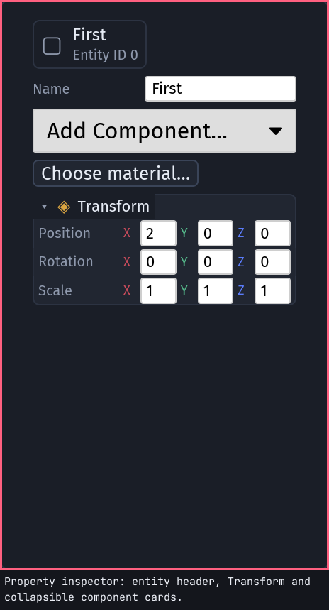
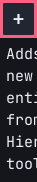
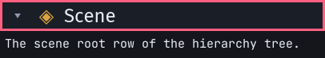
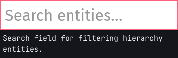
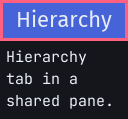
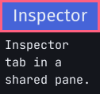
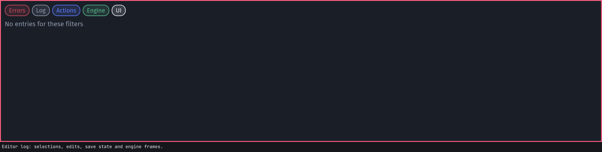
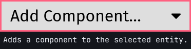

# Referência da UI do Doppio

Gerado por `cargo test -p doppio-ui capture_ui_gallery -- --ignored`. As descrições vivem em `caffeine-website/captures/ui-captions.json`.

## `editor.menu.scene`

Menu Cena: adicionar, guardar e jogar.

## `editor.menu.edit`

Menu Editar: desfazer, refazer e apagar.

## `editor.menu.view`

Menu Ver: focar, repor câmara e renderizar.

## `editor.pane.hierarchy`

Árvore da cena: linhas compactas, ícones semânticos, expandir/fechar e seleção.

## `viewport.canvas.gizmo`

Gizmo de transformação sobre o viewport (mover, rodar ou escalar).

## `editor.pane.viewport`

Render do motor para a cena atual, com controlos de câmara.

## `editor.pane.inspector`

Inspector de propriedades: cabeçalho da entidade, Transform e cartões de componentes recolhíveis.

## `inspector.material.picker`

Abre o seletor pesquisável de materiais .mat para a entidade selecionada.

## `hierarchy.toolbar.add`

Cria uma entidade nova a partir da barra da hierarquia.

## `hierarchy.tree.scene`

A linha raiz da cena na árvore da hierarquia.

## `hierarchy.search`

Campo de pesquisa para filtrar entidades da hierarquia.

## `editor.pane.tab.hierarchy`

Separador Hierarchy num painel partilhado.

## `editor.pane.tab.assets`

Separador Assets num painel partilhado.

## `editor.pane.tab.viewport`

Separador Viewport num painel partilhado.

## `editor.pane.tab.inspector`

Separador Inspector num painel partilhado.

## `editor.pane.tab.console`

Separador Console num painel partilhado.

## `console.filter.error`

Mostrar ou esconder erros no Console.

## `console.filter.log`

Mostrar ou esconder entradas gerais no Console.

## `console.filter.action`

Mostrar ou esconder ações do editor no Console.

## `console.filter.engine`

Mostrar ou esconder entradas do motor no Console.

## `console.filter.ui`

Mostrar ou esconder entradas da UI no Console.

## `editor.pane.console`

Registo do editor: seleções, edições, gravação e frames.

## `viewport.canvas.surface`

Imagem do motor apresentada dentro do painel de viewport.

## `inspector.entity.name`

Nome editável da entidade selecionada; chega ao motor.

## `inspector.add_component`

Adiciona um componente à entidade selecionada.

## `hierarchy.list.entity_row.0`

A row in the hierarchy list; rows use the .N suffix.

## `hierarchy.list.entity_row.1`

A row in the hierarchy list; rows use the .N suffix.

## `annotated.inspector`

Controlos do inspector, numerados para documentação.

