# Referência da UI do Doppio

  Generated
  Doppio

Gerado por `cargo test -p doppio-ui capture_ui_gallery -- --ignored`. As descrições vivem em `captures/ui-captions.json`.

## `editor.pane.tab.texture_generator`

<figure class="doc-figure">
  
  <figcaption>Separador do painel Texture Generator.</figcaption>
</figure>

## `editor.menu.project`

<figure class="doc-figure">
  
  <figcaption>Menu Projeto: gestor de projetos e atualização de assets.</figcaption>
</figure>

## `editor.menu.scene`

<figure class="doc-figure">
  
  <figcaption>Menu Cena: adicionar, guardar e jogar.</figcaption>
</figure>

## `editor.menu.edit`

<figure class="doc-figure">
  
  <figcaption>Menu Editar: desfazer, refazer e apagar.</figcaption>
</figure>

## `editor.menu.view`

<figure class="doc-figure">
  
  <figcaption>Menu Ver: focar, repor câmara e renderizar.</figcaption>
</figure>

## `editor.pane.hierarchy`

<figure class="doc-figure">
  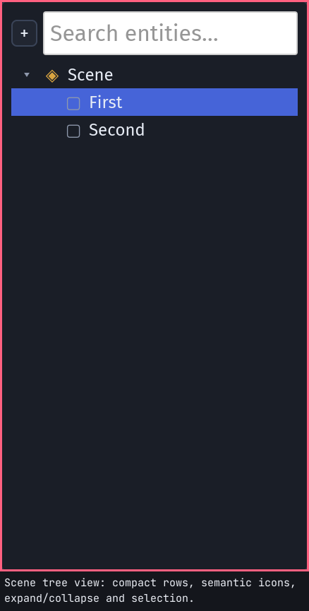
  <figcaption>Árvore da cena: linhas compactas, ícones semânticos, expandir/fechar e seleção.</figcaption>
</figure>

## `editor.pane.assets`

<figure class="doc-figure">
  
  <figcaption>Assets do projeto encontrados na raiz de assets carregada.</figcaption>
</figure>

## `assets.toolbar.search`

<figure class="doc-figure">
  
  <figcaption>Filtra o navegador de assets por nome de ficheiro ou caminho.</figcaption>
</figure>

## `assets.toolbar.up`

<figure class="doc-figure">
  
  <figcaption>Sobe para a pasta anterior no navegador de assets.</figcaption>
</figure>

## `assets.toolbar.root`

<figure class="doc-figure">
  
  <figcaption>Volta à raiz de assets.</figcaption>
</figure>

## `assets.toolbar.refresh`

<figure class="doc-figure">
  
  <figcaption>Volta a ler a raiz de assets do projeto.</figcaption>
</figure>

## `assets.toolbar.view_grid`

<figure class="doc-figure">
  
  <figcaption>Mostra os assets como cartões com miniatura.</figcaption>
</figure>

## `assets.toolbar.view_list`

<figure class="doc-figure">
  
  <figcaption>Mostra os assets como linhas compactas.</figcaption>
</figure>

## `assets.tree.empty`

<figure class="doc-figure">
  
  <figcaption>Mostrado quando uma pasta ou pesquisa não tem assets.</figcaption>
</figure>

## `assets.toolbar.new`

<figure class="doc-figure">
  
  <figcaption>Opens the asset wizard on the Create tab (folder, material, script…).</figcaption>
</figure>

## `assets.toolbar.import`

<figure class="doc-figure">
  
  <figcaption>Opens the asset wizard on the Import tab.</figcaption>
</figure>

## `assets.toolbar.tree_toggle`

<figure class="doc-figure">
  
  <figcaption>Shows or hides the folder tree beside the file view.</figcaption>
</figure>

## `assets.tree.folders`

<figure class="doc-figure">
  
  <figcaption>Folder tree of the project asset root.</figcaption>
</figure>

## `viewport.canvas.gizmo`

<figure class="doc-figure">
  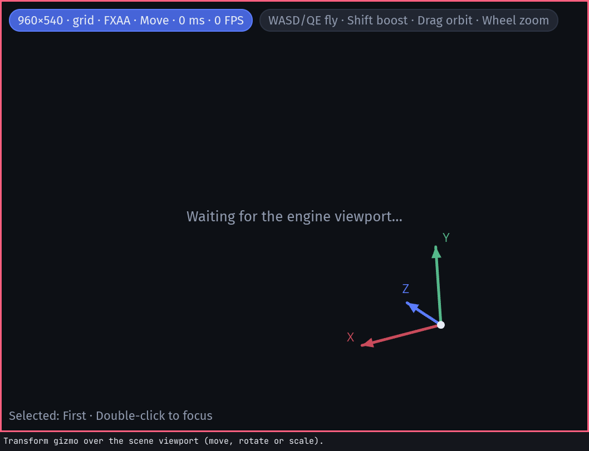
  <figcaption>Gizmo de transformação sobre o viewport (mover, rodar ou escalar).</figcaption>
</figure>

## `editor.pane.viewport`

<figure class="doc-figure">
  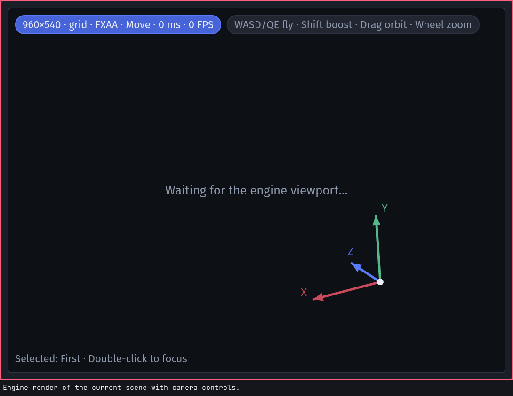
  <figcaption>Render do motor para a cena atual, com controlos de câmara.</figcaption>
</figure>

## `editor.pane.inspector`

<figure class="doc-figure">
  
  <figcaption>Inspector de propriedades: cabeçalho da entidade, Transform e cartões de componentes recolhíveis.</figcaption>
</figure>

## `inspector.material.picker`

<figure class="doc-figure">
  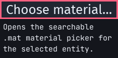
  <figcaption>Abre o seletor pesquisável de materiais .mat para a entidade selecionada.</figcaption>
</figure>

## `inspector.behaviour.add`

<figure class="doc-figure">
  
  <figcaption>Adiciona um comportamento à entidade selecionada: componente, script, malha ou material.</figcaption>
</figure>

## `hierarchy.toolbar.add`

<figure class="doc-figure">
  
  <figcaption>Cria uma entidade nova a partir da barra da hierarquia.</figcaption>
</figure>

## `hierarchy.tree.scene`

<figure class="doc-figure">
  
  <figcaption>A linha raiz da cena na árvore da hierarquia.</figcaption>
</figure>

## `hierarchy.search`

<figure class="doc-figure">
  
  <figcaption>Campo de pesquisa para filtrar entidades da hierarquia.</figcaption>
</figure>

## `editor.pane.tab.hierarchy`

<figure class="doc-figure">
  
  <figcaption>Separador Hierarchy num painel partilhado.</figcaption>
</figure>

## `editor.pane.tab.assets`

<figure class="doc-figure">
  
  <figcaption>Separador Assets num painel partilhado.</figcaption>
</figure>

## `editor.pane.tab.viewport`

<figure class="doc-figure">
  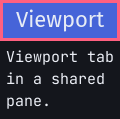
  <figcaption>Separador Viewport num painel partilhado.</figcaption>
</figure>

## `editor.pane.tab.script`

<figure class="doc-figure">
  
  <figcaption>Separador do editor de scripts num painel partilhado.</figcaption>
</figure>

## `editor.pane.tab.dryad_nodes`

<figure class="doc-figure">
  
  <figcaption>Separador Dryad Nodes num painel partilhado.</figcaption>
</figure>

## `editor.pane.tab.console`

<figure class="doc-figure">
  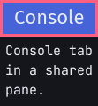
  <figcaption>Separador Console num painel partilhado.</figcaption>
</figure>

## `viewport.canvas.surface`

<figure class="doc-figure">
  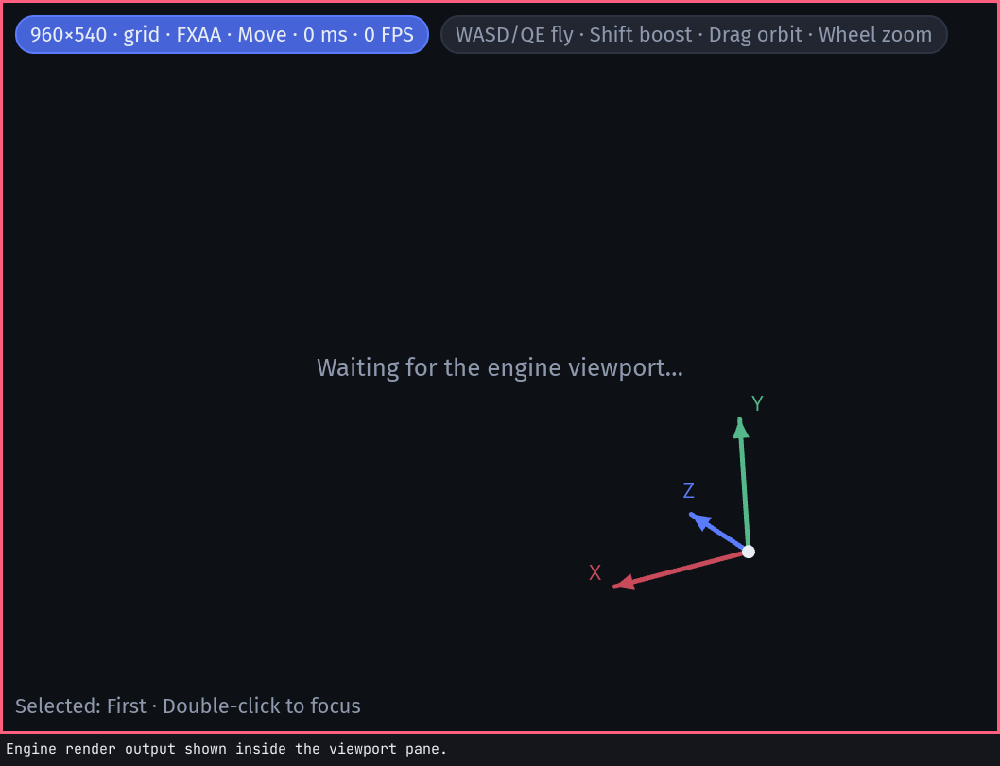
  <figcaption>Imagem do motor apresentada dentro do painel de viewport.</figcaption>
</figure>

## `inspector.entity.name`

<figure class="doc-figure">
  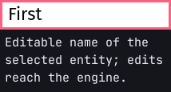
  <figcaption>Nome editável da entidade selecionada; chega ao motor.</figcaption>
</figure>

## `hierarchy.list.entity_row.0`

<figure class="doc-figure">
  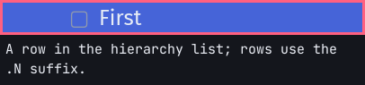
  <figcaption>A row in the hierarchy list; rows use the .N suffix.</figcaption>
</figure>

## `hierarchy.list.entity_row.1`

<figure class="doc-figure">
  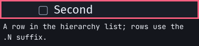
  <figcaption>A row in the hierarchy list; rows use the .N suffix.</figcaption>
</figure>

## `annotated.inspector`

<figure class="doc-figure">
  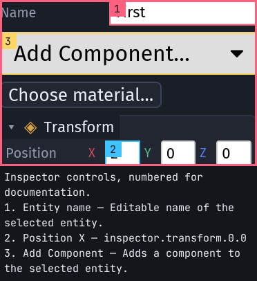
  <figcaption>Controlos do inspector, numerados para documentação.</figcaption>
</figure>

